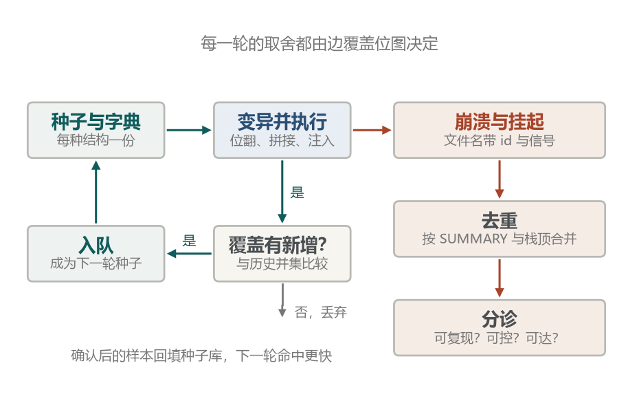

# 第二十二章　漏洞挖掘上手

第一次自己挖出洞的人多半会失望。没有反弹 shell，没有 CVE 编号，只有一个程序读到某个文件之后退出了，终端上留一行 `Segmentation fault`。

这行字是起点。它说明某个输入让程序走到了作者没想到的地方。接下来的工作是判断，走错的那一步是谁的错，错在哪个字节上，这个字节在真实场景里由谁提供。会跑工具的人很多，能把一行崩溃信息翻译成"这条路径在公网上走不走得到"的人不多，差别就在这一段。

这一章从一个几十行的程序开始，把覆盖率引导 fuzzing 的闭环完整跑一遍，再讲拿到 crash 之后怎么分诊、怎么记录、怎么提交。全程只碰自己写的代码和自己搭的机器。

## 22.1 先挑一个够小的目标

新手挑目标最容易犯的错是贪大。看到某个知名软件有过 CVE，就把它拉下来编译，想再挖一个。

这条路通常走不通，原因不在技术难度，在反馈周期。大型项目的构建要装一堆依赖，跑起来要一份能工作的配置，可能还要数据库和网络。等你把环境伺候好，一天过去了。fuzzer 跑起来之后，输入要先过几层协议解析、长度校验、状态机，才有机会碰到真正危险的代码，覆盖率爬得极慢。真出了 crash，你还要判断它是不是上游已经修过、是不是需要特定编译选项才复现、是不是在某个已知 issue 里挂着。任何一步卡住，热情就被消耗掉了。

第一个目标应该满足一个条件，能在当天出结果。三类东西符合。

自己写的程序最合适。你知道每个分支原本想干什么，所以看到崩溃点能立刻判断"这里本来不该发生"。想练手还可以故意埋一个 bug，把整个流程从发现到修复走一遍，再和修复后的版本对照。改坏了也没有任何人受影响。

开源项目是第二选择，价值也更高。主流项目大多被 OSS-Fuzz 这类持续 fuzz 平台覆盖了几年，剩下的问题要么需要特殊配置，要么藏在跨调用的状态里。长尾项目不一样，一个两千行的解析库、一个只有几十个 star 的命令行工具，很可能从来没人 fuzz 过。挑的时候看几条，代码量在两万行以内，主要语言是 C 或 C++，输入入口单一，有 `SECURITY.md` 或者至少有个能收邮件的维护者。

CTF 题目适合校准环境。题目有已知答案，用来验证"我的 ASAN 到底生效了没有""符号化配置对不对"很方便。它练不出判断力，因为答案是别人给的。

| 目标类型 | 上手成本 | 反馈速度 | 练到什么 |
| --- | --- | --- | --- |
| 自己写的程序 | 最低 | 当天 | 全流程与判断 |
| 小型开源项目 | 中等 | 几天 | 真实代码与沟通 |
| CTF 题目 | 低 | 分钟级 | 工具链校准 |

选定之后还有一步，找到输入入口。程序从哪个函数开始接触不可信数据，那才是 fuzz 的边界。从一个命令行工具的 `main` 开始变异，大部分算力会花在解析参数上；从它调用的 `parse_record` 开始，效率差一个数量级。

## 22.2 一个闭环由哪几部分组成

最朴素的 fuzzing 是随机变异。拿一个样本，随机翻几个字节，喂进去，看崩不崩。这种做法在真实程序上的效率低得惊人，因为绝大多数变异会让输入在第一层校验就被拒绝，比如长度字段对不上、魔数不对、JSON 括号不闭合。程序连危险代码都没走到，你却在为这次执行付出代价。

覆盖率引导（coverage-guided）解决的就是这个问题。编译器在每条边上插一小段计数代码，执行结束把计数写进一块共享内存。fuzzer 比较这次执行碰到的边集合和历史上所有输入的并集，如果这次碰到了新的边，就把输入留下，放进队列；如果一条新边都没有，就丢掉。

<figure>

<figcaption>图 22-1　覆盖率引导 fuzzing 的闭环。左侧四步循环，右侧是崩溃样本的去向。没有覆盖率反馈时，队列里只有随机输入，永远走不到第二层校验。</figcaption>
</figure>

这个机制听起来简单，效果差异巨大。有了它，fuzzer 会自己学会"先凑出一个合法的头部，再去改后面的内容"，因为只有头部合法的那一支能带来新覆盖。整个过程不需要你写语法，语法是从覆盖率的梯度里长出来的。

闭环里有几件东西需要人来准备。

种子（seed）是初始输入集合，理想状态是每个主要分支各有一个能走到的样本。一个配置解析器，种子里应该有普通键值、带引号的值、带转义的值、带注释的行。种子不需要多，需要"每种结构一份"。

字典（dictionary）是关键词和分隔符的列表。fuzzer 的变异算子里有一步叫字典注入，会把这些字符串插进输入。对文本协议来说，字典的收益比种子更大，因为它能一次插入 `=`、`"`、`\x` 这种"必须精确出现"的片段，而随机变异凑出两个连续有意义字符的概率很低。

harness 是把字节数组接到程序逻辑上的那段代码。三种形态。最简单的是文件模式，程序本来就从文件读，fuzzer 把变异结果写进临时文件，用 `@@` 传路径。标准输入模式次之。最快的是进程内模式，把解析函数直接调用，一轮循环跑上千次，省掉 fork 的开销。前两种写起来只要一行，第三种需要改程序，让它支持重复调用且不泄漏状态。

变异策略和调度由工具负责。AFL++ 和 libFuzzer 在这一层的差别不大，都能做位翻转、字节替换、块删除、块复制、拼接、字典注入。真正影响产出的是前面三项准备得怎么样。

进程内模式有个前提容易忽略，目标必须是无状态的。解析器里有一个全局缓存、一个静态计数器、一个复用的缓冲区，上一次输入留下的东西就会污染下一次。表现是同一个字节数组单独跑不崩，放在队列里跑就崩，或者反过来。这类问题在 fuzzer 屏幕上体现为 `stability` 掉下来，排查方法是把同一个输入连续跑两次，比较两次的覆盖是否相同。

## 22.3 靶程序与一次完整运行

下面这个程序是一个配置文件解析器。格式很常见，每行一个 `key=value`，`#` 开头是注释，值可以用双引号包起来，引号内支持 `\n`、`\t`、`\\`、`\xHH` 四种转义。守护进程读配置、插件读元数据，这类代码在真实项目里到处都是，写法也大多长这样。

```c
/* cfgparse.c —— 一个很小的配置解析器 */
#include <stdio.h>
#include <stdlib.h>
#include <string.h>

#define MAX_KEYS 16
#define NAME_MAX 32
#define VAL_MAX  64

struct entry { char key[NAME_MAX]; char val[VAL_MAX]; };
static struct entry table[MAX_KEYS];
static int entries;

static int hexval(int c)
{
    if (c >= '0' && c <= '9') return c - '0';
    if (c >= 'a' && c <= 'f') return c - 'a' + 10;
    if (c >= 'A' && c <= 'F') return c - 'A' + 10;
    return -1;
}

/* 还原 \n \t \\ \xHH，返回解码后的长度，出错返回 -1 */
static int unescape(const char *s, size_t n, char *out, size_t cap)
{
    size_t i = 0, o = 0;
    while (i < n) {
        char c = s[i++];
        if (c == '\\') {
            if (i >= n) return -1;
            c = s[i++];
            if (c == 'n') c = '\n';
            else if (c == 't') c = '\t';
            else if (c == 'x') {
                if (i + 2 > n) return -1;
                int hi = hexval(s[i]), lo = hexval(s[i + 1]);
                if (hi < 0 || lo < 0) return -1;
                c = (char)(hi * 16 + lo);
                i += 2;
            } else if (c != '\\') return -1;
        }
        if (o + 1 > cap) return -1;
        out[o++] = c;
    }
    out[o] = 0;
    return (int)o;
}

static void parse_line(const char *line, size_t len)
{
    if (len == 0 || line[0] == '#') return;
    const char *eq = memchr(line, '=', len);
    if (!eq) return;

    size_t klen = (size_t)(eq - line);
    size_t vlen = len - klen - 1;
    if (klen == 0 || klen >= NAME_MAX) return;   /* 键有长度检查 */

    char key[NAME_MAX], val[VAL_MAX];
    memcpy(key, line, klen);
    key[klen] = 0;

    if (vlen >= 2 && eq[1] == '"' && line[len - 1] == '"') {
        if (unescape(eq + 2, vlen - 2, val, sizeof val) < 0) return;
    } else {
        memcpy(val, eq + 1, vlen);   /* 值没有长度检查 */
        val[vlen] = 0;
    }

    if (entries < MAX_KEYS) {
        snprintf(table[entries].key, NAME_MAX, "%s", key);
        snprintf(table[entries].val, VAL_MAX, "%s", val);
        entries++;
    }
}

int cfg_parse(const char *data, size_t n)
{
    size_t start = 0;
    entries = 0;
    for (size_t i = 0; i <= n; i++) {
        if (i == n || data[i] == '\n') {
            parse_line(data + start, i - start);
            start = i + 1;
        }
    }
    return entries;
}

int main(int argc, char **argv)
{
    if (argc != 2) { fprintf(stderr, "usage: %s FILE\n", argv[0]); return 2; }
    FILE *f = fopen(argv[1], "rb");
    if (!f) { perror("fopen"); return 1; }
    static char doc[4096];
    size_t n = fread(doc, 1, sizeof doc, f);
    fclose(f);

    int k = cfg_parse(doc, n);
    printf("%d 个键值\n", k);
    for (int i = 0; i < k; i++)
        printf("  %s = %s\n", table[i].key, table[i].val);
    return 0;
}
```

真正的解析逻辑不到五十行。键的长度检查写在上面，值的长度检查没有，`memcpy` 直接把 `vlen` 个字节搬进 64 字节的栈数组。这段代码是我按"教科书式疏忽"写的，但它的形状在真实项目里一点也不罕见，位置往往更隐蔽，比如键和值共用一段缓冲区、长度在重构时被算错、检查加在了另一条分支上。

先手工跑一次，确认工具链是通的。

```bash
clang -g -O1 -fsanitize=address -o cfgparse cfgparse.c
printf 'a=1\nb=2\n' > ok.cfg
./cfgparse ok.cfg
```

输出两行键值，说明程序本身没坏。接着写 harness。libFuzzer 认 `LLVMFuzzerTestOneInput` 这个名字，把字节数组直接交给 `cfg_parse`，中间不落盘，一轮能跑几万次。

```c
/* fuzz_cfg.c —— 把字节数组接到解析入口 */
#include <stddef.h>
#include <stdint.h>

int cfg_parse(const char *data, size_t n);

int LLVMFuzzerTestOneInput(const uint8_t *data, size_t size)
{
    cfg_parse((const char *)data, size);
    return 0;
}
```

```bash
clang -g -O1 -fsanitize=fuzzer,address -o fuzz_cfg cfgparse.c fuzz_cfg.c
```

准备三个种子，覆盖普通、引号、转义三条路径。

```bash
mkdir -p corpus
printf 'a=1\nb=2\n'            > corpus/basic
printf '# note\nname="x\\n"\n' > corpus/quote
printf 'k="\\x41\\x42"\n'      > corpus/hex
```

再写字典。AFL 的字典格式是 `名字="内容"`，内容里用 C 风格转义，所以要表示字面的反斜杠得写两个。

```text
eq="="
hash="#"
quote="\""
esc="\\"
hex="\\x"
nl="\\n"
```

开跑。

```bash
./fuzz_cfg -dict=cfg.dict -max_len=4096 corpus/
```

libFuzzer 会在屏幕上滚动打印，每找到一个新覆盖就输出一行 `NEW cov`，段落结束时打一行 `pulse`。崩掉的时候它会先打印 ASAN 报告，再写一个 `crash-` 开头的文件到当前目录，末尾补一行 `SUMMARY`。

换成 AFL++ 也可以，而且对"程序本来从文件读"这种形态更省事，不需要写 harness，直接在命令行里给 `@@`。

```bash
export AFL_USE_ASAN=1
afl-clang-fast -g -O1 -o cfgparse_afl cfgparse.c
afl-fuzz -i corpus -o out -x cfg.dict -m none -- ./cfgparse_afl @@
```

三条环境上的坎值得提前知道。第一次跑很可能会被 `core_pattern` 拦下来，按提示执行 `sudo sh -c 'echo core > /proc/sys/kernel/core_pattern'`。开了 ASAN 之后内存占用变大，必须加 `-m none`，否则 fuzzer 会以为目标一启动就吃了太多内存。容器或云主机上 CPU 调频不是 performance 模式时，`AFL_SKIP_CPUFREQ=1` 能跳过这项检查。

跑起来之后看几个数字。左上角的 `last new find` 多久没更新，说明这条路径挖得差不多了。`cycles done` 到 1 表示队列完整过了一遍。`stability` 低于百分之百说明目标有非确定性，可能是未初始化内存、时间戳、地址随机化，这类目标的结果会变得不可信。`saved crashes` 增长最快的时候，往往就是该停下来做分诊的时候，继续跑只会堆更多重复样本。

## 22.4 crash 分诊

拿到第一个样本，先复现。

```bash
./cfgparse crash-1
```

ASAN 的输出比想象中有用，它不只告诉你崩了，还告诉你崩在哪个变量上。实际输出大致长这样，地址和行号因机器而异。

```text
==7412==ERROR: AddressSanitizer: stack-buffer-overflow on address 0x7ffd...
WRITE of size 65 at 0x7ffd... thread T0
    #0 0x55a1... in __interceptor_memcpy
    #1 0x55a1... in parse_line /home/lab/cfgparse.c:71:9
    #2 0x55a1... in cfg_parse /home/lab/cfgparse.c:88:13
    #3 0x55a1... in main /home/lab/cfgparse.c:104:9
    #4 0x7f2c... in __libc_start_main

Address 0x7ffd... is located in stack of thread T0 at offset 96 in frame
    #0 0x55a1... in parse_line /home/lab/cfgparse.c:60
  This frame has 2 object(s):
    [32, 64) 'key' (line 64)
    [96, 160) 'val' (line 64)
  Memory access at offset 96 overflows this variable
```

读的顺序是固定的。第一行给类型和方向，`stack-buffer-overflow` 说明写到了栈上的相邻区域，`WRITE of size 65` 说明一口气写了 65 字节，不是一字节的偏差。栈帧从下往上才是调用顺序，`main` 调 `cfg_parse`，`cfg_parse` 调 `parse_line`，`#0` 那一帧通常是 `memcpy` 的拦截器，没有信息量。最有用的是 `This frame has 2 object(s)` 这一段，它把局部变量的地址区间列出来，`[96, 160)` 是 `val`，长度正好 64，而访问从 96 开始写了 65 字节，越界一字节。最后一行直接点名了被踩坏的变量。

同一个靶程序还会出第二种崩溃。把值填到正好 64 字节，`memcpy` 本身不越界，但紧接着的 `val[vlen] = 0` 会在第 65 个字节上写一个零。

```text
WRITE of size 1 at 0x7ffd... thread T0
    #0 ... in parse_line /home/lab/cfgparse.c:72:9
  [96, 160) 'val' (line 64)
```

两个样本，两处不同的行号，一次写 65 字节、一次写 1 字节。它们是两个 bug 还是一个？根因是同一个，值长度没校验；触发点不同，一个是拷贝本身越界，一个是收尾的终止符越界。报告应该合并成一条，同时列出两种输入，因为维护者修的时候很可能只堵住拷贝那一处，一字节的那种还在。

分诊不是一次判断，是一串筛子。

<figure>

<figcaption>图 22-2　一个 crash 要过的四道筛子。每一道都可能把样本挡回去，挡回去不等于白干，只是结论不同。</figcaption>
</figure>

第一道是可复现性。同一份输入跑五次，栈帧是否一致。不一致的样本先别急着分析，可能是竞态、未初始化内存、或者依赖了上一次执行的残留状态。换一台机器、换 `-O0` 重编、关掉 ASAN 直接看信号，三种做法能区分"真问题"和"环境巧合"。关掉 ASAN 之后如果什么都不发生，说明这次越界写进了无害的填充区，问题依然存在，只是没被踩响。

第二道是类型。越界写、越界读、释放后使用、未定义行为，四类的可利用性差别很大。写能改数据流，读通常只能泄露，释放后使用要看那块内存之后被谁拿到。`-fsanitize=undefined` 报出来的整数溢出、移位超宽，很多时候只是"行为未定义"，不构成安全问题，但值得修。

第三道是数据来源。越界写的那些字节，有多少来自输入。我们的例子里全部来自输入，长度也由输入决定，这是最理想的情况。如果越界的是固定长度的一小段，或者是程序内部拼接出来的字符串，可利用性立刻降一个档次。

第四道是可达性。fuzzer 的输入是裸字节，真实入口可能有前置条件，比如外层协议要求校验和、要求先通过认证、要求字段长度不超过 255。这些条件决定了这个洞在真实场景里是"远程可用"还是"需要本地文件写权限"。判断这一条要把 harness 的输入路径和真实输入路径画出来对比，缺了哪一层就补哪一层。

四道都过了，才轮到写"影响"。在这之前，它只是一个崩溃。

## 22.5 从崩溃到可利用还差什么

这一段容易被写得过于乐观。看到一个栈溢出就想到了控制流劫持，中间其实隔着好几件事。

能不能控制写进去的内容。如果溢出的是 `memcpy` 搬来的输入数据，内容是任意的；如果溢出的是一个固定字符串或者一个循环计数器，可写的取值空间可能只有几个字节。前者有机会覆盖返回地址，后者可能连一个有用地址都拼不出来。

能不能控制长度。长度可控意味着可以从"刚好覆盖到返回地址"这个精确位置下手；长度不可控意味着要么覆盖不到，要么一次踩烂一大片，进程直接死在 canary 检查或者 `free` 的链表校验里。真实利用里最花时间的部分往往就是把长度调到刚好。

写到了什么后面。栈上的布局由编译器决定，同一份源码在 `-O0` 和 `-O2` 下的变量顺序可能完全不同，加了 `-fstack-protector` 之后 canary 会插在局部变量和返回地址之间。你手上的偏移量只对当前这个编译产物成立，报告里写清楚编译选项，比写一个漂亮的偏移数字更重要。

有哪些缓解措施。栈保护会拦住连续覆盖到返回地址的写法，但拦不住只改一个指针的写法。地址随机化让跳转目标不确定，需要先有一个泄露。`NX` 让栈上的 shellcode 不可执行，得转向 ROP。这些机制的存在不改变漏洞的性质，改变的是利用成本和报告的语气。

还有一个常见的误判，把崩溃地址当成了可利用的证据。`Segmentation fault at 0x41414141` 看起来像是控制了指令指针，实际上可能只是一个指针被填成了 `AAAA`，而这个指针从来没有被解引用到可控的位置。判断的方法是看寄存器里那个值是从哪来的，是输入里的字节，还是输入长度的某种变换，还是恰好落在了一个没人管的地址上。

走到这里，一个负责任的结论只有两种形态。"这个输入可以控制写入内容与长度，且在默认配置下可从网络入口触发"，或者"这是一个健壮性问题，触发的写入内容不可控"。前者交给维护者去评估影响，后者老老实实标成 low。把"崩溃"直接写成"可远程执行代码"，是新手报告里最常见也最伤信誉的一句话。

## 22.6 记录与提交

fuzz 出来的东西如果不记录，两周后你自己也说不清它是怎么来的。每天跑完留一份短记录，哪个仓库、哪个 commit、什么编译选项、跑了多久、执行次数、覆盖的边数、留下了几个样本。这些数字不需要精确到个位，但必须存在，否则"这个洞我什么时候发现的"永远答不上来。

最小复现要能交给别人独立跑通。四样东西缺一不可。

触发文件本身。几十个字节的东西，用 `xxd` 打出来贴在报告里，比附件更可靠，因为附件会被邮件网关拦。

版本。git commit 号，不是分支名，分支会移动。

构建方式。编译器和版本、优化级别、sanitizer 开关。少了 `-fsanitize=address`，维护者那边可能只看到一个静默的错误返回。

运行环境。架构、libc 版本、内核版本。栈布局和分配器行为都跟这些有关。

一份可以直接发出去的模板。

```text
标题  cfgparse: 值长度未校验导致栈溢出（parse_line）
版本  a1b2c3d
构建  clang 17.0 -g -O1 -fsanitize=address
输入  68 字节，见下
复现  ./cfgparse crash-1
结果  ASAN: stack-buffer-overflow WRITE of size 65 in parse_line
根因  parse_line 对键做了 klen >= NAME_MAX 的检查，对值没有做
      对应检查，memcpy(val, eq + 1, vlen) 写入 64 字节的栈数组 val。
影响  输入完全可控，长度可控；默认构建下可覆盖相邻栈帧。
      另有一种一字节越界（vlen == 64）由 val[vlen] = 0 触发。
修复  在拷贝前拒绝 vlen >= sizeof val，并把 unescape 的容量判断
      改成 o + 1 >= cap。

00000000  6b 3d 41 41 41 ... 41 0a                          |k=AAAA...A.|
```

样本本身也要瘦身。原始的 crash 文件往往带着一大段无关的前缀，是 fuzzer 从种子一路变异过来的中间产物。AFL 的 `afl-tmin` 和 libFuzzer 的 `-minimize_crash=1` 都能把它压到最小，压完的样本通常只剩几十个字节，一眼就能看出触发条件是一个超长的值。拿着这样的样本去跟维护者沟通，对方能在一分钟内理解问题，这比写十页分析有用。

提交之前先看项目的安全策略。多数项目有 `SECURITY.md`，里面写着私密报告渠道，有的是邮箱，有的用 GitHub 的私密漏洞报告，有的要求 PGP 加密。走公开 issue 是最糟的选择，等于在补丁出来之前替攻击者做完功课。

时间上要有耐心。九十天是业界常见的披露期限，从报告到修复再到发版，一个中等规模的项目往往需要这个量级。期间可以问进度，可以提供一个最小回归测试用例，但不要用"我要公开了"去催。你希望维护者修得对，不是修得快。

被回复"这不是安全问题"也很正常。有些项目只接受能证明影响的报告，有些维护者判断这个入口不可达。这时候该做的是补证据，而不是争辩。补不上，就把它记在自己的笔记里，标上判断依据，下次遇到同类代码时你会比别人快一步。

挖洞这件事，第一次能不能出结果，取决于目标选得多小，而不是工具用得多花。把闭环跑通一次，后面换目标只是换 harness 和种子的事。

<div class="chapter-end"></div>
