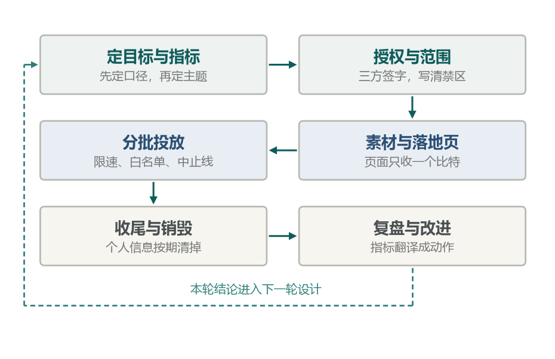
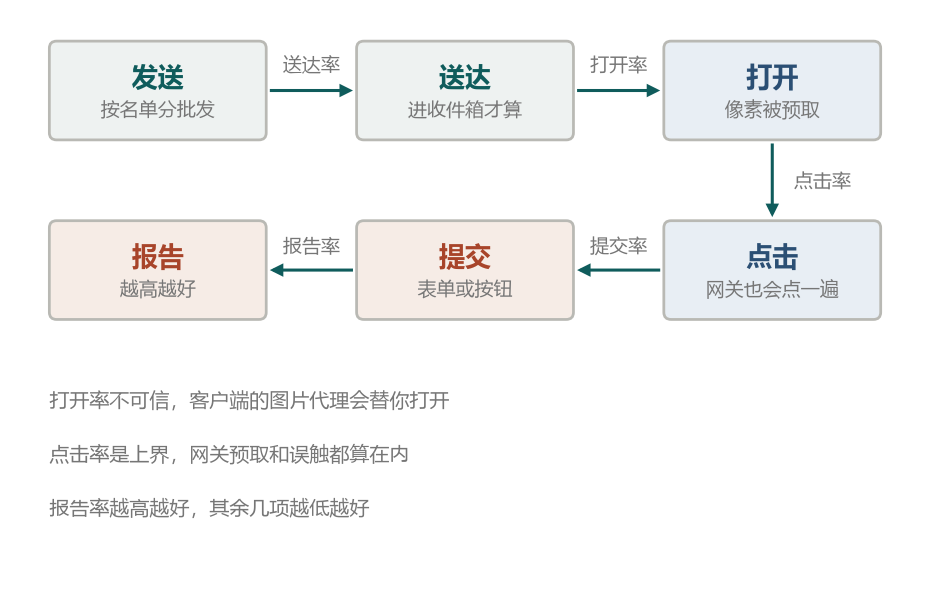

# 第二十三章　钓鱼演练的设计与执行

一家公司做过第一次钓鱼演练，报告第一页写着"点击率 34%"。会上有人问这个数算不算高，做演练的人说，业界大致在二三十个点。会议室安静了两秒，话题转到了预算。

半年后他们做了第二次，主题是"IT 通知：请更新 VPN 客户端"，点击率 11%，报告上写"安全意识显著提升"。又过半年，主题换成"本月工资条已生成，请查收"，点击率回到 33%。

三次演练，同一批人，同一套培训。变的只有借口。

这说明点击率主要衡量的是借口和日常工作的贴合程度，不是人的警惕性。把它当成 KPI 往上报，等于在汇报剧本写得好不好。

演练真正要回答的是另外几个问题。一封足够像的邮件能不能骗到人；被骗的人里有多少会主动报告；报告之后，安全团队花多久分辨出这是演练还是真事。这三个问题分别对应人的行为、报告渠道、响应流程，缺一个，演练就只是一次整蛊。

<figure>

<figcaption>图 23-1　一次演练的六个阶段。虚线那一圈是关键，没有它，下一轮只是把上一轮的邮件换个标题再发一次。</figcaption>
</figure>

## 23.1 演练在验证什么

一场演练至少同时在测三样东西，多数报告只写了第一样。

人的行为是可以直接统计的，点击、提交、报告，都有日志。这块最容易做，也最容易被过度解读。

邮件侧的检测能力经常被漏掉。一封群发的钓鱼邮件，正常情况下应该被网关拦下一部分，附件类型、域名信誉、URL 黑名单，任何一层生效都会降低投递量。如果演练邮件几乎全部进了收件箱，这本身就是一条发现，说明邮件安全策略在这类内容上有缺口。反过来，如果一封都没投进去，演练也没测到人，只测到了网关。所以"投递成功率"要单独记一笔，它是解读后面所有指标的前提。

响应流程是最有价值的一块，也最难测。员工点了链接之后，有没有一个显眼的入口让他报告；报告之后，值班的人多久看一眼；看一眼之后，能不能判断这是演练而不是真事。真实事件里，从第一封钓鱼邮件落地到第一台机器被加密，窗口可能只有几个小时，这个时间差靠的就是报告速度。

演练按告知方式分三种，各自测的东西不同。

全员事前告知的做法，是在演练开始前发通知说"本周会有一封测试邮件"。它测不出人的真实反应，但能干净地测流程，报告按钮好不好找、值班响应快不快，而且几乎没有伦理风险。成熟度低的组织从这里起步比较稳。

事后告知最常见。演练期间不说，结束后统一发说明。它的前提是员工手册或者隐私政策里已经写明"公司可能开展安全测试"，员工入职时签过。

完全不告知、事后也不说明的做法，法律风险最高，而且一旦有人从邮件头的蛛丝马迹里发现这是内部发的，信任损失远大于演练收益。除非有明确的合规依据和法务签字，不要碰。

## 23.2 授权、边界与心理安全

钓鱼演练在形式上就是一次针对自己员工的社会工程攻击。它跟真实的攻击只差一个东西，授权。

书面授权要写清楚六件事，缺一件都可能在事后变成纠纷。

范围，包括哪些部门、哪些地域、哪些子公司，是否包含外包和实习人员。

时间窗，从第一封发出到最后一封回收，写明日期的起止，不要写"近期"。

主题禁区，明确列出不允许使用的借口类型，比如裁员、处分、健康、家庭变故、薪资个人金额、司法传唤。这些主题的点击率特别高，因为它们戳的是人真实的焦虑，用它们做演练等于拿员工的情绪换一个漂亮的数字。

数据条款，收集哪些字段、存在哪里、谁能看、保留多久、怎么销毁。合理做法是只保留聚合结果和个人层面的"是否点击"这一个布尔值，三十天内删除明细。

中止条件与决策人，什么情况下立刻停、谁有权按下这个按钮、停了之后由谁对外说明。

通报路径，演练前后分别向谁汇报，出问题找谁。

心理安全这部分经常被当成客套话跳过，它不是。演练会在组织里制造一种"有人在盯着我"的气氛，处理不好，后续的真实钓鱼报告率会下降，因为员工会想，万一这又是测试呢。几个具体做法值得写进方案。

不点名。报告到部门或团队粒度就够了，个人层面的数据只用于判断"这个人需不需要额外培训"，不进入绩效、不进入晋升记录，这一点要在演练前明确告知。

不收集真实凭据。落地页的表单不要有后端校验，前端拿到输入就地丢弃，只上报"发生过一次提交"这个事件。技术上更干净的做法是页面上根本不放密码框，只放一个"登录"按钮，点了就算提交。真实凭据一旦进了演练系统的数据库，它就从演练物资变成了高危资产。

给点击的人一个不丢脸的出口。演练结束的说明邮件里，第一句话不要写"你被骗了"，写"这封邮件是我们发的，它模仿了真实的攻击手法，点击不影响任何评价，下面是三个识别要点"。同一个意思，后者能让人继续报告下一封。

涉及员工代表或工会的组织，演练方案要提前走一遍协商程序。跨境运营的还要看当地对员工监测的规定，多数司法辖区要求事先告知且遵循最小必要原则。这些不是安全团队能单方面决定的事。

## 23.3 借口、发件域与落地页

借口（pretext）的选择有一套朴素的判断标准。它要跟收件人的日常工作有关，要有时效压力，要指向一个明确动作，暗示的后果不要太重。

"您的共享文档需要重新验证"符合前三条，后果只是打不开文件。"您的账号将在 24 小时内停用"也符合，但后果偏重，容易引发恐慌式点击，测出来的数字好看，训练价值低。"关于上月报销单的补充材料"贴合度最高，因为报销是每个人都躲不掉的事。

主题禁区之外，还要避开组织当下正在发生的事。公司刚宣布重组、刚出过事故、刚裁过员，这几周不适合做演练，任何主题都会被解读成信号。

发件域有三种常见做法，各有代价。

自有子域最稳，注册一个 `it-notice.example.com` 之类的名字，配上自己的 SPF、DKIM、DMARC。它看起来不像外部攻击，但能测出"员工是否核对域名"这件事，而且投递稳定，不会被自己的网关当成仿冒。

相似域名更接近真实攻击，`examp1e.com`、`exarnple.com` 这类。注册之前要确认两件事，域名没有被真实企业占用，注册行为符合当地对域名注册的规则。这类域名通常活不过几周就会被安全厂商标记，演练窗口要压缩。

借用云服务更像现在的真实钓鱼，攻击者越来越多地用共享文档平台、表单工具、代码托管平台的免费额度发链接，因为主域信誉好。演练用同样的路径，测的是"员工会不会因为域名可信就放松"。

SPF、DKIM、DMARC 的配置有一个容易搞混的地方。如果目的是测人，三个记录要配好，否则邮件会进垃圾箱，样本量不够；如果目的是测网关能不能识别外部仿冒，那就故意不配，看有多少封被拦。这是两个不同的实验，方案里要写清楚做的是哪一个，不要一边想测人一边又抱怨被拦。

落地页保持最小。一个跟借口匹配的页面，一个按钮，提交后跳到一个说明页。表单里字段越少越好，理想情况是零。

技术细节上还有几条。页面要能区分"打开"和"提交"两个事件，前者记时间戳就够，不要记完整 IP，取地址的前两段用于粗略地理分布即可。页面不要引用外部 CDN 的资源，避免演练流量打到第三方。跳转后的说明页要写清楚这是公司演练、数据如何处理、去哪里反馈，这一页才是演练的教育价值所在。

附件型演练（宏文档、带链接的 PDF、快捷方式文件）现在多半会被拦，但"被拦"也是数据。它告诉你现有防护覆盖了哪一类载体，剩下的空白在哪里。做附件演练之前先跟邮件管理员对一遍策略，否则你会在垃圾箱里找到自己发的全部样本。

## 23.4 指标：哪些数字可信

指标的口径必须在开始之前定好，并且写进方案。演练做完再回头改口径，是最常见的自欺方式。

分母尤其要先定。是发送数还是成功投递数？退信的、被网关拦的、进了垃圾箱但没被打开的，算不算在分母里？合理的做法是用"成功投递到收件箱"做分母，被拦的部分单独统计成防护效果。

<figure>

<figcaption>图 23-2　从发送到报告的五个转化率。箭头是邮件的流向，不是指标好坏的流向，最后一个才是越高越好。</figcaption>
</figure>

打开率现在基本不能用了。主流邮件客户端会通过代理预加载图片，用于隐私保护的机制也会替用户"打开"邮件，这些都会让像素被请求，统计出来的打开率虚高，甚至接近百分之百。用它判断员工是否看过内容，误差大到没有意义。

点击率是上界，不是真实值。邮件安全网关在投递时会预先访问链接做信誉检查，安全团队的沙箱也会点一遍，邮件客户端的预览面板同样可能触发。一个人误点之后立刻关掉，也会算一次点击。所以点击率高估了"被说服的人"，但它作为相对指标仍然有用，同一批人、不同借口之间的对比是有意义的。

提交率最硬。它要求一个明确动作，填表或者点按钮，误触的概率低。要注意自动填充的干扰，浏览器可能把保存的凭据填进去，所以按钮式提交比表单式提交更干净。

报告率是唯一越高越好的指标，也是最能反映组织安全文化的指标。一个人发现可疑邮件之后愿意花三十秒去报告，说明他相信这个渠道有用、相信报告了不会被责怪。这两件事都比"能识别钓鱼邮件"更难建立。

首次报告时间（time to first report）值得单独统计。它决定了真实事件里你能不能赶在横向移动之前切断。一场演练如果点击率很低，但第一次报告发生在四十分钟之后，真实事件里这四十分钟就是攻击者的窗口。

| 指标 | 口径 | 可信度 |
| --- | --- | --- |
| 投递率 | 进收件箱数 / 发送数 | 高，可与网关日志核对 |
| 点击率 | 触发链接数 / 投递数 | 偏低，含预取与误触 |
| 提交率 | 提交事件数 / 投递数 | 高，动作明确 |
| 报告率 | 报告邮件数 / 投递数 | 高，但要看是否去重 |

## 23.5 执行：分批、限速、白名单与中止

一次把邮件发给全公司，是演练里最容易出事的做法。分批的理由有三个，控制影响面、观察报告率随时间的变化、给中止留出余地。

每批控制在总人数的百分之五到十，批间隔半小时以上。第一批发出去之后先看两个数，报告率和网关拦截量。报告率异常高说明借口写得太假，员工一眼就看出来了，后面几批的数字没有参考价值；拦截量异常低说明网关没识别，这本身是要写进报告的问题。

时间上避开几个节点。周一上午收件箱积压，员工扫读为主，点击率会偏高但不是因为轻信。周五下午没人看，样本回收率低。发薪日、月末结算、大促、系统切换窗口，这些时段员工本来就在处理大量真实通知，演练邮件混在里面会造成实际困扰。

白名单要提前维护，不是临时想起来的名单。高管单独沟通，他们的邮箱往往有额外的过滤和助理代为处理，数据不具代表性。长假、病假、产假期间的人排除，一个正在休假的人收到"账号异常"的邮件，可能真的会去处理。试用期员工排除，除非培训已经覆盖。正在走离职流程的人排除，任何带威胁意味的措辞都可能被解读成别的意思。外部收件人必须是零，一旦有一封漏到客户或供应商那里，事件性质立刻改变。

发送速率要和自己的邮件网关对齐。演练平台默认的并发往往远高于企业出站限额，触发自己的反垃圾策略之后，邮件会被延迟或丢弃，前面所有指标全部失真。

中止条件要写成硬性规则，并且提前告诉所有相关人。

有人把邮件转发到外部，或者客服、PR 收到询问，立刻停。

同一时间窗内发生了真实的安全事件，立刻停，避免团队在两条线上分心。

有收件人因为演练邮件做出了真实动作，比如真的去改了密码、真的打电话给 IT 报障，立刻停。

任何一个批次的中止由演练负责人一人决定，不需要开会。停下来的动作是先发全员说明，再复盘，不要悄悄停掉然后当作没发生。悄悄停掉的组织，下一次演练会发现自己连一半的参与度都没有。

## 23.6 复盘：把指标翻译成动作

复盘会的产出不应该是一张百分比图，应该是一份带负责人和日期的改动清单。

先看报告率，再看点击率。这个顺序很重要。点击率低但报告率也低的组织，看起来"员工不好骗"，实际上是"员工不报告"，真实事件里第一封邮件会在收件箱里躺一整天。点击率高但报告率高的组织反而更健康，说明有人上当，但也有人盯着，后者能在几分钟内触发响应。

两个指标的组合能推出不同的动作。

点击高、报告低，问题在渠道。报告按钮在哪个界面、员工知不知道有这个东西、报告之后会不会收到回复，这三件事决定了他下次还报不报。改这些比再训一轮有用。

点击低、报告高，保持现状，把演练频率降下来，边际收益已经很薄。

点击高、报告高，员工警觉但流程慢。这时候要看首次报告时间，如果报告发生在点击之后半小时，说明发现得晚；如果报告和点击几乎同时发生，说明流程没问题，是覆盖面不够。

点击低、报告低，最麻烦的一种。可能是样本量太小，可能是员工看出来是演练但懒得报，也可能是报告渠道根本不通。先做小范围访谈，别急着下结论。

分段统计能做，但要克制。按部门、按地域、按是否参加过培训分，都合理。一个二十人的团队里有两个人点了，这个百分之十不能说明任何事，样本量不够的时候，差异大部分来自噪声。写报告时把置信度标出来，比多画几张柱状图有用。

培训的边界要认清楚。知道"要看发件人域名"和在实际场景里真的去看，是两件事。反复演练的边际收益递减得很快，第三次和第四次之间的差别通常小于噪声。把资源从"教人识别"挪到"让报告变容易"，往往更划算，因为前者要求每个人每次都做对，后者只要求流程设计一次做对。

一轮演练做完，如果只留下一个数字，那这个数字最好是首次报告时间。它最接近真实事件里唯一要紧的那件事，我们多久会知道。

