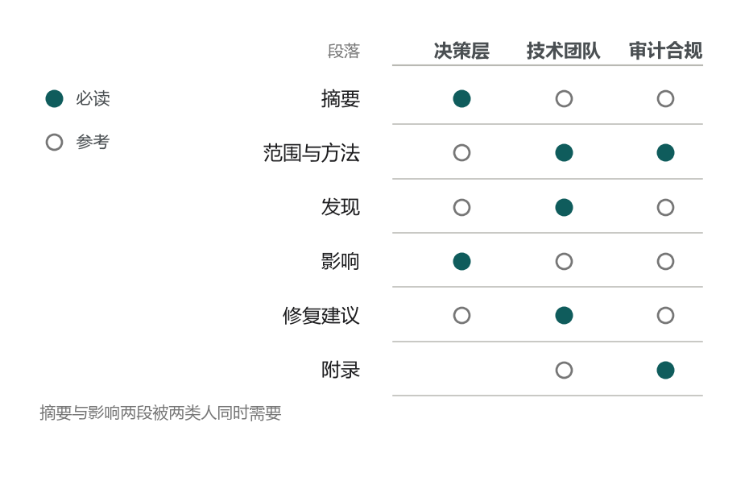
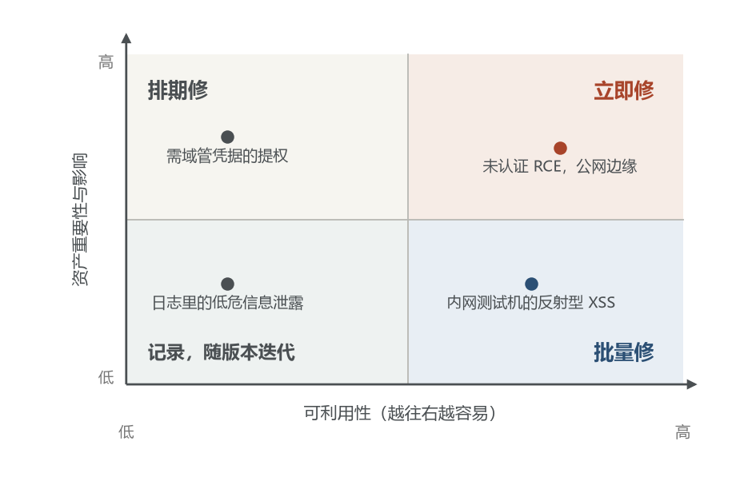

# 第二十四章　报告、沟通与修复

一份渗透报告发出去三天没有回音。第四天运维回了一句，"这个我们去年评估过"。

翻回自己报告的第三页，建议那一栏写着"建议升级到最新版本"。这句话谁都能写，谁都不会照着做，因为它既没说要升到哪个版本，也没说升级会影响什么，更没说在升级之前能做什么。

同一个发现，换一种写法，命运完全不同。写成"订单查询接口的 `order_id` 参数可控，未做参数化，可读取他人订单，修复方式是把这个接口的 SQL 改成预编译语句，涉及 `OrderDao.java` 第 118 行和第 203 行"，它会被排进下一个迭代。写成"存在 SQL 注入，建议加强输入校验"，它会被归档。

差别不在技术深度，在你有没有替读者把下一步想清楚。

## 24.1 同一份发现，三种读者

报告写完之后会被至少三种人看，他们关心的事情几乎没有交集。

决策者想知道要不要现在停下来处理。他读的是第一页，判断依据是"这件事会不会影响业务、会不会上新闻、要花多少钱"。给他二十页请求响应，他只会翻到最后一页看结论。

技术团队想知道怎么复现、改哪里。他需要请求原样、版本号、行号、配置片段。给他"存在注入风险"这种描述，他会回一句"能给我个包吗"。

审计和合规看的是范围与方法。他们不关心单个漏洞，关心这次评估覆盖了哪些系统、用了什么标准、有没有遗漏、结论是否可以复核。

<figure>

<figcaption>图 24-1　报告各段与三类读者的对应关系。实心点是必读，空心点是参考。摘要和影响两段被两类人同时需要，这两段最值得反复改。</figcaption>
</figure>

三种读者对应三种写法，一份文档要同时满足。可行的结构是分层，前面一页给决策者，中间给技术团队，后面给审计。层与层之间靠引用连接，摘要里说"详见 3.2"，读者自己决定停在哪一层。

常见的失败是把一种写法用在所有人身上。全是 payload 的报告发给管理层，会被判定为"看不懂，先放着"；全是结论的报告发给开发，会被判定为"没法修，先问清楚"。两种结果都是延迟，而延迟在高危漏洞上是实打实的风险。

摘要可以拿两句话对比。一句写"本次评估发现 12 个问题，其中高危 3 个、中危 5 个、低危 4 个"，另一句写"三个高危中有两个可直接拿到客户数据，且不需要登录，建议本周内处理，具体位置在 3.1 和 3.2"。前者是统计，后者是建议。决策者需要的是后者，统计只是它的依据。

## 24.2 骨架：六段，顺序固定

结构不需要创新，稳定比好看重要。

摘要放在最前面，一页以内。写法是每条一句话，三句话一条，先说是什么，再说会怎样，最后说怎么办。五条以内，按优先级排。摘要是全篇唯一保证会被读完的部分，值得写三遍。

范围与方法写清楚测了什么、什么时候测的、用什么身份测的、哪些是黑盒哪些有源码。这一段还有个必须写但常被删掉的部分，没测什么。没测的系统、没覆盖的接口、因为时间不够跳过的模块，都要列出来。读者很容易把"报告里没有"理解成"不存在"，这一句话能避免后续所有的误会。

发现按风险排序，每条用统一的结构，后面单独讲。

影响要翻译成业务语言。同样的漏洞，"可读取 `orders` 表全部字段"和"可读取全部历史订单，包含收货地址与手机号，涉及约多少万条记录"，后者才能让业务方判断紧急程度。数据量估算要给区间并注明依据，不要拍一个精确数字。

修复建议按优先级排，每条标出成本量级和是否影响业务连续性。有的修复要停机，有的可以在线做，这个信息对排期的人比风险等级更有用。

附录放原始材料。完整的请求响应、脚本、扫描器输出、时间线、术语表。正文里引用附录编号，不要把几百行日志贴进正文。

报告是活文档，头部要有版本号和修订记录。第一次交付写 v1.0，之后每次定级变化、补了新证据、对方修复完成，都追加一行，写清谁改的、改了什么、为什么。这条习惯在事后争议时能救命，半年前到底是怎么说的，翻一眼就知道。

## 24.3 写一条发现

一条发现的结构固定成七块，顺序不要变。写的人省事，读的人也能快速定位。

标题一句话说清位置、类型、后果。这一句决定读者会不会往下读。

位置给到能直接跳过去改的粒度。URL 带参数名，源码给文件和行号，配置给文件路径和键名。

复现步骤编号，每步一条命令或一次点击，附上期望看到的结果。别人按步骤走一遍能复现，这一条才算合格。

证据放最小可复现的那一份，不是最全的那一份。一个能触发问题的原始请求，比二十张截图有用。

影响写在这个系统里意味着什么，不是这个漏洞类型通常意味着什么。

修复写到具体位置和具体做法，能给出代码片段最好。

参考给 CWE 编号、相关文档、同类问题的历史记录。

标题的差别值得单独看两组对照。

```text
差：SQL 注入漏洞
好：订单查询接口 order_id 参数存在注入，可读取任意用户订单

差：存储型 XSS
好：个人资料页 nickname 未编码输出，可窃取任意访客会话
```

差的写法需要读者自己去猜严重程度和影响范围，好的写法把判断所需的信息都放进了一行。

模板可以直接抄。下面是渲染后的样子，缩进层级就是文档里的层级。

```text
3.2 订单查询接口注入（高危）

位置  GET /api/order/detail?order_id=（生产环境，v2.4.1）

复现
  1. 用普通账号 A 登录，取得会话 Cookie
  2. 发送下列请求，order_id 传入 1 OR 1=1
  3. 响应返回 200，body 中含 3 条不属于 A 的订单

  GET /api/order/detail?order_id=1%20OR%201%3D1 HTTP/1.1
  Host: shop.example.com
  Cookie: SESSION=...

证据  见附录 A-3，原始响应 12 KB，此处截取首条记录。

影响  orders 表全部字段可读，含收货人姓名、手机号、地址。
      按近三十天日均订单量估算，涉及记录量在六位数区间。

修复  OrderDao.findById() 第 118 行用字符串拼接构造 SQL。
      改为 PreparedStatement 并绑定参数，同类写法在第 203、
      247 行还有两处。临时缓解可在网关层拦截 order_id 中的
      非数字字符，但会误伤合法查询。

参考  CWE-89
```

每一块都在回答一个具体问题。位置回答去哪里改，复现回答怎么确认，影响回答为什么急，修复回答怎么动。写不出其中任何一块，说明这条发现还没查清楚。

## 24.4 定级：CVSS 之外

CVSS 是一个描述严重性的框架，不是一个排序工具。它算出来的是"这个漏洞在这个版本、这个配置下的技术严重性"，不包含"这个系统对你有多重要"。

通用漏洞评分系统（Common Vulnerability Scoring System，CVSS）分三组指标。基础分（base）描述漏洞本身的固有属性，攻击向量、复杂度、所需权限、用户交互、对机密性完整性和可用性的影响。时序分（temporal）考虑利用代码是否公开、补丁是否可用。环境分（environmental）才是把你的环境代进去算的那一组，包括缓解措施是否存在、资产的重要程度。

多数报告只算基础分，然后按分数排序。这个做法的问题在于基础分假设的是最坏情况，一个只能在本地触发、需要先登录的问题，只要三性全失，基础分也能到 7.8。反过来，一个公网未授权、但只泄露"服务器版本号"的问题，基础分只有 5 左右。把两者放在一张表里按分数排，运维会先去处理那个 7.8，而真正该今天关掉的可能是那个 5。

<figure>

<figcaption>图 24-2　把技术分和环境信息合起来看。横轴是可利用性，纵轴是资产重要性与影响，四个象限对应四种处理节奏。</figcaption>
</figure>

把四个维度摆在一起，排序会清楚很多。

举个具体对比。一个本地提权问题，需要已有高权限会话，成功后可读写全部数据，按 CVSS 3.1 的向量算出来基础分大约 6.7。另一个公网接口的未授权读取，只影响保密性，基础分大约 7.5。单看分数，第二个更高。但第一个发生在核心数据库服务器上、且攻击者已经拿到了普通账号，第二个发生在一个只返回公开商品信息的边缘服务上。真实的处理顺序很可能反过来。分数没错，错在拿它当了排序依据。

可利用性，指从"知道这个漏洞"到"打通"需要什么。公网可达、不需要认证、不需要用户交互，是最容易的一档；需要已有的管理员会话、需要物理接触、需要特定竞态，是最难的一档。

暴露面，指这个入口从哪儿能摸到。公网、合作方专线、内网办公段、生产服务器本地，四档的风险差别很大。同一个漏洞放在测试机上和放在支付前置机上，不是一回事。

资产重要性，看数据敏感度和业务关键性。这里面有主观判断，所以要写清楚依据，比如"该系统存有全量客户身份信息，且为下单链路的必经节点"。

影响，落到保密性、完整性、可用性三件事上。加密勒索属于可用性，篡改订单金额属于完整性，导出客户名单属于保密性。三者叠加时，报告里要说明叠加后的业务后果。

四个维度合成一个优先级，通常用三档就够，立即处理、排期处理、记录观察。档位之间的界线要在报告的方法部分写清楚，让读者知道"立即"是什么意思，是二十四小时内、还是本迭代内。

定级的视角也要说明。供应商视角看的是"这个产品所有用户的最坏情况"，你的视角看的是"我们这套部署的实际情况"。同一份报告里给两个结论并不矛盾，写清楚哪个是哪个就行。

## 24.5 修复建议与验证

修复建议最常见的毛病是正确但无用。"加强输入校验""完善访问控制""提升安全意识"，这三句话在任何报告里都成立，也都不指向任何一行代码。

可执行的建议有三个特征。指向具体位置，给出具体做法，说明副作用。

具体位置前面讲过。具体做法要区分根因修复和临时缓解，并且标明哪个是临时的。参数化查询是根因修复，WAF 加一条规则是缓解；打补丁是根因修复，关掉对外端口是缓解。缓解措施要写清楚它的有效期和失效条件，比如"该规则仅匹配当前的注入模式，攻击者换用编码方式即可绕过，建议在两周内完成代码修复后撤除"。

副作用经常被忽略。把 `order_id` 限制成纯数字，可能打断某个历史接口传入逗号分隔的多单查询；关掉一个调试端点，可能让运维的监控脚本失效。报告里提前写一句"该修改会影响 X，需要与 Y 确认"，能省掉一轮返工。

改动的大小也要在报告里标出来。有的修复是一行代码，有的是一个迭代的改造，有的是架构级调整，三者的排期逻辑完全不同。一行改动可以走紧急变更，架构调整要走年度规划。把它们混在一张清单里，读者无法判断哪些能本周做完。

修复之后要验证，验证要有清单。

原始路径再跑一遍，确认问题消失。这一步多数人会做。

变体路径再跑一遍。大小写变形、URL 编码、双重编码、参数污染、`order_id` 换成 `order[id]` 或 `order_id[]`，这些是同一个修复点最容易漏的地方。

相邻接口看一遍。同一个 handler 处理的其他路由、同一个 DAO 的其他方法，往往复制粘贴了同样的写法。

同类代码搜一遍。用固定的模式在代码库里搜，比如所有 `"SELECT" +`、所有 `executeQuery(` 拼接调用，把结果附在报告里。这一步的价值经常超过漏洞本身，它把"一个洞"变成了"一类洞"。

验证结果要留证据。什么时间、在哪个版本上、用什么请求、得到什么响应。没有证据的"已修复"在半年后没人敢信。

还有一种情况要写进报告，接受风险。有些问题修复成本高于风险，业务方决定不修，这是合理的决定，但必须有记录，谁批的、依据是什么、什么时候复评。没有记录的不修，等于遗忘。

## 24.6 沟通：节奏、不确定性与拒绝

技术工作里最难的部分往往不是发现，是让另一个人相信并行动。

节奏上有个简单的规则，坏消息越早越好。高危问题在确认当天就该口头同步，哪怕细节还没整理完。等到报告写完再通知，中间那几天就是暴露窗口。同步的时候说清楚三件事，问题在哪、现在能做什么、什么时候给完整报告。

书面报告在口头同步之后二十四小时内跟上，内容不必完美，但复现步骤必须准确。之后按固定的节奏更新，每周一次状态，有变化随时插播。沉默会被理解成"没事了"。

不确定性要明确说，不要用模糊的语气掩盖。能说的是"在该版本、该配置下稳定复现三次"，不能说的是"可能影响所有版本"。边界划清楚，读者才知道该信到什么程度。反过来，把所有话都加上"可能"，报告就失去了行动价值。

有些结论是"不建议做某件事"，这类结论最容易被当成唱反调。写法上给出理由和替代方案，不要只给禁令。"建议不要在边界设备上保留默认口令作为应急入口，因为它会被扫描器在几小时内发现，而应急场景一年用不到一次；替代方案是把应急入口改为需要双人授权的一次性凭据。"这比"禁止使用默认口令"更难被驳回。

被质疑的时候，先分清是哪一种质疑。对方说"这个不可利用"，可能是他真的知道某些前置条件，也可能是他没看懂复现步骤。前一种情况补证据，后一种情况补步骤。争论"你不懂安全"不会让任何一方改变结论。

升级路径要在项目开始时约定好。谁是对接人，多久没响应可以升级到谁的上级，升级之前通知谁。没有约定的升级会被当成越级告状，有约定的升级是正常流程。

对接人的作用容易被低估。技术团队往往不是决策者，他能做的是把你的结论转述上去，转述的质量取决于你给他的材料好不好用。给对接人一份三行的口头版本，比给他一份五十页 PDF 有效得多。

披露时限按协调披露的惯例处理，九十天是业界常见的时间窗，从报告到公开。有些项目要求在修复发布前完全不公开细节，有些项目自己就会发公告。跟着对方的流程走，同时把自己的时间点记下来，避免无限期等待。

对外说什么，不是安全团队单方面能决定的事。同一个问题，告诉客户、告诉监管、告诉媒体，三套说法需要三套措辞，而且必须在对外之前对齐。技术报告里只提供事实和边界，对外口径由法务和公关定，这条界线要提前划清。技术人员的职责是确保对外说法里没有事实错误，不是替公司写声明。

报告写完、发出去、对方修完、你复测通过，这件事才算闭环。中间任何一步断了，前面所有工作都只是自娱自乐。

写报告这件事，最终衡量的不是文笔，是对方读完能不能做一个决定。能做到这一点，一页纸就够；做不到，五十页也是废纸。

<div class="chapter-end"></div>
