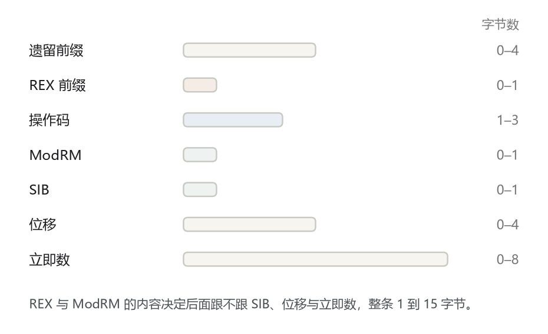
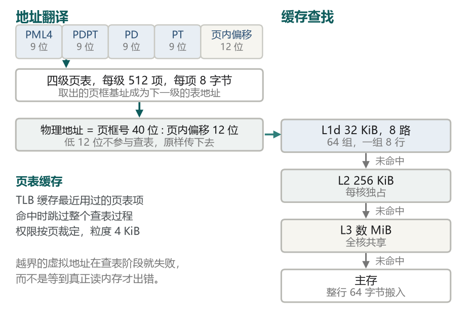

# 第一章　指令与微架构：一条指令走了多远

把调试器停在 `0x401136`，反汇编窗口给出 `48 8b 44 24 08`，注释写着 `mov rax, [rsp+8]`。把光标往下挪一个字节，从 `0x401137` 重新反汇编，同一段内存变成了另外几条指令，而且它们照样能执行、照样有明确语义。

这不是调试器的毛病。x86-64 的指令是变长的，一条指令的边界只由它自己的内容决定，没有一个全局的“第几条指令”索引。从哪个字节开始解码，就得到哪一套解释。这个性质在正常编程里从来不是问题，编译器总是从合法起点开始生成代码；但一旦有人能在内存里指定一个执行起点，性质就翻转成了一种能力。

一条指令从磁盘上的字节走到 ALU 里的电信号，中间要经过编码格式、取指译码、地址翻译、缓存查找几道关。每一道关都有自己的形状，而这些形状后来都变成了攻击者可以踩的台阶。这一章沿着这条路径走一遍，把每道关的形状量清楚。

## 1.1 变长编码的代价

8086 在 1978 年问世的时候，内存以 KB 计，代码密度是硬指标。为了让常见指令短、不常见的指令长，x86 从一开始就用了变长编码。这个决定一直保留到今天，成了这套指令集最难缠的部分。

一条 x86-64 指令由若干字段首尾拼接而成，字段按固定顺序出现，但大部分字段可以整段缺席。

<figure>

<figcaption>图 1-1　x86-64 指令的字段顺序。柱长表示该字段最多能占几个字节，从遗留前缀到立即数依序拼接，整条指令上限 15 字节。字段是否出现由前序字段的内容决定。</figcaption>
</figure>

最前面是遗留前缀，最多 4 个字节，用来改操作数位宽、改地址位宽、加锁、重复串操作、指定段。接着是最多 1 字节的 REX 前缀，格式是 `0100WRXB`。W 置位表示这是 64 位操作数，R、X、B 三个比特把寄存器编号扩展到 `r8` 到 `r15`。没有这一位，64 位模式下的寄存器就只有 8 个可用。

操作码占 1 到 3 个字节。以 `0F` 开头的两字节操作码是一张扩展表，`0F 38` 和 `0F 3A` 又是两张三级表，SSE、AVX 那些指令都藏在这些扩展表里。

后面是寻址部分。ModRM 一个字节，拆成 mod、reg、r/m 三个字段，分别占 2、3、3 位。reg 通常指寄存器操作数，r/m 指另一个操作数，mod 说明这个操作数在寄存器里还是在内存里。内存操作数的地址计算方式由 r/m 的低三位决定，其中编码 100 是一个转义，表示后面还要跟一个 SIB 字节；编码 101 在 mod 为 00 时表示 RIP 相对寻址，这个设计让位置无关代码可以只用一条指令取到附近的全局变量。

SIB 字节同样三个字段，scale、index、base。它解决的问题是数组下标寻址，形如 `[base + index * scale + disp]`，scale 可以是 1、2、4、8，正好对应常见元素宽度。

最后是位移和立即数，长度可以是 1、2、4、8 字节，取决于前面字段的选择。整条指令长度上限 15 字节，超过就触发异常，这条限制写在 Intel 的手册里，处理器必须遵守。

三条指令的实际编码摆在一起看更清楚。

```text
48 89 E5                  mov rbp, rsp
48 8B 44 24 08            mov rax, [rsp+8]
48 8D 84 24 00 10 00 00   lea rax, [rsp+0x1000]
```

第一条 3 字节，第二条 5 字节，第三条 8 字节。第二条里的 `44` 是 ModRM，mod 为 01，说明带一字节位移；r/m 为 100，说明还要一个 SIB；`24` 就是那个 SIB，base 指向 `rsp`，没有 index。这些字节之间没有任何分隔符，唯一能确定 `08` 是位移而不是下一条指令开头的东西，是前面几个字段的内容。

由此得到一个不太直观的结论。反汇编不是一件有唯一正确答案的事，它需要先知道一个可信的起点，然后顺着字段长度往下推。IDA 和 Ghidra 用的是线性扫描加递归下降的混合策略，遇到跳转目标就补一个起点，遇到数据段就停下。这套策略对付编译器生成的代码够用，对付手写字节或者被改过的字节就不够用了。

对手里有一份反汇编结果，和对手里有一份内存，是两种完全不同的处境。

## 1.2 取指、译码与流水线

一条 `add` 指令从取指到结果写回，中间要穿过十几个流水级。流水线的意思很简单，把一条指令的处理拆成若干小段，每一段由专门的硬件负责，上一段做完就把活交给下一段，自己腾出手来接新的指令。同一时刻流水线上同时躺着十几条指令，处在不同的阶段。

经典的五级划分是取指、译码、执行、访存、写回。真实的处理器比这复杂得多，前端负责按地址从 L1 指令缓存里取出一段字节，预解码器扫描这段字节找出每条指令的边界，真正的译码器把变长指令翻译成定长的微操作（micro-op），再送进微操作缓存。后端从微操作缓存里取指令，做寄存器重命名，塞进重排序缓冲（reorder buffer），等操作数齐了就发射到执行单元。

这套结构里最要紧的一点是，取指是顺序的、推测的。处理器不能等一条分支指令算完再去取下一条，那样流水线就空了一半。它选择猜。

分支预测器在几轮训练之后能记住“这个跳转上次走了、上上次也走了”，甚至能学会循环的退出时机。现代预测器用的是一组不同长度的历史表，把最近的跳转结果拼成一个全局历史，再用这个历史去索引预测结果，名字叫 TAGE 一类的东西。预测准确率在常见代码上能到九成以上。

猜错要付代价，流水线里所有推测执行过的指令全部作废，重新从正确地址取指。这个代价是十几个周期，而一条分支指令可能每几个周期就出现一次，所以前端的取指带宽很大程度上被预测准确率决定。

推测执行带来一个后来才被认真对待的后果。被作废的指令不允许改动体系结构状态，寄存器、内存都得恢复原样，但它们改过的微架构状态不在回滚范围内，缓存里那些被拉进来的行留在原地。

2018 年公开的 Spectre 和 Meltdown 都是从这个缝里钻进去的。Kocher 等人给出的 Spectre 攻击利用的是分支预测被训练之后，推测执行会短暂地执行本不该执行的分支目标，那段代码读到的数据虽然马上被丢弃，但它把数据当成地址去访问了一次内存，缓存状态因此被污染。攻击者随后用缓存时序把污染读回来。Meltdown（Lipp 等人，同样在 2018 年）利用的是乱序执行在权限检查完成之前就把数据送进了寄存器，越权读取的内容同样以缓存状态的形式泄漏出去。

对防御方来说，这一节解释了为什么 2018 年之后出现了那么多看起来莫名其妙的补丁。序列化指令、跳板（retpoline）替换间接跳转、微码更新，全是围绕“别让推测执行碰不该碰的东西”做的。

对攻击方来说，这一节确立了一件事：程序的行为不只体现在它的输出里，还体现在它留下的时间痕迹里。

## 1.3 内存层次

处理器跑得比内存快得多，这个差距从 1980 年代就开始拉大，现在两者差了两三个数量级。整个存储层次就是为了填这个坑搭起来的。

寄存器在核心里，访问不要周期。L1 缓存也贴着核心，访问几个周期，容量在几十 KB 的量级，指令和数据分开成两个。L2 容量大一些，也是每核独占，访问十几个周期。L3 被所有核心共享，容量到几 MB。再往外是内存，访问要上百个周期。磁盘和网络更远，那些走的是操作系统那套换页和协议栈。

缓存不是按字节管理的，按行。x86-64 的缓存行（cache line）固定 64 字节，一次从内存取数据，取的是包含目标地址的整行。这个粒度决定了很多事情。你在 `arr[0]` 上循环，硬件顺手把 `arr[1]` 到 `arr[15]` 也搬了上来，所以顺序访问快；你在跨步为 4096 的地址上跳着访问，每次都可能撞在同一组里互相踢出去，性能掉一大截。

缓存的组织结构是组相联。物理地址被切成三段，高位是标签（tag），中间若干位是组索引（set index），最低 6 位是行内偏移（block offset）。组索引选中一个组，组里若干路并排，每路存一个标签，硬件把地址的标签和每一路的标签比对，命中就返回那一行，没命中就往下走一级。

<figure>

<figcaption>图 1-2　一次访存的两段路径。左边是虚拟地址经四级页表翻译成物理地址，右边是物理地址在缓存层次里逐级查找。缓存容量与相联度为典型桌面处理器的取值，具体型号有差异；4 KiB 页、12 位页内偏移、64 字节缓存行是 x86-64 的固定约定。</figcaption>
</figure>

和缓存配套的还有一层翻译缓存。页表在内存里，一次普通访存要查四级页表，那就是四次额外的内存访问，谁都受不了。处理器里因此有一组小型缓存专门存最近用过的翻译结果，叫 TLB（translation lookaside buffer）。TLB 命中就当页表不存在，未命中才真的去走那四级。

这套结构本来是性能优化的产物，副作用是它造出了一个跨进程、跨权限的观察通道。两个进程如果共享同一个物理页，比如共享库的代码页，那么一方对缓存行的操作另一方是看得见的。Osvik、Shamir 和 Tromer 在 2006 年给出的 Prime+Probe 用填充缓存再探测的方式还原 AES 的密钥访问模式；Yarom 和 Falkner 在 2014 年给出的 Flush+Reload 借助 `clflush` 指令把一行刷掉，等目标访问过之后测量重新加载的时间，分辨率可以细到单条缓存行。

缓存行是 64 字节，这就是这类侧信道的空间分辨率。想知道某个字节的值，得让它影响某一整行的访问，这种“把秘密变成地址”的手法在后面的章节里会反复出现。

## 1.4 分段与分页

在讲页表之前得先处理一个历史包袱，分段。

8086 时代的地址是 16 位，寻址空间只有 64 KB，为了凑出 1 MB 的物理空间，Intel 让每个段寄存器带一个基址，逻辑地址等于段基址左移 4 位加偏移。后来的 32 位处理器把分段改成了正经的段描述符，基址、限长、权限都存在全局描述符表（GDT）里，代码段、数据段、栈段各有一套。这是 1990 年代操作系统教科书里那套“保护模式”的核心内容。

到了 64 位模式，分段基本被废掉了。CS、DS、ES、SS 的基址一律当作 0，限长也不再检查，只剩下两个寄存器保住了基址，`fs` 和 `gs`。Linux 把 `fs` 的基址指向线程本地存储（thread-local storage），glibc 的栈保护金丝雀就放在 `fs:0x28` 的位置上。Windows 用的是 `gs`，进程环境块挂在那里。这件事后面第三章讲栈保护的时候还会碰到。

真正干活的是分页。

x86-64 把 48 位虚拟地址切成五段，前四段各 9 位，最后 12 位是页内偏移（图 1-2 左）。`CR3` 寄存器存着第一级表的物理地址，叫 PML4。用虚拟地址最高的 9 位在 PML4 里选出第 N 项，这一项给出一张 PDPT 的基址；再用下一组 9 位在 PDPT 里选，如此往下，走完 PD、PT 四级，PT 里选出的那一项给出的就是物理页框号。页框号左移 12 位，加上原来的页内偏移，得到物理地址。

一张页表刚好一页，512 项，每项 8 字节，加起来 4096。这不是巧合，是照着页大小设计的。

每一项叫页表项（page table entry，PTE），64 位里用得上的就那么几位。

| 位 | 名称 | 作用 |
|----|------|------|
| 0 | P | 存在位，为 0 时访问会触发缺页异常 |
| 1 | R/W | 0 表示只读，1 表示可写 |
| 2 | U/S | 0 表示仅内核可访问，1 表示用户态也可访问 |
| 63 | NX | 置位表示这一页不可执行 |

还有几个位值得一提。第 5、6 位是访问位和脏位，由硬件自动置位，操作系统靠它们决定换出哪一页。第 7 位是页大小位，在 PD 这一级置 1 就得到 2 MB 的大页，在 PDPT 一级置 1 就得到 1 GB 的大页，少走两级查表，TLB 压力也小。第 8 位是全局位，标记为全局的页在切换地址空间时不被刷出 TLB，内核页通常这么标。

权限检查逐级进行。用户态要访问一个地址，从 PML4 一路到 PT，每一级的 U/S 位都必须是 1，任何一级为 0 都直接失败。写访问还要求路径上每一级的 R/W 位都是 1。这意味着权限只能收紧不能放松，一条路径上只要有一级说了不行，后面写什么都救不回来。

NX 位是 AMD 在 2003 年的 Opteron 上引入的，Intel 后来跟进，叫 XD。这一位把“可执行”从“可读”里拆了出来，直接终结了把 shellcode 塞进栈上再跳过去那个时代。它带来的连锁反应是整条利用技术的转向，代码复用取代了代码注入，第五章和第六章讲的就是这个转向。

大页和 TLB 的组合还留下了另一个后果。2 MB 的大页让 TLB 覆盖面变大，性能好，但权限粒度也跟着变成 2 MB。一块 2 MB 的区域里只要有一个字节需要可写，整块都得可写。云环境里开透明大页（transparent huge page）会拉长侧信道的泄漏窗口，原因就在这里。

再补两个和后来章节直接相关的控制位。`CR4` 里有两位管着内核和用户页的边界，SMEP 让内核态不能执行用户页上的代码，SMAP 让内核态不能读写用户页上的数据，除非临时开一个口子。这两位的出现把“让内核跳到一个用户能控制的地方”这条路堵了一大半，绕过去的办法在后面的内核章节里。

## 1.5 这些形状怎么变成攻击面

把前面几节的东西收拢起来，能抽出四条长期起作用的形状。

第一条是指令和数据在物理上同源。内存里没有标签说明哪个字节是指令、哪个字节是数据，唯一的区别是程序计数器有没有指过去。变长编码把这个性质放大了一档。因为指令没有固定长度，任意一个字节偏移都可能是一个合法的指令开头，一段本来只承担数据作用的字节，从中间某个位置开始解码，可能刚好凑出一串有用的指令。

1997 年 return-into-libc 出现的时候，攻击者复用的是完整的函数。2007 年 Shacham 在《The Geometry of Innocent Flesh on the Bone》里把这个思路推到底，他指出 libc 里那些看起来无害的指令序列，只要以 `ret` 结尾，就能被串成任意计算，并在图上证明了这套原语在图灵完备性上够用。这套技术叫 ROP（return-oriented programming），它的物质基础就是这一章开头那个现象：从任意偏移开始解码，得到新指令。

第二条是权限的粒度。页是 4 KB，所以 W^X（可写与可执行互斥）这类策略只能在页上生效。一个 JIT 编译器要生成代码，它得先把页设成可写、写入字节、再把页设成可执行，中间那段时间是可写且可执行的。浏览器为了缩短这个窗口用了双映射，同一块物理页映射到两个虚拟地址，一个可写一个可执行，硬件层面依旧满足 W^X，逻辑层面依然存在一个入口能被同时改写和执行。

第三条是缓存行的粒度。64 字节决定了很多侧信道能做到多细。一次越界读如果只能读一个字节，那泄漏的就是一个字节；但缓存的状态是以行为单位变化的，所以“把秘密变成对某一行的访问”这种间接手法反而比直接读更可靠。Spectre 的泄漏原语、Flush+Reload、Prime+Probe，全都在这个粒度上工作。

第四条是对齐。地址翻译以页为单位，向量指令以 16 或 32 字节为单位要求对齐，`movaps` 这类指令遇到未对齐的地址会直接触发异常。这一条在栈溢出利用里是个常见的坑，偏移算错 8 个字节，payload 本身没问题，程序却在一个看起来毫不相干的 `movaps` 上崩掉。第三章会把这笔账算清楚。

一条指令走过的这段路，每一站都留下了一个可被利用的形状。下一章往上游走一步，看这些字节是怎么被装进一个文件、又怎么被映射到刚才那些页上的。
