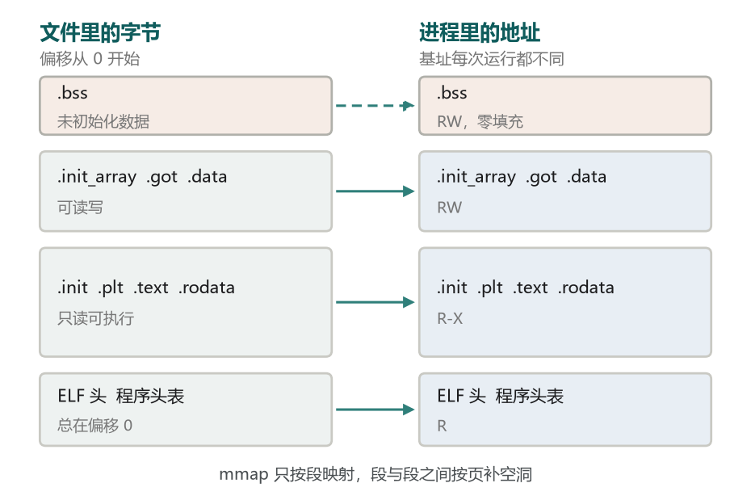
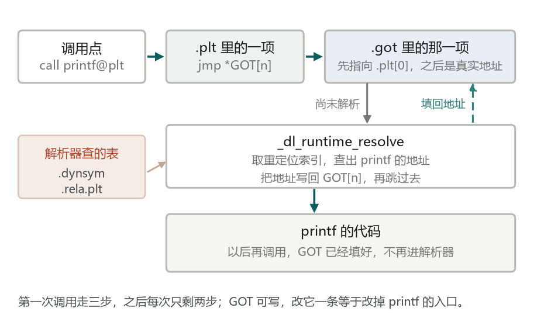

# 第二章　可执行文件与加载器

一个 hello world 的 C 程序编出来，`ls -l` 显示一万六千多字节。用 `readelf -l` 看，里面只有两个 LOAD 段。跑起来之后看 `/proc/self/maps`，映射却有六七条，其中几条的地址每次执行都不一样。

同一个文件，在磁盘上、在被加载的那一刻、在运行的时候，是三副不同的样子。磁盘上是一串带偏移的字节，加载时被拆成几块搬到地址空间里，运行时又多了页权限、多了重定位之后的地址。搞不清这三副样子之间的对应关系，读漏洞报告会很吃力，因为报告里的地址总是运行时的，而补丁总是打在文件上的。

这一章把这三副样子对齐来看。先看 ELF 怎么描述自己，再看动态链接留下的那几个可写的表，最后看加载器按什么顺序把这些东西摆到内存里，以及地址随机化是在哪一步插进来的。PE 放在最后对照着看，两边的结构其实能一一对上。

## 2.1 文件头、程序头与节头

ELF 文件的第一件事是自报家门。开头 4 个字节是 `7F 45 4C 46`，也就是 DEL 加 `ELF` 三个字母，任何工具拿到一个文件先看这四个字节。后面跟着 1 字节的类别（32 位还是 64 位）、1 字节的字节序、1 字节的版本号，然后是类型、机器架构、入口地址、两个表的位置和项数。

文件里有两张表，理解它们的区别是理解 ELF 的起点。

程序头表（program header table）描述的是段（segment）。每一项说明“从文件偏移 X 开始，取 N 个字节，放到虚拟地址 Y，长度 M，权限是这些”。加载器只看这张表，它要的是能直接映射的块，段的数量很少，通常个位数。

节头表（section header table）描述的是节（section）。每一项说明“这一段字节叫什么名字、属于什么类型、在哪个段里、对齐多少”。链接器、反汇编器、调试器看这张表，它要的是语义单元，节的数量可以到几十个。

两张表描述的是同一堆字节，切法不同。段是按权限切的，节是按用途切的。运行的时候节头表完全不参与，`strip` 删掉的就是节头表和符号表，删完之后程序照样能跑，只是没法调试，也没法用 `objdump -d` 那样按符号名反汇编了。

段类型里常用的几个。`PT_LOAD` 是要映射进内存的，通常两个，一个只读可执行装代码和常量，一个可读写装变量。`PT_INTERP` 存着一个字符串，内容是动态链接器的路径，通常是 `/lib64/ld-linux-x86-64.so.2`。`PT_DYNAMIC` 指向动态段，重定位表、符号表、依赖库列表都在那里。`PT_GNU_STACK` 用一个标志位声明栈要不要可执行。`PT_GNU_RELRO` 声明哪一段在重定位完成后要改成只读。

每个 `PT_LOAD` 段有两个长度字段，`p_filesz` 和 `p_memsz`。前者是从文件里搬多少字节，后者是在内存里占多少。后者大于前者的部分，内核负责填零。这个差值就是 `.bss` 存在的物质基础，它不占文件空间，只是把 `p_memsz` 撑大了一点。

<figure>

<figcaption>图 2-1　文件里的字节与进程里的页。左边从上到下是文件偏移增大的方向，右边是虚拟地址增大的方向。段按页对齐映射，段与段之间因此留下空洞；`.bss` 在文件里没有内容，映射后由内核清零。</figcaption>
</figure>

图里的左右两列高度不一样，这是个容易忽略的细节。文件里的段是紧挨着的，映射到内存时每段都要按页边界起止，中间的空洞白白占着地址空间但不占物理内存。段末那不到一页的零头也占一整个页。

## 2.2 几个关键节

`.text` 是代码，权限是可读可执行。`.rodata` 是常量，字符串字面量、跳转表、只读的全局数组都在这里，权限只读。这两个节通常挤在同一个只读段里，因此同一段内的任何位置只要被设成可写，整段代码都可写，这是页粒度、不是节粒度造成的。

`.data` 放初始化过的全局变量和静态变量。`.bss` 放没初始化或者初始化为零的，文件中不占空间。

`.init_array` 和 `.fini_array` 是两个函数指针数组。动态链接器在把控制权交给 `main` 之前会遍历 `.init_array` 依次调用，程序退出时遍历 `.fini_array`。C++ 的全局对象构造、`__attribute__((constructor))` 标记的函数，都注册在这里。这两个节的存在意味着“程序启动”和“程序退出”这两个时刻各有一串函数指针会被无条件调用，而它们在可写段里。

`.plt`、`.got`、`.got.plt` 三个节是下一节的主角。`.plt` 是桩代码，`.got` 是地址表。早期工具链把它们分成两张表，`.got` 存数据符号的地址，`.got.plt` 存函数地址并且可写；新一些的工具链在开启完全 RELRO 之后会把它们合并进只读段。

`.dynamic` 是动态链接器的工作清单，里面是一串 `(tag, value)` 对，写着需要哪些库、符号表和字符串表在哪、重定位表在哪、初始化函数数组在哪。`.dynsym` 和 `.dynstr` 是给动态链接用的符号表和字符串表，只保留导出的符号，比 `strip` 之前的 `.symtab` 小得多。

这些名字会反复出现在后面的章节里，值得记住的一点是它们的权限。只读的那几个弄不动，可写的那几个就是现成的目标。一个 8 字节的可写函数指针，只要攻击者能写进去，就等价于一次控制流劫持。

## 2.3 PLT、GOT 与延迟绑定

程序调用 `printf` 的时候，编译器并不知道 `printf` 最终会在哪个地址。libc 是共享库，加载到哪个基址由加载器决定，编译期无法确定。解决办法是在中间放一层间接。

编译出来的 `call` 指令指向 `.plt` 里的一个小桩，桩里只有一条 `jmp *GOT[n]`，跳到一个存地址的槽位。`GOT[n]` 里放的就是 `printf` 的真实地址。

第一次调用的时候这个槽位还没有填。链接器在构造可执行文件时，把 `GOT[n]` 初始化成指向 `.plt` 的第 0 项，也就是所谓的 PLT0。PLT0 里是两条指令，把重定位索引压栈，然后跳到 `_dl_runtime_resolve`。动态链接器拿到索引，去 `.rela.plt` 找对应的重定位项，去 `.dynsym` 找符号，在已经加载的库里搜这个名字，找到地址，写回 `GOT[n]`，最后跳过去。

<figure>

<figcaption>图 2-2　第一次调用外部函数与之后的调用。灰色的向下箭头是未解析时走的路，虚线的向上箭头是解析器把地址填回 GOT 的动作。填好之后，PLT 里的那条 `jmp` 直接落到函数本体。</figcaption>
</figure>

这套机制叫延迟绑定（lazy binding）。动机是启动时间，一个链接了 libc 和几个图形库的程序，导入了上千个符号，启动时全部解析一遍要花掉几十毫秒，而其中大部分函数整个生命周期都不会被调用。改成用到再解析，启动就快了。

代价是每次调用多一次间接跳转，而且第一次调用要进解析器，慢得多。对性能敏感的程序可以关掉它，链接时加 `-z now`，或者在环境变量里设 `LD_BIND_NOW=1`，加载器会在启动时把所有槽位一次填完。

延迟绑定留了一个副作用，装载了 `printf` 地址的那张表必须是可写的，否则解析器写不进去。

这就是 RELRO（relocation read-only）要解决的问题。部分 RELRO 在重定位完成后把 `.init_array`、`.fini_array`、`.dynamic` 和 `.got` 改成只读，但保留 `.got.plt` 可写，因为还要延迟绑定。完全 RELRO 同时打开 `-z now`，所有符号启动时就解析完，整张 GOT 一起改成只读。
安全上的差别是决定性的。部分 RELRO 下，一个任意写原语可以直接改写 `printf` 的 GOT 槽位，下一次调用 `printf` 就跳到别处去了。完全 RELRO 下这条路被堵死，得另找地方。

这也是后面几章反复出现的模式。防守方每关掉一个可写目标，攻击方就要往更深处找，找那些“程序自己也会写”的结构。glibc 的 `__free_hook` 和 `__malloc_hook` 曾经是最热门的两个，2.34 版本把它们删掉了。`exit_funcs` 里那串退出处理函数还在，但指针被 `PTR_MANGLE` 加了一层异或，光有写原语不够，还得有读原语把密钥读出来。

符号解析的顺序本身也是个可用的口子。链接器按依赖顺序搜索，谁先提供同名符号就用谁的。`LD_PRELOAD` 环境变量能让一个库排到最前面，于是它的 `malloc`、`open`、`time` 会顶替掉 libc 里的同名函数。调试、性能计数、还有恶意劫持都靠这个机制。setuid 程序启动时会主动清掉这个变量，否则任何人拿一个自己写的 `open` 就能让 root 程序帮忙读任意文件。

## 2.4 加载发生在什么时候

`execve` 系统调用拿到一个 ELF 文件，内核先读文件头，检查魔数和架构，然后读程序头表，找到 `PT_INTERP`。如果找到了，内核会把动态链接器也映射进来，把入口设成链接器的入口，而不是程序自己的 `e_entry`。与此同时，内核把命令行参数和环境变量按字符串形式摆到新栈的顶部，栈顶之上就是这块区域，`argv` 和 `envp` 两个数组只是指针，指向同一块地方。`/proc/self/environ` 能读到它们，原因也是它们一直在栈上。

控制权因此先落在 `ld.so` 手里，不是 `_start`。链接器做的事按顺序是，读程序自己的 `PT_DYNAMIC`，把依赖的共享库逐个映射进来，处理所有重定位，把 `PT_GNU_RELRO` 标记的区域改成只读，遍历 `.init_array` 调用初始化函数，最后跳到程序原来的入口。从那里经过 `_start`、`__libc_start_main`，才轮到 `main`。

映射每个 `PT_LOAD` 段用的是 `mmap`。这里有个约束，`p_vaddr` 和 `p_offset` 对页大小取模的结果必须相同，否则映射没法按页对齐。这解释了为什么段在文件里总是按页对齐的。

地址随机化插在哪一步，是个常被搞混的问题。

内核在 `execve` 里决定几件事。栈的起始地址随机，mmap 区的基址随机，如果可执行文件是 PIE，它的装载基址也随机。非 PIE 的可执行文件用链接时写死的地址，x86-64 Linux 上通常是 `0x400000` 附近，不做随机。

关键在“在 `execve` 里”这四个字。`fork` 出来的子进程继承父进程的地址空间布局，基址完全一样。只有执行了 `execve`，才会重新掷一次骰子。这个细节在写利用的时候很要命，一个 `fork` 多次的服务进程，只要父进程的布局被泄漏过一次，所有子进程都能用同一个地址。

随机化的粒度也值得记住，以页为单位。一页 4 KB，意味着任何一个地址的最低 12 位在随机化前后都不变。所以常见的做法是只覆盖低两个字节，把目标改到同一个页或者邻近页里的另一个位置。这种部分覆盖（partial overwrite）不需要知道基址，只需要知道相对偏移。

## 2.5 PE 里的对应结构

Windows 的可执行格式是 PE，结构和 ELF 对得上，术语不一样。

文件开头是一小段 DOS 头，只为了兼容，里面有一个字段 `e_lfanew` 指向真正的 PE 头。PE 头后面是可选头，装着入口点的 RVA、镜像基址 `ImageBase`、节对齐 `SectionAlignment`、文件对齐 `FileAlignment`，以及一张 16 项的数据目录表。

数据目录表就是 ELF 里 `PT_DYNAMIC` 的对应物，每一项是一个 RVA 加长度，分别指向导出表、导入表、资源、重定位表、TLS、调试信息等等。节表在可选头之后，每项 40 字节，写着名字、虚拟大小、虚拟地址、原始大小、原始偏移和一组特性位。特性位里 `IMAGE_SCN_MEM_EXECUTE`、`MEM_READ`、`MEM_WRITE` 三个和 ELF 的段权限一一对应。

导入表是 PE 里最有意思的部分。它列出这个模块依赖的每个 DLL，每个 DLL 下面挂一串函数名。加载器为每个 DLL 建一张导入地址表（import address table，IAT），把解析出来的函数地址填进去。编译器生成的 `call` 指令直接间接调用 IAT 里的槽位，中间没有 PLT 那样的桩。

所以 IAT 和 GOT 是同一个东西的两种写法。IAT 可写就意味着同样的任意写机会，Windows 上的漏洞利用里“覆盖 IAT”是个经典手法，和覆盖 GOT 完全平行。

重定位表处理的是另一种问题。DLL 有自己的首选基址，如果这个地址被别的模块占了，加载器得把它搬到别处，搬完之后所有写死的绝对地址都要调整。重定位表就是这些位置的清单，每项写着“在偏移 X 处有一个 64 位绝对地址，加上实际基址与首选基址的差值”。`IMAGE_REL_BASED_DIR64` 这个类型占了绝大多数。

PE 的加载器在 `ntdll` 里，进程环境块（PEB）里维护着已加载模块的双向链表，每个模块记录基址、入口、名字。这条链表是 shellcode 定位 `kernel32` 的经典路径，因为不依赖任何导入表，只需要几个固定的偏移。

## 2.6 这些结构给出的位置

把上面几节的信息整理一下，文件格式给出的攻击位置可以归成三类。

第一类是可写的函数指针表。GOT、IAT、`.init_array`、`.fini_array` 都属于这一类，它们的共同点是“程序自己会去读，并且读完就跳”。只要写进去，不需要触发什么特殊的路径，程序正常跑就会用上。这类目标的价值在于稳定，代价是防守方也最清楚它们在哪，RELRO、CFG 这类机制都是冲着它们来的。

第二类是格式本身的元数据。程序头表、节头表、重定位表、`.dynamic`，这些结构在正常运行时只读一次，读的时候信任程度很高。一个能改写磁盘上文件的攻击者可以改程序头，让加载器把某个段映射成可写可执行，或者改入口点。这类攻击需要文件写权限，门槛比内存写高，但完全绕过运行时的所有防护。

第三类是地址的可预测性。PIE 关掉的时候代码段地址是固定的，ROP 用的 gadget 地址可以直接写死。PIE 打开之后需要一次泄漏，泄漏的来源通常是格式化字符串、越界读、或者未初始化的栈变量。随机化只影响基址，不影响页内偏移，所以只要泄漏一个指针，整个模块的布局就都知道了。

三类位置对应三种前置条件：一个写原语、一个文件写权限、一个读原语。后面的章节会把这三种前置条件逐个拆开，看它们各自怎么被拿到。

下一章往栈上看，那里有一个每次函数调用都会重建的结构，它同时存着局部变量和返回地址。
