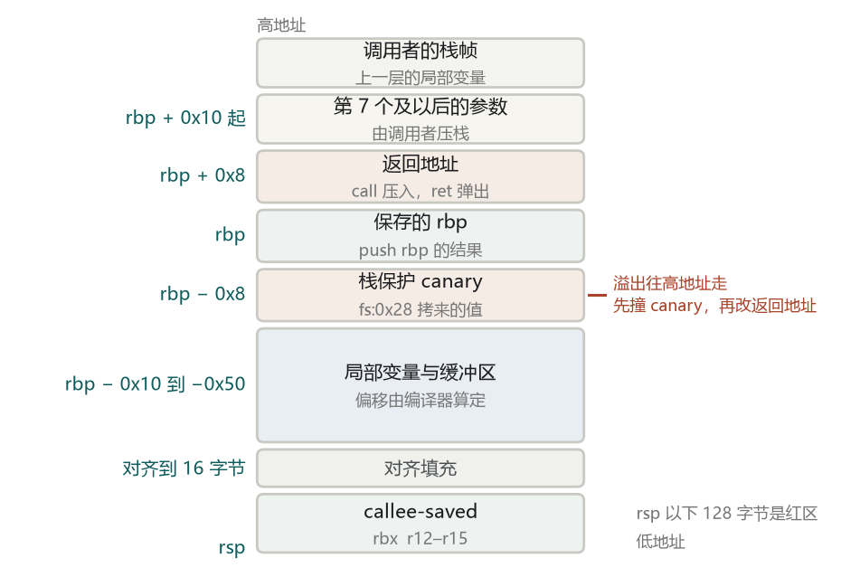
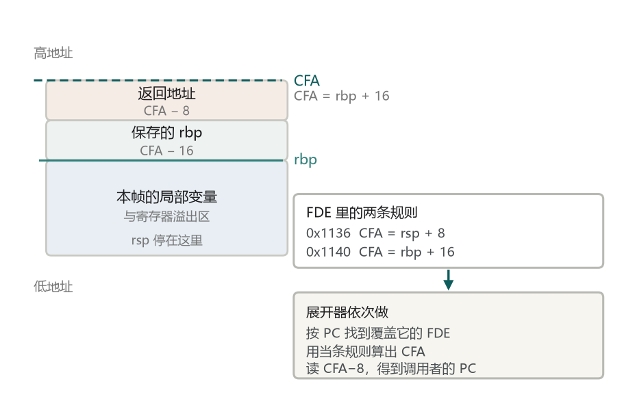

# 第三章　调用约定与栈的物理结构

有一段 exploit 在本地跑得好好的，换一台机器就崩，崩的位置还不在 payload 里，而在 `printf` 内部的一条 `movaps` 上。地址全对，偏移全对，程序就是不肯走。

这类问题的根源很少在漏洞本身，而在“栈上到底长什么样”这件事没算准。函数调用不是一件抽象的事，它在内存里留下一个具体的、按字节排布的结构，每个字段的位置由调用约定和编译器共同决定，任何一处偏差都会让精心构造的 payload 落到错误的地方。

这一章把这个结构拆到字节。先看参数怎么传、返回值怎么回，再看一帧里有哪些东西、各占几个字节，然后看没有帧指针的时候调试器和异常处理靠什么把事情还原出来。最后处理两个具体的坑，一个是优化打开之后布局的变化，一个是对齐。

## 3.1 参数放在哪里

在 x86-64 上跑 Linux，用的调用约定叫 System V AMD64 ABI。它的核心是一张寄存器分配表。

整型和指针参数按顺序放进 `rdi`、`rsi`、`rdx`、`rcx`、`r8`、`r9` 六个寄存器。浮点和向量参数走另一条线，放进 `xmm0` 到 `xmm7`。两条线各算各的，所以一个函数完全可以是“第一个浮点参数在 `xmm0`，第一个整型参数在 `rdi`”。

返回值放在 `rax`，浮点返回值放在 `xmm0`，128 位的整数返回值用 `rax` 和 `rdx` 拼。如果一个结构体大于 16 字节并且按值返回，编译器会改成传一个隐藏指针，由调用者提供空间，被调用者往里写，这个指针占掉第一个整型参数的位置，后面所有参数名次往后挪一位。读反汇编的时候看到函数开头往 `[rdi]` 里写东西，就要想到这可能是返回值而不是普通参数。

超过六个的整型参数从右往左压栈，第七个参数在栈上最靠近返回地址的位置。栈上的参数区也要遵守对齐规则，编译器会插入填充。

调用可变参数函数的时候还有一条额外约定，`al` 寄存器里要放这次调用实际用到的向量寄存器个数。`printf` 靠这个数字决定要不要去保存 `xmm` 寄存器。忘了设 `al`，或者设错了，`printf` 会读到一堆垃圾。

寄存器的存活规则是另一张表。`rax`、`rcx`、`rdx`、`rsi`、`rdi`、`r8` 到 `r11` 是调用者保存（caller-saved），被调用者可以随便改，调用者想保住就得自己先存。`rbx`、`rbp`、`r12` 到 `r15` 是被调用者保存（callee-saved），被调用者用了就必须在返回前恢复原值。这条规则解释了为什么函数序言里经常出现一串 `push`，那不是为了局部变量，是为了把这几个寄存器腾出来用。

栈本身有一条硬性对齐要求。`call` 指令执行的那一刻，`rsp` 必须是 16 的倍数。`call` 把 8 字节返回地址压进去，所以进入函数体时 `rsp % 16` 等于 8。序言里 `push rbp` 之后回到 0，`sub rsp, N` 里的 N 就必须是 16 的倍数。如果有奇数个 `push`，编译器会额外减 8 补上。

最后是红区（red zone）。`rsp` 往下 128 字节的区域，叶函数可以放心使用而不调整 `rsp`，因为信号处理程序不会踩它。这个约定省掉了叶函数调整栈指针的开销，也让栈上的布局在靠近 `rsp` 的地方多出一块没有标记的空间。

Windows 的 x64 约定不一样，前四个参数放 `rcx`、`rdx`、`r8`、`r9`，调用者还要在栈上留 32 字节的影子空间（shadow space）给被调用者随便用。两套约定不能混，跨平台读汇编的时候先确认平台。

结构体的传递还有一层分类。尺寸不超过 16 字节的结构体会被拆成八字节一块，按字段类型归到 INTEGER 或 SSE 两类，分别用整型寄存器和向量寄存器传。一个 `{int, double}` 的结构体占两个寄存器，第一块走 `rdi`，第二块走 `xmm0`。看见函数开头用 `movq` 把 `xmm` 里的值搬到内存，很可能就是在拆一个这样的参数。

## 3.2 一帧的逐字节账本

一个函数被调用时，栈上会依次出现这些内容。

<figure>

<figcaption>图 3-1　一个带 64 字节缓冲区、三个保存寄存器的函数的栈帧。上高下低，所有偏移以 `rbp` 为基准。缓冲区到 canary 之间隔着 8 字节，到返回地址之间隔着 16 字节，这两个数字必须按具体二进制验算。</figcaption>
</figure>

调用者的帧在上面，它自己的局部变量和它保存的寄存器都在那儿。它的栈上还压着给被调用者的第七个及以后的参数。

然后是返回地址。`call` 指令把下一条指令的地址压进去，这就是函数返回之后要去的地方。

接着是保存的 `rbp`。序言里那条 `push rbp` 把调用者的帧指针存进来，随后 `mov rbp, rsp` 让 `rbp` 指向这个位置。从这之后，函数里所有对局部变量的访问都用 `rbp` 减一个常量，这个常量在编译期就定死了。

再往下是栈保护金丝雀。开了 `-fstack-protector` 之后，编译器在局部变量和返回地址之间插一个 8 字节的值，从 `fs:0x28` 拷过来，函数返回前再比一次。值变了说明有人写了不该写的地方，程序走 `__stack_chk_fail` 直接终止。这个值的最低一个字节固定是 0，因为字符串函数遇到 0 就停，用它把这块区域当字符串读出去，最多只能得到前面几个字节，不会整块露出来。

缓冲区在更下面。它的起始位置离 `rbp` 有多远，取决于它多大、还有哪些局部变量、编译器的排列顺序。

底部是保存的 callee-saved 寄存器和对齐填充。

一个具体的例子。函数里有 `char buf[64]` 和三个 `long` 类型的局部变量，开了栈保护，用到了 `rbx`。

```text
sub  rsp, 0x60         ; 96 字节：64 缓冲 + 24 变量 + 8 canary
mov  rax, fs:0x28
mov  [rbp-0x8], rax    ; canary 在 rbp-8
```

缓冲区从 `rbp-0x50` 开始，到 `rbp-0x10` 结束。canary 在 `rbp-0x8`，距离缓冲区末端正好 8 字节。再往上是保存的 `rbp`，再往上是返回地址。

从缓冲区起点写到返回地址，需要写 0x50 减 0x10 加 0x10 再加 0x8，也就是 88 字节，再写 8 字节覆盖返回地址。这个算术看起来简单，出错的方式却很多。缓冲区起点可能不是 `rbp-0x50`，中间可能插了别的变量，`sub rsp` 的量不决定起始位置，只决定栈指针停在哪。

唯一的验证办法是打开调试器。在溢出发生前停下，`p/x $rbp` 拿到帧指针，`p &buf` 拿到缓冲区地址，两个一减就是真实偏移。再 `x/8gx $rbp-0x10` 看 canary 在不在那个位置。这一步不做，后面所有偏移都是猜的。

## 3.3 谁在算这笔账

函数一层层调下去，栈上就叠了一串帧。想要从当前这一帧走回上一帧，需要知道三件事，上一帧的 `rbp` 在哪、返回地址在哪、栈指针该恢复到哪个值。

有帧指针的时候这件事很轻松。当前 `rbp` 指向保存的 `rbp`，读出来就是上一帧的 `rbp`，返回地址在 `[rbp+8]`。顺着这条链一直往上走，就能打印出完整的调用栈。`gdb` 的 `bt` 在没有调试信息的时候也能工作，靠的就是这条链。

帧指针一省略，链就断了。编译器为了多省一个寄存器，从十几年前开始就在 `-O1` 以上默认不生成帧指针（`-fomit-frame-pointer`）。这时候要还原栈，得靠另一套数据。

这套数据叫调用帧信息（call frame information，CFI），放在 `.eh_frame` 节里。`.debug_frame` 是同一套格式的另一份拷贝，只给调试器用，`.eh_frame` 是运行时用的，异常处理、`backtrace`、性能分析器读的都是它。

CFI 的核心概念是规范帧地址（canonical frame address，CFA）。它的定义是“调用指令执行前的栈指针值”，几乎就是返回地址所在的地址加 8。每一帧的 CFA 都可以用寄存器加偏移算出来，而在函数的不同位置，算法可能不同。

`.eh_frame` 被切成一个个 FDE（frame description entry），每个 FDE 覆盖一段指令地址范围，里面按地址递增列出一串规则。开始位置之前是序言，此时 CFA 还是 `rsp+8`（`rsp` 指向返回地址）。序言执行完之后，CFA 变成 `rbp+16`，同时记下 `rbp` 保存在 `CFA-16`，返回地址在 `CFA-8`。

<figure>

<figcaption>图 3-2　CFI 描述与展开动作。左边虚线是 CFA 的位置，实线是 `rbp`。FDE 里的规则给出“CFA 等于哪个寄存器加多少”，展开器据此算出 CFA，再从 `CFA−8` 读出返回地址、从 `CFA−16` 恢复 `rbp`，进入上一层。</figcaption>
</figure>

用 `readelf --debug-dump=frames` 看，输出是一张表，行首是指令地址，后面几列是 `CFA` 和各寄存器的规则。规则的形式有几种，`rsp+8` 这种叫偏移规则，寄存器在栈上的某个位置；`c-16` 是 `CFA-16` 的简写；`u` 表示这个寄存器在这一帧里没有保存，值不可知；`r6` 这种表示“在另一个寄存器里”。

C++ 的异常展开走的是两个阶段。第一阶段从抛出点往上找，看哪一帧的 personality routine 说“我能处理这个异常”，这期间不改变任何状态。找到之后进入第二阶段，重新走一遍，这次真正执行清理代码、析构局部对象、恢复寄存器，最后跳到 `catch` 块。整个过程全靠 CFI 描述，一帧都不能算错。

编译器在生成 `.eh_frame` 的同时，也会在汇编输出里留下 `.cfi_startproc`、`.cfi_def_cfa_offset` 这类伪指令，它们不产生机器码，只是告诉汇编器该怎么写这段元数据。反汇编里看到序言之后紧跟着的 `sub rsp`，在源码层面往往对应一条 `.cfi_def_cfa_offset`。

这套元数据是只读的，正常情况下改不动。但它的存在意味着“程序的栈布局”这件事在二进制里有一份完整的书面记录，读得懂它，就不用靠猜。

## 3.4 优化之后

同一份源码，`-O0` 和 `-O2` 编出来的栈帧可以完全不同。

最直观的变化是帧指针。省略之后，`rbp` 变成一个普通寄存器，可能被拿去存循环变量。此时所有以 `rbp` 为基准的偏移都失效了，只能改用 `rsp` 相对，而 `rsp` 在函数执行过程中是会变的，所以偏移也跟着变。

变量本身也在动。一个 `int len` 在 `-O0` 时规规矩矩躺在 `rbp-0x14`，在 `-O2` 时可能整个生命周期都在 `eax` 里，栈上根本没有这个位置。反过来，一个只写不读的缓冲区可能被整个优化掉，攻击者精心构造的溢出点在新版本里消失了。

函数边界也会消失。内联把被调用者的代码摊进调用者，`call` 和 `ret` 都没有了，栈上也不再有对应的帧。这就是为什么复现漏洞时要确认优化级别，同一段代码在 `-O0` 上有栈溢出，在 `-O2` 上可能是完全不同的另一处越界。

尾调用是另一种形态。`return f(x);` 这种写法，编译器可以直接 `jmp f`，把自己这一帧交出去。返回地址不再指向“调用者的下一条指令”，而是变成了“调用者的调用者的下一条指令”。`backtrace` 里少一帧，栈回溯看起来像是少调了一层。GCC 和 Clang 都会在 `-O2` 上做尾调用优化（sibling call optimization），这属于标准允许的范围。

可变长度数组和 `alloca` 让帧大小在运行时才确定，`rsp` 会在函数中途继续往下走，CFA 规则因此要写成表达式而不是常数偏移。

这些变化合起来说明一件事。所谓“偏移是 88 字节”这种话，只有绑定到具体的二进制、具体的编译器版本、具体的优化级别才有意义。源码里写着 `buf` 和 `ret` 之间隔着 88 字节，换个编译器就是 104，再换个版本可能缓冲区都不存在了。

## 3.5 对齐错误的代价

回到开头那个 `movaps` 崩溃。

`movaps` 是 SSE 指令，要求操作数地址 16 字节对齐，不对齐就触发通用保护异常。glibc 里不少字符串和内存函数的实现用 SSE 或 AVX 搬数据，`printf` 内部格式化字符串时也会用到。这些实现之所以敢用对齐指令，是因为它们相信 ABI，相信调用者在 `call` 之前已经把 `rsp` 对齐到 16。

ROP 链不走 `call`。链上的每一步都是 `ret`，每次 `ret` 弹出 8 字节，`rsp` 的奇偶性因此完全取决于链的长度。链走到 `printf` 之前，如果 `rsp % 16` 是 8，进入 `printf` 之后所有基于 `rsp` 的对齐假设就整体偏了 8 字节，某条 `movaps` 撞上未对齐地址，程序收到 SIGSEGV。

这个症状很容易误判。崩溃地址在 libc 里，跟 payload 完全无关，第一反应往往是“地址算错了”或者“栈被写坏了”。实际上地址一分不差，问题只是链的长度差了一个 `ret`。

修法是在链里插一个只含 `ret` 的 gadget，把 `rsp` 再挪 8 字节。判断依据很简单，数一下从链的起点到 `call` 或 `jmp` 到目标函数之前，一共弹了几次。奇数次和偶数次对应两种对齐状态，试一次就知道。

同样的坑在 `system` 上也会出现。`system` 内部会调用 `posix_spawn` 或者 `fork`，路径上有 SSE 操作，对齐错了同样崩。这就是为什么标准做法里的 ROP 链总是在 `system` 之前多放一个 `ret`。

对齐还牵连两件事。向量化的代码在栈上分配的数组会按 16 或 32 字节对齐，于是缓冲区起点可能不在 `rbp` 减去缓冲区大小的地方，而是往上对齐到一个整倍数，中间多出一段没人用的空洞。还有，`sub rsp` 里那个数如果是 16 的倍数，帧内所有 8 字节变量的相对位置是对的，但一旦编译器插入了奇数个 `push`，整个布局就整体平移 8，肉眼对着源码数出来的偏移全部作废。

## 3.6 偏移是需要算出来的

把这一章的方法收成三步。

读反汇编，看序言到底做了什么。`push` 了几个寄存器，`sub rsp` 多少，`mov rbp, rsp` 有没有出现，canary 从 `fs:0x28` 拷到了哪个偏移。这四件事决定了整帧的骨架。

找缓冲区的实际位置。编译器不保证缓冲区按源码顺序排，也不保证它紧贴着 canary。开了 AddressSanitizer 之后每个变量周围还会加红区，布局完全变了。

用调试器验算。断点打在溢出发生前，读 `rbp`、读缓冲区地址、读 canary 的值，三个数对不上就说明前面的推断有错。这一步花不了两分钟，能省掉几个小时的“为什么偏移不对”。

## 3.7 可变参数与寄存器保存区

固定参数靠寄存器传，这件事在有六个以上参数时有一个明确的规则，但可变参数函数是个特例。编译器不知道调用者实际传了几个参数，也不知道每个参数是什么类型，所以它没法按常规方式取。

解决办法是定一块固定大小的溢出区，把所有可能装参数的寄存器在函数入口处全部存一遍。这块区域叫寄存器保存区（register save area），固定 176 字节，算法是六个整型寄存器各 8 字节，加上八个 `xmm` 寄存器各 16 字节。

```c
typedef struct {
  unsigned int gp_offset;      /* 下一个整型参数在保存区里的字节偏移 */
  unsigned int fp_offset;      /* 下一个浮点参数的偏移 */
  void        *overflow_arg_area; /* 寄存器用完之后，栈上的参数从哪开始 */
  void        *reg_save_area;     /* 176 字节那块区域的起点 */
} va_list[1];
```

`gp_offset` 的初值不是 0，是“有名整型参数个数乘 8”。一个 `void f(int a, ...)` 里它从 8 开始，因为 `rdi` 已经被 `a` 占了。`fp_offset` 同理，初值是 48 加上有名浮点参数个数乘 16，48 就是那六个整型寄存器的总宽度。

`va_arg` 展开出来只有几句。偏移没超过 48 就从保存区里取，取完把偏移加 8；超过 48 就说明寄存器用完了，改从 `overflow_arg_area` 里取，那是一片位于调用者栈上的区域。

这也解释了 `al` 那个寄存器的真正作用。调用者在 `call` 之前把“这次用了几个向量寄存器”写进 `al`，被调用者的序言根据这个数决定要存几个 `xmm`。存多了浪费，存少了 `va_arg` 取到的是垃圾。一个手写的汇编函数忘了设 `al`，调用它的代码又恰好传了浮点参数，现象就是浮点值变成莫名其妙的数，而参数本身完全正确。

格式化字符串利用就在这堆结构上工作。`printf` 的第一个参数在 `rdi`，后面五个可变参数在 `rsi` 到 `r9`，`%1$p` 到 `%5$p` 读这五个，`%6$p` 开始读 `overflow_arg_area`，也就是调用者传参用的那块栈区。如果调用者在此之前把局部变量或临时值压在了那里，读出来的就是那些值。调试时一串 `%p` 打印出十几项，中间几项经常是金丝雀和保存的返回地址，原因就在这里。

有一条边界很容易踩。大于 16 字节的结构体按值传递时不走寄存器，全部放栈上；`long double` 占 16 字节，也总是走栈。这两种参数会把 `overflow_arg_area` 的位置往后推，于是之前算好的 `%n$p` 序号整体偏移。同一个利用在一台机器上能读到金丝雀，换一个编译器版本就读到别的，通常就是这个原因。

## 3.8 栈有多大，谁在看着它

前面一直把栈当成一块可以随便往下长的空间，实际上它有上限，而且在边界上有一道陷阱。

主线程的栈大小由 `RLIMIT_STACK` 决定，`ulimit -s` 看得到，默认 8192 KB。这只是个上限，不是一开始就分配的。刚启动时只有很小的一段被映射，`rsp` 往下走，碰到未映射的页就触发缺页异常。内核在异常处理里判断这个地址是不是“合理地”低于当前 `rsp`，是的话就把那段页补上，不是的话就发 SIGSEGV。栈因此是按需长出来的。

“合理地”这三个字有具体定义。内核在栈和它下方最近的映射之间强制留一段空隙，叫 `stack_guard_gap`，默认 256 页，也就是 1 MB。任何试图把栈长进这段空隙的访问都会被拒绝，栈扩张就在这里停住。

```bash
cat /proc/sys/vm/stack_guard_gap   # 单位是页，默认 256
ulimit -s                         # 单位是 KB，默认 8192
```

这段空隙不只是一道墙，它还是一条攻击路径的入口。2017 年 Qualys 公开的 Stack Clash 就是拿它做文章，思路是不让程序一页一页地碰栈，而是一次把 `rsp` 挪过保护页，挪到下面某块映射里去。挪的办法很具体，一个循环里的 `alloca`，或者一个在运行时才确定长度的变长数组，都能让 `rsp` 在一次减法里跳过几 MB。`rsp` 落到堆或共享库的映射区之后，函数序言里的 `push` 和局部变量的写就变成了对那块内存的越界写。

当时的缓解有两层。内核把空隙从一页拉到 1 MB，迈大步也跳不过去；编译器加了 `-fstack-clash-protection`，在每个超过一页的栈分配之前插入探测，每 4 KB 碰一下，逼着内核把中间那些页一页页补上。GCC 8 开始提供这个选项，发行版陆续默认打开。

线程栈是另一套。`pthread_create` 创建的栈由 `mmap` 得到，默认也是 8 MB，但它的两端都有明确边界，低地址那一端用 `mprotect` 设成一页不可访问当保护页。所以线程栈不会增长，一开始就占满整个大小，超出就是段错误。写多线程程序时把大数组放在线程栈上，很容易在 `pthread_create` 之后几步就崩，而崩溃地址看起来和一个合法的 `memcpy` 无关。

这些数字对写利用的人有直接含义。栈溢出能写多远，不只取决于缓冲区多大，还取决于距离最近的映射边界有多远。一个能往栈上写几 MB 的原语，在 8 MB 的主线程栈上可能一路写到底而不碰任何保护页，在线程栈上写一半就撞到别的映射，变成不可控的破坏。判断一个溢出是否可用，先看它跑在哪种栈上。

观察栈长到哪了只要一条命令。`cat /proc/self/maps` 里那一行 `[stack]` 的大小就是当前已映射的范围，远小于 8 MB 上限。在一个递归函数里反复打印这一行，能看到它随深度一跳一跳地变大，每次以 4 KB 为粒度。`pthread` 创建的栈在 maps 里没有 `[stack]` 标记，只是一段匿名的 `rw-p` 映射，要认它得看地址是不是落在那个线程的 `rsp` 附近。

栈是每帧自动分配的，函数一进来就有一块，函数一返回就没了，布局由编译器在编译期算定。堆不是这样，堆上的空间按需申请，由一个叫分配器的组件在运行时记账。那本账的结构比栈帧复杂得多，下一章去翻它。
