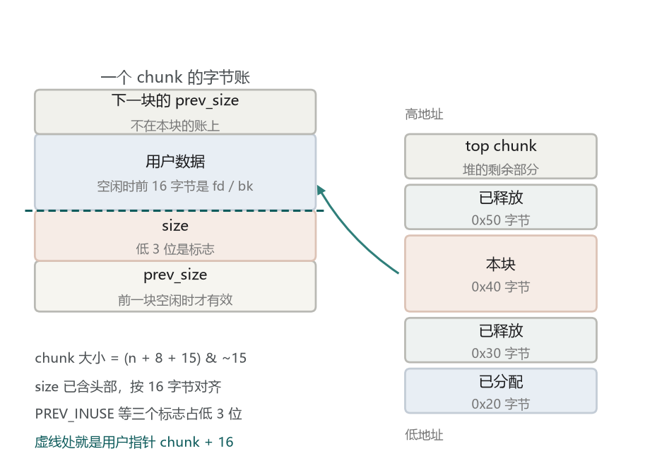
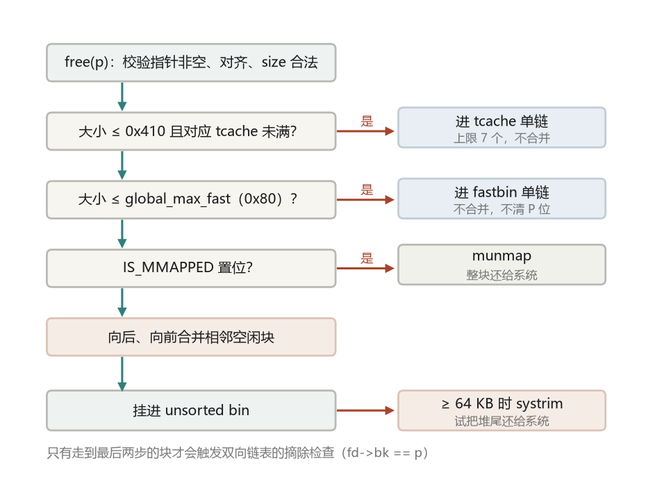

# 第四章　堆与分配器：malloc 的账本

一份漏洞报告里写着“堆上 0x20 字节的越界写，覆盖了相邻 chunk 的 size 字段”。看着不起眼，二十几个字节而已。可这二十几个字节落在的位置，正好是一本账的栏目上。

先做一个对比。同一个程序，`char buf[64]` 放栈上，多写一个字节就压到相邻变量；改成 `malloc(64)`，多写一个字节什么都不会发生，因为那 64 字节后面跟着的是这块内存自己的账目，而不是别人的数据。堆上的越界之所以有时“看不见后果”，是因为分配器在块的末尾留了一段它自己的记录，写到那里去的字节暂时没人读。

这段记录就是这一章要拆的东西。程序向 `malloc` 要内存，拿到的是一个指针，指针前面 16 个字节连着两个机器字。这两个字描述了这块内存多大、前一块是不是空闲。所有关于堆的利用，无论走哪条路，最后都要落到这两个字上，或者落到 `free` 时链表指针呆的位置上。

## 4.1 堆从哪里来

用户进程地址空间里那块叫堆的地方，并不是一整块。glibc 的分配器有两条来源，选哪条取决于请求多大、以及程序之前释放过什么。

第一条是 `brk`。进程有一个 program break 指针，指向数据段之后第一个未映射的地址，`brk` 系统调用能把它往前推或往后退。主线程用的 arena（叫 main arena）就靠这个指针往上长，长出来的连续区间就是堆。这块区间里所有块首尾相接，越界写一定会碰到邻居。

第二条是 `mmap`。请求超过一个阈值时，分配器不去动 break，而是直接 `mmap` 一段独立的内存，用完 `munmap` 还回去。这个阈值默认是 128 KB，但它不是常数。`free` 掉一个由 `mmap` 得来的块时，glibc 会把阈值提升到这块的大小，上限 32 MB。理由是程序既然申请过这么大的块，下次还可能申请，不如留着让它走 brk。所以“多大的请求走 mmap”这个问题，答案取决于程序的历史行为，同一段代码在不同的运行路径下可能给出不同的映射。

两条来源在攻击面上的差别很实际。mmap 出来的块彼此隔着未映射的页，越界写通常一头撞进空洞，直接 SIGSEGV；brk 区里块挤在一起，越界写能安静地改掉邻居的头部字段。所以同一个 bug，在主线程的小请求上是有用的原语，在 1 MB 的请求上多半只是崩溃。

多线程还有第三条路。主线程之外的线程第一次 `malloc` 时，会拿到一块 64 MB 的 `mmap` 区域当作自己的 heap，配一个独立的 arena。arena 的总数上限是 CPU 核数的 8 倍，32 位上是 2 倍。这条设计原本是为了减少锁竞争，副作用是把堆打散成好几块，让“相邻”这个概念变得依赖线程调度。

## 4.2 一个 chunk 的字段

分配器给每块内存配一个头部，叫 chunk。结构定义在 `malloc.c` 里，四个字段，每个字段一个机器字，64 位上就是 32 字节。

```c
struct malloc_chunk {
  INTERNAL_SIZE_T mchunk_prev_size;  /* 前一块空闲时，存它的大小 */
  INTERNAL_SIZE_T mchunk_size;       /* 本块大小，低三位是标志 */
  struct malloc_chunk *fd;           /* 空闲时用：前向链表指针 */
  struct malloc_chunk *bk;           /* 空闲时用：后向链表指针 */
};
```

前两个字是头部，后面两个字在块空闲时被链表借用。分配出去的块，`fd` 和 `bk` 所在的位置就是用户数据的起点。

`size` 里存的不是请求的字节数，是整块的大小，包含头部，并且按 16 字节对齐。既然低四位恒为 0，低三位就被拿去放标志。最低位是 `PREV_INUSE`，为 1 表示前一块正在使用中；第二位 `IS_MMAPPED` 表示这块是 `mmap` 来的，不归 arena 管；第三位 `NON_MAIN_ARENA` 表示它属于某个线程 arena。读 `size` 时必须先 `& ~7`，直接拿去做算术会错得很离谱。

请求大小到 chunk 大小的换算只有一行，`(req + 8 + 15) & ~15`。多出来的 8 字节是为了容纳 `prev_size` 字段。这块设计有点绕，值得讲清楚。

`prev_size` 只在“前一块空闲”时才有意义。前一块在用的时候，这 8 个字节谁也读不到，于是 glibc 把它借给前一块的用户数据用。32 字节的 chunk 扣掉 16 字节头部只剩 16 字节，加上借来的这 8 字节就有 24 字节可用，正好等于 `malloc(17)` 到 `malloc(24)` 都返回 32 字节 chunk 时用户的可用空间。`malloc_usable_size` 返回的是 `chunksize - 8` 而不是 `chunksize - 16`，原因就在这里。

这个借用关系带来一个常被忽略的事实，一个 32 字节的 chunk 实际能写 24 字节用户数据而不碰坏任何账目。写第 25 个字节起才开始改 `size`。很多报告里“越界 8 字节”之所以无害，也是因为它写进了下一个 chunk 的 `prev_size`，而那块 chunk 在用，这个字段本来是垃圾。

两个方向的换算各有一个宏，`chunk2mem` 加 16，`mem2chunk` 减 16。调试时这两个常数比任何文档都好用。把 `malloc` 的返回值减 16，`x/4gx` 出来的四个字依次是 `prev_size`、`size`、`fd`、`bk`，一眼就能看出这块是不是空闲、是不是 `mmap` 来的。反过来，从堆上随便一个地址往下找 16 字节对齐的位置，如果那里的 `size` 能通过“不小于 32、16 对齐、低三位合法”这三条，基本就是它所属 chunk 的头部。这个“从任意指针反推 chunk”的动作，是判断一份越界写到底打中了什么的最快办法。

<figure>

<figcaption>图 4-1　一个 chunk 的字段，以及它在堆段里的位置。头部两个机器字，用户指针从 `chunk + 16` 开始；`size` 的低三位是标志，`prev_size` 在前一块忙碌时借给前一块使用。</figcaption>
</figure>

最小 chunk 是 32 字节，`malloc(0)` 也会给这么一块。上界在另一个方向，`size` 字段本身是 `size_t`，理论上能表示到 2 的 64 次方，实际受 arena 大小限制。

## 4.3 bins 是几组链表头

空闲的块不是随便堆着的，按大小分类挂在几组链表上。这些链表头不在堆上，而在 arena 的描述结构 `malloc_state` 里，堆上被 free 的块通过 `fd`、`bk` 把自己串起来。分类表列出来是这样。

| 分类 | 组数 | 链式 | 覆盖的 chunk 大小 |
| --- | --- | --- | --- |
| tcache | 64 | 单链，LIFO | 0x20 到 0x410 |
| fastbin | 10 | 单链，LIFO | 到 0x80 默认 |
| unsorted | 1 | 双链 | 未归类的中转站 |
| smallbin | 62 | 双链，FIFO | 小于 0x400 |
| largebin | 63 | 双链，按大小排序 | 0x400 以上 |

tcache 是 2.26 才加进来的，位置和其他几个不一样。它不在 arena 里，在每线程的 TLS 里，`tcache` 结构跟着线程走。每个 bin 只存 7 个块，再多就退回原来的路径。这个数字很关键，它意味着 `free` 的第八个同尺寸块一定会落到 fastbin 或 unsorted 上去，攻击者能控制的东西因此分成两段。

tcache 的链表节点就是块里的 `fd`，只用一个指针，后进先出。从 2.29 起每个节点还多一个 `key` 字段，写的是所属 tcache 结构的地址，`free` 时如果发现 `key` 已经等于这个地址，就报 double free 并终止。这个检查只针对 tcache，而且它依赖的字段就写在块自己身上。谁能往一块已经释放的内存里写一次，把 `key` 改掉，第二次 `free` 就静悄悄地通过了。

fastbin 是十组单链，默认只接受到 128 字节的 chunk（`global_max_fast`）。它最大的特点是 `free` 时完全不合并，也不清相邻块的 `PREV_INUSE`。于是堆上会出现两个物理相邻、逻辑上都空闲的 fastbin 块，谁也不知道对方是空的。这种“延迟合并”换来了速度，也换来了一段元数据不一致的窗口。

unsorted bin 只有一个，双向链表，`free` 进来但还没归类的块先放这儿。它是三类分配的交叉口，`malloc` 找不到精确匹配时会来扫一遍。

smallbin 有 62 组，每组只装一种大小，块大小从 32 到 1008，间隔 16。同一组里是先进先出，最早 `free` 的最早被拿走。largebin 有 63 组，每组管一段大小范围，组内按大小从大到小排，所以能在组内做“最小的够用”的搜索。

## 4.4 一次 malloc 走过的路

`malloc` 的前半段很短。它先把请求换算成 chunk 大小 `nb`，然后去 TLS 里查 tcache，对应 bin 非空就直接摘下第一个节点返回。这一步不加锁，也不进 arena，绝大多数小请求在这里就结束了。

tcache 空的时候才进 `_int_malloc`，后面是一串有序的尝试，顺序本身值得记住，因为它决定了堆上剩下的碎片会被谁先拿走。

请求落在 fastbin 范围内时，先看对应的 fastbin。有块就从单链头摘下来直接返回，不需要改任何标志位，因为当初放进去的时候也没改过。取出来的块要对齐，块大小也要和这个 bin 对得上，这些检查在各个版本里加得不一样严。

然后是 smallbin。精确大小那一组非空，就取链尾那个块。这里有一次完整性检查，`victim->bk->fd` 必须指回 `victim` 本身，这是双链表被改坏时的第一道拦网。

前三步都不中，就轮到 unsorted bin。扫之前先做一次 `malloc_consolidate`，把 fastbin 里所有块合并成正常的空闲块丢进 unsorted。合并的动作会顺带修正 `PREV_INUSE` 和 `prev_size`，这一步如果元数据被改过，通常就在这儿崩。

扫 unsorted 的逻辑是逐个取出：大小正好等于 `nb` 的直接返回；比 `nb` 大的先放进对应的 smallbin 或 largebin，然后继续扫下一个。扫完一圈没找到精确匹配，才去 largebin 里挑一个够用的切一刀，剩下的部分留在原 bin 或变成新的 unsorted 块。这里还有一处特殊处理，从 unsorted 里拿到的块如果大于 `nb` 且不小于最小可切尺寸，切剩的部分会被记成 last remainder，交给下一个小请求，而这一段的 `PREV_INUSE` 与 `prev_size` 会被重写一遍。连续申请几个不同大小的块时，堆上地址的跳变常常就是这一段造成的。

最后是 top chunk。上面全落空时，从 top 上切 `nb` 下来，剩下的成为新 top。这解释了为什么连续 `malloc` 拿到的地址是单调递增的。top 不够大就调 `sysmalloc`，通过 `brk` 或者 `mmap` 扩一块新的，把旧 top 也并进去。

整条路径的末尾还藏着一个细节。判定的边界条件都是“小于等于”还是“小于”，差一个字节就换一条路径，而换了路径，块最后落在哪个 bin、是否被合并、`fd` 指针指向谁，全都不同。复现堆漏洞时版本对不上，最先表现出的就是这个差异。

## 4.5 一次 free 的合并账

`free` 比 `malloc` 复杂，因为它要维护“物理相邻”这个不变式。

第一件事是校验。指针非空、按 16 字节对齐、对应 chunk 的 `size` 不小于 32 且对齐、不超过这个 arena 的总量。任何一条不过就 `abort`，报 `free(): invalid pointer` 或 `invalid size`。这些检查在 2.26 之后陆续加严，很多十年前能用的手法现在第一步就被拦下。

校验过了先试 tcache。大小在 0x20 到 0x410 之间、对应 bin 未满 7 个，就压进链表，写完 `key` 就返回。这条路不合并、不改 `PREV_INUSE`、不碰 arena，也是最快的一条。攻击者要的“同样的指针第二次进 free 还能被接受”，通常就从这里钻。

tcache 满了才走后面的路。大小在 fastbin 范围内，先做一次 double free 检查（顶部块不能是同一个），然后压进单链，返回。这一路同样不合并。

有一类块既不进 bin 也不参与合并。`IS_MMAPPED` 置位的块由独立的 `mmap` 得来，`free` 时直接 `munmap` 整块还回去，不碰任何链表，也不和邻居打交道。所以从 `mmap` 来的块没有头部以外的账，改它的 `size` 只会让 `munmap` 的长度算错，效果通常是一次崩溃而不是一次可控写。

剩下的大块才真正走合并。先向后看，也就是高地址方向的下一块。下一块是 top 的话，直接把本块并进 top，并移动 top 指针；下一块空闲的话，调用 `unlink_chunk` 把它从链表上摘下来，大小相加。接着向前看，如果本块的 `PREV_INUSE` 为 0，说明前面一块是空的，用 `prev_size` 找到它，`unlink` 之后合并。最后把合并结果挂进 unsorted bin。

`unlink_chunk` 是这一章最值得盯的函数。它做的是从双链表上摘下一个节点，而“摘”这个动作要写四个指针。

```c
/* 节选，只留一致性检查与摘链两句 */
static void unlink_chunk (mstate av, mchunkptr p) {
  if (p->fd->bk != p || p->bk->fd != p)
    malloc_printerr ("corrupted double-linked list");
  p->fd->bk = p->bk;
  p->bk->fd = p->fd;
}
```

两个条件都必须成立。早年的实现只查一个方向，甚至不查，于是“把 `fd` 和 `bk` 覆盖成精心选的两个地址，一次 `unlink` 就得到一次任意写”成了 2005 年前后最流行的技术。加严之后，只改一个指针会被拦；能过检查的伪造必须让 `fd` 和 `bk` 互指，也就是构造一整块自洽的假 chunk，或者利用某个真实存在、指向该块的指针。这道检查把“改两个字段”抬高成了“造一段内存”，成本差了一个量级。

合并完之后还有一步。如果合并出来的块大于 64 KB（`FASTBIN_CONSOLIDATION_THRESHOLD`），分配器会再跑一次 `malloc_consolidate`，然后试着用 `systrim` 把堆尾还给系统。这个动作会让堆的布局在 `free` 之后发生变化，时序敏感的技术因此对触发时机很挑。

<figure>

<figcaption>图 4-2　一次 `free` 的判定顺序。前几道关口不合并、不改 `PREV_INUSE`，块因此以“逻辑空闲、物理未合并”的状态停留在链表上；只有走到最后一步的块才会触发双向链表的摘除检查。</figcaption>
</figure>

## 4.6 别人的账本

glibc 不是唯一的选择，不同分配器的账目结构差别很大，而这些差别直接决定了某条技术能不能移植。

jemalloc 用在 FreeBSD 的 libc、Firefox，Rust 也曾经把它当默认分配器。它把内存切成固定档位的大小类，每个大小类管一组页（run），线程本地有一层缓存。关键设计是元数据分离，描述这些 run 的结构（extent）放在独立的 radix tree 里，不在用户块旁边。所以“越界 8 字节改掉下一个块的 size”在 jemalloc 上没有对应物，要利用就得先想办法改到那个 radix tree，难度完全不同。它的 `free` 也不做相邻合并，回收靠整段页的过期，堆布局因此比 glibc 稳定得多。

tcmalloc 用三层结构，线程缓存、中央空闲链表、页堆。小于 256 KB 的对象按大小类分配，同一类的对象在同一个 span 里；大于这个值直接走页堆。线程缓存没有容量上限但有回收机制，闲置线程的缓存会被搬到中央链表。对象按大小隔离，8 字节的对象旁边不会躺着 4 KB 的对象，这让“越界撞到什么”变得可预测，但也让被撞到的东西价值下降。

Windows 的 NT 堆是另一套。每个堆块前面有一个 `_HEAP_ENTRY`，8 或 16 字节，存大小、标志、未使用的字节数、段索引。小块（不超过 16 KB）在前端走 LFH（low fragmentation heap），按大小分桶，桶内是一条单链；大块走后端段。Windows 10 之后又引入了 segment heap，把元数据挪到段的头部集中管理，块之间只剩很薄的头部。跨平台写利用最常踩的坑就在这儿，Linux 报告的“chunk 头部 16 字节”在 Windows 上长度和字段含义都对不上。

有一条统一的判断标准。元数据贴着用户数据，越界写就能改账；元数据被挪远，这条路径就先断了一半。剩下的那一半，要么靠泄漏拿到元数据的位置，要么靠一个能写到任意偏移的原语。所有堆利用技术，本质上都在回答同一个问题，怎么让分配器相信一段不是它写的内存。

## 4.7 arena 里到底存了什么

链表头不在堆上，这句话前面提过，现在把它展开。所有 bin 的头、top 指针、上次切割剩下的那块，全部集中在一个叫 `malloc_state` 的结构里，一个这样的结构叫一个 arena。

```c
struct malloc_state {
  __libc_lock_define (, mutex);      /* 4 字节，多线程用 */
  int flags;                         /* 是不是主 arena */
  int have_fastchunks;               /* 快链表里有没有块 */
  mfastbinptr fastbinsY[NFASTBINS];  /* 10 个 fastbin 头 */
  mchunkptr top;                     /* 当前 top chunk */
  mchunkptr last_remainder;          /* 上次切割剩下的那块 */
  mchunkptr bins[NBINS * 2 - 2];     /* 254 个指针，成对存 fd 与 bk */
  unsigned int binmap[BINMAPSIZE];   /* 4 个字，每位对应一个 bin 非空 */
  struct malloc_state *next;
  struct malloc_state *next_free;
  INTERNAL_SIZE_T attached_threads;
  INTERNAL_SIZE_T system_mem;        /* 这个 arena 向系统要了多少 */
  INTERNAL_SIZE_T max_system_mem;
};
```

`bins` 存 254 个指针而不是 254 个链表头，是因为 glibc 省内存的办法很直接。它把每个 bin 的“头”当成一个假的 chunk，头节点的 `fd` 和 `bk` 就落在 `bins` 数组里。第 i 号 bin 的头地址用 `bin_at(av, i)` 算，而 unsorted bin 固定是 1 号，所以 `bins[0]` 和 `bins[1]` 正好是它的 `fd` 与 `bk`。小 bin 的编号直接对应大小，`i` 号管 `i * 16` 字节，所以 2 号是 32 字节的 chunk，63 号是 1008 字节。

`binmap` 是一张位图，每个 bin 一位，不空就置 1。`malloc` 去 largebin 里找块时不必逐个扫，先把位图里的四个字取出来，用 `__builtin_ctzl` 找最低的非零位，一次就跳到一个非空的 bin 上。这是分配路径上少数几个“聪明的位运算”。

arena 与线程的绑定是懒的。一个线程第一次 `malloc` 时从空闲 arena 链表里取一个，取不到就新建，取到之后就一直用下去，`attached_threads` 加一。线程退出时这个计数减一，减到 0 且这个 arena 不是主 arena，整块空间就被释放。所以一个短命的线程池会在堆上留下一批已经空掉的 arena，它们不归主线程管，也不会被合并回主堆。

主 arena 的实例叫 `main_arena`，在 libc 的数据段里，不是导出符号，但调试器里 `p &main_arena` 直接能拿到。拿到之后 `x/a &main_arena.top` 看当前 top，`x/4gx &main_arena.bins` 看 unsorted bin 为空时 `fd` 和 `bk` 是不是都指回自己。一个空链表两头都指向头节点，这个现象是判断“这块内存是不是 unsorted bin 头”的最快办法，比查符号还快。

当年最著名的一个手法直接打在这个结构上。一个块被放进 unsorted bin 时，它的 `bk` 指向头节点。`malloc` 把它取出来的时候执行两件事，`bck = victim->bk`，然后 `bck->fd = unsorted_chunks(av)`。如果攻击者把 `victim->bk` 改成“目标地址减 0x10”，第二句就变成了往目标地址写入一个 libc 里的指针。

```c
/* 节选，2.29 之前的形状 */
bck = victim->bk;
unsorted_chunks(av)->bk = bck;
bck->fd = unsorted_chunks(av);   /* 写入 bck+0x10 */
```

写进去的值不能选，是 `main_arena` 里的一个固定地址，所以这个原语不能直接改到任意内容。但“把一个 libc 指针写到全局变量里”这一件事本身就够用了，比如把一个全局的 `size` 或指针改成很大的值。2.29 加了一句 `if (bck->fd != victim)`，要求链表双向自洽，这个手法从此失效。

## 4.8 把分配器看清楚

tcache 和 fastbin 的行为依赖很多编译期和运行期参数，光读源码猜不准。glibc 留了几个口子可以当场观察和调整。

最小的一步是 `malloc_stats()`，它往 `stderr` 打一段人类可读的统计，包括每个 arena 向系统要了多少字节、其中多少还在用。更细的是 `malloc_info(0, fp)`，输出是一段 XML，每个 bin 一段，能看到每个尺寸有多少块、总字节数。

```text
<heap nr="0">
  <sizes>
    <size from="33" to="48" total="144" count="3"/>
    <size from="65" to="80" total="160" count="2"/>
  </sizes>
  <total type="fast" count="4" size="272"/>
  <total type="rest" count="1" size="96"/>
  <system type="current" size="135168"/>
</heap>
```

这份输出有用在两点。它把 fastbin 与普通 bin 分开统计，能看出一个块到底落在了哪条链表上；`system` 那一行是 arena 实际向内核要的总量，和它一对比就知道碎片有多严重。

调节参数分两类。环境变量在启动时生效，`MALLOC_ARENA_MAX` 限制 arena 个数，多线程程序把它设成 1 可以省内存，代价是锁竞争变多。`MALLOC_PERTURB_` 设一个非零字节，`free` 时用这个字节填满释放的内存，`malloc` 时用它的取反值填满新分配的块，调试“用了已释放内存”时非常有效，因为读到的会是 `0x5a` 或 `0xa5` 这样的图案。

第二类是 tunables，从 glibc 2.32 开始可以通过环境变量改 tcache 的容量。

```bash
GLIBC_TUNABLES=glibc.malloc.tcache_count=0 ./prog
```

这一句把 tcache 关掉，所有小块的释放直接落到 fastbin 或 unsorted bin。复现一篇旧报告时，如果作者的机器上 tcache 是开着的而你的环境关了，同一个溢出会落到完全不同的链表上，现象差得很远。反过来也一样。看一份利用代码，先看它对 tcache 的假设，再看目标环境的 `ldd --version`。

最后一个观察手段不需要改代码。`/proc/<pid>/maps` 里堆那一段的权限是 `rw-p`，长度 132 KB 上下，那就是主 arena 第一次 `brk` 拿到的量。它随程序运行会变大，但只增不减，因为 `brk` 回退的条件很苛刻。把这块区间的大小和 `malloc_stats` 的 `system` 对一下，能看出程序到底是真在要内存，还是在反复申请释放同一批块。

两个参数值得单独提。`mallopt(M_MMAP_THRESHOLD, n)` 能把那条 128 KB 的线拉低，代价是拉低之后动态调整机制就关了，程序再也不会自动把阈值抬回去，映射次数因此变多。`mallopt(M_TRIM_THRESHOLD, n)` 控制 `free` 之后要不要把堆尾还给系统，调大了省系统调用，调小了省内存。长时间运行的服务经常要手调这两个值，因为默认值是按“堆会持续增长”的负载定下的。

还有一组数容易混。`malloc_stats` 里的 `system` 是 arena 向内核要的总量，包含头部和已经挂在 tcache 上的小块；`/proc/<pid>/status` 里的 `VmData` 包含整个数据段和所有匿名可写映射。前者总是不大于后者，差的那一块是 `mmap` 直接得来的大块，它们不归 arena 记账，`free` 时直接 `munmap` 回去。

误判最常出在这里。`malloc_usable_size` 返回的是可用字节数，不是请求的字节数，两者能差 8 到 24 字节；把它当成请求大小去算 chunk 大小，算出来的头部位置会偏一个字段。正确的做法是先 `mem2chunk` 拿到头部，再读 `size & ~7`。反过来验算也一样，从 `size` 减 8 得到可用字节数，只有在这块不是 `mmap` 得来的、也没被借用过 `prev_size` 时才成立。

不改代码也能调这两个阀值，环境变量 `MALLOC_MMAP_THRESHOLD_` 和 `MALLOC_TRIM_THRESHOLD_` 在启动时被读一次，名字末尾那个下划线是原样的。

账本能改到什么程度，取决于下一段代码有多信任这个指针。分配器只负责把地址交出去，交出去之后那块内存被当成什么，是下一层的事。

下一章接着看这些原语怎么一级一级往上叠。
