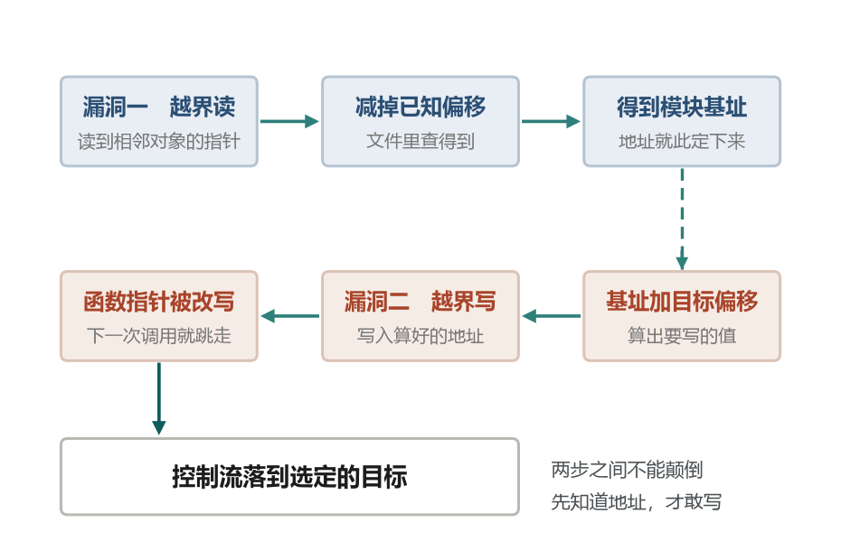

# 第五章　利用原语：从越界到任意读写

一个 Web 服务在解析请求头时，把 `Host` 字段拷进了一个 `char host[64]` 的局部数组。字段比 64 字节长，多出来的部分顺着栈往高地址写，盖掉相邻的变量，再往上就是保存的寄存器和返回地址。工程师在测试环境里发了一个超长请求，进程当场退出，日志里留下一行 segmentation fault。改成 `strncpy` 之后，单子关了。

如果只看到这里，“缓冲区溢出”这个词的全部含义就是一句能让程序崩溃的写法。实际情况是，那几行代码给出的东西比崩溃多得多。多出来的字节落在哪里、能不能被读回来、能不能反复命中同一个位置，决定了攻击者最终拿到的是拒绝服务，还是一台机器的控制权。

这一章讲的就是这段距离。从“程序有一个缺陷”到“攻击者可以读写任意内存”，中间不是一步，而是一串可以分开讨论的台阶。每一级都有自己的前提，也都有自己的失败方式。

## 5.1 把缺陷当成接口

安全研究里有个说法，漏洞是输入到内存操作的映射。这句话听起来抽象，落到代码上很具体。找出 `memcpy(dst, src, len)` 里三个参数分别由谁决定，就找出了这个缺陷的全部能力。

`len` 直接来自输入、`src` 也来自输入，那么这段代码提供的能力是“在 `dst` 之后写入任意长度、任意内容的字节”。`len` 是固定的 4，能力就缩水成“写 4 个字节”。`len` 来自输入但 `src` 指向一段常量，能力变成“写任意长度，内容已知”。这三种情况在代码审查里可能被记成同一个缺陷，能做的事情差了几个数量级。

把这种能力单独拎出来命名，叫原语（primitive）。原语不谈“哪个函数有问题”，只谈“我现在能让这台机器做什么”。一个合格的原语要满足三条，位置可控、内容可控、可以重复触发。三条缺一条，利用的难度就会上升一档。位置不可控，只能靠布局碰运气；内容不可控，只能写别人准备好的字节；不能重复，那么一次写错就前功尽弃。

这种表述方式的用处在于，它把不同语言、不同平台的缺陷放到同一张桌子上比较。PHP 的解释器、浏览器的 JIT、Windows 的内核驱动，表面上毫无关系，抽象成原语之后往往是同一类东西，也往往用同一套办法升级。

## 5.2 六级台阶

按能力从弱到强排下来，利用原语大致有六级。

第一级是越界读。程序读到了本该属于别人的内存，返回值里带出了内容。它自己不能改变任何东西，但它能看见。

第二级是越界写。相邻的内存被改写。这是绝大多数内存破坏漏洞的起点，也是最常见的一级。

第三级是释放后使用（use after free，UAF）。对象被释放，指向它的指针还留着。这块内存会被分配器重新发出去，于是同一块地址上先后住过两个对象，旧指针成了通往新对象的后门。这一级的价值不在“用了已释放的内存”，而在于攻击者可以决定新住进来的是谁。

第四级是类型混淆（type confusion）。同一块内存被两段代码用两套规则解释。C++ 的继承、JavaScript 的对象、内核里的联合体，都可能出现这种错位。

第五级是任意地址读写。要读哪里、要写哪里，由输入决定，不再受对象边界的约束。到了这一级，攻击者实际上拿到了一个可以操作整个进程内存的调试器。

第六级是控制流劫持。下一条要执行的指令不再由程序决定。

<figure>

<figcaption>图 5-1　利用原语的六级台阶。右侧是该级新获得的能力，每一级都要跨过一道具体的桥，跨不过去就停在前一级。</figcaption>
</figure>

这张图容易被误读成“漏洞的种类”。它描述的是攻击者此刻手里的工具，不是缺陷的标签。同一个 UAF，如果释放之后那块内存再也没被分配出去，攻击者只拿到一个悬垂指针，什么也做不了；如果紧接着被一个带函数指针的结构体占了，可能直接跳到第六级。同一个越界写，只能改一个字节的时候叫“单字节溢出”，改的是长度字段的低位，往往比写一整片还值钱。

## 5.3 第一座桥，相邻对象的字段

从第二级往第五级走，最常走的一条路是改掉相邻对象里的字段。分配器按请求的大小切内存，同一批申请的对象往往紧挨着排布，溢出几个字节就能碰到下一个对象的开头。

考虑这样一个结构体。

```c
struct session {
    char     name[64];
    size_t   name_len;
    void   (*on_close)(struct session *);
};
```

`name` 后面的两个字段是这段代码里最值钱的东西。`name_len` 决定了后续所有对 `name` 的读写边界，把它改大，一个老老实实的 `memcpy(s->name, src, s->name_len)` 立刻变成任意长度的越界写。`on_close` 是一个函数指针，把它改成攻击者想要的值，会话结束时程序就会跳过去。一次溢出可以同时完成这两件事。

C++ 的容器把同样的思路做得更彻底。`std::vector` 的对象里通常是三个指针，指向缓冲区的起点、终点和容量末尾。改掉起点，这个 vector 就变成“从任意地址开始的一片内存”；改掉终点，任何一次遍历都会读到界外。`std::string` 在小字符串优化下把内容直接放在对象内部，一个 32 字节的对象里既有长度也有字节，长度字段离缓冲区只有几个字节的距离。工业界的漏洞报告里，被改坏的“长度”比被改坏的“返回地址”多得多。

这条路之所以好用，是因为它绕开了两个麻烦。它不需要知道任何地址，只需要知道相对偏移；它也不需要一次写很多，改对一个字段就够。

## 5.4 第二座桥，分配器的账本

另一条路不去碰用户对象，直接改分配器自己的记录。

glibc 的 `malloc` 在每个块的用户数据之前放了两个机器字，前一个是上一个块的大小（只在上一块空闲时有意义），后一个既是本块大小也存放三位标志。

```c
/* 位于用户指针之前 16 字节处，size 必须是 16 的倍数 */
struct malloc_chunk {
    size_t prev_size;
    size_t size;                  /* 低三位是标志 */
    struct malloc_chunk *fd;      /* 空闲时才有效 */
    struct malloc_chunk *bk;
};
```

`size` 的低三位里，最低位表示前一块正在使用，第二位表示这块是 `mmap` 来的，第三位表示它属于非主分配区。改掉 `size`，分配器对“这一块有多大、下一块在哪里”的判断就全错了。它可能认为下一块已经空闲，于是把两块合并，合并时要按链表指针把邻居从空闲链表里摘出来，摘除操作会写两个地址。老式的 unsafe unlink 就是靠这一点把一次越界写变成“往任意地址写一个值”。

另一种做法是伪造空闲链表。glibc 2.26 引入的 tcache 为了快，每个大小档只保留一条单向链表，最多 7 块，链接指针直接存在用户数据的前 8 个字节里。释放时把当前块压进链表头，分配时从链表头摘一个出来。如果能改掉这个链接指针，下一次申请就会返回攻击者指定的地址。2.32 之后加了 safe-linking，链表里存的不再是裸指针，而是指针右移 12 位再与自身异或的结果，写一个任意值进去，解出来就是一个几乎必然无效的地址。这道检查没有让原理失效，只是提高了“先泄漏、再计算”的必要性。

近年 glibc 在这些地方堆了不少检查，块大小是否对齐、双链表指针是否自洽、tcache 是否重复释放。绕过它们的方法每年都在变，不变的是那条思路，把分配器当成一个可以被欺骗的记账程序。

## 5.5 泄漏为什么几乎必需

有了写的能力，接下来要决定写什么。绝大多数目标需要一个绝对地址。

地址空间布局随机化（address space layout randomization，ASLR）把这个前提打破了。每次启动，栈、堆、共享库、主程序的位置都会变。攻击者在自己机器上调试出来的地址，换一台机器、换一次启动就不作数。这种情况下，越界写再强也没处落笔，因为不知道往哪个地址写。

所以现代利用的第一步几乎总是泄漏（info leak）。一个越界读、一段格式化字符串、一个把指针当整数打印出来的日志，都能提供一个真实地址。拿到一个地址之后，剩下的工作是减法。

```text
泄漏值    0x55d3a41c2a30      从越界读里拿到的指针
已知偏移  0x1c2a30            从二进制文件里查出的符号偏移
模块基址  0x55d3a4000000      两者相减
```

模块内的符号偏移在编译时就固定了，写在文件里，谁都能查。于是随机化被抵消，整个模块的布局都确定下来。

<figure>

<figcaption>图 5-2　一次完整的利用。上半段用越界读确定地址，下半段用越界写落到目标，中间那一步减法是把随机的地址变成确定的偏移。</figcaption>
</figure>

也有不需要泄漏的场合，代价是成功率。页的大小是 4 KB，模块基址按页对齐，所以一个地址的低 12 位是固定的，随机的只有第 12 位往上的部分。如果只覆盖地址的低两个字节，高 6 个字节保持原样，那么命中概率大约是十六分之一，因为低 16 位里只有 4 位是随机的。这种做法叫部分覆盖（partial overwrite），它把“必须泄漏”换成了“可以重试”。进程崩了能重启、重启后布局不变的服务，可以靠这种方式硬撞。

## 5.6 控制流落在哪里

第六级需要一个“把执行流交出去”的位置。历史上被用过的地方并不多，翻来覆去就是那么几类。

栈上的返回地址是最老的一个。函数返回时从栈上取地址跳过去，只要溢出能够到那里，就能改。挡在它前面的通常是栈保护符，也就是在局部变量和返回地址之间插一个随机值，函数返回前比较一次。绕过的办法要么是先把保护符读出来，要么是找一个不需要经过检查就能改到的位置。

结构体里的函数指针比返回地址好用。回调、虚函数表指针、文件操作表、定时器回调，都是“数据里的地址”，改了之后总会有一次调用替攻击者完成跳转。C++ 对象的头 8 个字节通常就是虚表指针，把它指向一块伪造的表，再让表里的某一项指向目标，两次写就能完成一次调用劫持。

全局偏移表（global offset table，GOT）曾经是热门目标，因为动态链接把库函数的真实地址存在那里，改一项就等于换掉一个函数。链接器后来加了 RELRO，把这张表在重定位完成后改成只读，全量 RELRO 下这条路基本封死。

异常处理链在 32 位 Windows 上曾经非常好用，因为异常处理回调的指针就存在栈上，溢出可以直接改。64 位 Windows 改成了表驱动，处理函数的地址放在只读的 `.pdata` 里，栈上不再有可改的指针。C++ 的异常表也是同样的思路，编译器把“哪段代码对应哪个 catch”写成只读数据。

| 落点 | 需要什么 | 现在的状态 |
| --- | --- | --- |
| 栈上的返回地址 | 溢出能写到栈帧顶部 | 有栈保护符，通常要配合泄漏 |
| 对象里的函数指针 | 能写到对象内部 | 最常用，CFI 之下仍有空间 |
| 虚表指针 | 能改对象开头 8 字节 | 要额外伪造一张表 |
| GOT 表项 | 目标段可写 | 全量 RELRO 之后不可写 |
| 异常处理链 | 栈上有可改的回调指针 | 64 位改为表驱动，基本失效 |

这张表解释了一个现象。同一种防护在不同平台上效果差得很远，原因往往不是防护本身强弱，而是那个平台上还剩下哪些落点。

## 5.7 成功率是一门工程

写过利用代码的人都会遇到同一件怪事。同一份脚本，在自己机器上十次成功十次，换一台机器一次也不成，输入完全一样。

原因在于内存布局不是程序的一部分，而是运行历史的一部分。分配器此刻手里有哪些空闲块，取决于之前发生过多少次申请和释放，每个块多大，有没有跨线程，是不是刚从别的分配区借来的。攻击者要写的那几个字节落在哪，取决于这些历史。所以利用代码里通常有一大段准备工作，先按特定顺序申请一批对象、释放其中几个、再触发缺陷，把堆整理成需要的样子。这套做法被叫作堆布局整形（heap grooming），听着玄，本质是把不确定的分配器状态推向一个确定的分支。

剩下的不确定性来自随机化。ASLR 让地址每次不同，栈保护符让值每次不同，线程调度让时序每次不同。工程上的处理办法有三条，能泄漏就把随机量消掉，不能泄漏就用部分覆盖把概率抬到可以接受，实在不行就重试。有些服务用 `fork` 派生工作进程，父进程的地址和保护符在子进程里一模一样，这种情况下可以逐字节爆破，一个字节最多试 256 次，失败一次子进程退出，父进程还在。

判断一份利用写得好不好，看的不是它有没有成功，而是它有多少余量。成功率 90% 的利用可以放进自动化流程，成功率 1% 的只能在特定条件下演示。防守方评估风险时也应该看这个数，一个需要三十次尝试、每次都会留下崩溃日志的漏洞，和一个一次就中的漏洞，威胁等级完全不同。

## 5.8 泄漏一般从哪里掉出来

前面说“一次泄漏就够”，没说泄漏从哪里来。真实的缺陷里，能稳定交出地址的载体只有四类，每一类的成因不一样，排查手法也不一样。

第一类是没有终止符的字符串。一个 `char buf[64]` 里写满了 64 字节数据，没有留出 NUL 的位置，下一次 `strlen` 或 `printf("%s")` 就会一路读到相邻的栈变量或堆对象上去，直到碰巧遇到一个零字节。读出来的尾巴里常常夹着指针，因为栈上相邻的位置接下来就是保存的寄存器。这类缺陷在把它们当成“只是乱码”的人手里看起来无害，实际上是最便宜的一种泄漏。

第二类是长度字段和实际内容不一致。`struct blob { char data[64]; uint16_t len; }`，写入时 `len` 被截断成 16 位，读回时却按 `size_t` 展开，于是一次“读回这个对象”就变成了读 64 KB。反过来，`len` 先设大、再填数据，中间出一个异常路径，拷回去的就是未初始化的内存。

第三类是格式化字符串。`printf(buf)` 把用户输入当成格式串，`%p` 就会把参数区里的值按指针打印出来。位置是可以算的，x86-64 上 `printf` 的第一个参数在 `rdi`，五个可变参数在 `rsi` 到 `r9`，`%6$p` 开始读调用者栈上的传参区。一段真实的输出往往是这样。

```text
$ ./fmt '%p.%p.%p.%p.%p.%p.%p.%p'
0x7ffd5c3a1f40.0x7f2b8c1d2a30.0x7f2b8c1d2a30.(nil).0x1.0x702e702e702e702e.0x7ffd5c3a2040.0x7ffd5c3a1f50
```

第四项起的值各不相同，其中指向 `0x7f...` 那一段的是 libc 里的地址，后面的 `0x7ffd...` 是栈地址。每个靶子都要重新数一遍序号，因为编译器版本、优化级别、调用点前面的局部变量都会改变栈的布局。工程上的做法是一次打印二十个，把像地址的那几个挑出来，用 `readelf -s` 去核。

第四类是未初始化的内存。结构体有填充字节，`sizeof` 算进去的 8 字节对齐空隙从来没被写过；`malloc` 拿到的块如果是回收来的，里面是上一个使用者的数据。把这样一个结构体整体写出去，就等于把上一轮的生命周期交了出去。内核里那些“忘了 `memset` 就 `copy_to_user`”的漏洞，根子也是这个，只是多了一层权限边界。这类缺陷在检测工具里报成“未初始化读”，常被当成低危，实际价值完全看那块内存上一个主人是谁。

这四类有一个共同点，都不需要攻击者能控制读多少字节。只要有一处把“本不该读的内存”当成了正常数据，泄漏就发生了。防守方要堵的是“拷贝前确定长度”，而不是“拷贝得少一点”。

只有一两个字节的泄漏也有用。模块基址按页对齐，低 12 位在随机化前后不变，所以一个泄漏出来的指针只需要它的高几个字节，剩下的靠已知偏移补齐。更极端的情形是只能读到最低两个字节，那也能判断“这个指针落在哪个模块里”，因为同一个模块里所有函数的低 16 位分布是固定的。反过来，只能读到高位而低位未知时，泄漏的价值下降很多，因为页内偏移直接决定了能不能落到想去的 gadget 上。

## 5.9 同尺寸重用与类型混淆的接口

UAF 要变成类型混淆，中间差一步摆放。分配器按大小分桶，同一尺寸的块会互相重用，所以只要旧对象和新对象的尺寸落在同一个 chunk 上，新对象就会住进旧地址。

C++ 里这件事很好凑。`std::string` 在 libstdc++ 上是 32 字节，小字符串优化把那块 16 字节的缓冲区直接放在对象里；`std::function` 也是 32 字节，内部是两个指针加一个管理函数指针；`std::vector` 是 24 字节，`std::shared_ptr` 的控制块通常是 24 或 32 字节。

```cpp
struct Note    { std::string text; };            /* 32 字节 */
struct Handler { std::function<void()> fn; };    /* 32 字节 */

Note    *n = new Note;
Handler *h = new Handler;
delete h;                     /* 0x30 的 chunk 回到 tcache */
Handler *h2 = new Handler;    /* 同一个地址，n->text 与 h2->fn 重叠 */
```

第三行之后，如果 `h` 的指针还留在某个容器里，通过它读 `fn` 得到的就是另一个对象的字节。把一个字符串指针写进 `std::function` 的两个指针字段，调用时就会跳到那个地址。这类链条在浏览器、办公套件、消息中间件的报告里反复出现，因为它们都是用 C++ 写的、大量使用标准库容器、并且把对象指针存在全局注册表里的程序。

尺寸的分布不是均匀的。0x20、0x30、0x40 这三档最拥挤，因为标准库的小对象、节点、缓冲区几乎全落在这里。想要让两个对象重叠，先把它们的 `sizeof` 算出来，加上 8 或者 16 的头部，对到 16 的倍数上。对不上就差一个关键字，比如把 `std::string` 换成 `std::string_view`，尺寸立刻从 32 变成 16。

有一个细节会让整条链失效。新对象在构造时会把整个块初始化，`std::string` 的构造函数会写三个字段，`std::function` 会写一个空状态。如果旧指针在新对象构造之前就被用了，读到的还是旧对象残留的数据；如果在新对象构造之后被用，读到的是新对象的合法内容，也不构成混淆。真正有用的窗口在第三步，旧指针把新对象里的某个指针字段改成一个受控值，再让新对象自己把这个指针当真去用。三步缺一步都不行。

堆布局整形也是从这里落的。常见的序列是先申请 N 个同尺寸对象把 tcache 的七个格子填满，再释放其中奇数位置的，于是下一次申请时分配器只能从你选定的那些洞里拿。整个过程不涉及地址，只涉及顺序，所以它不受随机化影响。

尺寸别凭印象猜。`gdb` 里一句 `p sizeof(std::string)` 就能问出来，libstdc++ 与 libc++ 在同一个类上给出的结果不同，`std::string` 分别占 32 和 24 字节，差就差在 SSO 缓冲区放不下一个指针。

台阶到这里就铺完了。从读一个字节到改写一条指令，每一级都需要一个具体的条件成立。防守方的工作，就是把这些条件一条条拿掉。拿掉之后还剩多少，要算概率。
