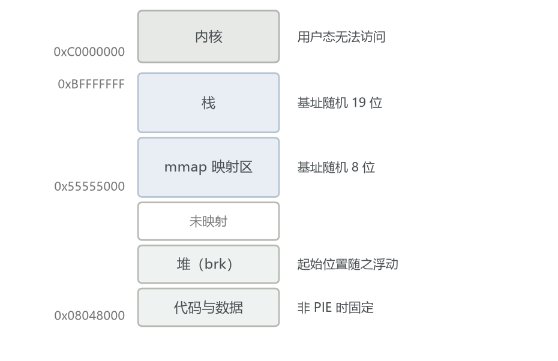
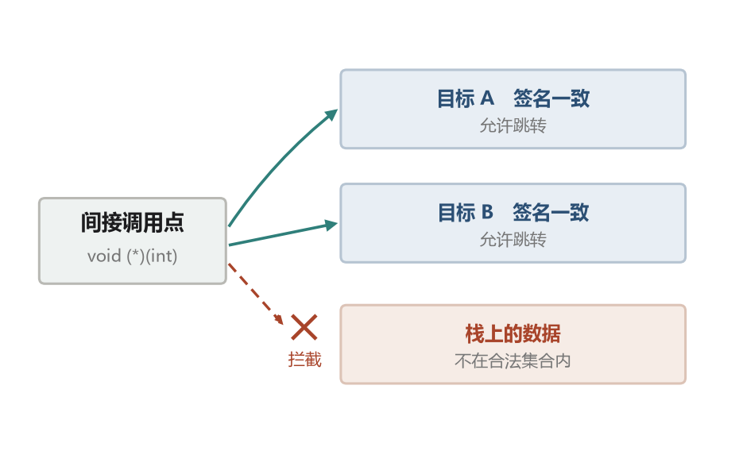

# 第六章　缓解机制的数学

2005 年前后，Linux 发行版陆续在默认配置里打开地址随机化。当时的乐观情绪很普遍，理由是攻击者没法再猜准地址，而猜不准地址就跳不过去。二十年过去，公开的漏洞利用仍然一年比一年多，其中相当一部分在开着全部缓解机制的机器上一次就中。

原因不复杂。每一种缓解机制都不是一道绝对的门，而是一个概率乘数或者一个成本乘数。随机化把一个确定的地址变成一个取值范围，取值范围的宽度决定了攻击者要试多少次；栈保护符在一条写路径上插了一个检查点，检查点的时间窗和空间窗决定了它看得住什么；控制流完整性限定了跳转的落点集合，集合的大小决定了还有多少可用的目标。

这一章把这几种机制拆成可以算的量。不是给出“开了就安全”的结论，而是给出每个结论依赖的数字。

## 6.1 熵才是关键量

随机化能挡住攻击的前提是取值范围足够大。这个范围用位数衡量，叫熵（entropy）。一个区域有 n 位熵，攻击者平均要试 2 的 n 次方次才能命中。

32 位进程的地址空间只有 4 GB，能拿出来做随机的余地很小。早期的实测结果大致是这样，栈的基址有 19 位随机，堆的起始位置有 13 位，共享库的映射区只有 8 位。8 位意味着 256 种可能。

256 这个数字在攻击面前几乎等于没有。2004 年 Shacham 等人在一篇论文里系统地算过这件事，他们的结论是 32 位 Linux 上的地址随机化可以被暴力破解，耗时以分钟计。理由不只是熵低，还在于很多网络服务用 `fork` 处理连接，父进程的布局在子进程里原样复制。攻击者反复连接，每次猜一个基址，猜错进程崩溃、父进程不受影响，猜对就进去了。

<figure>

<figcaption>图 6-1　32 位 Linux 进程的典型布局与各区域的随机位数。数值取自早期内核的实测结果，随内核版本、发行版配置和程序是否 PIE 而变化。</figcaption>
</figure>

64 位改变了数量级。x86-64 的用户空间有效地址是 47 位，内核可以把映射区放在更大的范围里。常见的默认配置下，共享库和 PIE 程序的基址有 28 位随机，栈有 22 位。28 位是两亿七千万，按每秒尝试一千次算，需要三天以上，而每次失败的代价是一个崩溃。这条路走不通。

值得注意的是堆。它在 64 位上并没有跟着涨，仍然是十几位的量级，因为 `brk` 只能在数据段后面一小段范围内移动。堆地址的熵低，在只泄漏了堆指针、没有泄漏库地址的场合会变成短板。

## 6.2 PIE 与那一次泄漏

位置无关可执行文件（position independent executable，PIE）解决的问题是主程序自己也被随机化。不开 PIE 的时候，主程序的代码段固定在 0x400000 或 0x08048000 附近，攻击者可以直接引用里面的任何地址，唯一不确定的是共享库。开了 PIE，加载器把整个程序当成一个可重定位的模块搬到随机位置。

代价很小。PIE 要求编译器用相对寻址生成代码，多用一个寄存器存基址，启动时多做一轮重定位。测出来的性能差异通常在百分之一以内，比起它带来的好处可以忽略。

于是攻防的焦点转到泄漏上。机制上没有办法阻止一个进程泄漏自己的地址，因为进程里到处都是地址，随便一处没有初始化干净的内存、一条打印指针的日志、一个越界的读，都能把它们交出去。

一次泄漏为什么够用，因为同一模块内部的相对位置是固定的。代码段里每个函数的偏移、全局变量相对基址的位置、库函数之间的距离，在编译链接时就定下来了，写在文件里。攻击者只要知道一个真实地址，就能把所有需要的地址算出来。这也是为什么“只读不写”的漏洞在评级里从不被当成低危，它提供的是后面所有步骤的坐标。

反过来，如果一处泄漏都找不到，攻击者只剩两条路。一条是部分覆盖，改地址的低两个字节，靠十六分之一的概率硬撞。另一条是找不需要地址的原语，比如把某个已经指向目标的值复制过去，或者利用程序自己算出来的指针。

## 6.3 不可执行之后的借码

NX 的引入让栈和堆上的数据不再能当指令执行。做法是在页表项里加一位，标记这一页不可执行，取指时遇到这一位就触发异常。这一位在 x86 上叫 XD，在 ARM 上叫 XN，几乎不带来性能损失，兼容性问题主要出在需要运行时生成代码的程序上。

攻击者于是改了做法。既然不能自己写代码，那就用程序里已有的代码。返回导向编程（return oriented programming，ROP）是这个思路的完整形态。程序里到处都是 `ret` 结尾的短指令序列，每一段只做一件小事，比如把栈顶弹进一个寄存器、做一次加法、往某个地址写一个值。把这些片段的地址按顺序摆在栈上，程序就会一段接一段地执行，拼出任意逻辑。

这条路成立的条件有三个。程序里要有足够多的有用片段，这叫 gadget 库的丰富程度，库越大、指令越密，可用的片段越多。栈上要放得下整条链，链越长越容易越过栈顶。每个片段的地址都要已知，于是又回到泄漏。

ROP 的意义不只是绕过了 NX。它说明了一件事，可执行权限管的是“代码从哪里来”，管不了“控制流去哪里”。程序自己的代码永远是合法可执行的，借来的指令同样能完成任务。要防这类利用，只能反过来限制跳转的目标。

## 6.4 栈保护符的时间窗

栈保护符（stack canary）在函数入口处从线程本地存储里取一个随机值，放在局部变量和保存的帧指针之间；函数返回前再取一次，比较栈上那份有没有被改。这个值在线程本地存储里的位置是 `%fs:0x28`，每个线程一份，程序启动时随机生成。

它的保护范围由放置位置决定。局部变量在低地址，返回地址在高地址，保护符夹在中间，所以连续向上溢出必须先跨过它。改不了它，就改不到返回地址。

时间窗是它的弱点。检查发生在函数末尾，那么任何不经过函数末尾就离开的路径都绕过了检查。C 语言的 `longjmp` 直接把栈指针挪回去；C++ 抛出异常时栈展开由独立的元数据驱动，不执行正常的收尾代码；线程被取消、进程调用 `exit`，也一样。这些路径上，被改坏的返回地址不会被用到，但被改坏的其他东西会被用到。

空间窗是另一个弱点。保护符只保护返回地址，保护不了位于缓冲区低地址一侧的变量。一个结构体里如果数组在前、函数指针在后，情况还好；如果函数指针在前、数组在后，溢出碰不到它。真正麻烦的是相反的情形，编译器把某些变量排在缓冲区下方，这些变量被改掉时保护符纹丝不动。局部数组旁边的函数指针、`std::vector` 对象的三个指针，都属于这一类。

剩下的一条路是猜。保护符的低字节通常是 0，因为随机值在生成时会清掉最低位，防的是字符串函数把它当成终止符。这一个字节的已知，让逐字节爆破成为可能，前提是目标进程允许反复尝试且每次的随机值不变。`fork` 型服务正好满足，父进程的保护符在子进程里一模一样。

## 6.5 把跳转目标收窄

控制流完整性（control flow integrity，CFI）的思路是给每一次间接跳转列一张白名单。编译器在编译时知道每个调用点可能调用哪些函数，运行时检查实际目标在不在名单里。

工程上分两档。粗粒度只检查目标是不是“某个函数的开头”，实现方式是一张位图，几百 KB 就能覆盖整个程序。Windows 的控制流保护（control flow guard，CFG）走的就是这条路，开销很小，但正如它的名字，它只知道目标是一个函数入口，不知道是哪个函数。攻击者只要把控制流引到任意一个函数入口，检查就通过了。细粒度把函数签名也纳入检查，调用 `void f(int)` 的地方只能跳到参数和返回值类型完全一致的函数，实现上要在编译时给每个类型算一个哈希，在跳转前比对。它需要全程序优化，需要所有代码一起重新编译，兼容性代价高得多。

<figure>

<figcaption>图 6-2　间接调用点与其合法目标。签名一致的函数允许跳转，栈上伪造的数据不在集合里，检查在跳转发生前把它拦下。</figcaption>
</figure>

后向边是另一件事。返回地址从栈上取，检查它是否指向调用者的下一条指令，需要在别处保存一份可信的副本。Intel 的 CET 里这部分叫影子栈（shadow stack），处理器在每次调用时把返回地址同时压进普通栈和影子栈，返回时比较两者。ARM 上对应的机制是指针认证，做法不同，目标一致。这条防线的价值在于它不依赖编译器分析，硬件保证了副本的完整性，攻击者改普通栈上的返回地址只会导致不匹配。

前向边还有一个硬件层面的补丁，间接分支跟踪（indirect branch tracking，IBT）。它要求所有合法的间接跳转目标以一条特殊指令 `endbr64` 开头，跳到别处就触发异常。这条检查很便宜，一两个周期，但它只保证目标是一条“被声明为可跳入”的指令，不保证是哪个函数。所以 IBT 通常和影子栈、类型检查一起上，各自负责一段。

这些机制的共同前提是生态配合。CPU 要支持，内核要打开，编译器要生成对应的指令，所有库要重新编译。任何一环缺失，机制就退化成部分生效的状态，而部分生效在攻击面前往往等于不生效。

## 6.6 ARM 的两条路

ARM 从另一个方向解决同样的问题。

指针认证（pointer authentication，PAC）利用了 64 位指针里没用满的高位。ARMv8.3 规定，如果开启了地址翻译的顶部字节忽略特性，指针的高 8 位不参与寻址，可以拿来存别的东西。PAC 用一块硬件密钥对这些位算一个签名，签名同时绑定指针的值和一个上下文修饰符，比如当前的栈指针。函数返回前，返回地址被签名后写回栈；返回时先验证，签名不对就跳转失败。

这个办法的巧妙之处是省事。不需要影子栈那样的额外存储，也不需要在内存里维护第二份副本，签名就插在原来的指针里。攻击者改了栈上的返回地址，验证就会失败，因为他没有密钥，算不出对应的签名。

签名不是无限的。可用的位数取决于具体的实现和地址空间大小，常见配置下十几位，暴力搜索在这个量级上不算完全不可能，尤其是在能反复触发、能测量时间的场合。另一种绕过不碰签名，直接把一个已经签好的指针搬到另一个用途上，这叫签名重用。所以 PAC 一般和 BTI 一起用，前者管返回地址，后者管间接调用的目标。

内存标记（memory tagging，MTE）解决的是另一个维度。ARMv8.5 给每一块 16 字节的内存配一个 4 位的标记，同时把指针高位的 4 位当作指针自己的标记，访问时比较两者。数组越界访问到相邻的块，标记对不上，立刻报错；对象释放后标记被换掉，悬垂指针再用就会失败。同步模式下错误在访问那一刻精确触发，异步模式只在流经特定指令时检查，开销更小但可能漏。

MTE 的边界也很清楚。4 位标记只有十六种取值，两个对象碰巧拿到同一个标记的概率是十六分之一，如果攻击者能控制分配顺序，可以反复申请直到撞上。它防的是“访问了不属于自己的内存”，防不了“访问了本该属于自己的那块内存里的错位置”。开销方面，标记本身要占十六分之一的内存，性能损失根据模式不同从几乎为零到一成左右。

## 6.7 代价与失效条件

把这几样东西放在一起看，会发现它们的性价比差别很大。

| 机制 | 主要挡住什么 | 典型代价 |
| --- | --- | --- |
| 地址随机化 | 直接引用固定地址 | 启动时几毫秒，无运行时开销 |
| 栈保护符 | 连续向上溢出改返回地址 | 每函数几条指令，百分之一以内 |
| 不可执行位 | 在数据页上执行代码 | 几乎为零，JIT 需要特殊处理 |
| 控制流完整性 | 间接跳转落到任意位置 | 几个百分点，外加兼容性 |
| 影子栈与指针认证 | 改写栈上的返回地址 | 需要新硬件，跨界调用要适配 |
| 内存标记 | 越界与悬垂访问 | 内存增加十六分之一，性能看模式 |

每一行都对应一个明确的失效条件。随机化失效于熵不足或者泄漏，保护符失效于非正常返回路径或者逐字节爆破，CFI 失效于合法目标集合过大，内存标记失效于标记碰撞。这些条件不是理论上的边角，在真实的漏洞报告里每一条都反复出现。

所以“这机器开了 ASLR 和 NX”这句话本身说明不了什么。有意义的问题是，这个程序的映射区有多少位随机，有没有一条路径能泄漏地址，编译时开的是哪一档保护。防守方做评估，攻击方做选择，用的都是同一组数字。
