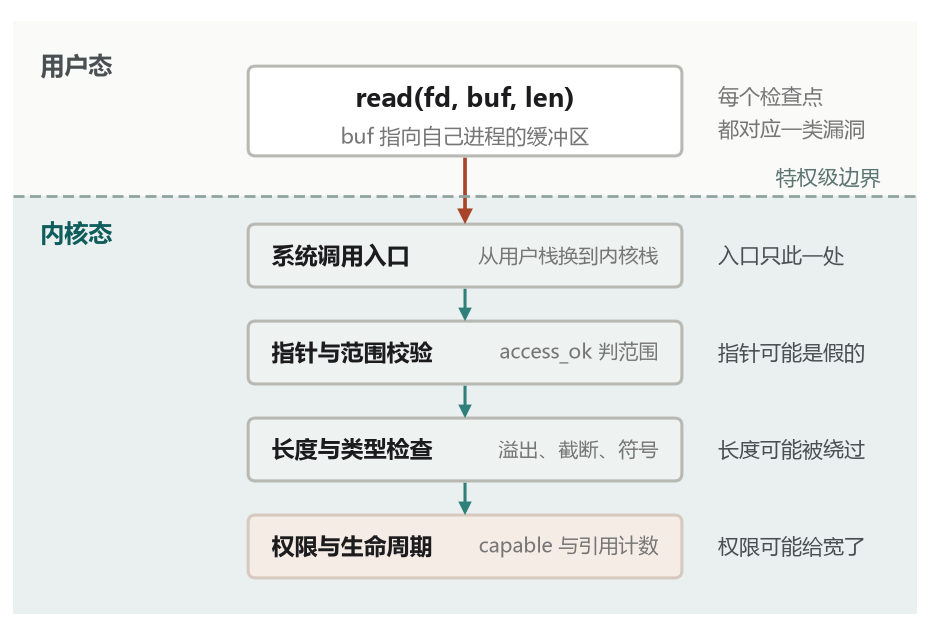
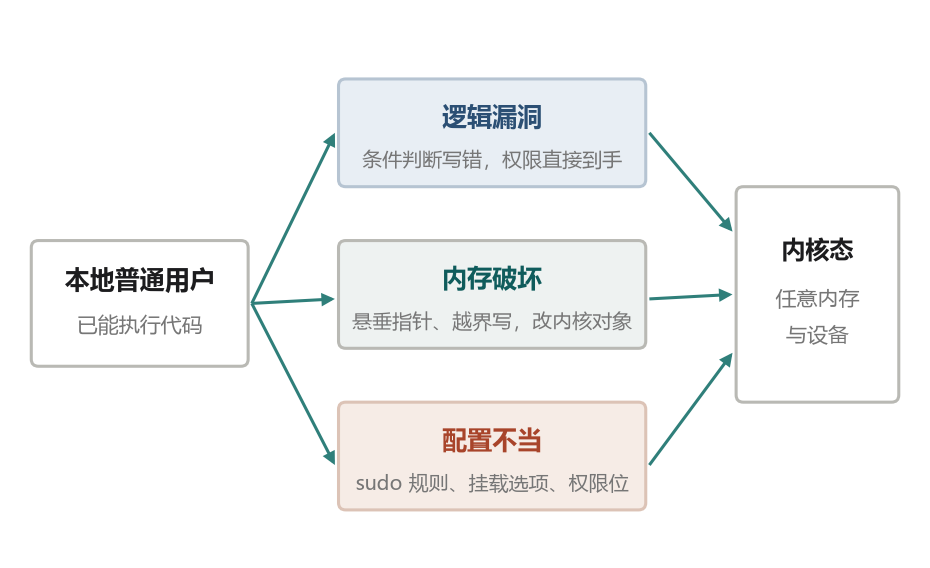

# 第七章　内核攻击面

2022 年 3 月，一个普通用户在自己的机器上写进了一个只读文件。文件权限是 `-r--r--r--`，文件系统是只读挂载，SELinux 也没发出任何告警。改动直接落在了内核的页缓存里，磁盘上的内容没动，读到的是新的。这个漏洞叫 Dirty Pipe，编号 CVE-2022-0847，成因是管道缓冲区上一个标志位没有被清除。

这类漏洞和前面几章讲的东西不在一个层面上。栈溢出要改的是一个进程的返回地址，堆利用要改的是一个分配器的账本，它们的影响范围是一个进程。内核里的一个字节改动，影响的是整台机器上所有进程，包括那些以 root 身份运行、自以为受到保护的进程。容器、沙箱、权限模型、审计日志，全部建立在内核正确工作的前提上。

内核的攻击面就是“用户态能碰到的所有内核代码”。这个集合很大，因为内核要替用户态做几乎所有有副作用的事，读写文件、收发网络包、创建进程、配置设备。每一次请求都要跨过一道特权级边界，边界内侧的代码必须自己检查每一个来自外侧的值。这一章看这些检查点在哪里、怎么被漏掉，再看容器和两个新子系统为什么把面撑得更大，最后去 Windows 那边对照一遍。

## 7.1 那道线在哪里

x86-64 有四个特权级，实际只用了两个。用户态跑在 ring 3，内核态跑在 ring 0。区分两者的不是代码段选择子这么抽象的东西，而是页表里的一个位，每个页表项都有一个 U/S 标志，标为 supervisor 的页在 ring 3 访问会直接触发缺页异常。

这条规则保证了用户态无法直接读写内核内存，但也带来一个后果，用户态想做事就必须“进来”。进来的唯一正当入口是系统调用。`syscall` 指令把 `rip` 跳到内核预先注册的入口地址，同时把 `rflags` 存进 `r11`、返回地址存进 `rcx`，然后 `swapgs` 换掉 per-CPU 的基址寄存器，从 TSS 里取出内核栈指针，把 `rsp` 切过去。接下来的几十条指令把用户寄存器压成一个 `pt_regs` 结构，再按 `rax` 里的编号去 `sys_call_table` 里取出处理函数。

这一步之后，参数就在寄存器里，而寄存器里的“指针”只是一个整数。用户传进来的 `buf` 可能是任何值，可能是内核地址，可能是未映射的地址，也可能指向一块正在被另一个线程改的内存。内核不能直接解引用它。SMAP 打开之后，内核态访问用户页会触发异常，唯一合法的路径是 `copy_from_user` 和 `copy_to_user` 这一类封装，它们会先做范围检查再逐字节搬运，出错时返回未拷贝的字节数。

于是每个系统调用都长成一个固定的骨架，入口、参数解析、权限检查、实际操作、结果拷回。所有的检查点都落在这条线上，而所有的内核漏洞都是这条线上某一处漏掉了什么。

<figure>

<figcaption>图 7-1　一次 `read` 跨过特权级边界之后的检查点。入口只有一处，检查点却有四个层次，每一层对应一类漏检方式。用户提供的指针和长度在跨过边界时仍然只是数字。</figcaption>
</figure>

这张图里最容易被忽略的是第一层和第四层的区别。入口处的检查是机械的，编号合法、参数个数对得上就放行，它不判断语义。第四层的检查才是“这个进程有没有资格做这件事”，而这一层经常被放在错误的位置，比如放在 `copy_from_user` 之后，于是用户数据已经影响了检查逻辑本身。

## 7.2 检查点漏掉的四种账

内核里绝大多数内存破坏漏洞，根子都能归到四类算术或时序错误上。

第一类是长度。`copy_from_user(dst, src, len)` 的 `len` 来自用户，如果内核先用它分配、再用它拷贝，中间没有把两者绑定，就会出现“分配得小、拷得多”。更隐蔽的形态是长度被存进了一个更窄的类型，`size_t` 赋给 `int`，超过 2 GB 的请求变成负数，再被当成无符号比较，检查通过而实际长度极大。还有一种是拷贝失败没人管，`copy_from_user` 返回未拷贝的字节数，函数没检查返回值就直接用那块缓冲区，剩下的部分是栈上或堆上的残留数据。

第二类是整数溢出。`len + sizeof(header)` 溢出成一个小数，`count * size` 在 32 位里回绕，这些都能让分配大小和实际写入量脱钩。难点在于编译器不会因为溢出报警，而溢出条件往往要构造非常具体的输入才成立。审计代码时看的不是“这里有没有检查”，而是“这个检查是在哪种位宽下做的”。

第三类是引用计数。内核对象靠引用计数决定何时释放，`kref_get` 和 `kref_put` 必须严格配对。多一次 `put` 会让对象提前释放，此后任何持有旧指针的代码都是在访问已释放内存；少一次 `get` 则相反，对象在还被引用时被回收。真正难的地方不是配平，而是并发。两个线程同时判断“引用计数还没到零”然后各自加一，中间那个窗口就足以让第三个线程把它减到零并释放。

第四类是先检查后使用。检查对象时对象是安全的，使用时对象已经被换掉，这个窗口在 Linux 里通常由文件描述符和 `ioctl` 构成。`fd` 指向的结构可以在检查与使用之间被另一个线程关闭或替换，尤其在 `O_PATH` 打开的描述符上。

还有一类不算算术错误但也常出现在报告里，就是未初始化的内存被拷回用户态。内核栈上的 `struct` 有填充字节，没有清零就 `copy_to_user` 一整块，泄漏的是栈上的残留数据。而内核栈上恰好经常残留着返回地址，于是这就成了一次地址泄漏，能把 KASLR 的随机化直接抹掉。

上面这些全都指向同一种结果，内存被改坏。内核提权并不是只有这一条路。

<figure>

<figcaption>图 7-2　Linux 上本地提权的三条路径。只有中间一条需要先拿到内存破坏原语，其余两条依赖的是权限模型本身的错误，成本往往低一个数量级。</figcaption>
</figure>

中间那条技术要求最高，收益也最稳定，因为它不依赖目标机器的配置。上边那条靠的是检查点写错，`ptrace` 的父子关系没算全、`pkexec` 的 `argc` 为 0 时把环境当参数读，这类 bug 一次调用就能把 uid 换成 0，但每修一个就少一个。下边那条最好用，也最容易被忽略，`sudo` 允许某个命令带通配符、一个 SUID 二进制依赖了可劫持的库、`docker.sock` 挂在了一个普通用户能进的组里、systemd unit 的 `ExecStart` 指向可写目录。这些都不需要一个字节的内存破坏，却能把“本地普通用户”直接变成 root。审计一台机器的提权风险，先看第三条，性价比远高于翻内核版本。

## 7.3 命名空间不是安全边界

容器的隔离感来自命名空间。PID 命名空间让进程看到自己的 1 号进程，mount 命名空间给它一套独立的挂载树，network 命名空间给它自己的网卡和路由表，再加上 UTS、IPC、cgroup、user 命名空间，一台机器上能跑起几十个看起来互不相干的环境。

这些机制提供的是视图，不是权限。它们改变“看到什么”，不改变“能做什么”。所有容器共用同一个内核，同一个 `sys_call_table`，同一份内核内存。内核里任何一处越界写，从任何一个容器里都能触达，而且一旦成功，影响的边界不是容器而是整台机器。

user 命名空间把这件事推得更远。它允许无特权用户创建一个命名空间，并在其中成为 root。这个 root 在宿主机上没有特权，但它能调用一批原本要求 `CAP_SYS_ADMIN` 的接口，挂载 overlayfs、创建网络设备、加载一部分 BPF 程序。这些接口的审计强度和普通系统调用不一样，因为设计时的假设是“只有真 root 能到这里”。假设被 user 命名空间打破之后，那些接口就成了无特权用户的攻击面。

已经出现过两次很典型的后果。一次是 runc 的 CVE-2019-5736，容器里以 root 运行的进程能在 `exec` 时拿到宿主机 `runc` 二进制的写权限，因为 `/proc/self/exe` 指向的是宿主机上的那个文件，不是容器里的副本。改掉之后，宿主机上下一次创建容器就执行了攻击者的代码。另一次就是开篇提到的 Dirty Pipe，它写的是页缓存，而页缓存按 inode 共享，容器里改一个文件，宿主机上所有看到这个 inode 的进程都读到新内容，只读挂载和权限位都拦不住。

这两次都不是“命名空间有 bug”，而是命名空间之外的共享结构把隔离绕开了。评估一个容器环境的安全强度，看的不是容器运行时写了什么，而是内核版本、seccomp 策略、LSM 配置、以及 user 命名空间有没有对普通用户开放。

## 7.4 两个新入口

最近十年内核里新加的两个子系统，把攻击面撑大了不少。

eBPF 允许用户态提交一段字节码，验证之后在内核里执行。它被用在网络过滤、跟踪、安全策略上，现在几乎是内核里增长最快的子系统。设计上的核心是验证器，它必须证明这段程序不会越界访问、不会死循环、不会调用不允许的辅助函数。这件事在理论上不可判定，所以验证器做的是保守的近似，用抽象解释追踪每个寄存器的取值范围和类型。

问题就出在“近似”上。验证器认为安全的程序未必安全，只要它的抽象域和真实语义之间有缝。CVE-2020-8835 是 32 位边界追踪与 64 位运算不一致，CVE-2021-3490 是 ALU32 操作之后上界计算错误，两个都能让一段通过了验证的程序在运行时读到内核任意地址。比起传统的参数校验错误，这类漏洞更难发现，因为它们藏在数据流分析的实现里，读代码的人得先在脑子里跑一遍同样的分析。

io_uring 的问题不在验证，而在生命周期。它把提交队列和完成队列放在用户与内核共享的内存里，一次 `io_uring_enter` 可以提交几十个操作，而操作本身是异步完成的。为了省掉每次系统调用的开销，它还允许提前注册文件描述符和缓冲区，这些资源的生命周期从“一次系统调用”被拉长到了“一个 ring 的生命周期”。

结果是检查和使用的距离被拉长了。检查 `fd` 有效的时候，对应的文件还在；真正执行 IO 的时候，另一个线程可能已经把它关掉、复用、指向了别的对象。这类窗口在同步系统调用里只有几十条指令，在 io_uring 里可能横跨几次调度。资源注册表本身也是一份被用户间接影响的元数据，越界写它和越界写堆上的链表头没有本质区别。

两个子系统的共同点是，它们把大量有状态的、异步的语义塞进了内核，而校验这些东西的成本远高于校验一个定长参数。

## 7.5 Windows 那边

Windows 的内核攻击面结构不同，但问题类型高度相似。

对象管理器（object manager）是入口。文件、进程、令牌、段、注册表键在内核里都是对象，每个对象有一个头部，存类型、引用计数、安全描述符。用户态拿到的是句柄，句柄表在进程里，指向对象。攻击者关心的通常不是对象本身，而是“这个句柄允许我做什么”，比如用 `PROCESS_VM_WRITE` 打开一个高权限进程，或者拿到一个段对象的句柄去映射一块共享内存。

令牌（token）里存着 SID、特权列表和完整性级别。UAC 的实现方式是给管理员一个受限令牌和一个完整令牌，默认进程用前者。完整性级别（integrity level）分 Low、Medium、High、System 四档，是一条强制完整性控制规则，低级别的进程不能写高级别的对象，浏览器渲染进程就跑到 Low 上。这条规则从来不是安全边界，微软自己也这么说过，它拦的是误操作而不是攻击。

内核池（kernel pool）对应 Linux 的堆。小块从 lookaside 列表里取，大块走页分配器，每个块的头部在用户数据前面，记录大小和池标签。越界写池块会碰到相邻块的头部，手法和改 chunk 的 `size` 是同构的，只是字段布局和链表结构换了一套。

IOCTL 是 Windows 特有的入口。用户态通过 `DeviceIoControl` 给驱动发一个控制码加一段缓冲区，缓冲区怎么传由控制码里的三位决定。`METHOD_BUFFERED` 由 IO 管理器复制，最安全；`METHOD_NEITHER` 则把用户态指针原样交给驱动，驱动如果直接解引用而没有先 `ProbeForWrite`，用户就能让它往任意内核地址写。这是驱动漏洞里最经典的一类，成因和 Linux 里“忘了 `copy_from_user`”完全一样。

还有一种不靠漏洞的路径。攻击者自带一个有签名但有漏洞的驱动，加载之后用它去改内核内存或者关掉安全软件，业界叫 BYOVD（bring your own vulnerable driver）。这条路不需要自己找 0day，只需要找到一份还没被拉黑的旧驱动，代价是留下一个明显的加载记录。

## 7.6 补丁窗口与不稳定的利用

内核漏洞在链条里的位置通常是最后一步。前面所有工作都在一个受限进程里完成，拿到内核执行权之后，所有上层防护一次性归零。这也是它价格高的原因。

代价是稳定性。内核利用要面对的环境变量比用户态多得多。

KASLR 在 x86-64 上把内核正文按 2 MB 对齐随机放置在一个 GB 级的窗口里，几百个可能位置，虽然熵不高，但足够让“猜地址”这条路失效。打开 KPTI 之后，用户态的页表里没有内核映射，靠读页表反推地址的老办法也失效了。SMEP 和 SMAP 让内核既不能执行也不能直接访问用户页，于是“把 shellcode 放用户态然后跳过去”这种思路彻底作废。

堆的随机化更麻烦。SLUB 分配器的空闲链表在初始化时被打乱，`CONFIG_SLAB_FREELIST_RANDOM` 一开，“先释放 A 再分配 B 就能让 B 落在 A 的位置”这条最基本的假设就不成立了。有些发行版还开了 `init_on_alloc`，分配出来的内存默认清零，未初始化数据的价值随之消失。RANDSTRUCT 更进一步，把结构体字段的顺序在编译时随机化，靠固定偏移改字段的技术全部失效。

除了这些，还有分布本身的问题。同一个漏洞在不同发行版上的行为可能完全不同，因为内核版本、配置项、补丁集都不一样。一个在主线 5.15 上稳定的利用，换到某个 LTS 发行版上可能连第一步都走不通，因为那个发行版已经 backport 了一半的修复，或者反过来，带着一个只有它有问题的补丁。

补丁窗口也短。从公开披露到主流发行版推送更新，通常以天计；而从更新推送到机器真正重启，往往以月计。中间这段时间是所有 1-day 利用的黄金期，也是攻击者最喜欢的位置，因为此时漏洞的细节已经公开，而目标还没打补丁。

这些条件加在一起，让内核漏洞的利用呈现出一种奇怪的形状，技术上限很高，实战稳定性很低，一次失败的代价是整机崩溃外加一份完整的内核日志。工程师在这个层面做判断，看的不是“能不能打通”，而是“打不通的时候会留下什么”。

绕过内核之后，攻击者面对的是一个权限完整的环境。而在拿到内核之前，最难攻破的用户态目标是浏览器，它同时具备复杂的语言运行时、即时编译器和一个刻意做得很窄的沙箱。下一章去那里。
