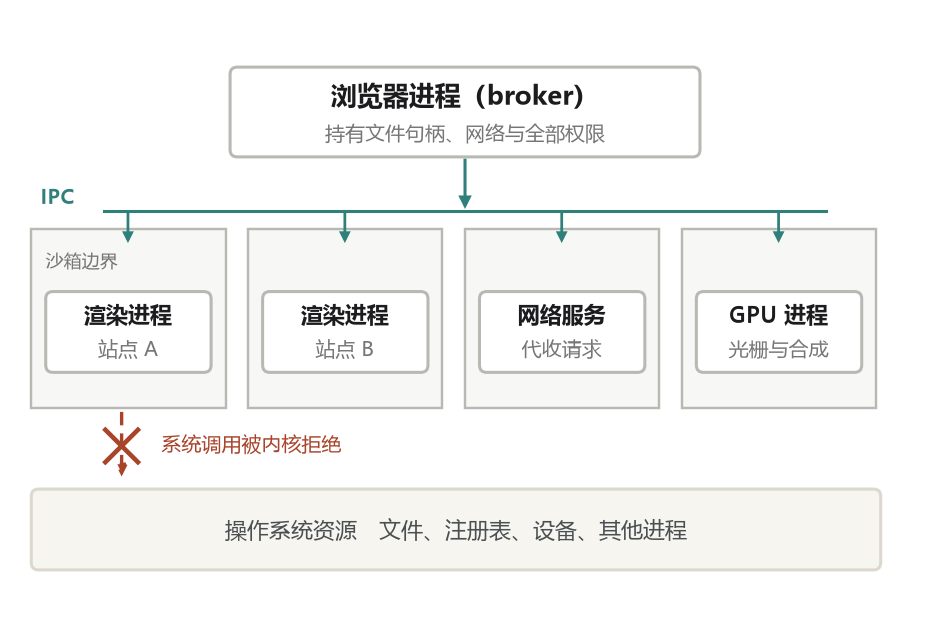
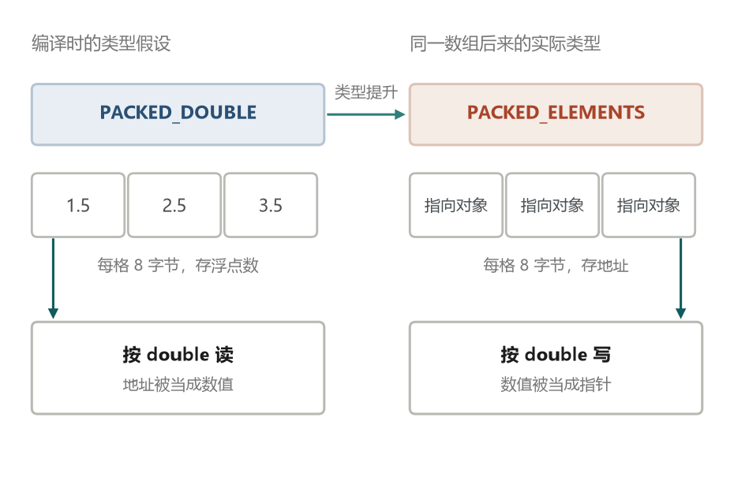

# 第八章　浏览器与 JIT

一个网页里塞了太多广告脚本，标签页卡住，风扇转起来。打开任务管理器，能数出至少四个进程属于这个浏览器，其中一个占了几百兆，一个几乎不占内存，还有一个在网页关掉之后仍然活着。这些进程之间的边界，是这个时代被攻击得最多的一段边界。

浏览器是少数几个必须同时做到三件互相冲突的事的程序。它要执行来自任意站点的、由陌生人写的代码；这段代码运行的速度要接近本地应用；而它拿到的权限必须比一个记事本还少。前两条要求它把 JavaScript 编译成机器码，第三条要求它把编译出来的机器码关在一个笼子里。笼子和速度之间的张力，就是浏览器漏洞的主要来源。

这一章按这个张力展开。先看进程模型和沙箱怎么切分信任，再看 JavaScript 引擎把一个对象放在内存里的什么位置，然后看 JIT 为了快而做的假设，以及这些假设被打破时会发生什么。最后看 Spectre 之后进程模型为什么又被改了一遍。

## 8.1 一个页面背后有几个进程

最早的浏览器是单进程的，一个页面里的脚本崩溃，整个浏览器跟着退出；一个页面里的漏洞，能看到所有其他页面的数据。现在的浏览器把这个模型拆开了。

浏览器主进程（browser process）持有真正的权限，它管窗口、管网络栈的一部分、管文件对话框、管所有子进程的创建。它不解析 HTML，也不执行脚本。

渲染进程（renderer）负责一个站点的文档，解析、排版、执行 JavaScript 都在里面。现代配置是一个站点一个渲染进程，不同站点的页面即使嵌在同一个顶层页面里（iframe）也跑在不同进程里。

网络服务、GPU 进程、各式各样的工具进程各自负责一块。GPU 进程的存在是因为图形栈太难审计，把它关进单独的进程比留在主进程里安全。

这套划分的依据不是性能，是信任。渲染进程是最先被攻破的那一个，因为它执行的代码来自攻击者。所以它拿到的权限最少，而它想做的每一件有副作用的事，都必须通过 IPC 请求主进程或者网络服务代做。

<figure>

<figcaption>图 8-1　浏览器的进程划分与沙箱边界。渲染进程只能通过 IPC 请求代做，它自己发起的系统调用会被沙箱拦下；这一层拦住的是“直接拿权限”，拦不住“利用内核漏洞”。</figcaption>
</figure>

沙箱本身不是浏览器自己实现的隔离，它借用操作系统提供的能力。Linux 上主要是三样东西叠起来，一套 `seccomp-bpf` 白名单把允许的系统调用限制到几十个，一组命名空间把 PID、网络、挂载视图分开，再加上一个 `chroot` 到空目录。Windows 上是一套受限令牌加一个作业对象（job object），再套上 AppContainer 这个应用容器，渲染进程对文件系统、注册表、命名对象的访问都要经过能力声明。

这些机制组合起来的效果是，渲染进程里的代码即使完全受控，能做的事也只有申请内存、读写自己进程的内存、通过 IPC 跟主进程说话。想读写文件，得让主进程替它做，而主进程会检查请求来自哪个站点、有没有用户授权。

从攻击者的角度看，这就把一个目标切成了两段。第一段是在渲染进程里拿到任意代码执行，第二段是从这个沙箱里出去。两段的技术栈完全不同，通常也由两套不同的漏洞完成。

## 8.2 对象在内存里长什么样

JavaScript 是动态语言，一个对象的属性可以在运行时任意增删，属性的类型也可以变。如果照着教科书的做法，每个对象带一张哈希表，每次读属性都查一次表，速度会慢到无法接受。引擎的做法是给每个对象配一张“形状”描述，让属性访问变成固定偏移的读写。

V8 里这张描述叫 Map，其他引擎叫 hidden class 或者 shape，概念一样。一个 Map 记录了对象有哪些属性、每个属性在对象内的偏移、属性的类型（是 Smi、双精度浮点、还是堆对象指针）、原型链、以及这个对象是不是数组、数组的元素类型是什么。

对象本身只存值，按 Map 给的偏移排成一排。属性少的时候直接内联在对象里（in-object），多了之后转到外部的属性数组（out-of-object properties）里，对象里只留一个指针。

Map 之间组成一棵转移树。同一个构造函数创建出来的对象共享一个初始 Map；给它加一个属性 `a`，引擎就沿着一条标着 `a` 的边走到一个新 Map；再加一个 `b`，再走一条边。同一个属性序列走出来的路径是确定的，所以同一个站点上的同一段代码创建出来的对象，Map 完全一致。

这份一致性是优化的基础。当引擎看到 `obj.x` 这一行代码在过去一百次执行中，`obj` 的 Map 都是同一个，它就可以把“查 Map、算偏移、读内存”这一串动作压成一条“从固定偏移读 8 字节”的指令。这个机制叫内联缓存（inline cache）。缓存一个 Map 叫单态，缓存几个叫多态，超过阈值就叫超态，退回查表。

数组另有一套。V8 给数组元素分了类型，叫 elements kind。全是小整数就是 `PACKED_SMI_ELEMENTS`，有浮点就是 `PACKED_DOUBLE_ELEMENTS`，有对象或者字符串就是 `PACKED_ELEMENTS`，中间有空洞就加上 `HOLEY_` 前缀。这套类型只能单向泛化，从 Smi 到 Double 到 Elements，不能退回去。往一个 SMI 数组里塞一个 1.5，整个数组的元素表示就从“紧凑的整数”换成“紧凑的双精度浮点”，底层缓冲区要重新分配、逐个转换。

这个单向性是有意的设计。它让引擎在编译时可以假设“这个数组的元素类型只会变得更一般，不会变得更特殊”，从而省掉很多检查。代价是这个假设一旦被打破，后果不是慢，而是错。

## 8.3 把假设编译成机器码

JavaScript 先被解析成字节码，跑一段时间之后，热点函数被送进优化编译器。V8 现在有三层，解释器加基线编译器 Sparkplug，中间层 Maglev，最上面是 TurboFan。越往上，做的假设越多，生成的代码越快，出错时的代价也越大。

优化编译器做的事情本质上叫特化。它读一遍字节码，结合运行时的类型反馈，对每个操作做出假设：这个加法两边都是 Smi，这个属性访问的 Map 是 M，这个数组的长度在循环里不会变。基于这些假设，它把动态查找编译成直接的内存访问，把边界检查提到循环外面，把不可能走到的分支删掉。

写出来的机器码放在哪？这里有个矛盾。代码页需要可执行，而可写又可执行的页是攻击者最喜欢的东西，因为它意味着一次任意写就能变成一次任意执行。操作系统的做法是 W^X，一个页要么可写要么可执行，不能同时。引擎的做法是先申请一块可写页，把机器码写进去，然后改权限变成可执行。在 Apple Silicon 的 macOS 上，这件事被进一步限制到线程级别，同一时刻只有一个线程能写 JIT 代码，切换靠 `pthread_jit_write_protect_np` 这样的接口。

这套流程保证了稳态下没有可写可执行的页，但也留下一个窗口。如果攻击者能在“写完还没改权限”的那一小段时间里改到那块内存，或者能让引擎把某个数据页误当成代码页执行，W^X 就形同虚设。

优化代码有一个逃生门，叫去优化（deoptimization）。每段优化代码的开头都挂着一串检查，确认关键假设还成立。发现某个对象的 Map 变了，或者数组的元素类型变了，代码就跳到一个由编译器生成的去优化入口，把寄存器状态还原成字节码解释器能接手的形状，然后从字节码继续跑。这套机制的存在说明引擎自己也知道假设会失效，它选择的是“失效时退回去”，而不是“失效时继续按老假设跑”。

那么漏洞从哪来？从那些检查漏掉的地方来。

## 8.4 类型混淆是怎么发生的

类型混淆（type confusion）的定义很朴素，一段代码按类型 A 的布局去解释一块实际是类型 B 的内存。在 JavaScript 引擎里，它几乎总是同一个形状的故事。

<figure>

<figcaption>图 8-2　一个数组在优化期间从双精度浮点变成普通对象数组。优化代码仍然按“每格 8 字节存浮点”读写，于是读到的是对象指针，写进去的浮点数被当成指针。</figcaption>
</figure>

上图这个场景在真实漏洞里出现过很多次。优化编译器看到循环里反复读写一个 `PACKED_DOUBLE_ELEMENTS` 数组，把元素访问编译成“基址加索引乘 8，读一个 double”。循环执行到一半，某段代码往数组里塞了一个对象，元素类型提升为 `PACKED_ELEMENTS`，缓冲区可能被重新分配，每格的含义从浮点变成了指针。如果优化代码里没有对应的类型检查，或者检查被错误地提到了循环外面，接下来的读操作就会把一个对象指针当成浮点数返回，写操作就会把一个浮点数当成指针存进去。

读到指针意味着一次地址泄漏，把 `1.5` 这样的值写进去意味着一次可控的指针伪造。从这一步出发，配合引擎里其他可以被伪造的结构，就能做出任意的读写原语。

同类的成因还有几种。边界检查消除做过头，把“这个索引小于长度”的判断提到循环外，而循环体里有代码能改长度；整数运算被假设不会溢出，`a * b` 在优化代码里用 32 位算，回绕之后索引变成一个巨大的负数；`arguments` 对象或者内联的闭包变量在某个路径上被重新赋值，而优化代码仍然从老的栈位置读。

这些 bug 有一个共同前提，优化器相信了某个在它看来永远成立的假设，而语言规范允许这个假设在某条冷门路径上被打破。写引擎的人要在“多检查一次就慢一点”和“少检查一次就可能被利用”之间划线，这条线画在哪儿，决定了那一年的漏洞数量。

攻击者这边的工程问题是如何把一个类型混淆变成稳定的读写。常用的一步是伪造对象，找一块能写的数据区，按引擎内部结构的样子摆好字段，让一个被混淆的引用指向它，于是“读某个属性”变成“读任意地址”，“写某个属性”变成“写任意地址”。第二步是拿到代码执行，改一个 JIT 函数的入口，或者改一个函数对象的内部指针，让它指向一段攻击者布置好的机器码。

## 8.5 JIT 喷射与地址随机化

ASLR 在浏览器里一直是硬骨头。渲染进程每次启动，堆、栈、库、JIT 代码页的位置都随机，而类型混淆给出的原语通常只能写相对偏移。

JIT 喷射（JIT spraying）是针对这个问题的一种老办法。2007 年 Dionysus Blazakis 在 Black Hat 上把它讲清楚了，思路是让引擎生成大量包含攻击者选定常量的机器码。JavaScript 里写一个很长的常量数组，或者一段全是立即数的算术，优化器会把那些常量嵌进指令里。代码页在内存里是连续的一大片，里面几乎每个字节都是可控的。

关键性质是地址未知但偏移已知。攻击者不需要知道代码页在哪，只需要知道“某个位置附近一定是我的数据”。把返回地址或者函数指针部分覆盖，只改低 16 位或低 24 位，就能落到那片喷射区里，因为页内偏移是确定的，页基址的高位保持不变。

现代的引擎给这条路加了几道门槛。常量被放进只读的常量池而不是嵌进指令流，代码页的位置在更大的范围内随机，指针压缩把堆指针变成 32 位偏移从而改变了伪造对象所需的字段宽度。但喷射的思路没有消失，只是从“喷射机器码”变成了“喷射可控的数据结构”，用来给伪造对象准备落点。

真正稳定的链条通常还要一个泄漏。渲染进程里一次数组越界读、一次被混淆的读属性，都能拿到某个对象的地址，由此推出堆基址和代码页基址。泄漏加写，这两件事凑齐之后，ASLR 就只剩下一点残余的熵。

## 8.6 沙箱之后

拿到渲染进程的任意读写，离控制这台机器还有一段。这一段就是沙箱。

沙箱出口通常不是操作系统的系统调用，因为那条路被 `seccomp-bpf` 和 AppContainer 挡住了。出口更多在 IPC 上。渲染进程和主进程之间通过 Mojo 通信，接口定义在 `.mojom` 文件里，每个接口有明确的参数类型和权限检查。历史上被利用的入口包括文件读取接口对路径的检查、剪贴板接口对格式的处理、IPC 消息反序列化时对长度字段的信任。

IPC 接口难打，因为它们是被最多人审计过的一段代码，而且类型系统本身很窄，参数都是定长整数和字节数组，能传递的复杂度有限。所以链条的最后一环常常不在浏览器里，而在 GPU 进程或者内核。GPU 进程能调用的系统调用比渲染进程多得多，图形驱动又是内核里质量最差的部分之一。

2018 年初 Spectre 公开之后，这套进程模型又改了一轮。Spectre 的一类变种依赖同一个进程内的地址空间共享，两个站点在同一个渲染进程里，就能互相读到对方的推测执行痕迹。对策是把站点隔离（Site Isolation）从“可选加强”变成默认，跨站点的 iframe 一律放到独立进程。代价是内存占用翻倍，Chrome 团队为此写过好几篇工程总结。

同一时期还有两个变化值得记住。V8 从 2020 年起启用指针压缩，整个堆被限制在一个 4 GB 的 cage 里，所有堆指针都变成 32 位偏移。这让伪造对象容易了一些，因为指针字段只有 4 字节，但也把可寻址的范围锁死，越界读能扫到的区域变小。另一个变化是渲染进程的定时器精度被压到百分之一毫秒并加了抖动，`performance.now()` 读出来的数不再连续，侧信道的时间测量因此更难做准。

这些工程决策加在一起，塑造了今天浏览器漏洞的形态。一个完整链条通常是三到四个漏洞，渲染进程里一个类型混淆拿到读写，一个泄漏拿到地址，一个 IPC 或者驱动的漏洞出沙箱，最后可能还有一个内核漏洞拿到真正的权限。每一个单独看都不算致命，串起来才是。

浏览器之所以是这条链上最难也最有价值的一环，原因不在它的代码有多少行，而在它必须同时满足的三个要求互相拉扯。要执行陌生人的代码，所以要有沙箱；要快，所以要有 JIT；JIT 必须做假设，而假设一定会被打破。工程师能做的是让打破假设的代价变大，让每一环都需要一个新的漏洞。

同样的拉扯也出现在别的地方。内核要替所有人干活，所以边界内侧的检查必须自己写全；浏览器要跑陌生代码，所以必须假设笼子会破。再往外一层，是人和系统之间的那条边界，口令、证书、会话。下一章去看那一层用的是什么样的数学。
