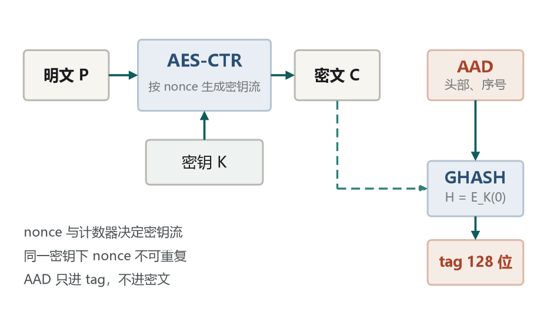
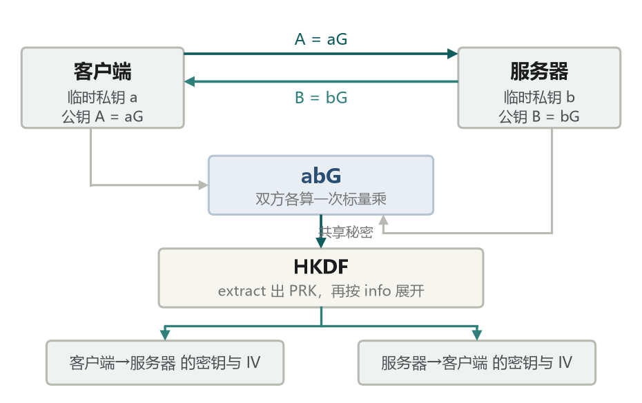

# 第九章　密码学的构造

假设有人要给自己的服务加密一批配置文件。他打开文档，找到 AES，看到两个函数，一个加密一个解密，半小时就把功能写完了。密钥放在环境变量里，密文存进数据库。上线之后一切正常，没有任何报错。

这段代码保证的东西比他以为的少。AES 只保证一件事，给定一个 128 位的分组和一把密钥，输出看起来和随机数没有区别。它不保证两段相同的明文不会产生相同的密文，不保证密文被人改过之后能被发现，也不保证同一把密钥能安全地用在一百万条消息上。这些保证由外层的结构提供，密码学里管它叫构造（construction）。

构造错了，原语再强也没用。密码学史上大部分灾难，不是 AES 被攻破，而是协议把几个正确的零件拼错了位置，或者漏掉了一个前提条件。这一章讲这些零件各自保证什么，以及拼装时哪几条线不能踩。

## 9.1 分组密码与它的工作模式

AES 是一个分组密码（block cipher）。它的输入是两个定长的东西，一个 128 位的明文块，一把 128、192 或 256 位的密钥，输出一个 128 位的密文块。内部做十轮、十二轮或十四轮替换与混淆，每轮由字节代换、行移位、列混合和轮密钥加组成。设计目标是让输出在不知道密钥的人看来和随机数无法区分，这个性质叫伪随机置换（pseudorandom permutation，PRP）。

128 位只装得下 16 个字节，一条消息往往比这长，需要一个工作模式（mode of operation）把分组密码扩展成能处理任意长度的方案。同一个 AES 在不同模式下能提供的安全性可以差到天壤之别。

最直接的做法是电子密码本模式（Electronic Codebook，ECB），把消息切成 16 字节一块，每块独立加密。相同的明文块会得到相同的密文块。明文是位图时，大片同色区域的密文会保留原来的形状，肉眼就能看出轮廓；明文是结构化记录时，攻击者不需要解密，看哪些块的密文相同就知道哪些字段的值一样。

密码分组链接模式（Cipher Block Chaining，CBC）解决了这个问题。它让每一块先和前一块的密文异或，第一块用一个随机初始向量（initialization vector，IV）。相同的明文块在不同位置会得到不同的密文。代价是必须串行，而且明文长度不是 16 的整数倍时要填充，PKCS#7 的规则是缺几个字节就补几个值为几的字节，缺 16 个就补 16 个 0x10。

CBC 有一个结构性的弱点。修改第 i-1 块的密文，会让第 i 块的明文产生对应的比特翻转。攻击者虽然不知道明文是什么，却能精确控制翻转的位置和值。如果他猜到某段明文里有 `role=user`，把 `user` 翻成 `admi` 只需要算出两个字符串的异或差，再异或到前一块的密文上。这类攻击不需要密钥，只需要能改密文。

计数器模式（Counter，CTR）换了个思路，不加密明文，而是加密一串递增的计数器得到密钥流，再和明文异或。加密和解密是同一个操作，不需要填充，可以并行。它把分组密码变成了流密码（stream cipher），也因此继承了流密码最致命的约束，同一段密钥流只能用一次。

```text
C1 = P1 xor KS        C2 = P2 xor KS
C1 xor C2 = P1 xor P2
```

两条消息用了同一个 nonce 和计数器起点，密钥流就完全一样。两条密文一异或，密钥流被消掉，剩下两条明文的异或。中英文都有大量固定搭配，靠这种关系加猜测，可以一段一段把两条明文还原出来。

CTR 和 CBC 都只提供机密性，不提供完整性。密文被改过，解密照样出结果。要让接收方能判断“这段密文是不是原封不动”，需要另一套机制，而把这两件事拼在一起的方式，正是下一节的主题。

## 9.2 AEAD 与用途分离

最早的拼法是加密之后再加一个校验值，有人用 CRC32，有人用 SHA-256 哈希密文。这些做法能挡住偶然的传输错误，挡不住有意的修改，因为校验值没有密钥，攻击者可以自己算一遍再改。

正确的做法是带密钥的消息认证码（message authentication code，MAC）。有了 MAC，拼接顺序仍然有讲究。先加密再算 MAC（encrypt-then-MAC）是安全的，先算 MAC 再加密（MAC-then-encrypt）在实现上非常容易出问题，这一点在讲 TLS 时会再遇到。

带关联数据的认证加密（Authenticated Encryption with Associated Data，AEAD）把两步收进一个接口。一次调用接收密钥、nonce、明文和一段不加密但要认证的关联数据（associated data，AAD），输出密文和一个认证标签（tag）。调用者不需要决定先做哪一步，也就没有拼错的机会。

AES-GCM 是最常见的 AEAD。它内部用 CTR 模式加密，用 GHASH 做认证，tag 长度 128 位，也可以截短到 96 或 64 位，截短会等比降低伪造的难度。GCM 的 nonce 推荐 96 位，要求是在同一把密钥下不重复。注意它不要求随机，只要求不重复。这个区别很重要，因为很多系统用随机数生成 nonce，而随机数在数量大了之后一定会碰撞。

96 位随机 nonce 的碰撞概率可以用生日界估算，大约 q²/2^97，q 是消息条数。发到 2^32 条时碰撞概率约为 2^-33，NIST 建议在这个量级换密钥。每秒一万条消息的服务，跑上五天就到这个数。

<figure>

<figcaption>图 9-1　AEAD 加密时各部分的分工。AAD 不进密文但进 tag，密文本身也参与 GHASH；任何一个受认证的比特被改动，tag 都对不上。</figcaption>
</figure>

nonce 重用对 GCM 的破坏是两个层面的。第一层和 CTR 一样，两条消息的密钥流相同，密文异或就得到明文异或。第二层更严重，GCM 的 tag 依赖一个由密钥导出的值 H = E_K(0)，两条同 nonce 的消息给出两个 tag 方程，联立之后可以解出 H。Antoine Joux 在 2006 年指出过这一点。拿到 H 之后，攻击者能给任意伪造的消息算出合法 tag。一次 nonce 重用不只是泄漏两条消息的内容，而是让这把密钥彻底作废。

AAD 解决的是一个具体问题。很多协议的消息有头部，头部必须明文传输，接收方要先读它才知道怎么处理，但它又不能被篡改。头部放进 AAD，不进入密文，却参与 tag 计算，改一个比特 tag 就对不上。版本号、序列号、长度字段都适合放在这里。

用途分离是这一节最后要记的一条。同一把密钥不应该同时用于加密和认证，也不应该同时用于两个方向的通信。原因很朴素，同一个密钥在两种算法里出现，就给攻击者提供了把两种结构放在一起分析的素材。工程上的做法是用一个主密钥派生出若干子密钥，每个子密钥只干一件事，派生时用一个标签区分用途。HKDF 的 `info` 参数就是干这个的。

## 9.3 哈希、MAC 与长度扩展

密码学哈希（cryptographic hash）把任意长度的输入压成定长输出。它要满足三条性质，抗原像、抗第二原像、抗碰撞。前两条的难度是 2^n，碰撞因为生日悖论只需要 2^(n/2)。SHA-256 的碰撞强度是 128 位，不是 256 位。

绝大多数常见哈希用的是 Merkle–Damgård 结构。消息先填充到分组的整数倍，填充里带上原始长度，然后一块一块喂进压缩函数，上一块的输出作为下一块的输入。SHA-1、SHA-256、MD5 都是这个结构。

这个结构有一个副作用，叫长度扩展（length extension）。给定 H(secret || m) 的值和 secret 的长度，不需要知道 secret，就能算出 H(secret || m || padding || suffix) 的值。原因是压缩函数的状态就是输出，攻击者可以把它当成中间状态接着往下算。把 `H(key || message)` 当 MAC 用的系统全部受这个影响，早期的一些 Web 框架和 API 签名就这么写过。

HMAC 是为此设计的。它用两层哈希，内层把密钥和消息一起处理，外层再把内层的结果和密钥处理一遍。
```text
HMAC(K, m) = H((K xor opad) || H((K xor ipad) || m))
```

密钥先填充到分组长度（SHA-256 是 64 字节），`ipad` 是 0x36 重复，`opad` 是 0x5c 重复。长度扩展在这里失效，因为攻击者拿到的是外层哈希的结果，想接着扩展得先穿过外层，而外层的输入里有他不知道的密钥。

验证 MAC 要用常数时间比较。`memcmp` 在第一个不同的字节就返回，攻击者能靠测量响应时间一个字节一个字节试出正确的 tag。库一般提供 `constant_time_compare`，自己写比较别省这一步。

MAC 和加密的拼接顺序值得单独看一眼。MAC-then-encrypt 的问题在于，接收方必须先把密文解开才能验 MAC，而解开的过程中填充是否正确、MAC 是否正确会被分别报错。如果这两种错误在时间上或者错误信息上可以区分，攻击者就有了一个预言机（oracle），可以一个字节一个字节地解出明文。这是 CBC 时代一整类攻击的根源。AEAD 之所以成为默认选择，很大程度就是因为它把这个顺序问题从接口层面消掉了。

## 9.4 公钥：从离散对数到椭圆曲线

对称加密要求双方共享同一把密钥。两个从未见过面的人要在网络上建立这样一把密钥，总得先有一条安全的通道，而这条通道正是他们想建立的东西。公钥密码（public-key cryptography）打破了这个循环，每个人持有一对密钥，公钥可以公开，私钥只有自己知道。

Diffie 和 Hellman 在 1976 年的论文里给出了第一个可行方案，安全性建立在离散对数问题（discrete logarithm problem）上。取一个大素数 p 和一个生成元 g，双方各自选随机数 a 和 b，交换 g^a mod p 与 g^b mod p，各自算出 (g^b)^a 和 (g^a)^b，得到同一个值 g^(ab)。旁观者能看到 g^a 和 g^b，要算出 g^(ab) 就得先解出 a 或 b。

“足够大”有具体含义。p 至少 2048 位，并且 p-1 要有一个大素因子，否则会有小子群攻击。攻击者可以发一个落在小子群里的公钥，让共享密钥只有很少几种可能，反复几次就能试出对方的私钥。Logjam（2015）攻击的正是 512 位的出口级参数，以及大量服务器复用的 1024 位参数，研究者估算对后者做一次预计算大约需要一周的集群算力，之后就可以实时解密。

RSA 是另一条路，1977 年由 Rivest、Shamir 和 Adleman 提出。选两个大素数 p 和 q，n = pq，公开 (n, e)，私钥 d 满足 ed ≡ 1 mod φ(n)。加密是 c = m^e mod n，解密是 m = c^d mod n。安全性建立在大整数分解的困难上。

教科书上的 RSA 不能直接用。它是确定性的，同一段明文每次加密结果相同；它还是乘法同态的，E(m1)·E(m2) = E(m1·m2)，攻击者可以让服务器解密一个自己构造的乘积，再从结果推出原文。PKCS#1 v1.5 的填充试图解决这个问题，但错误处理泄漏了信息，Bleichenbacher 在 1998 年用填充预言机攻破了它，2017 年的 ROBOT 工作发现同样的问题在一大批实现里仍然存在。现在用的是 OAEP，用随机数把明文撑开，每次加密结果都不同。

指数也不能随便选。e = 3 且没有填充时，如果明文很短，m^3 根本不会超过 n，开三次方就得到明文。两个用户共用同一个 n 同样是灾难，知道其中一组 (e, d) 就能分解 n。

椭圆曲线密码（elliptic curve cryptography，ECC）用另一套代数结构。曲线上的点是满足 y² = x³ + ax + b 的 (x, y)，两个点可以相加，一个点可以反复自加得到标量乘。已知 P 和 kP 求 k，就是椭圆曲线离散对数问题。目前最好的算法复杂度是 √n，所以 256 位曲线能提供约 128 位安全强度，同强度的 RSA 需要 3072 位。密钥短、运算快，这是 ECC 在移动端和 TLS 里普及的原因。

曲线参数本身也是攻击面。有些实现不验证收到的点是否在曲线上，攻击者可以发一个另一条曲线上的点，那条曲线的阶有小因子，逐位泄漏私钥。Curve25519 只做 x 坐标运算，天然免疫这类攻击。

ECDSA 是常见的签名算法，签名是 (r, s)，其中 r 是随机数 k 对应点的 x 坐标，s = k^(-1)(h + r·d)。如果同一个 k 用两次，两个方程一联立，私钥 d 直接被解出来。索尼的 PS3 在 2010 年就因为固定了 k 而被破了签名。k 不仅不能重复，还不能有偏，稍微偏向某几个位，格攻击就能从几百个签名里恢复私钥。

## 9.5 密钥交换与前向保密

有了公钥算法，密钥交换看起来很简单，客户端生成一个随机会话密钥，用服务器的公钥加密发过去就行。TLS 1.2 里的 RSA 密钥交换就是这么做的。它有一个很难受的性质，服务器的私钥一旦泄漏，攻击者把之前录下的流量翻出来，一条条解开就行。那些流量可能已经在某个硬盘上存了三年。

前向保密（forward secrecy）要解决的就是这件事。做法是每次握手都生成一对临时密钥，用完就扔。双方用临时密钥做一次 Diffie-Hellman 得到共享秘密，再由它派生出这次会话的所有密钥。服务器的长期私钥只用来签名，证明这条临时公钥确实是我发的，不再参与密钥的生成。这样即使长期私钥泄漏，历史会话也解不开，对应的临时私钥早就销毁了。

代价是计算量。一次 ECDHE 比一次 RSA 解密贵，但开销已经压得很低，这也是 TLS 1.3 敢把它设成唯一选择的原因。TLS 1.3 删掉了静态 RSA 密钥交换、CBC、RC4、压缩和重协商，密钥交换只剩 (EC)DHE 和预共享密钥（pre-shared key，PSK）。

<figure>

<figcaption>图 9-2　ECDH 得到的共享秘密从不直接当密钥用，先经 HKDF 抽出 PRK，再按用途标签展开成两个方向的会话密钥。</figcaption>
</figure>

图里画的是 ECDHE 的骨架。客户端选 a，发 aG；服务器选 b，发 bG；双方各算一次标量乘得到 abG。这个值从来不在网络上出现，它是后续所有密钥的种子。真正的会话密钥不是它本身，而是经过 HKDF 派生出的若干子密钥，一个方向一把。

认证这一步不能省。Diffie-Hellman 不认证对方是谁，中间人能和两边各做一次交换，两边都以为自己在和对方说话。TLS 用证书私钥对握手记录签名（CertificateVerify），把临时公钥绑到身份上。

前向保密也不是万能的。它只保护过去的会话，实时拿到服务器私钥的攻击者仍然可以冒充服务器。

## 9.6 KDF 与口令哈希

KDF 有两个场景，从高熵的共享秘密派生多把密钥，从低熵的口令派生密钥。两件事目标不同，算法也不同。

HKDF（RFC 5869）属于前者。它分两步，extract 用一个盐把输入压成固定长度的伪随机密钥（PRK），expand 用 `info` 参数把 PRK 拉成任意长度。`info` 是用途标签，同一个 PRK 加上不同的 info 得到互不相关的子密钥，这正是前面说的用途分离。它的安全性依赖输入的熵，输入如果是口令，HKDF 起不到任何抗暴力的作用。

口令的问题在于熵太低。`password123` 这种口令的熵可能不到 20 位，而一块显卡每秒能算几十亿次 SHA-256。直接哈希口令，等于把口令明文交给攻击者。加盐（salt）能挡住彩虹表和一次算完全网通用的批量攻击，每个用户一个随机盐，同样的口令得到不同的哈希，攻击者只能逐个用户地算。

加盐不能降低单次猜测的成本，所以还需要让每次计算变慢。PBKDF2 的做法是迭代，把 HMAC 跑几千到几十万次。它只消耗 CPU，不消耗内存，GPU 和 ASIC 可以并行跑几万个实例，攻击者的成本远低于防御者的预期。

bcrypt（1999）用 Blowfish 的密钥调度做迭代，成本参数每加一，时间翻倍。它有一个 72 字节的口令截断，超出部分被忽略，长口令场景下这是个坑。它的内存占用只有 4 KB 左右，抗 GPU 的能力有限。

scrypt（2009）引入了内存硬（memory-hard）的设计，计算过程中要占用大量内存，参数 N 控制内存大小。攻击者想并行就得准备同样多的内存，内存比算力贵得多。

Argon2 是 2015 年密码哈希竞赛的胜出者，对应 RFC 9106。它有三个变体。Argon2d 的数据访问依赖输入，抗 GPU 最好，共享环境里有侧信道风险；Argon2i 相反；Argon2id 前半段用 i，后半段用 d，是推荐默认值。参数有内存 m、迭代次数 t、并行度 p。

参数的依据不是越大越好，而是给自己定一个可接受的延迟。登录接口上单次验证 100 毫秒是常见的取舍，攻击者试一百万个口令要花掉 27 个小时的等效算力，正常用户感觉不到。

存储格式一般是自描述的，比如 `$argon2id$v=19$m=65536,t=3,p=4$<salt>$<hash>`，参数跟着哈希一起存。将来调参不需要让老用户重置口令，验证时按记录里的参数算就行。自研系统常忽略这一点，把所有用户固定在同一组参数上，几年后想升级就面对一次全量迁移。
