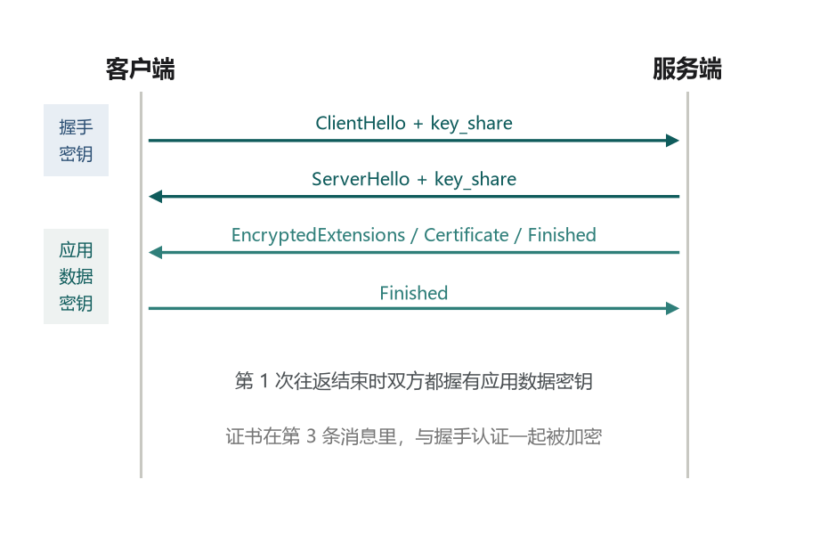
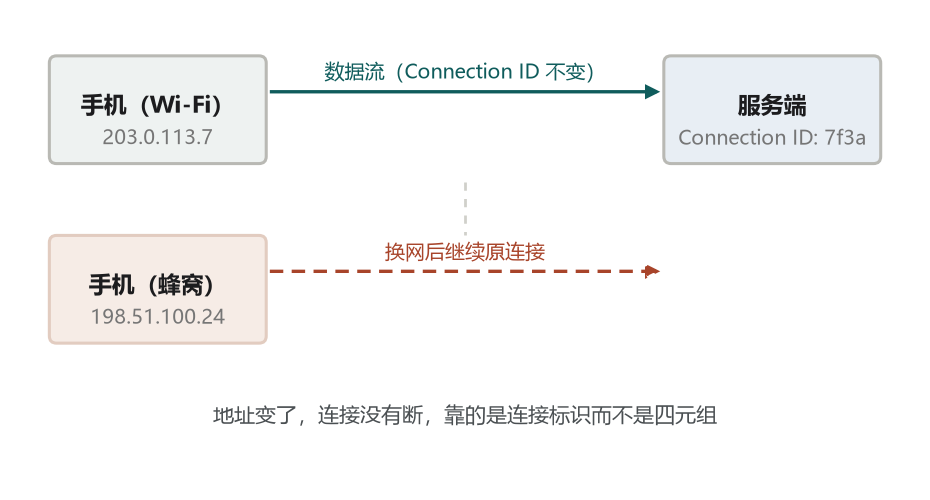

# 第十章　协议安全：TLS 1.3 与 QUIC

在咖啡店里连上公共 Wi-Fi，打开一个 https 网站，抓包工具里出现的第一批字节是明文。你能看到一个域名，却看不到页面的任何内容。后面所有的数据都变成了噪声，只有握手开头的那几百字节清清楚楚。

为什么这几百字节必须明文，加密的边界又到底划在哪里，这些问题的答案藏在握手的顺序里。TLS 1.3 把密钥协商压进第一个往返，QUIC 干脆把传输层也搬到了 UDP 上，两个协议面对的是同一组约束，认证、保密、前向保密、抗重放，只是取舍不同。

这一章按一次真实连接的顺序走。先看握手在交换什么，再看证书凭什么被相信，然后看降级和 0-RTT 这两种“为了快而让步”的设计各自的代价，最后区分两类完全不同的失败，协议设计错了，和协议实现写错了。

## 10.1 一个往返里塞进了什么

TLS 要同时提供四样东西，机密性、完整性、对服务器身份的认证、前向保密。这四样不是并列的，后两个依赖前两个的机制，顺序错了就白做。

握手的第一条消息是 ClientHello，里面有客户端支持的版本、密码套件列表、一个随机数，以及 TLS 1.3 新增的密钥份额（key_share），也就是客户端临时生成的 ECDHE 公钥。服务器回 ServerHello，选一个套件，附上自己的密钥份额。这两条消息交换完，双方已经能算出共享秘密，后面的所有报文都可以加密。

加密之后服务器发四条，EncryptedExtensions 放一些不涉及密钥的扩展，Certificate 放证书链，CertificateVerify 用证书私钥对握手记录的哈希签名，Finished 是对整个握手记录的 MAC。客户端验证完这四条，发自己的 Finished，握手结束，应用数据立刻可以开始流动。整个过程一个往返，所以叫 1-RTT。

<figure>

<figcaption>图 10-1　TLS 1.3 的 1-RTT 握手。左侧两条竖线是报文方向，右侧一列是从 PSK 与 ECDHE 逐级派生出的密钥阶段，每条报文用哪一级密钥加密是固定的。</figcaption>
</figure>

图里右侧那列是密钥调度（key schedule）。TLS 1.3 不直接用 ECDHE 的共享秘密当密钥，而是把它喂进 HKDF，一级一级往下推。第一级是早期秘密（early secret），只由 PSK 或全零导出；第二级是握手秘密（handshake secret），掺入了 ECDHE 的结果；第三级是主秘密（master secret），再由它派生出两个方向的应用流量密钥。

每一级都带一个“转录哈希”（transcript hash），也就是到目前为止所有握手报文的哈希。这个设计让握手报文无法被中间人悄悄修改，改一个字节，后面派生出的密钥就全不一样，Finished 校验直接失败。

同一套机制还负责版本降级保护。支持 TLS 1.3 的服务器在和只支持 1.2 的客户端协商时，会在 ServerHello 的随机数末尾写入固定的 8 字节标记 `DOWNGRD\x01`，客户端看到这个标记就知道有人在中间压低了版本。这个检查之所以有效，是因为降级攻击者改不了 ServerHello 里的随机数，改了就会让转录哈希变化，Finished 对不上。

0-RTT 是这套流程里最激进的优化。客户端如果之前连过这台服务器，握有 PSK，就可以在第一条消息里带上加密的应用数据，不等服务器回应。省下的正是那一个往返，在高延迟链路上很值钱。

代价有两个。早期数据只能用由 PSK 派生的早期密钥加密，不掺 ECDHE，所以没有前向保密，PSK 泄漏了这段数据就能被解。更麻烦的是它可以被重放，攻击者录下这段 0-RTT 数据，换个时间再发一遍，服务器无法从密码学上分辨这是不是同一条。协议只能要求应用层自己保证幂等，或者服务器用一次性票据加缓存来挡。CDN 上的缓存刷新接口、支付接口，都不该接受 0-RTT。

## 10.2 证书与信任链

密钥交换解决了“和谁说话不被偷听”，没有解决“对面是谁”。TLS 用证书补上这一块。

证书是一个签过名的结构，里面装着公钥、域名、有效期，以及签发者的名字。浏览器不直接信任网站的证书，它信任的是一小撮根证书颁发机构（certificate authority，CA），这些根证书预装在操作系统或浏览器里，通常有一百多个，背后是几十家机构。服务器发来的是一个链，站点证书由中间 CA 签，中间 CA 由根 CA 签，浏览器沿着链一路验到某个预装的根。

验证的内容不止签名。证书里的域名要和用户访问的域名匹配，现代实现看的是主体备用名（subject alternative name，SAN），通用名（common name，CN）早就被忽略。有效期要覆盖当前时间。基本约束（basic constraints）要标明这张证书是不是 CA，路径长度要符合。名字约束（name constraints）可以限制某个 CA 只能签发某几个域下的证书。

这套体系有一个结构性的弱点，任何一家 CA 被攻破，或者主动违规，都能签出任意域名的证书。2011 年荷兰的 DigiNotar 被入侵，攻击者签发了包括 `*.google.com` 在内的几百张证书，用于监听伊朗用户的 Gmail，事情曝光后这家 CA 破产，证书被各大浏览器吊销。2017 年 Symantec 被发现长期误签证书，谷歌推动逐步取消信任，最终在 2018 年把它从 Chrome 的根列表里移除。

证书透明（Certificate Transparency，CT）是对这个弱点的补救。所有公开 CA 签发的证书都要提交到几个可公开审计的日志里，浏览器要求服务器在握手中带上签名证书时间戳（signed certificate timestamp，SCT），并且这个 SCT 对应的条目必须真的在日志里。域名所有者可以监控日志，发现有人给自己不存在的子域签了证书，就能提前知道有人在准备钓鱼或者中间人。

吊销机制一直不太灵。CRL 是一份被吊销证书的列表，文件越来越大，浏览器不愿意每次都下载。OCSP 是实时查询，但要额外连一次 CA 的服务器，慢，而且 CA 服务器挂了就会拖慢所有 HTTPS 连接，所以实现普遍采用“软失败”，查不到就算通过。OCSP stapling 让服务器自己带上 OCSP 响应，减少一次连接，也掩盖了用户的访问行为。这套东西的实际效果是，一张已经泄漏的证书往往在被吊销之前还能用很久。

还有一个容易被误解的地方。证书有效只说明“这把公钥属于这个域名，且由一个受信任的 CA 签发”，它不说明这个域名背后的组织可信。钓鱼站点用 Let's Encrypt 申请一张 DV 证书，十分钟就能拿到，浏览器地址栏照样是锁。锁只保证你和这个域名之间的通道没有被偷看，不保证域名主人是好人。

## 10.3 降级与 HSTS

降级攻击的思路很朴素，把 HTTPS 换成 HTTP 就行，后面的加密全都不存在了。

TLS 内部的降级已经被前面的机制挡住了。协议版本在 ClientHello 里协商，服务器返回的版本被转录哈希覆盖，1.3 的服务器还会在随机数里写哨兵值。攻击者想删掉 1.3 的选项，客户端会发现 Finished 对不上；想伪造 1.2 的响应，哨兵值会露馅。

真正的缺口在协议外面。用户输入 `example.com`，浏览器默认发 http 请求，服务器回一个 301 跳到 https。这中间有一个明文的往返，攻击者在这个窗口里插一个响应，把用户引到一个长得一模一样的 HTTP 页面上，后面所有防护都不存在。更糟的是，很多站点从来不做这个跳转，或者只在首页做。

HTTP 严格传输安全（HTTP Strict Transport Security，HSTS）就是为了关掉这个窗口。服务器返回一个响应头 `Strict-Transport-Security: max-age=31536000; includeSubDomains`，浏览器记住这个域名，在有效期内所有请求都直接走 HTTPS，连跳转都不发。`includeSubDomains` 让子域也受保护，防止有人拿 `http://a.example.com` 做入口。

HSTS 有一个明显的冷启动问题，用户第一次访问时浏览器还没记住，窗口依然存在。补救办法是预加载列表（preload），把域名硬编码进浏览器发行版。申请加入列表要求先设置足够长的 `max-age`、带上 `includeSubDomains`，并且所有子域都能提供 HTTPS，一旦加进去，撤销要等好几个月。

即使 HSTS 全开，仍然有几个口子。用户在证书错误页上点了“继续访问”，浏览器会放行，因为这是用户的显式授权。直接用 IP 访问、走非标准端口、或者用别的协议，HSTS 也不一定覆盖。企业环境里装了自己的根证书做 TLS 拦截，所有证书校验都在企业这一层被替换，HSTS 拦不住，也检测不到。

## 10.4 QUIC 的连接与迁移

QUIC 要解决的是 TCP 留下的两个问题。

一个是队头阻塞。TCP 把字节流按序交付，一个包丢了，后面所有已经到达的数据都要等它重传，哪怕它们属于完全不同的请求。HTTP/2 在一条 TCP 连接上复用了很多流，一个丢包就卡住全部。另一个是协议僵化。TCP 的选项空间被中间盒盯得太紧，新的传输特性很难部署，改内核更是要等好几年。

QUIC 在 UDP 之上自己实现了可靠传输、拥塞控制、流量控制，把流的概念做进了协议。每个流独立编号、独立重传，一个流丢包不影响其他流。它还把 TLS 1.3 直接嵌进握手，不再有“先建连接再握手”的两步。

<figure>

<figcaption>图 10-2　QUIC 的连接迁移。四元组变了，连接标识符不变，服务器据此把新路径上的包接到原连接上，并用 PATH_CHALLENGE 验证新地址确实可达。</figcaption>
</figure>

QUIC 的包长这样，一个短头里带着连接标识符（connection ID）、包号和经过头部保护（header protection）的载荷。包号字段的低几位被掩码盖住，不解析载荷就拿不到真实包号，这是为了防止中间设备根据包号做统计或者干扰。连接标识符是一段不透明的字节，服务器可以按它查表找到连接状态，这个设计把连接和四元组（源 IP、源端口、目的 IP、目的端口）解耦了。

解耦带来的是连接迁移（connection migration）。手机从 Wi-Fi 切到蜂窝，IP 变了，TCP 连接必然断掉重来，QUIC 只要继续用同一个连接标识符发包，服务器就能把新地址上的包接到原连接上。换路径之前要验证，服务器发 PATH_CHALLENGE，客户端在新路径上回 PATH_RESPONSE，验证通过才正式切换，否则任何人都能伪造源地址把连接劫走。

迁移也有代价。连接标识符如果一直不变，观察者就能把用户在 Wi-Fi 和蜂窝下的活动关联到同一个人，即使地址变了。所以协议支持更换标识符，双方可以协商一组备用 ID，定期切换，同时用 `disable_active_migration` 扩展告诉对端不要迁移。另外服务器在新路径上发送数据之前，要遵守三倍放大限制，收到多少字节才发多少，防止被当成反射放大器。

0-RTT 在 QUIC 里同样存在，同样可重放。差别在于 QUIC 把“这数据能不能重放”这个问题摆到了应用接口上，HTTP/3 明确规定 0-RTT 只能用于幂等方法，服务器可以拒绝早期数据，让客户端重发。协议能做的是给你一个开关，用不用得对还是应用自己的事。

## 10.5 中间盒与 SNI

服务器可能在一台 IP 上托管几万个网站，握手开始的时候它还不知道客户端要访问哪一个，也就不知道该出示哪张证书。TLS 的解决办法是客户端在 ClientHello 里带一个服务器名称指示（Server Name Indication，SNI），明文写出想要的域名。

这个字段从诞生起就是明文，因为它在密钥建立之前就得被读到。后果是任何在路径上的设备都能看到你访问了哪个域名，哪怕页面内容一个字节都看不到。审稿、 parental control、运营商统计、咖啡店的流量分析，全都靠这个字段。对审查系统来说，SNI 比 DNS 更好用，它就在连接的第一包里。

加密客户端问候（Encrypted Client Hello，ECH）试图补上这个洞。做法是把真实的 ClientHello 整个加密，外面套一个只有域名的外壳，真实域名通过 DNS 里的 HTTPS 记录发布的公钥来加密。中间设备看到的是一个无害的外层 SNI，只有目标服务器能解开。ECH 依赖 DNS 记录不被篡改，也依赖客户端和服务器同时支持，部署进度比 TLS 1.3 慢得多。

中间盒对协议的干扰是一个长期问题。有些防火墙看到不认识的 TLS 扩展就直接断开，有些对 1.3 的握手结构不适应，会丢弃看起来“不完整”的连接。TLS 1.3 为此带了一个兼容模式，在握手中间插入一个假的 ChangeCipherSpec 记录，让老设备以为这还是 TLS 1.2。GREASE 是另一个对策，客户端故意在扩展列表里塞一些随机编号的空扩展，逼中间盒学会忽略不认识的东西，否则等新扩展真的要用时就会被卡住。

企业网络的 TLS 拦截把这条链彻底改了。代理服务器和客户端建一条 TLS，和服务器再建一条，中间解密再加密，客户端被要求安装企业自己的根证书。这套做法在技术上完全可行，代价是端到端的安全性质没有了，代理能看到全部明文，也能改。证书固定（pinning）的应用会直接拒绝这种连接，所以很多 App 在企业网里用不了。

## 10.6 设计错误与实现错误

2014 年 4 月，OpenSSL 爆出一个漏洞，编号 CVE-2014-0160，后来被叫作 Heartbleed。TLS 的心跳扩展允许一方发一个“心跳请求”，里面包含一段任意内容和它的长度，对方应该原样回显这段内容。OpenSSL 在 1.0.1 到 1.0.1f 的实现里没有检查这个长度是否真的和内容匹配，攻击者可以声称自己有 64 KB 的数据，实际只发了几个字节，服务器就会把内存里紧随其后的 64 KB 读出来发回去。

这 64 KB 里可能有会话密钥、用户口令、私钥片段。攻击者反复请求，就能一块一块地把服务器进程的内存拼出来。整个攻击只需要一个包，不需要认证，服务器上不会留下任何异常日志。

从分类上说，这是实现错误。协议本身规定得很清楚，长度字段描述的就是载荷长度，实现者漏掉了一次边界检查。修复也只是加一行判断，1.0.1g 补上之后攻击就失效了。

填充预言机是另一类。CBC 模式要求明文长度是分组的整数倍，不够就填充。接收方解密之后要检查填充是否合法，不合法就报错。如果“填充错误”和“MAC 错误”在响应时间或者错误码上可以区分，攻击者就能构造密文，通过反复询问把明文一个字节一个字节地推出来。POODLE（2014）利用的是 SSL 3.0 的 CBC 填充检查，Lucky13（2013）利用的是 MAC-then-encrypt 结构下的时间差。

这一类更多是设计错误。CBC 加 MAC-then-encrypt 这个组合，只要实现者要在错误处理上做区分，就会泄漏信息，而完全不区分错误又很难做到。TLS 1.3 的处理方式是把 CBC 整个删掉，只留 AEAD，填充由 AEAD 内部处理，错误只有一种，预言机没有存在的空间。删掉一个选项，比让几万个实现都写对要可靠得多。

区分这两类错误有实际意义。实现错误靠打补丁和代码审计，设计错误要靠换协议版本。一个协议用了十年才被发现的问题，往往是设计层面的，因为实现层面的早就被 fuzz 出来了。评估一个系统的安全性时，先看它用的是哪个版本的协议、哪些选项还开着，比看它打了多少补丁更有信息量。
