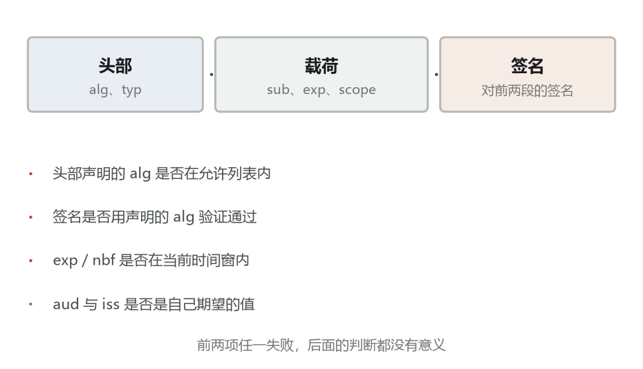
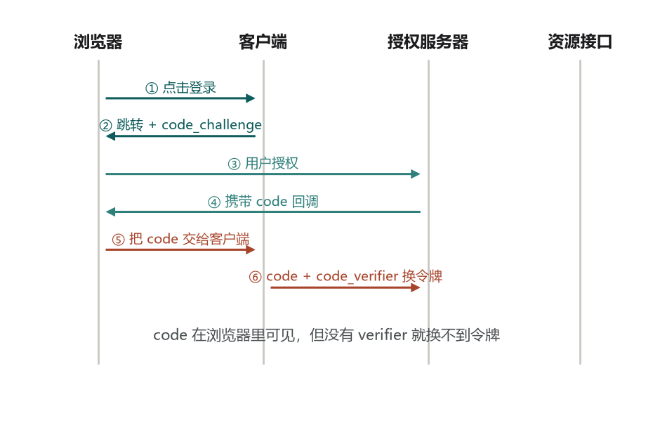

# 第十一章　身份与授权

一个后台页面，左边是用户列表，右边是当前用户能看到的菜单。菜单是登录之后由接口返回的，普通账号看不到“用户管理”这一项。有人把账号借给同事用，同事打开开发者工具，直接请求了那个菜单对应接口的地址，返回了全公司的用户信息。

这个场景里没有密码被破解，没有注入，没有越界访问。系统在认证上做得完全正确，它确实知道请求来自一个合法的普通用户。出错的地方在后半段，它没有问这个用户能不能做这件事。

认证（authentication）和授权（authorization）经常被当成一个东西来做，实现上也常常写在同一个函数里。它们的失败方式完全不同。认证失败是别人进不来，用户立刻会发现；授权失败是别人进来了不该进的地方，可能几年都不会有人发现。

## 11.1 两个问题与一个常见的混淆

认证回答的是“你是谁”，手段是口令、证书、指纹、一次性验证码。授权回答的是“你能做什么”，手段是角色、策略、规则表。前者的产出是一个身份，后者的输入是这个身份加上资源和动作。

把两者混在一起的系统会在代码里体现出来，函数叫 `requireLogin`，检查完会话就放行，至于这个会话背后的人能不能访问这个资源，交给调用方自己记得判断。调用方有几十处，漏一处就是一个洞。

浏览器返回的状态码其实把这个区分标得很清楚。401 是未认证，意思是“你还没告诉我你是谁”，客户端应该去登录。403 是已认证但无权限，再登录一次也没用。很多 API 无论什么情况都返回 401，客户端只能反复跳登录页。

代理混淆（confused deputy）是这类问题的一个经典形态。一个拥有高权限的组件，替低权限的调用方执行了操作。比如图片处理服务持有读整个存储桶的权限，用户传一个 URL 让它去取图，如果它不检查这个 URL 是否属于该用户，用户就能让它把别人的私有图片取回来。问题不在于服务本身的权限太大，而在于它没有把调用方的身份和请求绑定起来。

后面几节按层次展开，先看怎么维持一个身份（会话与令牌），再看第三方授权的标准流程，最后看授权判断为什么总是在业务代码里出错。

## 11.2 会话与 Cookie

HTTP 本身没有状态，登录这个动作要变成“后续请求都带着某个凭证”，靠的是 Cookie。

最早的做法是服务端会话。用户登录成功，服务器生成一个随机的会话标识（session ID），存进一张表，把标识写进 Cookie。之后每个请求带着这个标识，服务器查表得到用户身份。这个模型的好处是撤销容易，删掉表里那一行，会话立刻失效。坏处是表要在多台服务器之间共享，容量和过期清理都得管。

Cookie 上有几个属性直接决定安全边界。`HttpOnly` 让 JavaScript 读不到这个 Cookie，XSS 拿不到会话标识。`Secure` 要求只在 HTTPS 上发送，防止在明文链路上泄漏。`SameSite` 控制跨站请求要不要带这个 Cookie，`Strict` 完全不带，`Lax` 在顶层导航的 GET 请求上带，`None` 全带但必须配合 `Secure`。Chrome 从 80 版开始把没有声明 `SameSite` 的 Cookie 默认当作 `Lax`，这个默认值的变化当年弄坏了不少跨站集成。

`Domain` 属性要慎用。默认情况下 Cookie 只发给设置它的那个主机，一旦写成 `.example.com`，所有子域都能收到。任何一个子域被攻破，攻击者就能在自己的子域上读到主站的会话 Cookie，或者往主站写一个同名 Cookie 做会话固定（session fixation）。

会话固定是一种老手法，攻击者先拿到一个会话标识，想办法让受害者用这个标识登录，之后攻击者手里的标识就成了有效会话。防御很简单，登录成功后重新生成会话标识，把旧的作废。这个动作很多框架默认做了，自己写登录逻辑的容易漏。

会话的生命周期也需要设计。绝对超时和空闲超时是两个不同的量，前者从登录时刻算起，后者从最后一次活动算起。银行类系统两个都要短，一般站点可以让空闲超时到几十分钟。`__Host-` 前缀是浏览器提供的一道附加约束，带这个前缀的 Cookie 必须设 `Secure`、不能指定 `Domain`、`Path` 必须是 `/`，这样即使某个子域被攻破，也没法覆盖主站的会话 Cookie。

无状态令牌走的是另一条路，服务器不存表，把身份信息签个名直接发给客户端，下次请求带回来，服务器验签即可。它的优点是不用共享存储、天然适合多机房，缺点是撤销困难，签出去的令牌在过期之前一直有效，除非另外维护一张黑名单。

## 11.3 JWT 的结构与误用

JSON Web Token（RFC 7519）是无状态令牌最常用的格式。一个 JWT 是三个 base64url 段用点连起来的字符串。

第一段是头，说明签名算法，通常是 `{"alg":"RS256","typ":"JWT"}`。第二段是载荷，一组声明（claim），标准的有签发者 `iss`、主体 `sub`、受众 `aud`、过期时间 `exp`、生效时间 `nbf`、签发时间 `iat`、唯一标识 `jti`。第三段是签名，对前两段的 base64 文本做签名。

<figure>

<figcaption>图 11-1　JWT 的三段结构与几类典型误用。载荷只是 base64url，不是加密；验签失败大多不是算法被攻破，而是校验项少做了一步。</figcaption>
</figure>

要记住的第一件事是 base64url 不是加密。任何人都能把中间那段解开，看到里面的所有字段。把手机号、角色、内部 ID 放进去没问题，把密钥、身份证号放进去就是事故。

要记住的第二件事是签名保护的是完整性，不是“这段内容一定来自我信任的签发者”。后者取决于验签时用的密钥和校验的字段。

历史上有几类反复出现的误用。

`alg` 字段写成 `none` 时，规范允许不带签名。一些库早期默认接受这种令牌，攻击者把 `alg` 改成 `none`、删掉签名，服务端照样放行。修复方式是在服务端固定允许的算法列表，绝不信任头里的 `alg`。

密钥混淆发生在同时支持 RS256 和 HS256 的库里。RS256 用私钥签名、公钥验签，HS256 用同一个密钥签名和验签。如果服务端按头里的 `alg` 选算法，攻击者把 `alg` 改成 HS256，再用服务器公开的 RSA 公钥当 HMAC 密钥重新签名，服务端就会用这把公钥去验 HMAC，验过。攻击者根本不需要私钥。

`kid` 是头里的密钥标识，有的实现拿它去拼文件路径或者查数据库。拼路径就可以用 `../../dev/null` 让验签读到空密钥，查数据库就可以用注入。这个字段的正确用法是从服务端自己维护的集合里查，任何来自令牌的字符串都不能直接进文件系统或者 SQL。

`jku` 和 `x5u` 指向一个 JWKS 地址或者证书地址，如果实现直接去取，攻击者可以把这两个字段指向自己的服务器，用自己生成的密钥签名，服务端取回攻击者的公钥，验签通过。这类字段要么禁用，要么用白名单限制域名。

还有一类不是密码学问题，而是忘了校验。签名对了不代表这张令牌现在能用。`exp` 要检查，`aud` 要和本服务匹配（否则给 A 服务的令牌就能拿去访问 B 服务），`iss` 要和预期的签发者对得上。多服务共用一套密钥时，漏掉 `aud` 是很常见的错误。

JWT 的撤销问题没有好答案。短有效期加刷新令牌是通用做法，令牌十分钟过期，刷新令牌存在服务端可撤销。有些系统在令牌里塞一个版本号，改密码时把版本号加一，旧令牌全部失效，代价是每次请求都要查一次用户表，无状态的好处也就没了。

JWT 也不适合当权限列表用。把用户能访问的所有资源 ID 塞进载荷，令牌会变得很长，每个请求都要带上它，权限一变还得重新签发。角色和粗粒度的 scope 适合放进去，细粒度的判断还是要查服务端。

## 11.4 OAuth 2.0 与 OIDC

OAuth 2.0 解决的是“让第三方应用访问我在另一个服务上的资源，但不给它我的密码”。它把授权拆成四个角色，资源所有者（用户）、客户端（第三方应用）、授权服务器、资源服务器。

<figure>

<figcaption>图 11-2　授权码流程加上 PKCE。客户端先发 `code_challenge`，换令牌时再发 `code_verifier`，中间被截获的授权码没有 verifier 就换不出令牌。</figcaption>
</figure>

最常用的流程是授权码（authorization code）。客户端把浏览器重定向到授权服务器的 `/authorize`，带上 `client_id`、`redirect_uri`、`scope` 和一个随机 `state`。用户在授权服务器上登录并同意，浏览器被重定向回客户端的回调地址，URL 里带着一个一次性的授权码。客户端在服务端用这个码加上自己的密钥，向授权服务器的 `/token` 换访问令牌。

授权码走前端，令牌走后端，这个分离是关键。访问令牌从不经过浏览器地址栏，也就不会留在历史记录、Referer 头或者日志里。

四种流程里，隐式流程（implicit）直接把令牌放在重定向 URL 的片段里发给浏览器，已经被 OAuth 2.1 移除。密码流程让客户端直接收用户的用户名密码，只有自家App才勉强能用。客户端凭证流程没有用户参与，用于服务间调用。

重定向地址必须严格匹配。如果服务端做前缀匹配或者通配，攻击者可以把自己的域名构造成 `https://client.com.evil.com/cb` 这种形式，授权码就送到他手里。`state` 是用来防跨站请求伪造的，客户端生成、存进会话、回调时比对，少了这一步，攻击者能诱导受害者用自己的账号完成一次授权，把受害者的资源和攻击者的客户端绑在一起。

PKCE（Proof Key for Code Exchange，RFC 7636）补的是另一个洞。移动端的回调可能被同机的恶意应用抢走，Web 端的授权码也可能从日志或者 Referer 里泄漏。PKCE 让客户端在第一步生成一个随机串 `code_verifier`，算出它的 SHA-256 摘要 `code_challenge` 一起发过去；换令牌时把原始串带上，授权服务器比对摘要。截获了授权码的人没有 verifier，换不出令牌。现在 PKCE 对所有客户端类型都是推荐做法，公共客户端是必须。

OIDC 在 OAuth 之上加了一层身份。`/token` 之外多一个 `id_token`，是一个 JWT，里面写明这个用户是谁、什么时候认证的、用了什么方式。客户端要校验签名、`iss`、`aud`、`exp`，还要校验 `nonce` 是否和自己发起请求时放进去的一致，防止令牌被替换。`at_hash` 把访问令牌和 id_token 绑在一起，防止两者被拆开组合。

SAML 是更早的企业级方案，用 XML 传递断言。它的签名验证出过一整类问题，叫签名包装（XML signature wrapping）。XML 的签名可以只覆盖文档的某一部分，而业务代码解析的可能是另一部分。攻击者构造一个文档，里面有两个 assertion，一个是签过名的合法 assertion，另一个是伪造的、权限更高的 assertion，验证器验的是前者，业务读的是后者。这类问题在 2012 年前后被系统性地研究过，根因是 XML 的解析模型太灵活，签名覆盖范围和读取路径很难保证一致。

## 11.5 授权为什么总在业务代码里出错

认证有标准协议可以套，授权没有。授权规则和业务绑得太紧，只能写在业务代码里，而业务代码最容易漏。

最典型的是不安全的直接对象引用（insecure direct object reference，IDOR）。接口是 `/api/invoice/1234`，服务端检查了登录，然后按 ID 查出发票返回，没有检查这张发票属不属于当前用户。把 1234 改成 1235 就能看到别人的。这类问题在 REST 接口里极其常见，因为 URL 里的 ID 看起来就像一个参数，参数校验的直觉是“格式对不对”，而不是“这个人有没有权”。

越权通常分两个方向。横向是同一层级的用户互相访问，普通用户 A 看到普通用户 B 的订单，IDOR 属于这一类。纵向是低权限用户执行高权限操作，普通用户调用了管理员接口。两个方向的检查点不同，横向检查资源归属，纵向检查角色或者权限位，代码里经常只做了其中一个。

功能级授权缺失是另一种。管理接口挂在 `/admin/users`，前端不给普通用户显示入口，接口本身却不检查角色。前端隐藏不是安全措施，请求可以手工构造。

多租户系统里最常见的是租户隔离失败。用户的租户 ID 应该从会话或者令牌里取，代码里却从请求参数或者请求头里取，攻击者改一下就能跨租户。这类问题在 SaaS 里出过一次又一次，因为每个查询都要记得带上租户条件，漏一个就漏一片。

还有一种更隐蔽的，检查和使用的时机不一致（TOCTOU）。代码先查“这个优惠券还能用吗”，再去扣减，两步之间没有锁，并发请求可以同时通过检查。授权判断和实际操作必须在同一个原子操作里完成，或者在数据库层面用条件更新把检查写进语句。

正确的做法有几个共同点。判断集中在一处，不要散落在每个 handler 里。默认拒绝，没有明确允许的一律拒绝。资源级检查放在数据访问层，查询语句本身就带上“属于当前用户”的条件，而不是查出来再判断。上一节的 JWT 里放角色声明是可以的，但角色只是输入，最终的判断还要看这个角色对这一个资源有没有权限。

系统设计上有一个原则值得反复强调，令牌不是身份，是声明。它说的是“签发者认为这个主体有这些属性”，这些声明可能过期、可能被伪造、可能被错误地签发。把它当成“这个人就是他自称的那个人”，就等于把判断权交给了一个字符串。任何一次授权决策，都要在服务端重新确认，而不是相信客户端带上来的东西。

## 11.6 多因素与钓鱼抵抗

认证的三个因素分别是知道的（口令）、持有的（设备、令牌）、生物特征。多因素认证（multi-factor authentication，MFA）要求至少两个不同类别，两个口令不算。

目前最普及的实现是 TOTP，对应 RFC 6238。它的基础是 HOTP（RFC 4226），把计数器取成 Unix 时间除以 30 秒，用一把双方共享的密钥算 HMAC-SHA1，再对结果做动态截断，取低 4 位作为偏移，从那个位置读 4 个字节，去掉最高位，对 10^6 取模，补足六位。服务端要允许前后各一个时间窗的漂移，因为客户端时钟不准；一个码用过之后要记下来，否则 30 秒有效期内可以被重放。密钥在注册时通过二维码传到客户端，这意味着注册环节的通道安全就是整条链的安全。

短信验证码的问题在通道。号码可以被 SIM 交换攻击接管，运营商内部人员可以补卡，信令网（SS7）的老协议允许查询和转发。NIST 的 SP 800-63B 从 2017 年起把短信列为受限的认证方式，建议只在没有更好选择时使用。

推送确认看起来比短信可靠，因为它绑在一台已注册的设备上，但推送疲劳（MFA fatigue）绕过了它。攻击者拿到口令之后，反复向受害者的手机推送登录请求，直到对方在某个疲惫的时刻点下批准。2022 年 9 月 Uber 的事件就是这么发生的，攻击者从一个外包人员的口令入手，推送轰炸持续了将近一个小时，最后在即时通讯软件上冒充公司 IT 支持，让对方自己批准了请求。业界的应对是号码匹配，推送时显示一个两位数，用户必须在登录页上选中同一个数字，单纯按“批准”不再有效。

真能把钓鱼挡在外面的是 WebAuthn，W3C 标准，2019 年成为正式推荐。注册时认证器（安全密钥、手机里的安全芯片）为这个站点生成一对密钥，私钥不出设备，公钥交给服务器。登录时服务器发一个随机 challenge，认证器把 challenge、源（RP ID）和签名计数器一起签了。签名覆盖了 origin，钓鱼站点即使拿到了 challenge，它签出来的签名里 origin 是钓鱼站点的域名，服务器一验就失败。这个性质叫源绑定，TOTP 和短信都不具备。

passkey 把 WebAuthn 的私钥同步到云端，换设备不用重新注册。体验好了，代价是“持有”这个因素的物理隔离变弱，安全性从“设备在你手上”退回“云账号没被攻破”。这是可以接受的取舍，但要明白取舍的是哪一部分。

每个注册了第二因素的用户还应该拿到一批一次性恢复码。设备丢了是必然会发生的事，没有恢复路径的系统最后会被人用“客服重置”绕开，而那个流程往往比原认证弱得多。

## 11.7 授权模型的三种形态

授权规则的表达能力，决定了它能写在哪一层。三种模型的分界线在这里。

基于角色的访问控制（role-based access control，RBAC）把权限绑到角色上，再把角色分配给用户。Ferraiolo 与 Kuhn 在 1992 年提出这个模型，后来成了 ANSI/INCITS 359-2004 标准，标准里分了四个层次，扁平、带继承的层次、带约束的、以及对称的。职责分离是它的一个卖点，同一个人不能同时拥有申请和审批两个角色。

RBAC 的问题是角色会膨胀。业务提出“只能看自己部门的数据”，实现的人加一个角色；再来一个“华东区的临时工只能看工单不能改”，再加一个。几十个角色之后，没人能说清某个角色到底能做什么，审计只能靠人肉读配置。它也表达不了数据级的规则，因为“这个订单属不属于我”不是角色能回答的问题。

基于属性的访问控制（attribute-based access control，ABAC）把判断写成策略表达式，主体、资源、动作、环境各有属性，策略是这些属性的布尔组合。NIST 的 SP 800-162 在 2014 年给了一套参考架构。它的表达力够用，代价是策略冲突、属性来源的可信度和审计难度。属性从哪来、谁维护、改一个属性会影响哪些判断，这些问题在 ABAC 里都要专门回答。

基于关系的访问控制（relationship-based access control，ReBAC）把授权看成图上的可达性问题。Google 的 Zanzibar 系统（USENIX ATC 2019）是这条路线的代表，它的数据模型是关系元组，形如 `文档:报告#阅读者@组:工程部#成员`，读作“工程部的成员是这份报告的阅读者”。判断一个用户能不能读，就是在这个图上做一次深度有限的可达性查询。元组支持并、交、差三种集合运算，可以表达“除黑名单外所有人可见”这类规则。Zanzibar 用 zookie 标记元组的版本，保证一次判断看到的是一个一致的快照，不会因为并发的授权变更给出前后矛盾的答案。论文给出的规模是每秒千万级的授权检查，元组数量以万亿计。

三种模型在工程上的分界大致是这样。角色少于几十个、数据级规则简单，RBAC 够用，也最好审计。规则里大量出现时间、地点、金额、风险分这类条件，ABAC 的表达更自然。共享文档、组织架构、项目成员这类天然是图的结构，ReBAC 写起来最短，也最不容易漏。实际系统常常混用，先用 RBAC 做粗粒度拦截，再在数据访问层用 ReBAC 或一条带条件的 SQL 做细粒度判断。

策略的执行位置也要分开。XACML 的术语叫策略决策点（policy decision point，PDP）和策略执行点（policy enforcement point，PEP），业务代码只负责把请求上下文交给 PDP，由 PDP 统一判断。开源的实现有 Open Policy Agent 的 Rego、AWS 在 2023 年开源的 Cedar，以及做 ReBAC 的 OpenFGA 和 SpiceDB。判断集中在一处，才有可能做一致的测试和审计。分散在每个 handler 里的判断，总会在某一次重构之后漏掉一条。
