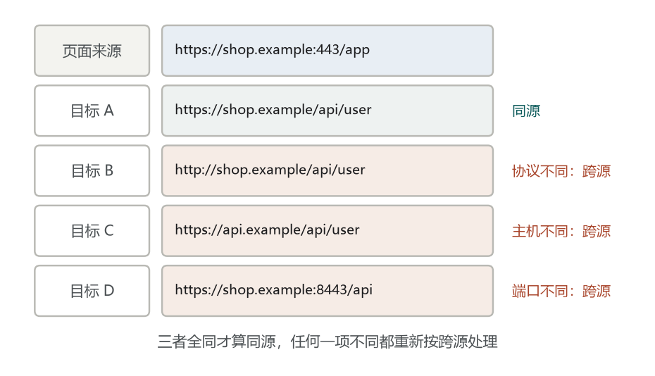
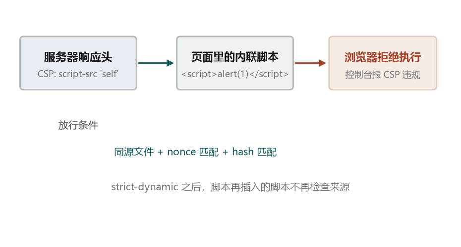

# 第十二章　Web 平台的安全模型

一个页面里同时跑着三种代码，站点自己的脚本、广告联盟的脚本、用户上传的富文本渲染出来的内容。它们共享同一个 DOM，同一份 Cookie，同一套 API。从操作系统的角度看，这是一个进程，权限完全一样。

浏览器没有别的选择。它不可能为每段第三方脚本开一个进程再配一套权限，那样页面根本跑不起来。它换了一个办法，把“来源”这个概念做进每一个 API 的第一行检查里，让不同来源的代码即使跑在同一个进程里，也读不到对方的数据。

这个模型叫同源策略（same-origin policy）。它从 1995 年 Netscape 2.0 开始存在，规则只有一句话，但这句话的边界、例外和绕过方式，构成了整个 Web 安全的地形。后面几节都在回答同一个问题，浏览器凭什么认为两段代码是“一起的”。

## 12.1 源：三个字段决定的边界

一个源（origin）由三样东西决定，协议、主机、端口。三者全同才是同源，任何一个不同就是跨源。

`https://example.com/a` 和 `https://example.com/b` 同源，路径不参与判定。`http://example.com` 和 `https://example.com` 跨源，协议不同。`https://example.com` 和 `https://example.com:8443` 跨源，端口不同，缺省端口 443 算作显式写了 443。`https://example.com` 和 `https://www.example.com` 跨源，主机名不同。

把主机名换成 IP、大小写、末尾的点，浏览器都有明确的规范化规则，规范化之后相同就算同源。子域不算同源，这是很多人第一次接触这个概念时最容易搞错的地方，`a.example.com` 读不到 `b.example.com` 的 Cookie，除非 Cookie 显式设了 `Domain=.example.com`。

有几个例外要单独记。`document.domain` 曾经允许两个子域把自己的源改写成共同父域，从而互相访问，这个特性因为太容易被滥用，已经在逐步移除。`about:blank` 和 `javascript:` 这类没有主机名的文档，会继承创建者的源。用 `sandbox` 属性加载的 iframe，如果没有加 `allow-same-origin`，会被赋予一个不透明源（opaque origin），它对任何其他源都跨源，连自己都读不到自己的存储。

还有一类源不属于任何主机，`data:`、`blob:`、`file:` 的源各自独立。`data:` 文本页面的源是不透明的，它里面的脚本读不到打开它的页面的任何东西。这也是为什么把用户上传的 HTML 直接当 `data:` 打开，比放在同源目录下安全。

比源更粗的一个概念是站点（site），取的是可注册域名，也就是公共后缀列表（public suffix list）往上一级。`a.example.co.uk` 和 `b.example.co.uk` 同站，`example.co.uk` 和 `evil.co.uk` 不同站。公共后缀列表的存在是为了防止有人注册一个 `co.uk` 下的域名就声称自己和所有 `.co.uk` 站点同站。

<figure>

<figcaption>图 12-1　同源判定与一次跨源请求的路径。三元组任一不同即为跨源；请求照样送达服务器，浏览器只在响应回来的路上决定能不能把内容交给脚本。</figcaption>
</figure>

两个概念的用途不同。DOM 的访问控制用源，因为一个源里的脚本能读到的数据，必须是这个源自己的数据。Cookie 的发送用站点，因为 Cookie 本来就是设计成在子域之间共享的。同站不等于同源，这个区别是理解一系列漏洞的起点，比如子域接管为什么能偷主站的会话。

## 12.2 CORS：跨源读取的放行条件

同源策略禁的是“读”，不是“发”。一个跨源的 `fetch` 请求会被正常发出去，服务器会正常处理，数据库该改的也改了。浏览器拦的是响应，脚本拿不到 `response` 的内容，也拿不到状态码。

这个设计经常被误解成“浏览器帮我挡住了跨站请求”。它挡住的是数据外流，不是操作本身。如果一个接口用 GET 做删除，或者用 POST 做转账而不校验来源，攻击者不需要读到响应就能完成攻击。

预检还有一个副作用，它让“简单请求”成了绕过预检的通道。`text/plain` 在安全列表内，攻击者可以用它发一个内容其实是 JSON 的 POST，很多框架不看 `Content-Type` 就解析，请求照样被处理。防 CSRF 不能靠 CORS，要靠 SameSite、CSRF token 或者校验 `Origin` 头。CORS 管的是读取，不是写入。

要让跨源读取合法地发生，需要服务器明确允许，这套机制叫跨域资源共享（Cross-Origin Resource Sharing，CORS）。

请求分两类。简单请求不需要预检，条件是方法是 GET、HEAD 或 POST，头部只用了少数几个安全列表内的字段，`Content-Type` 只能是 `application/x-www-form-urlencoded`、`multipart/form-data` 或 `text/plain`。这类请求直接发出，浏览器在响应上检查 `Access-Control-Allow-Origin`，匹配才把内容交给脚本。

不满足条件的请求要先发一个 `OPTIONS` 预检，带上 `Access-Control-Request-Method` 和 `Access-Control-Request-Headers`，问服务器“我能不能用这个方法、带这些头”。服务器回 `Access-Control-Allow-Methods`、`Access-Control-Allow-Headers` 和一个缓存时间 `Access-Control-Max-Age`。预检通过，真正的请求才发出去。

带凭证的请求更严格。`Access-Control-Allow-Credentials: true` 时，`Allow-Origin` 不能是 `*`，必须是具体的源，因为 `*` 意味着任何站点都能读，配合 Cookie 就等于全泄。响应还要带 `Vary: Origin`，否则中间缓存会把给 A 站的响应发给 B 站。

最常见的错误配置是把请求里的 `Origin` 原样反射回去，再打开凭证。写法大概是读 `Origin` 头、拼进 `Allow-Origin`、返回 `true`。这样任何站点都能读，等于自己拆了同源策略。正确的做法是维护一个白名单，只放行已知的源。

## 12.3 CSP：在解析阶段拦下脚本

同源策略管的是“不同源的代码能读什么”，它管不了“同一源里混进来的代码”。XSS 注入的脚本和站点自己的脚本同源，浏览器看不出区别。内容安全策略（Content Security Policy，CSP）补的是这一层，它告诉浏览器这个页面允许从哪些地方加载、执行什么。

CSP 通过响应头 `Content-Security-Policy` 下发，一组指令用分号分隔。`default-src 'self'` 是常见的起点，意思是所有资源默认只能从同源加载。`script-src` 单独收紧脚本，`object-src 'none'` 关掉插件，`base-uri 'none'` 防止攻击者用 `<base>` 改写相对路径，`form-action 'self'` 限制表单提交目标。

真正能挡住 XSS 的是 nonce 和 hash。服务器每次响应生成一个随机 nonce，写进头里，同时给每个合法的 `<script>` 标签加上同样的值。浏览器执行脚本前先比对，没有 nonce 的内联脚本一律不执行。攻击者注入的 `<script>` 拿不到这次的 nonce，因为它每次请求都变。

<figure>

<figcaption>图 12-2　CSP 对内联脚本的判定路径。有匹配的 nonce 或 hash 就执行，只剩 `unsafe-inline` 而没有随机值时才放行全部内联，`strict-dynamic` 把信任传给受信脚本动态创建的元素。</figcaption>
</figure>

`strict-dynamic` 是给现代前端框架用的。框架渲染出来的脚本往往是运行时创建的，静态 nonce 覆盖不到。打开 `strict-dynamic` 之后，带 nonce 的脚本创建的子脚本自动被信任，而主机名白名单和 `unsafe-inline` 被忽略。信任沿着“谁创建的”这条链传递，注入点不在链上，就没有信任。

CSP 的绕过大多不是因为策略本身写错，而是因为站点里存在“把字符串变成脚本”的接口。被允许的域名上如果有 JSONP 端点，攻击者构造一个回调名就能执行任意代码。老版本的 AngularJS 能把模板里的表达式当代码跑，也被用来绕过。这些接口让“允许这个域名”等价于“允许执行任意脚本”，把白名单的效果削掉了。审计 CSP 时要看的不只是头，还有被允许的域名上究竟托管了什么。

部署 CSP 一般从 `Content-Security-Policy-Report-Only` 开始，策略只上报不拦截，观察一段时间，把站点实际用到的资源收集齐，再切成强制模式。直接上强制模式的结果往往是一批功能静默失效，然后有人把整条策略删掉。CSP 只对浏览器收到的响应生效，服务端模板里的注入如果发生在渲染之前，它挡不住已经进入 HTML 结构的内容，它挡的是执行，不是注入。

## 12.4 iframe 与进程隔离

iframe 是页面里嵌入另一个页面的标准方式。被嵌入的文档有自己的源、自己的脚本环境，和父页面之间受同源策略约束。父页面能拿到 iframe 的 `contentWindow`，但读不到里面的 DOM，除非同源。

`sandbox` 属性可以进一步收紧。加上这个属性后，iframe 里的脚本被禁用、表单不能提交、弹窗被拦、所有存储被隔离，源变成不透明的。要放开某一项，就加对应的 `allow-` 值，`allow-scripts` 放脚本，`allow-forms` 放表单，`allow-popups` 放弹窗。

这里有一个组合必须避开，`allow-scripts` 加 `allow-same-origin` 同时出现时，iframe 里的脚本能拿到自己的 `frameElement`，把 `sandbox` 属性删掉，然后重新加载自己，沙箱就没了。两个值单独用都是合理的，放在一起等于没加沙箱。一些富文本预览、第三方组件容器就是这么写的。

反方向的限制是防止页面被嵌入，也就是防点击劫持。老的方案是 `X-Frame-Options: DENY`，新的方案是 CSP 里的 `frame-ancestors`，后者能指定允许哪些源嵌入，前者只能全禁或禁跨源。透明 iframe 盖在按钮上骗点击，是最古老的界面欺骗手法之一，这两个头是唯一的服务端防御。

隔离的粒度在最近十几年里一直在变粗。早期所有站点共用一个渲染进程，Spectre 出来之后，浏览器开始按站点分进程（site isolation），一个站点一个进程，跨站的 iframe 走进程间通信。配套的是 COOP 和 COEP 两个头，同时设置之后页面进入跨源隔离状态（cross-origin isolated），才能用 `SharedArrayBuffer` 和高精度计时器。隔离的代价是内存，一个标签页开几十个进程并不罕见。

`credentialless` 是更新的一个选项，嵌入的 iframe 发请求时不带 Cookie，服务器看到的就像一个新用户。它和 `sandbox` 解决的不是同一个问题，`sandbox` 限的是能力，`credentialless` 限的是凭证。广告位、第三方评论框这类不值得信任又需要渲染的嵌入，两种都用得上。

## 12.5 postMessage 与序列化边界

跨源的窗口之间要通信，靠的是 `postMessage`。父页面调 `iframe.contentWindow.postMessage(data, targetOrigin)`，接收方监听 `message` 事件，从 `event.data` 取内容，从 `event.origin` 取发送方的源。

两个参数都有讲究。`targetOrigin` 写成 `*` 表示不限制接收方，任何嵌入这个页面的站点都能收到消息。如果消息里带用户 ID 或者令牌，写 `*` 就等于广播。接收端必须检查 `event.origin`，而且要精确比较，用 `startsWith` 或者 `indexOf` 会被 `https://good.com.evil.com` 这种域名骗过。

传递的数据经过结构化克隆（structured clone），不是 JSON 序列化。函数、DOM 节点、原型链上的方法都过不去，`Date`、`Map`、`RegExp` 这些内置类型能保留，`ArrayBuffer` 可以转移所有权而不是复制。这个语义差异会导致一些意外，发送端传了一个带方法的对象，接收端拿到的是一个普通对象，调用方法时报错。

接收端的检查应该写成这样，先比对再使用。

```js
window.addEventListener('message', function (e) {
  if (e.origin !== 'https://widget.example.com') return;
  if (e.source !== iframeRef.contentWindow) return;
  render(e.data);
});
```

`e.source` 也要比，否则同一个源里另一个窗口发来的消息也会被当成有效。

序列化的边界是注入类问题的老巢。任何“把一段文本还原成对象”的过程，都可能被构造的输入影响。`JSON.parse` 本身不执行代码，但如果后续代码把解析出来的对象合并进另一个对象，`__proto__` 字段就能改掉原型，这叫原型污染（prototype pollution），影响面能扩散到整个应用。Java 的反序列化、Python 的 pickle、PHP 的 `unserialize` 更直接，某些类型的对象在还原时就会触发代码执行。

判断一个序列化边界是否安全，看两件事。输入能不能控制类型，而不只是控制值；还原过程会不会触发副作用。两条都成立时，这个接口就是一个远程代码执行的入口。

## 12.6 客户端存储

浏览器给了页面好几种存数据的地方，安全属性差别很大。

Cookie 是最老的，会自动随请求发送，可以设 `HttpOnly` 让脚本读不到。`localStorage` 是同步的键值存储，每个源一份，容量几 MB，没有过期时间，脚本可以随意读写，也不随请求自动发送。`sessionStorage` 类似，但生命周期跟标签页绑定。IndexedDB 是异步的对象数据库，容量大得多，能存结构化数据。

把访问令牌放进 `localStorage` 是很常见的做法，理由是简单，刷新页面不用重新登录。代价是任何一次 XSS 都能把它读走，而且读走之后攻击者可以在自己的机器上慢慢用，不受页面关闭的影响。放进 `HttpOnly` Cookie 能挡住读取，但要额外处理 CSRF，因为 Cookie 会自动带上。两种做法没有绝对优劣，取决于站点更怕 XSS 还是更怕 CSRF，以及有没有做好对应的防护。

存储是按源隔离的，这是同源策略的一部分。攻击者从 `evil.com` 读不到 `bank.com` 的 `localStorage`，但它如果能把自己的脚本注入到 `bank.com` 的页面里，就读得到，因为那时脚本的源就是 `bank.com`。存储隔离防的是跨源，防不了同源里的注入。

Cookie 的 `SameSite` 在追踪语境下还有另一层作用。第三方 Cookie 被全面限制之后，跨站追踪转向了存储和网络层指纹，浏览器于是把 Cookie 也按顶层站点分区。这套变化对安全的影响是双向的，攻击者更难跨站带着凭证发请求，一些合法的单点登录流程也要重新设计。

Service Worker 把这个问题放大了一层。它能拦截这个源下的所有请求，把响应缓存下来。一个被攻破的 Service Worker 脚本可以长期驻留在用户浏览器里，即使服务器上的漏洞修好了，缓存里的恶意响应还在。注册 Service Worker 的脚本必须和页面同源，作用域受路径限制，所以把用户上传的文件放在独立子域上是有意义的，那个子域即使被攻破也影响不到主站。

最近几年浏览器还在做存储分区（storage partitioning），把 iframe 里的存储按顶层站点再切一次。同一个第三方 iframe 嵌在 A 站和 B 站里，拿到的是两份不同的 `localStorage`。这个改动的目的是断掉跨站追踪，副作用是一些依赖跨站共享状态的嵌入组件会失效。

## 12.7 响应头里的那几条基线

前面几节讨论的都是“谁能做什么”，还有一组头管的是“这个响应该怎么被解释”。后者不出现在架构讨论里，但漏掉一条就是一个洞。

`X-Content-Type-Options: nosniff` 关掉 MIME 嗅探。早期的 IE 不看 `Content-Type`，直接看内容猜类型，一个上传的图片如果在开头塞了 HTML，就会被当成页面执行。这个头从 IE8 开始支持，现在所有主流浏览器都认。它挡的是“内容类型与声明不符”这一类，比如用户上传的文件以 `text/plain` 返回，浏览器却按 HTML 渲染。

`Content-Disposition` 决定浏览器是渲染还是下载。用户上传的文件统一回 `attachment`，不要让浏览器有机会在站点的源里解析它。文件名参数里不能出现回车换行，否则可以注入额外的响应头，这是把用户输入拼进头部的老陷阱。

`Cross-Origin-Resource-Policy` 限制谁能引用这个资源，取值 `same-origin`、`same-site`、`cross-origin`。它的场景是防止别的站点用 `` 或 `<script>` 把你的响应拉过去，再靠时序或者报错推断内容。Spectre 之后浏览器把这类跨站读取当成真实威胁，CORP 是配套的措施之一。

请求方向上，浏览器会自动加几个 `Sec-Fetch-*` 头。`Sec-Fetch-Site` 说明发起方是同源、同站还是跨站，`Sec-Fetch-Mode` 说明是导航、CORS 还是 no-cors，`Sec-Fetch-Dest` 说明要拿来干什么。脚本改不了这些值，它们由浏览器在发出请求时填。服务端用 `Sec-Fetch-Site: cross-site` 拒掉带副作用的请求，比查 `Referer` 可靠，因为 `Referer` 会被隐私设置裁掉。

| 头 | 取值 | 挡什么 |
|---|---|---|
| `X-Content-Type-Options` | `nosniff` | 内容嗅探导致的类型混淆 |
| `Content-Disposition` | `attachment` | 上传文件在站点源内被渲染 |
| `Cross-Origin-Resource-Policy` | `same-origin` | 跨站直接引用资源 |
| `Sec-Fetch-Site` | 拒绕 `cross-site` | 跨站发起的带副作用请求 |

这四条不是全部，但它们覆盖了最常见的几类“响应被错误解释”的问题。部署时把它们写进反向代理的默认配置，比在每个应用里手工加可靠。

## 12.8 第三方脚本与供应链

站点自己的代码经过评审、测试、发布流程，第三方脚本没有。一行 `<script src="https://cdn.example.net/widget.js">` 让一个外部团队获得了和站点同等的执行权，能读 DOM、读存储、带着用户的 Cookie 发请求。

完整性校验是第一道闸。子资源完整性（Subresource Integrity，SRI）在标签上写 `integrity="sha384-..."`，浏览器下载完先算哈希，对不上就不执行。跨源加载时还需要服务器返回 CORS 头，否则浏览器拿不到内容做校验。SRI 的局限很明显，对方一发版哈希就变了，静态写死的标签会失效，运行时动态注入的脚本也用不上。

2024 年 6 月发生的事说明了这条链有多脆。polyfill.io 是一个被大量站点引用的脚本托管服务，提供老浏览器的兼容垫片，域名在当年 2 月被转卖给一家叫 Funnull 的公司。新的持有者从 6 月开始对一部分访问者返回带恶意跳转的脚本，只对特定来源和移动端生效，正常访问看不出来。Cloudflare 的统计是超过十万个站点引用了这个域名，事件曝光后多家 CDN 和域名注册商做了拦截，项目本身也迁到了新的维护方。这个案例里没有任何一个站点写错了代码，它们只是引用了一个曾经可信的第三方。

结构性的对策是自托管和锁版本。把依赖下载到自己的域名下，引用构建产物而不是运行时加载；必须用外部 CDN 时，用 SRI 加版本号固定的 URL，不用 `latest`。更彻底的是 CSP 的 `strict-dynamic` 加 nonce，只有带 nonce 的脚本能执行，它动态创建的子脚本继承信任，而 HTML 里直接写的第三方 `<script src>` 没有 nonce 就完全不执行。

供应链的层级比想象的多。直接依赖、间接依赖、构建工具、CI 里的第三方 action、打包时拉的基础镜像，每一层都能改最终产物。审计的时候要问的是“这个字节是谁写的”，而不是“这个库有没有漏洞”。前者是供应链问题，后者只是依赖管理问题。
