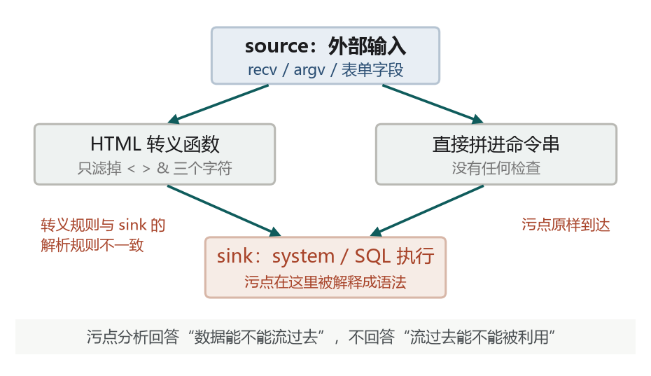
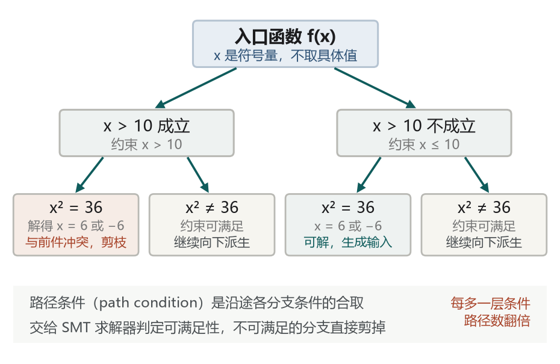

# 第十三章　程序分析：符号执行与抽象解释

一个三十万行的 C 项目要发版。团队跑了一遍静态扫描，两个商用工具再加上 clang 自带的检查器，报告里只有十四条告警，全是“可能为空的指针”这一类，逐条看过，都无关紧要。三个月后，某个解析配置文件的函数被外部提交的一个畸形样本打崩，原因是数组下标没做上界检查。

复盘会上有人问了一句，为什么扫不出来。

这个问题不太好回答，因为答案不是“工具不好用”。同一批工具在别的项目里救过命。真正的原因藏在工具的假设里。扫描器读的是代码的形状，不是代码的行为。它不知道那个下标来自一个长度为 4 的字段，也不知道上游的校验被一次重构挪走了。它看到的是一个整数，而整数的取值范围，在它眼里是“任何一个 32 位数”。

这一章讲的就是这类工具的内部结构，以及它们的能力边界划在哪里。四种方法看同一段代码的角度完全不同，失效的方式也完全不同。搞清楚它们各自相信什么，才能读懂一份扫描报告的真实含义。

## 13.1 三种粒度：词法、AST、IR

所有静态分析工具，第一步都是把源代码变成某种可计算的数据结构。选择哪种结构，几乎决定了后面能问出什么问题。

最浅的一层是词法。工具把文件切成 token 序列，用正则匹配去找东西，`grep -rn "strcpy(" .` 就是一个词法工具。硬编码的密钥、误提交的私钥文件，用正则抓效率极高，特征在字符层面足够明显。

短板同样明显。它不知道 `strcpy` 出现在字符串常量里还是函数调用里，不知道这个调用被 `#if 0` 包着。一段写在文档注释里的示例代码，会让它报一条“不安全的字符串拷贝”。

往下一层是抽象语法树（abstract syntax tree, AST）。编译器前端把 token 组织成表达式和语句的树形结构，每个节点带着类型信息。这时候工具可以问结构性的问题了，比如“是否存在对同一指针连续两次 `free`”、“`malloc` 的返回值有没有检查”、“`switch` 是否漏了 `default`”。clang-tidy 和大多数 lint 工具都工作在这一层。

AST 能看懂语法，看不懂语义。考虑这段代码。

```c
if (len > 0 && len < 16) {
    memcpy(dst, src, len);
}
```

AST 上这是一个 `if`，条件是两个比较的与。工具可以说“这里做了长度检查”，但它说不清这个检查是否覆盖了所有到达 `memcpy` 的路径。函数上方如果还有一条 `goto` 直接跳进去，AST 看不见，因为跳转关系不是树的父子关系。

要表达控制流，就得再往下一层，用中间表示（intermediate representation, IR）。编译器把 AST 降解成三地址码，控制流画成图，基本块是节点，跳转是边。LLVM 的 IR 还带静态单赋值形式（static single assignment, SSA），每个变量只被赋值一次，定义点可以顺着用法的链查上去。

到了 IR 这一层，“这个下标可能取什么值”才成为能计算的问题。沿着定义链往上追，看它是从 `read()` 的返回值来的还是从常量表取的，中间经过几次加减和掩码。这个过程叫到达定值分析。

代价是保真度。宏、模板、异常、运行时派发，在 IR 上要么被展开成看不懂的形状，要么根本没进 IR。一份报告指向 `parser.cpp:412`，你在那一行找不到可疑之处，因为问题在它展开的宏里。

## 13.2 数据流与污点分析

数据流分析的框架在 1970 年代就定型了。给定一张控制流图，给每个程序点关联一个抽象状态，给每条语句一个转移函数，反复迭代到状态不再变化，得到一个不动点。

考虑“哪些变量在这个点一定被初始化过”。从入口开始，假设都未初始化，遇到赋值就标记，遇到分支把两条分支的状态取交，遇到循环再迭代一轮。稳定之后，就得到每条语句执行前必然成立的事实。编译器用它删死代码，安全工具用它抓“使用未初始化变量”。

污点分析（taint analysis）是这个框架的变体，状态里多带一份标签。先声明一批 source，即外部数据进入程序的位置，比如 `recv`、`read`、`argv`、环境变量、HTTP 字段；再声明一批 sink，即 `system`、`execve`、SQL 拼接、`memcpy` 的长度参数这类危险操作。然后沿数据流传播标签，看图 13-1 那样的路径能不能走到 sink。

<figure>

<figcaption>图 13-1　污点从 source 到 sink 的两条路径。左侧经过一次转义，但转义规则针对的是 HTML，挡不住命令拼接；右侧完全没有检查。污点分析能算出这两条路径都通到 sink，至于通到之后能否被利用，它不管。</figcaption>
</figure>

传播规则跟着语言语义走。`a = b` 让 `a` 继承 `b` 的标签，`a = b + c` 只要有一个带标签，`a` 就带标签。规则写起来不难，难的是写全。一个 `struct` 拷贝，标签该怎么走。一次通过函数指针的调用，被调函数是谁。一个值存进全局数组又换个下标读出来，还带不带标签。

静态分析在这些地方统统做保守假设。别名分析说“这两个指针可能指向同一块内存”，于是通过任一指针的写入都要污染另一条路径；间接调用说“可能指向 N 个候选”，于是 N 条路径都要分析。保守保证不漏报，代价是误报。

动态污点分析换了一个思路，直接在运行时跟。工具给每个字节配一位影子标记，记录这个字节是不是来自 source，然后按指令语义更新影子内存。Intel 平台上有几套实现，libdft（Kemerlis 等，2012）用二进制插桩，TaintDroid（Enck 等，2010）在 Android 的 Dalvik 解释器里做，粒度到变量而不是字节。

动态的好处是几乎没有误报，标签真流到了 sink 就是真流到了。坏处是只覆盖跑过的那条路径，对隐式流无能为力。

```c
int t = secret & 1;
if (t) { x = 1; } else { x = 2; }
```

`x` 携带了 `secret` 最低位的信息，但标签传播只走数据依赖，`x` 是从常量赋的值，不会被打上标签。这类经由控制流泄漏信息的通道要靠更贵的分析才覆盖得到，实际工具基本放弃。

报告里最常见的一类误报也出在净化函数的建模上。有人给输入加了 `escape_html()`，工具照样报“命令注入”，因为它的模型里这个函数不算净化。反过来把它加进白名单，所有走它的路径都被放过，可它滤掉的只是尖括号和引号，对 `;` 和 `|` 一概不管。白名单写宽了，漏报就跟着来。

## 13.3 符号执行：把输入变成变量

数据流分析算的是“哪些值可能流到这里”。符号执行问的是另一个问题，“要让程序走到这里，输入需要满足什么条件”。

做法是把输入当成符号，不赋值。`x` 在分析器内部是符号表达式，执行到 `y = x * 2 + 1` 时，`y` 的值就是 `2x + 1`，不是数字。执行到分支时无法判断走哪边，于是分成两个状态，一边记下 `x > 10`，另一边记下 `x <= 10`，各自往下走。

走到 `assert`、`abort` 或者一次越界访问之前，分析器把沿途累积的条件取合取，交给 SMT 求解器（satisfiability modulo theories solver）问一句有没有解。有解，求解器顺便给出一组具体取值，那就是能触发该路径的测试输入。无解，这条路是死路，直接剪掉。

<figure>

<figcaption>图 13-2　符号执行在一段两重条件上的状态分裂。每个叶节点对应一条路径，路径条件是沿途条件的合取。左下角那一条要求 `x` 同时大于 10 且平方等于 36，求解器判定不可满足，整条分支被剪掉；右下角那一条能解出 `x = 6` 或 `x = -6`，可以直接拿去当测试用例。</figcaption>
</figure>

图 13-2 那棵树的形状说明了符号执行最诱人的地方。它不是猜，是推导。模糊测试靠随机变异碰运气才能让 `x` 恰好等于 6，符号执行直接算出来。解析器里那些层层嵌套的格式校验，最吃这种能力。

让符号执行能落地的是三件事凑齐。SMT 求解器在 2000 年代后期成熟，Z3（de Moura 与 Bjørner，2008）把位向量、数组、线性算术收进一套接口。编译器能产出规整的 IR，符号执行直接在 LLVM bitcode 上跑，不必面对 C 的边角语法。环境建模也有了办法，KLEE（Cadar、Dunbar 与 Engler，2008）用符号文件系统把 `open`、`read` 的返回值也变成符号量，“读一个文件”这种外部依赖就进了分析范围。

一个实用的符号执行引擎，工作量的大头不在路径探索，在建模。`malloc` 返回的地址怎么表示，两次分配会不会别名，`strlen` 的返回值是什么表达式，`printf` 有没有副作用，`ioctl` 的参数该不该具体化。建模不全，分析器就在某处卡住，或者报个假结果。

## 13.4 路径爆炸与求解器的墙

符号执行的理论上限由两个东西决定，路径数量和求解能力。

路径数量是指数级的。每遇到一个未定分支就分裂一次，走十层就有上千个状态，二十层上百万。真实程序里的循环更没底线，迭代次数取决于输入，分析器不知道该走几轮。这就是路径爆炸（path explosion）。

工程上有几种应对。给循环设上限，最多展开 k 次，越过 k 轮的行为就分析不到。找循环不变式，猜测每轮之后某些量保持不变，把无限展开压成一个状态，猜错了结果就不准。做状态合并，把程序点相同、条件不同的状态并到一起，用 if-then-else 代替分裂，代价是表达式膨胀、求解变慢。还有更粗暴的一条路，随机挑一条路径深入，其余先放着，这实际上退化成引导式搜索。

求解器那边有一道更硬的墙。SMT 求解器擅长的是位向量运算、线性整数算术、数组读写、未解释函数。这些理论在给定位宽下可判定，复杂度是 NP 难的，实践中靠启发式能撑住大部分查询。它不擅长的是非线性算术。一个 `x * y == 1234567 && x > y` 的约束，求解器要么暴力枚举，要么直接返回未知。整数域上的非线性丢番图方程可解性，是希尔伯特第十问题，答案是根本不存在通用判定算法。

还有一类更常见的困难。程序里只要出现一次哈希或者加密，约束就变成了“找到原像”。

```c
if (md5(password) == 0x8f14e45fceea167a5a36dedd4bea2543) {
    grant_access();
}
```

求解器面对它只有一条路，把输入空间里的值逐个代入。它不会比暴力快，因为好哈希函数的设计目标就是让任意一位的改动都彻底改变输出，位向量求解器赖以工作的按位推理在这里完全失效。

浮点运算是第三道坎。IEEE 754 的语义可以被精确建模，位爆破成整数位向量后求解器能处理。可是精度一高，位宽就翻倍，约束规模跟着暴涨，几个浮点乘加连在一起就开始超时。

还有环境。分析器碰到一个没建模的库函数，只有两条路，报“无法求解”然后停下，或者把这个符号值替换成一个具体值继续跑。后者叫具体化（concretization），能让分析走下去，但它把符号分析变成了只覆盖一条路径的测试，完整性就没了，而报告上看不出任何异常。

所以“符号执行证明了这段代码没有越界”这句话，实际含义是“在我设的循环展开上限、我建的内存模型、我处理的库函数集合之内，用求解器没有找到反例”。这句话很有价值，但它不是数学证明。

## 13.5 抽象解释与区间分析

抽象解释（abstract interpretation）走的是另一条路。它不问“哪条路径能到 bug”，它问“在这条语句执行之前，这个变量的所有可能取值都落在哪个集合里”。

Cousot 父子在 1977 年的文章里把这个想法形式化了。具体执行是在真实值上算，抽象执行是在一个抽象域上算。抽象域里的每个元素代表一组具体值，比如区间 `[0, 100]` 代表 101 个整数。运算符在抽象域上有一个对应的版本，`[0,10] + [5,20]` 得到 `[5,30]`。只要这个对应关系满足单调性，并且抽象域里的升链是有限的（或者用 widen 强行让它有限），迭代就一定能收敛到不动点。

收敛到的那个不动点，是程序所有真实行为的一个上近似。包住了真实行为，也可能包多了。所以抽象解释是可靠的（sound），不会漏掉任何一个真实存在的值，但会把不可能出现的值也算进去，于是报警。

报的警是不是真的，取决于抽象域有多细。最粗的是区间域，每个变量一个上下界。区间域处理不了变量之间的相关性。

```c
int i = 0, j = 100;
while (i < 50) { i++; j--; }
```

`i` 和 `j` 始终满足 `i + j == 100`，区间域却分别给出 `[0, 50]` 和 `[50, 100]`，把这个关系丢了。越界检查一旦依赖它，区间分析就报假警。换更细的域，八边形域（octagon）能表达 `±x ± y ≤ c`，多面体域（polyhedron）能表达任意线性不等式组，精度上去了，计算量和内存也指数级上去。

循环是绕不开的难点。上面那段代码，第一轮 `i ∈ [0,1]`，第二轮 `[0,2]`，一直涨。分析器不能迭代五十次，于是用一个叫 widen 的操作把上升的区间推到边界之外，`[0, +∞)`，逼迭代停下。代价是精度大幅损失，之后靠 narrow 往回收一点。

这个领域最有名的成果是 Astrée（Blanchet 等，2003），用来证明空客 A340 飞控软件里不存在运行时错误，包括整数溢出、除零、数组越界和浮点异常。这份证明不依赖测试覆盖，代码里每条路径都被算了进去，靠的是针对飞控代码定制的抽象域和一套极严格的建模，换一份代码就不一定成立。

抽象解释和符号执行不是竞争关系，它们回答的是不同的问题。抽象解释给你一个覆盖全部的、可能过粗的结论；符号执行给你若干个精确到具体输入的、可能不完整的例子。前者适合“这段代码不能出错”的场合，后者适合“我要找到那个能让它出错的输入”的场合。

## 13.6 动态分析与混合执行

前面几种方法都在代码上跑，不执行程序。另一类工具直接跑起来看，开销小得多，代价是只看到跑过的地方。

最常见的形态是运行时检查器。AddressSanitizer（Serebryany 等，2012）在每次访存前后插检查，给每个内存块加上红区（redzone），读写落到红区或者已释放的区域就立刻报错。影子内存记录哪些字节可用，一次检查几条指令，整个程序慢两三倍，换来的定位精度很划算，它报出的每个问题都真实发生过。MemorySanitizer 追未初始化内存，UndefinedBehaviorSanitizer 抓有符号溢出和非法移位，原理类似。

符号执行和真实执行能缝在一起，做成混合执行（concolic execution）。程序拿一组具体输入正常跑，同时记录每个分支实际走了哪边。跑完之后把路径条件取反，交给求解器算出新输入，让它下次走另一条分支。DART（Godefroid、Klarlund 与 Sen，2005）和 CUTE（Sen、Marinov 与 Agha，2005）是早期工作，微软的 SAGE（Godefroid、Levin 与 Molnar，2008）把它用到了 Windows 解析器的自动化测试上。

混合执行的好处是遇到复杂环境不用建模，直接让真实系统去执行；坏处是每换一条路径都要重跑一次，而且路径条件只能覆盖到实际执行到的那条线附近，跳不出局部。

回到开篇那个问题。零告警可能是真的没问题，也可能是假设把问题挡住了。分辨这两种，要问四件事。它建模了哪些外部输入，有没有把 `read` 的返回值当符号量。循环展开上限是多少，出问题的代码是不是在第五十轮之后才执行。求解器在什么公式上会放弃，放弃的查询里有没有关键的那条。它对白名单有多信任，那个把 `escape_html` 列为净化的补丁是谁加的。

一份扫描报告的可信度，等于这四个问题的答案的乘积。工具厂商喜欢宣传“零误报”，这句话在工程上等价于“我把判定阈值调高了”，阈值高的另一面就是漏报。真正的静态分析工具，报告里的每一条告警都应该带着它的路径条件和假设，让人能判断该不该信。

下一章讲另一种找问题的方法。它不要证明，也不推导条件，就是把一堆畸形输入灌进去，看程序会不会崩。听起来很笨，但它是过去十年里找出真实漏洞最多的手段。
