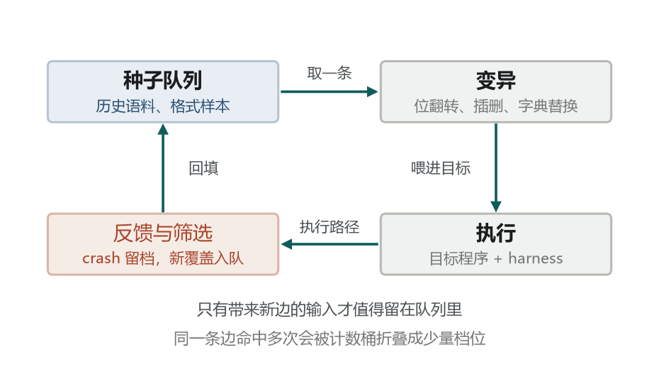
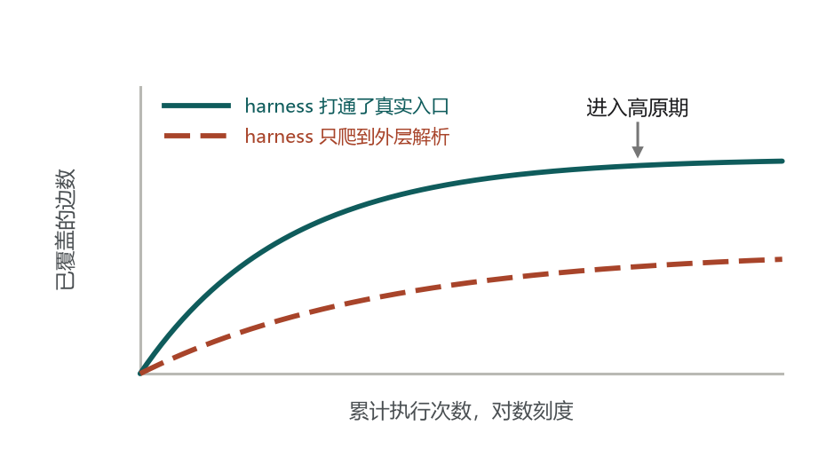

# 第十四章　模糊测试：覆盖率与变异

2016 年，Google 启动了一个叫 OSS-Fuzz 的服务。它做的事情简单到有点粗糙，把开源项目拉下来，用编译器插桩，然后不停地往里面灌随机数据，一跑就是几年。到 2017 年年中，这个服务累计报出的漏洞已经超过一千个。

模糊测试（fuzzing）不是新东西。1988 年，威斯康星大学的 Barton Miller 让学生用随机字符串去轰 UNIX 工具，结果一堆程序崩了。那份技术报告的写法很朴素，结论也不复杂，却开了一门手艺。之后二十年，随机测试被当成一种廉价但低效的手段，没人觉得它能替代人工。

转折点是覆盖率的引入。纯粹的随机灌数据，绝大多数输入在第一个 `if` 就被挡回来了，程序深处的代码永远跑不到。如果能知道这次输入走到了哪些地方，下一次就优先保留那些走到了新地方的输入，随机就变成了有方向的搜索。

这一章讲这个搜索是怎么做的，以及它在什么情况下会失效。

## 14.1 覆盖率的三种口径

模糊测试器所谓的“覆盖率”，有三种口径，粗细分得很开。

最粗的是行覆盖，也叫语句覆盖。编译器在每个基本块里插一条记录，跑完看哪些地址被命中过，映射回源码就是哪些行被执行了。这个指标好统计，也好看，所以被各种测试报告用滥了。它的问题是粒度太粗。

```c
if (a > 0) { handle_positive(a); }
```

只要 `a > 0` 和 `a <= 0` 两种情况都跑过一次，这一行就算覆盖了。可是如果函数体里还有 `if (a == 8)`，行覆盖看不见“a 恰好等于 8”这一状态，即使 `a` 只取过 1 和 -1。行覆盖回答的是“这行代码有没有被执行”，不是“这个分支的每种结果有没有被走到”。

细一档的是边覆盖，也叫分支转移覆盖。它记录的不是“执行了哪一行”，而是“从哪个基本块跳到了哪个基本块”。上面那个例子，`a > 0` 成立时走的边和 `a <= 0` 时走的边不同，编译器插桩能区分开。AFL 系列工具用的就是这个粒度，在每条边的入口处塞一段随机数，把 `上一块的编号 ^ 这一块的编号` 作为一个下标，去一张固定大小的位图里置位。

边覆盖同样有盲区。它能区分“走了哪条分支”，不能区分“在这条分支上用什么值走的”。一个对输入做逐字节比较的解析器，`if (buf[0] != 'M') return;`，只要输入的第一个字节是 `M` 就往下走，改了别的地方覆盖率一点变化都没有，但后面的解析可能全崩。

最细的是路径覆盖，要求控制流图里每一条完整路径都被走到。这个指标在实际程序里不可实现，一个二十次迭代的循环就有上百万条路径。工程上用它做局部约束，比如“让这个函数里的每一条路径都跑一遍”，也只在小函数里可行。

<figure>

<figcaption>图 14-1　反馈式模糊测试的一轮循环。队列里取出一条种子，变异后交给目标执行，执行产生的边覆盖和 crash 一起被记录，只有带来新边的输入才回到队列。整个循环的吞吐量取决于执行一次的开销，所以真实工具会跳过进程创建，用 fork 或者就地重入的方式反复跑同一个目标。</figcaption>
</figure>

## 14.2 反馈式循环

图 14-1 的四步看起来简单，把它做到每秒几千次执行，每个环节都有工程问题。

第一环是队列。队列里存的是种子，也就是已知能跑通并且带来过新覆盖的输入。种子从哪来，很大程度上决定了整场测试的上限。一个格式解析器，给它一个结构完全合法的样本，它能在几秒钟内进入解析深处；给它一堆随机字节，它可能永远卡在文件头校验上。

第二环是变异，细节留到下一节。

第三环是执行，也是最费时间的一环。每次执行都要启动目标进程、读入数据、跑完、收集结果，进程创建本身就吃掉几毫秒。AFL 的做法是在启动时 fork 出一个“服务端”，之后每次测试用 `fork` 从它派生一个子进程，跳过动态链接和初始化。更快的是持久模式（persistent mode），把 `main` 改成循环，在同一个进程里反复调用被测函数，每次只重置必要的全局状态。这一步能把每秒执行次数从几百提到几万。

第四环是反馈。执行完一遍，程序留下两样东西，一张覆盖位图，一份崩溃记录。位图与全局累积的位图做比较，出现了新置位的位，这条输入就被认为是“有价值的”，加入队列。这个判断标准是整套方法的核心，它把“随机”约束成“朝着没走过的地方走”。

位图的大小是固定的，AFL 里是 64K 个位置。边数超过这个规模就会碰撞，两条不同的边映射到同一个位，碰撞会让工具误以为某条边已经覆盖过，漏掉真正的新路径。更大的目标要把位图调大，代价是每次比较的开销上升。

还有一处容易忽略的细节。同一条边在循环里可能被命中几万次，如果按次数记，位图很快就被这些热点撑满，比较也失去意义。所以工具会把命中次数折成几个档位，1 次、2 次、3 次、4 到 7 次、8 到 15 次，往上到几百次，只保留档位差。这样“循环多转了一圈”也能被当成新信号，但不会淹没整张图。

## 14.3 变异策略与字典

变异算子是一组改写输入的小动作。最基础的是位翻转和字节替换，把某一位取反，或者把某个字节换成一个随机值。稍微聪明一点的是整数替换，把 4 个字节解释成一个整数，替换成 0、1、-1、`0x7f`、`0x8000`、`0xffffffff` 这类“边界值”。这类值在真实漏洞里出现频率极高，因为边界条件几乎总是写在这几个数上。

再往上是结构性的操作，删除一段、插入一段、把一个块复制到另一个位置、把两条种子各切一半拼起来。这些操作能让输入的长度和布局发生变化，对解析器里的偏移计算类漏洞特别有效。

变异策略里最值得说的是字典。很多格式有固定的标记，文件头是 `GIF89a`，XML 开头是 `<?xml`，HTTP 请求以 `GET ` 开头，协议里有固定的魔数和关键字。纯随机变异要凑出 6 个字节的魔数，概率是 2 的 48 次方分之一，永远等不到。把已知的标记做成字典，变异时按一定概率把字典里的词插进去，命中率立刻就不一样了。

字典从哪来，公开的格式文档、抓到的真实流量、程序二进制里的字符串常量。AFL 的用法是启动时传 `-x dict.txt`，每行一个词。这件事听起来很土，效果比很多花哨的算法都明显。

再进一步是语法感知的变异。工具先解析种子，知道它是一个 JSON、一个 PNG、一个 protobuf 消息，然后按语法结构去改，改字段值而不破坏结构，或者在合法的位置插入合法的新节点。这一路做下去，本质上是在写一个针对格式的生成器，通用性下降，效率上升。libprotobuf-mutator 就是这种思路，把输入定义成 protobuf 消息，变异在消息层面做，序列化之后再交给目标。

种子本身也得挑。一个语料库里塞着几千个样本，跑一遍要花掉大量时间，其中大部分对覆盖的贡献是零。工具提供语料最小化功能，跑一遍全集，记录每条输入带来的新边，只保留那些独占了某条边的样本。精简之后的语料库往往只剩几十个，覆盖却和全集一样。

## 14.4 怎么评价一个模糊测试器

学术界每隔一段时间就会有一篇论文宣称自己的方法比 AFL 快多少倍，工业界看了往往不以为然。原因在于评价标准不好定。

最直接的指标是发现了多少去重后的漏洞。难点在去重。同一个 bug 会以几百种输入触发，产生几百个 crash 文件，工具怎么知道它们是同一个。常用做法是拿崩溃时的调用栈做哈希，栈帧地址规范化之后比较；或者拿崩溃前的覆盖路径做签名。两种做法都会出错，栈哈希会把同一个 bug 的不同调用点算成两个，覆盖签名会把不同的 bug 合并成一个。

第二个指标是发现时间，从开始跑到报出第一个漏洞花了多久。这个数比“总量”更能反映效率，因为真实的测试是有时间预算的。跑一年发现一万个漏洞，和跑一天发现一百个，量级完全不同。

第三个指标是复现率。很多工具报告里的 crash 拿回来一跑，复现不了。原因可能是竞态、可能是超时、可能是测试环境的内存布局不同。一个只能复现一半的工具，报告要打对折看。

Google 在 2020 年推出了 FuzzBench，用统一的容器环境、统一的基准目标、多轮重复实验来做对比，把很多“比 AFL 快十倍”的结论打回了原形。之前那些结论大多来自单次实验，跑在不同机器、不同编译选项、不同种子库上，差异全被算进了算法优势里。

评测里最隐蔽的作弊方式是泄漏答案。把某个 CVE 的 PoC 放进种子语料，然后宣称工具找到了这个 CVE，这种实验毫无信息量，因为它测的是复现能力，不是发现能力。Magma 这类基准专门为此设计，用打了补丁和没打补丁的两个版本做对照，只有漏洞真的被触发才算命中，而且会检查触发点是不是在注入的那一处。

## 14.5 内核与协议的特殊性

用户态程序的模糊测试相对简单，一个进程，一个输入缓冲区，跑完退出。内核不是这样。

内核的入口是系统调用，参数不是一块字节，是几十个带类型的整数和指针。直接灌随机字节给 `ioctl`，绝大多数情况下会在参数检查那一关被 `EINVAL` 挡回来。要真正走到深处，得知道每个系统调用期望什么参数，哪些值组合是合法的。

syzkaller（Vyukov 从 2015 年开始写）的解法是把每个系统调用的签名写成描述文件，声明参数类型、取值范围、依赖关系，然后用这些描述生成结构合法的调用序列。它跑在虚拟机里，每次测试前拍快照，崩了就回滚，把崩溃现场的日志和输入收集起来。检测靠内核自带的检查器，KASAN 抓越界和释放后使用，KCSAN 抓数据竞争，lockdep 抓锁序问题。

内核还有一个用户态没有的维度，状态。文件系统的挂载状态、socket 的连接状态、设备驱动的初始化顺序，都会影响某条代码路径能不能走到。一个系统调用的语义依赖于之前几十个调用的结果，这种依赖关系用状态机描述，测试器要能按状态转移来编排调用序列。syzkaller 用一套伪系统调用（`syz_open_dev`、`syz_mount_image` 之类）来建立前置状态，让生成器不必自己推导。

协议测试的困难类似。一个 TLS 服务器，你发一个畸形握手包，它可能在解析扩展字段时就关掉连接，永远走不到密钥交换。要测到深处，客户端得先完成握手的前几步，把自己放在一个合法的会话状态里，再注入畸形数据。所以协议 fuzzer 往往带一个状态机模型，或者干脆录制真实流量再回放和变异。

这些场景里，harness 的质量比变异算法重要得多。harness 是把输入送进被测代码的那段胶水代码，它决定了 fuzzer 能看到多少代码。写得好的 harness 直接调用库的内部函数，绕开命令行解析和文件读写；写得差的 harness 在 `main` 外面套一层，输入要先过一遍配置文件解析，一半的测试时间花在无关代码上。

harness 还会造假漏洞。如果 harness 自己没检查返回值，把 `NULL` 往下传，崩的是 harness 而不是目标。如果 harness 捕获了所有异常然后继续跑，真正的 bug 就被吞掉了。这类问题在报告里表现为“漏洞集中在 harness 文件”，一看就知道该去改哪里。

<figure>

<figcaption>图 14-2　两条覆盖率增长曲线的形状示意，横轴为对数刻度的累计执行次数，纵轴为已覆盖的边数，未标注具体数值。实线代表 harness 打通了真实入口的情形，前期增长快，后期在高位走平；虚线代表 harness 只能爬到外层解析，很早就进入平台期，再堆执行次数也换不来新边。真实测量值随目标差异很大，这里只表达形状。</figcaption>
</figure>

图 14-2 里的两条曲线解释了为什么很多团队觉得“跑了三天没结果”就放弃。他们的 fuzzer 不是慢，是早就进了高原。执行次数继续涨，新边一条也不涨，因为剩下的代码需要特定的前置条件才能进，随机变异凑不出来。这时候该做的不是加机器，是改 harness、补字典、换种子。

## 14.6 定向模糊测试

标准 fuzzing 的目标是“尽可能多覆盖”，定向 fuzzing 的目标是“走到某一个特定位置”。后者的动机很实际，刚打完一个补丁，想知道这个补丁有没有堵住漏洞；或者静态分析报了某处可能有越界，想构造一个输入验证它。

做法是给每个基本块算一个到目标块的距离，距离可以用控制流图上的最短跳数，也可以用函数调用图的层次，然后用这个距离给种子打分，优先变异那些“离目标更近”的输入。AFLGo（Böhme 等，2016）就是这么做的，把模拟退火的思想搬到种子调度上，让队列朝着目标收敛。

另一条路是用符号执行或者约束求解去啃硬骨头。fuzzer 卡在某个复杂的校验函数上，比如一段校验和计算，随机变异永远过不去，这时候把那段路径条件取出来求解，就能直接得到通过校验的输入。工程上更便宜的做法是比较拆解，把 `memcmp(buf, "SECRET", 6)` 编译成一串逐字节比较，fuzzer 就能一个字节一个字节地推进，而不是一次猜六个。

真实工具里这些手段是混着用的。Redqueen 一类的技术从执行轨迹里提取输入和比较操作数之间的对应关系，直接把比较的另一个操作数写进输入，一步跨过校验。这类技术在 2019 年之后成了主流 fuzzer 的标配。

模糊测试的效率可以拆成三项相乘，单位时间内执行的次数、每次执行带来多少有效反馈、种子库里有多少值得变异的东西。三项里任何一项接近零，整体就接近零。工业界最常犯的错是只优化第一项，堆机器堆到每秒十万次执行，却因为 harness 写错、字典缺失、种子全是垃圾，覆盖率停在原地。

还有一个反复出现的误解，crash 不等于漏洞。ASan 报出来的越界读，如果读到的值不影响任何控制流和输出，攻击者拿它什么也做不了。一个断言失败在发布版本里根本不存在。一次 OOM 只是拒绝服务。把 crash 列表直接当漏洞列表交给下游，得到的一定是一堆无法利用的样本和一条被浪费的修复流程。
