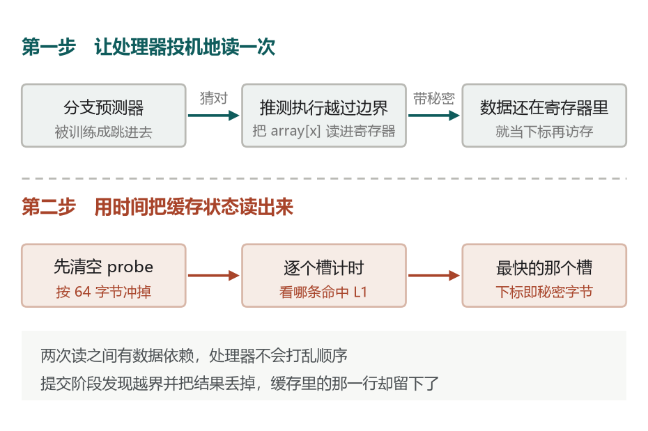
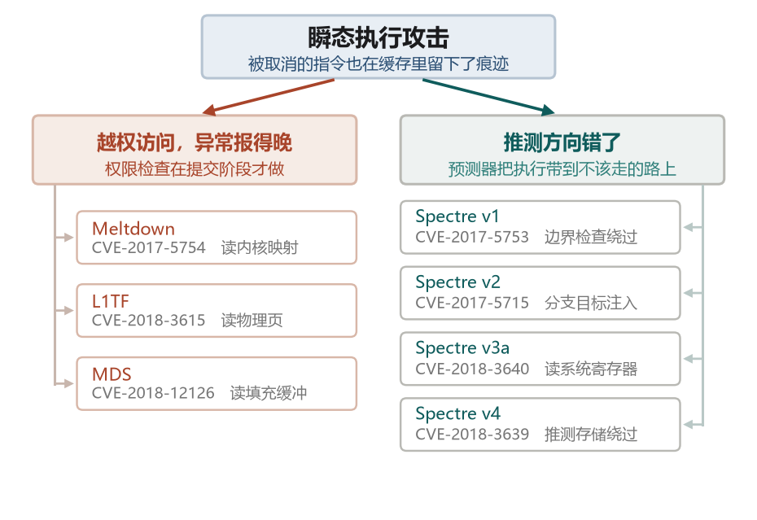

# 第十五章　侧信道与微架构

2018 年 1 月 3 日，几个研究团队同时公开了一组漏洞，Meltdown 和 Spectre。它们不需要任何软件层面的 bug，代码写得完全正确，编译器没有出错，操作系统也没有漏检。攻击者做的事情只有一件，让处理器执行一段合法的程序，然后掐着秒表看它跑了多久。

这个结论在当时很难接受。安全领域几十年的假设是，只要程序的逻辑正确、权限检查到位，攻击者就拿不到不该拿的数据。可这两个漏洞说明，权限检查确实到位了，数据也确实没有被“读”出来，处理器把一个字节从内核内存搬到了寄存器，发现自己越权，把结果丢掉，然后报告异常。整个过程中，寄存器的最终值是干净的。可这个字节在流转的两百个时钟周期里，把一条缓存线拉进了 L1，而缓存的状态没有人清理。

这一章讲的就是这种“没有读出来，但确实留下痕迹”的泄漏，以及为什么这类问题没法用打补丁的方式彻底解决。

## 15.1 时间就是信号

侧信道（side channel）的定义很朴素，不通过程序提供的接口，而是通过执行过程留下的物理痕迹推断信息。时间、功耗、电磁辐射、声音，都算。

时间是其中最容易被利用的一种，因为它几乎总是可测的。现代 CPU 上一次 L1 命中的延迟在 4 到 5 个时钟周期，一次 L3 命中在 40 个左右，一次主存访问要 200 以上。这个差距在纳秒级，而 `rdtsc` 指令的精度就是纳秒级。把同一段操作跑上一万次取平均，噪声就被压下去，4 个周期和 40 个周期的差别清清楚楚。

要让时间差有意义，得让“访问哪块内存”依赖于秘密。最经典的例子是查表实现。一个 AES 实现如果直接用 S 盒做索引，`sbox[secret_byte]` 会访问 256 个槽中的一个，这个槽所在的缓存线被加载。攻击者事先把整个表从缓存里赶出去，让受害者跑一次，再自己逐个槽去计时读，命中最快的那个槽就对应秘密字节。这就是 Prime+Probe 和 Flush+Reload 这一类技术的基本形状。

Flush+Reload（Yarom 与 Falkner，2014）要求攻击者和受害者在同一块物理内存上，共享库、共享页面、内存去重都能提供这种条件。做法是用 `clflush` 把目标缓存线刷掉，等受害者执行，然后自己计时读一次。快，说明受害者碰过。慢，说明没碰。

```c
clflush(&probe[i]);          /* 先把这一条刷出缓存 */
run_victim();                /* 等受害者执行一次 */
t0 = rdtscp();
v  = probe[i];               /* 被打断读一次 */
t1 = rdtscp();
hit = (t1 - t0) < 120;       /* 阈值按机器校准 */
```

这段代码的每一行都是普通指令，没有任何权限问题，它做的是测量而不是读取。阈值 120 是随手写的，实际要用几千次采样拟合出一条双峰分布，两个峰之间的距离就是信噪比的来源。

Prime+Probe（Percival，2005；Osvik、Shamir 与 Tromer，2006）不要求共享内存。攻击者用自己的数据把某一组缓存集占满，等受害者执行，再看自己那些数据被挤掉了几个。挤掉的多，说明受害者访问了映射到同一组的地址。它更通用，也更难测，因为信息是间接推出来的。

TLB（translation lookaside buffer）提供另一个观察点。页表项的缓存状态会暴露“最近访问了哪些页”，粒度是 4KB 而不是 64 字节，噪声大，但对于“访问了哪个函数”、“访问了哪一块大结构”这类问题已经够用。

<figure>

<figcaption>图 15-1　一次 Spectre 式攻击的两个步骤。上面是让处理器投机地越过边界读一个字节，并把这个字节当作下标去访问探测数组；下面是在处理器撤回结果之后，用计时的方式把缓存状态读回来。处理器从未把那个字节写进任何架构可见的位置。</figcaption>
</figure>

## 15.2 推测执行与乱序

要理解为什么越权读的结果能被利用，得先看现代处理器是怎么跑的。

x86 的一条指令在硬件里被拆成若干微操作，取指、译码、重命名、发射、执行、提交。为了让流水线不空转，处理器会把后面还没轮到执行的指令提前拉进来做。遇到条件分支时，它不等条件算出来，先猜一个方向，沿着猜的方向继续取指执行。猜错了怎么办，把这条路径上已经算出的结果全部丢掉，寄存器恢复到分支前的状态，从头再走对的那条。

这套机制叫推测执行（speculative execution），配套的乱序执行（out-of-order execution）负责把指令顺序打乱以填满流水线。它是过去二十年处理器性能提升的主要来源，没有它，流水线的利用率会掉一半。

关键在于“丢掉”这个动作丢的是什么。被丢掉的是架构状态（architectural state），也就是程序员能看到的那些东西，寄存器、内存、标志位。提交阶段（commit）之前的所有结果都还在重命名缓冲里，一旦发现有异常或者预测错误，这些结果直接作废，寄存器堆里的值不变。从软件的角度看，那条指令好像从来没执行过。

可它的副作用没有作废。一次访存会把数据拉进缓存，缓存的状态是微架构状态（microarchitectural state），它不在指令集的定义范围里，没有“回滚”这个概念。一次 TLB 填充、一次分支历史表更新、一次预取，都是这样。程序员看不到它们，处理器也不知道自己该撤销它们。

这一个缝隙就是整类攻击的入口。推测执行让处理器做了一件本来不该做的事，撤回机制保证了架构状态干净，但缓存里留下了痕迹。攻击者只要能看到痕迹，就能反推出被撤回的那次操作做了什么。

## 15.3 Spectre

Spectre 的第一个变体针对的是边界检查。

```c
if (x < array1_size) {
    y = array2[array1[x] * 4096];
}
```

`x` 来自攻击者，正常情况下 `x >= array1_size` 时整个分支被跳过，什么也不会发生。攻击者先做一件事，用一系列合法的 `x` 反复调用这段代码，把分支预测器训练成“这个分支总是跳进去”。然后传入一个越界的 `x`，同时把 `array1_size` 从缓存里赶出去，让那次比较需要几百个周期才能完成。

处理器等不及，按训练结果猜“跳进去”，于是 `array1[x]` 被读了出来。这次读越界了，但因为 `array1_size` 还在从内存里取，页表项有效，读本身在硬件层面并不报错。读到的那一个字节被乘以 4096 当作下标，去访问 `array2`。这次访问把 `array2` 的某一条缓存线拉了进来。

等 `array1_size` 到位，处理器发现 `x >= array1_size` 成立，整个分支作废，`y` 没有被赋值。攻击者这时候用 Flush+Reload 扫一遍 `array2` 的 256 个槽，哪个槽命中缓存，那个槽的下标就是 `array1[x]` 的内容。一个字节就泄漏了，把这段逻辑放进循环就能把整块内存读出来。

这个攻击里没有任何一个环节违反硬件规范。分支预测器的行为没有被规定，推测执行的行为也没有被规定。软件层面的一切都是对的，问题出在“微架构实现可以选择这样做”。

第二个变体换了入口，不去骗分支方向，去骗间接跳转的目标。间接调用、虚函数、`switch` 跳转表、函数返回，这些地方处理器也要预测目标地址。预测的依据是分支目标缓冲（branch target buffer）里记录的历史，而这张表是按虚拟地址的低位索引的，不同进程、不同权限级别的代码可能映射到同一条记录。攻击者在自己进程里训练某条记录指向自己的 gadget，然后触发受害者进程里的同一个跳转，处理器就可能跳到攻击者的代码上去。

这一个变体比第一个更麻烦，因为修补的位置不在源代码里，而在各个编译器和各个运行时的间接跳转点上，而且需要硬件配合。

两个变体在真实环境里都要解决同一个问题，攻击者得知道自己在测什么地址。探测数组的位置由攻击者自己分配，好办；受害者的数组和缓存集布局要靠信息泄漏或者暴力试探。地址随机化、跨核调度、虚拟机退出都会让噪声变大，所以论文里的演示往往跑在同一台机器的同一个核上，用几十万次采样换一个字节。这些条件限制了攻击的适用面，也解释了为什么这类漏洞的公开利用比想象中少。

## 15.4 Meltdown 与变体家族

Meltdown 的机制不一样，它不依赖分支预测，依赖的是权限检查和异常报告的时机差。

用户态代码访问一个内核地址，硬件会在做地址翻译的时候发现当前特权级不够，产生一个页错误。正常情况下，这条指令会失败，程序收到 `SIGSEGV`。问题在于这个检查发生在流水线的后段，而它前面那些微操作已经把数据从内存取到了寄存器。乱序执行让这条访存指令的后续依赖指令（比如把取到的值乘以 4096 去访问另一个数组）先跑了起来，等页错误终于被报告，缓存已经被污染了。

Meltdown 的原文标题是“从用户态读内核内存”，它的威力在于速度，一个字节几十个周期，一秒能读几十 KB，整个内核内存几分钟就能扫完。

<figure>

<figcaption>图 15-2　瞬态执行类攻击的两条主线。左边靠“权限检查失败但异常报得晚”，右边靠“预测器把执行带到了错误的路径上”。CVE 编号是厂商分配的入口，同一个机制在不同硬件上往往有多个编号。</figcaption>
</figure>

图 15-2 里的分类不是学术上的严格划分，它按“处理器为什么会做错事”来分，因为这是判断一台机器有没有同类问题的依据。

左侧那一支后来又长出了几个变体。L1TF（Foreshadow，2018）利用的是页表项里“页不存在”和“页存在但无权限”这两种情况的处理差异，读的是物理内存里的任意页。MDS（2019，几个团队各自命名为 RIDL、ZombieLoad、Fallout）利用的是填充缓冲（line fill buffer）和加载端口里的残留数据，同一个核上的另一个超线程能看到它。这一支的共同点是“数据已经在微架构的某个缓冲里，只是权限检查挡住了它”。

右侧那一支按 Spectre 的编号继续排。v1 是边界检查绕过，v2 是分支目标注入，v3a 读的是系统寄存器，v4 是推测存储绕过。2019 年的 SWAPGS 和 2020 年的 LVI（load value injection）属于由这些变体派生的具体利用路径。编号排到 v4 之后就不再增加了，因为新的发现开始按机制命名，而不是按序号。

## 15.5 缓解措施与代价

Meltdown 的补丁最直接，内核页表不再映射到用户进程的地址空间里。这个技术叫内核页表隔离（kernel page table isolation, KPTI），Linux 从 4.15 开始默认开启。代价是每次系统调用和中断都要切换页表，TLB 被刷掉一部分。测下来的开销跟工作负载强相关，跑计算密集的程序几乎没有影响，跑系统调用密集的程序（数据库、网络服务）损失可以达到百分之十几，个别场景更高。这是 2018 年初那批服务器性能下降的主要来源。

Spectre v1 的补丁要在编译器里做，把可能被推测越界的下标掩掉，或者在有风险的访存前插入一条 `lfence` 阻止推测。这类改动影响的是代码生成，全局打开会让所有程序慢一些，所以多数编译器把它做成逐函数的选项，需要人工标注哪些函数敏感。

Spectre v2 的补丁叫 retpoline，思路是把间接跳转改写成一段精心构造的 `ret`，让处理器的返回预测器去预测一个固定目标，从而不跳到攻击者训练出来的地址。它有额外的几条指令开销，比 KPTI 便宜得多。后来 Intel 和 AMD 都在微码里提供了 IBRS、IBPB 这类硬件开关，用硬件状态位来限制跨权限级的预测，代价是每次切换都要付出一点开销。

v4 用 SSBD 关闭推测存储转发。MDS 用 `verw` 指令在进出内核时清空相关缓冲，彻底一点的做法是关掉超线程，那对吞吐量的影响就大了，很多云厂商宁愿承担风险也不关。

所有缓解措施都有一个共同特点，它们是概率性的。它们没有消除“微架构状态可以被观察”这个事实，只是把可利用的窗口缩小、把攻击的成本抬高。这也是为什么 2018 年之后每年都还有新变体出现，每一次都是绕开上一轮的缓解。

更根本的代价在于，这些补丁把性能还给了安全，而性能是过去三十年处理器设计的全部目标。分支预测器越激进，推测窗口越深，性能越好，泄漏面也越大。这不是一个能靠工程手段收敛的问题，它是一条连续的取舍曲线。

## 15.6 功耗、电磁与声

时间不是唯一的信道。功耗分析的历史比缓存侧信道更长。Kocher 在 1996 年用执行时间的差异攻破了 RSA 的模幂实现，又在 1999 年和 Jaffe、Jun 一起提出了差分功耗分析（differential power analysis），用示波器采集芯片在运算时的电流波形，通过统计相关性把密钥一位一位剥出来。

电磁辐射是同一类问题的另一种观测方式。芯片里的电流变化会产生磁场，用近场探头在几厘米外就能测到，而且能定位到芯片内部的某个区域。van Eck 在 1985 年就演示过从显示器辐射中还原屏幕内容，这条线后来发展成了 TEMPEST 一类的标准。

声音听起来最不靠谱，但它确实能用。Genkin、Shamir 与 Tromer 在 2014 年发表的工作里，用一只麦克风采集笔记本电脑在解密时发出的高频噪声，从电容和电感因为电流变化产生的微弱振动中恢复了 RSA 密钥。实验条件是把麦克风放在机器旁边几十厘米，密钥是 4096 位。

这三类信道的共同点是信噪比极低，需要大量样本和仔细的信号处理。它们的共同优势是不接触目标，甚至不需要在同一台机器上跑代码。物理隔离的房间、屏蔽机箱、滤波电源，防的都是这一类。

侧信道研究的价值不在于教人偷密钥，而在于它改变了对“正确”的定义。一段代码在功能上正确，在时序上可能完全不正确。密码学实现里所谓的常数时间（constant time）编程，要求代码的执行路径和访存模式都不依赖于秘密，分支要用掩码代替，查表要用扫描代替，加法要防止进位传播造成的时序差异。这些约束写起来极其啰嗦，性能也差，但它们是唯一能在软件层面做的事。

剩下的事情，得靠硬件厂商承认微架构状态是攻击面，并在设计阶段就把它当成安全性的一部分来对待。到目前为止，这个转变只完成了一半。
