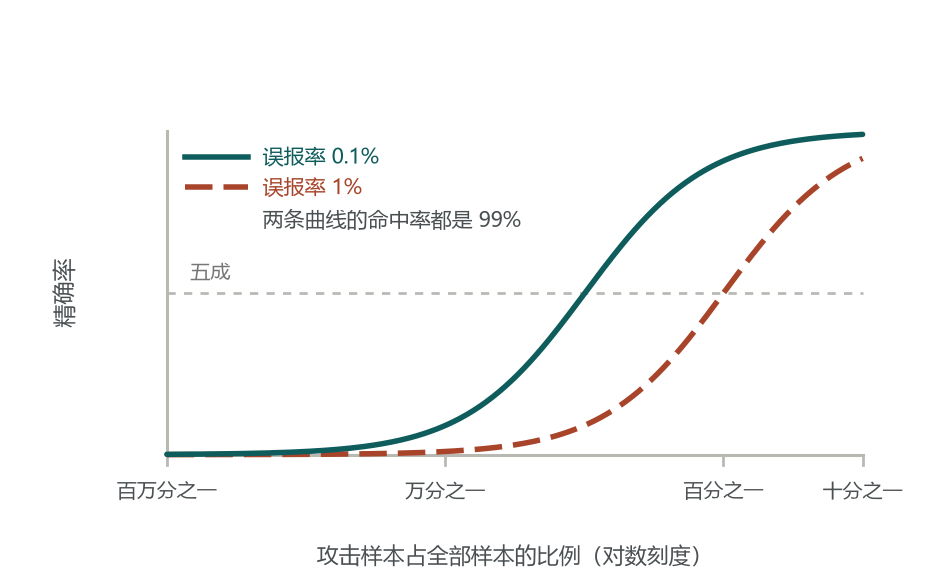
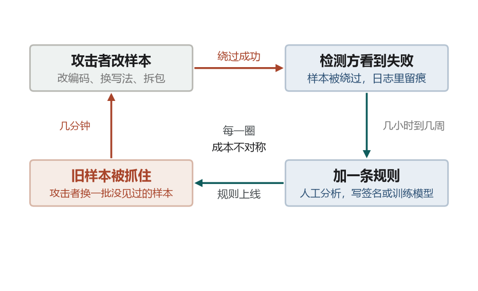

# 第十六章　检测的极限

一家公司买了套终端检测系统。厂商给的测试报告很漂亮，检出率 99.2%，误报率 0.1%，还附了一张 ROC 曲线，曲线下面那块面积几乎是满的。

上线三个月，安全团队每天处理两百多条告警，其中真正需要处置的不到五条。分析师开始按文件名和路径扫一眼就关掉，第三个月有人把一个真正的勒索软件样本当成误报点了忽略。事故复盘时，厂商说自己的指标没问题，客户说这套东西没法用，双方都没说谎。

问题出在一个很少被摊开算的除法上。检出率和误报率都是条件概率，条件的分母不一样。把它们直接相乘相加去推断“我收到的告警里有多少是真的”，中间少了一个关键输入，攻击样本在全部流量里占多大比例。

这个比例叫基率（base rate）。它决定了任何检测系统在真实环境里的表现，而它几乎从不出现在厂商的宣传材料里。

## 16.1 把检测写成一个判定

任何检测器，无论它叫杀毒引擎、入侵检测系统还是异常行为分析，抽象出来都是一个二分类函数。输入是一条样本，输出是“恶意”或“正常”。

四种结果，两个方向。真的恶意被判成恶意，叫真正例（true positive）。真的恶意被判成正常，叫假负例（false negative），也就是漏报。正常样本被判成恶意，叫假正例（false positive），也就是误报。正常样本被判成正常，叫真负例。

从这四个数可以派生出两组指标。第一组看“检测器能不能抓到”，真正例率（true positive rate, TPR）等于真正例除以所有恶意样本，也叫召回率；假正例率（false positive rate, FPR）等于假正例除以所有正常样本。第二组看“报警值不值得信”，精确率（precision）等于真正例除以所有被判为恶意的样本。

两组指标的差别在于分母。TPR 和 FPR 的分母分别是恶意样本总数和正常样本总数，跟环境里有多少恶意样本无关。精确率的分母是告警总数，它同时受 TPR、FPR 和基率影响。厂商报的是前一组，运维感受到的是后一组，两者之间的桥就是基率。

代价还不对称。漏掉一个勒索软件，损失可能是整个文件服务器；误报一次，成本是分析师二十分钟和一点耐心。这两件事的价值差了几个数量级，可二分类器默认两者一样重。要让判定有意义，得把代价矩阵写进去，选一个让期望损失最小的阈值，而不是选一个让准确率最高的阈值。

这是统计决策论里的老结论，Neyman 与 Pearson 在 1933 年就把“在固定误报率上界下最大化检出率”写成了优化问题。安全检测用的还是这套东西，只是很多产品把它简化成了一个数字。

## 16.2 精确率被基率吃掉

来算一遍。

一个邮件网关每天处理一百万封邮件，其中一千封是钓鱼，基率千分之一。检测器的 TPR 是 99%，FPR 是 0.1%。

一千封钓鱼里，990 封被抓到，10 封漏过去。九十九万九千封正常邮件里，有 999 封被误判。告警总数 1989，其中 990 是真的。精确率 49.8%。

每抓到一个真货，就有一个假货跟在后面。分析师的时间一半花在无效告警上，这已经是能忍受的极限了。

把 FPR 从 0.1% 压到 0.01%，误报降到 100 条，精确率升到 90.8%。看起来好了很多，代价是检测器要严格十倍，通常会连带把 TPR 拉下来几个点。这不是调参能免费拿到的。

再换一个场景。终端上有恶意行为的机器，在一万台里可能只有一台，基率万分之一。同样的 99% 检出率和 0.1% 误报率，算下来九千九百九十九台正常机器里有十台被误报，一台真感染被抓到，精确率不到 10%。

<figure>

<figcaption>图 16-1　同一台检测器在不同基率下的精确率，由贝叶斯公式直接算出，不含任何实验数据。两条曲线的检出率都是 99%，区别只在误报率。基率每降一个数量级，达到同样精确率所需的误报率也要降一个数量级，这条要求随基率线性收紧，没有尽头。</figcaption>
</figure>

图 16-1 的形状说明了一件事。想要在低基率环境里拿到高精确率，误报率必须压到基率同一个数量级甚至更低。基率是百万分之一，就得有百万分之一的误报率。而百万分之一的误报率几乎无法测量，你得跑一千万条正常样本才能看到十个误报，还得保证这些样本真的覆盖了生产环境的多样性。

这就是基率谬误（base rate fallacy）在安全领域的形态。它不是某个产品的缺陷，是贝叶斯公式的算术后果。任何声称“高准确率”的检测器，如果没有说明测试时的基率，这个数字就没有意义。在一个正负样本各占一半的测试集上刷到 99.9%，换到千分之一基率的生产环境，精确率可能只有个位数。

## 16.3 ROC 曲线为什么看着很美

ROC 曲线把 TPR 画在纵轴、FPR 画在横轴，扫一遍阈值就得到一条曲线。曲线越靠左上越好，曲线下的面积（AUC）常被当成一个综合指标。

它的优点是与基率无关，同一个模型在不同环境里 ROC 不变。这个优点的另一面是它掩盖了环境的影响。FPR 从 0.1% 降到 0.01%，在 ROC 上只是横轴上极小的一段位移，肉眼看不出来；在真实环境里，那是误报从一千条降到一百条，是三个分析师的工作量。

精确率-召回率曲线（PR 曲线）把精确率画在纵轴、召回率画在横轴，它的形状直接受基率影响。同一台检测器，基率降一个数量级，整条 PR 曲线往下掉一大截。这个性质让 PR 曲线不好看，但它诚实。

Davis 与 Goadrich 在 2006 年证明，在同一个数据集上，两条 ROC 曲线的支配关系和对应的 PR 曲线一致，但在类别极不平衡时，PR 曲线会把差异放大到肉眼可见的程度。Saito 与 Rehmsmeier 在 2015 年用具体例子说明，不平衡数据上只报 AUC 会严重高估模型的实际表现。

工程上的做法是两条都报，再补一个基率。评估报告里写“AUC 0.99，在千分之一基率下精确率 12%”，这句话才有信息量。只写 AUC 0.99，等于什么都没说。

还有个更隐蔽的问题，阈值不可移植。检测器在实验室里调到 FPR 0.1%，上线之后误报暴涨，原因往往不是模型退化，是生产环境的样本分布跟测试集不一样，某些特征的出现频率差了十倍。FPR 是相对于“正常样本总体”定义的，总体变了，同一个阈值的行为就变了。

## 16.4 异常检测与开放世界

前面讨论的都是有标签的二分类。真实场景里更常见的是另一种设定，手里只有正常样本，没有恶意样本，因为新的攻击方式还没出现过。

这类方法叫异常检测（anomaly detection）。思路是先学出“正常”的边界，落在边界外面的就是异常。统计方法用均值方差，机器学习用单类支持向量机、自编码器的重构误差、密度估计，工业界还流行用序列模型预测下一个行为再比对偏差。

问题在于“异常”和“恶意”不是一回事。一台服务器突然开始向外部 IP 发起大量连接，可能是被植入后门，也可能是新上线的备份任务。一个进程读取了大量注册表键，可能是勒索软件在枚举，也可能是刚推的补丁在收集环境信息。运维变更、灰度发布、季度结算，这些都会在行为特征上表现为离群。

安全团队把这类告警叫噪声，其实它们不全是噪声，其中一部分是真实但不重要的变化。一个异常检测器如果只按“偏离正常”打分，它会把所有变化都报出来，因为它的目标函数里没有“重要性”这个概念。

开放世界的问题更深一层。二分类器的假设是正负样本的分布固定，测试时的样本来自训练时见过的分布。攻击不是这样。攻击者会引入全新的技术，样本落在训练时根本没覆盖的区域，模型对它们的判断等于随机。你可以用持续学习去追，但每学一次都要重新验证，而且新样本的标注成本极高。

这也是为什么工业界的检测系统很少是单一模型。它们是一堆规则的组合，每条规则由一次真实事件催生，覆盖一个具体的场景。这种结构笨重、难维护、有明显的长尾，但它在开放世界里比一个漂亮的黑盒模型更可靠，因为每条规则背后都有一个人知道它在防什么。

## 16.5 对抗演化

检测器一旦上线，它面对的不再是静态的样本分布，而是一个会读报告的对手。

攻击者针对检测器优化的手段很成熟。把恶意代码分段加密，运行时再解密拼装，静态特征全部失效。把 C2 流量伪装成正常的 HTTPS，端口和证书都模仿常见服务。把恶意文件的大小、编译器指纹、导入表调整成跟正常软件一致，这叫模仿（mimicry）。投放之前先用多个引擎扫一遍，只挑检出数为零的样本用，这是最直接的对抗。

防御方也有对抗手段。沙箱里跑一遍看行为，绕过静态特征。检测内存里的无文件攻击，绕过分段加密。做行为链关联，绕开单点伪装。

<figure>

<figcaption>图 16-2　检测方和攻击者的一圈循环。攻击者改样本是分钟级的工作，检测方从发现到上线一条规则通常要几小时到几周，中间还要人工分析。循环每转一圈，双方的成本都在涨，但涨的速度不一样。</figcaption>
</figure>

图 16-2 里最值得看的是两个时间标注。攻击者改一个字节、换一种编码，几分钟就够。检测方从看到告警、确认是新型攻击、分析行为、写出规则、测试、灰度、全量，走完要几天。这个时间差决定了任何基于已知样本的检测都天然滞后。

滞后本身不可怕，可怕的是它会被对手利用。攻击者知道新样本有几天的窗口期，于是把最有价值的行动放在窗口期的开头。检测方也知道这一点，于是把资源投向“未知威胁检测”，可未知威胁检测的误报率天然更高，又回到了 16.2 的算术。

学界把这一类问题叫对抗机器学习（adversarial machine learning）。它的核心结论是，任何固定的分类器都可以被针对性地构造输入绕过，因为分类器的决策边界是已知的、可微的、可优化的。唯一的出路是让边界持续移动，也就是持续更新，而更新要人。

## 16.6 怎样评测才不骗人

一个检测系统的评测，做到不骗人比做到准确更难。下面几条是常见的陷阱，每一条都能让一份看起来严谨的报告失去意义。

划分数据要按时间切，不能用未来的样本训练再回头测过去。安全数据的时间相关性极强，同一个家族的样本在时间上聚集，随机划分会把同源样本同时放进训练集和测试集，测出来的指标虚高一大截。更严格的做法是按家族或按来源分组划分，保证测试集里没有训练时见过的变种。

报告指标要带基率。在一个正负各半的测试集上得到的 99% 准确率，换到千分之一基率的环境里几乎没有参考价值。评估报告至少应该给出，在预期基率下的精确率，以及达到这个精确率需要多低的误报率。

报告置信区间，尤其是“零误报”这种说法。如果在 n 个正常样本上没有出现误报，真实的误报率并不是零，而是有一个上界。按常用的近似，95% 置信水平下这个上界约为 3/n。跑一万条样本零误报，只能说明误报率大概率低于万分之三，对于基率百万分之一的场景，这个上界还差两个数量级。

报告代价，而不只是指标。一条告警的平均处置时间是二十分钟，一天两百条告警就是六十六个小时，需要八个人。这个数字比任何 AUC 都更能决定一套系统能不能用。代价不对称还要体现在阈值选择上，同样的模型，漏报代价是误报代价的一百倍时，最优阈值会往检出那边偏。

保留可复现的全部条件。数据集版本、样本采集时间、模型权重、随机种子、硬件环境。安全领域的数据大多不能公开，这没办法，但至少要留下能让第三方在同一批数据上复现的说明。做不到这一点的评测，结论只能当参考。

这些要求加起来，会让很多漂亮的结论变得难看起来。这不是坏事。一个检测系统真正的能力，是在明确的基率、明确的代价、明确的置信区间下的表现，而不是一个脱离了上下文的百分比。

回到开篇那家公司。他们真正需要的不是更高的检出率，是在自己那条流量上，把误报压到分析师能处理的数量。这个目标没法靠换一个更好的模型达到，它要求把基率测出来，把误报的代价算清楚，然后接受一个不那么好看但可用的工作点。

没有任何检测器能做到零误报零漏报。能做到的，是把这两项错误控制在一个已知的、可承受的范围里，并且诚实地把它写在报告第一页。
