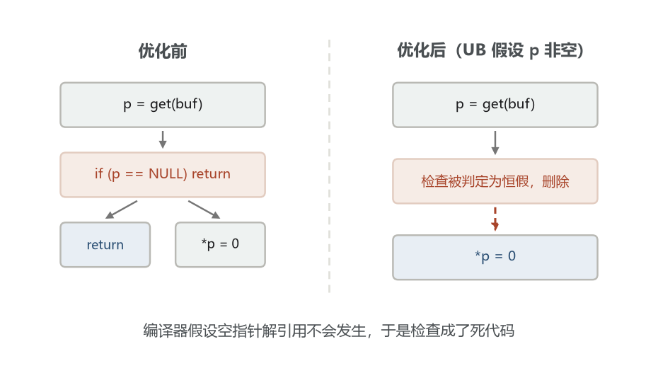

# 第十七章　编译器与未定义行为

审计里最常用的手段是拿源码和二进制对照着看。做这件事的人迟早会遇到一个让人不太舒服的场面：源码里明明写着 `if (!c) return -ENODEV;`，反汇编出来的函数里却没有这条分支。跳到那个地址，`rdi` 是零，程序照样往下走，执行到 `mov eax, [rdi+8]` 时崩溃。

这种差异一般不是编译器写错了。多数情况下编译器有充分理由，它从代码里推出了一个更强的结论，比如"走到这个位置时这个指针一定非空"，于是检查变成恒假，被当成死代码删掉。而它敢做这个推理，依据的是语言标准里的一句授权：程序不会做出标准没规定的事。

这句话听起来像免责声明，实际上是整个优化体系的地基。C 语言里有大量"标准不做要求"的情形，统称未定义行为（undefined behavior，UB）。编译器被允许假设这些情形永不发生，只对满足这一假设的那部分程序负责。违反假设的程序，编译器给出的输出可以是任何东西，包括一条看起来完全正常但少了一个安全检查的机器码。

这一章沿着这条路走一遍。先看编译器的四段流水线在做什么样的变换，再看 UB 这份合同的具体条款，然后挑一次真实的检查被删除的过程拆开看。整数和别名这两块是 UB 出现最密集的地方，单独讲一节。最后说清楚那些"关掉优化"的开关到底关了什么，以及为什么编译器自己也会出错。

## 17.1 一条语句经过的四段路

编译器不是把 C 直接翻译成机器码。中间隔着几层表示，每一层解决一类问题。

前端（front end）负责读懂代码。词法分析切出记号，语法分析建出抽象语法树，语义分析填类型、解析名字、检查约束。前端产出的东西通常是一种中间表示（intermediate representation，IR），函数体被拆成基本块（basic block），变量被改写成单赋值形式（static single assignment，SSA），也就是每个变量只被赋值一次，多次赋值就换名字。GCC 在这一层用 GIMPLE，LLVM 用它的 IR，两者的结构差不多。

中端是优化器。它在 IR 上跑几十到上百个 pass，每个 pass 做一件小事，比如把常量折叠掉、把不可能执行到的块删掉、把只有一个调用点的函数内联进来、把循环里的不变量提到循环外、把连续的四个字节拷贝合成一条 32 位访存、把独立的加法打包成 SIMD 指令。pass 之间有先后依赖，跑完一轮还要再跑一轮，直到没有变化为止。

后端负责落地。指令选择把 IR 里的操作映射到目标架构的指令，寄存器分配决定哪个值留在寄存器、哪个溢出到栈上，指令调度重排顺序填满流水线气泡，最后生成目标文件。

把这三段黏在一起的是同一条规则，叫 as-if 规则。C 标准对实现的唯一要求是：程序的可观察行为（observable behavior）必须和抽象机按标准逐条执行的结果一致。可观察行为在标准里的定义范围很窄，大致是对 volatile 对象的访问、程序终止时写进文件的数据、交互设备的输入输出。其余的一切，包括中间变量存在哪、循环执行了多少次、函数有没有被真正调用，编译器都可以改。

于是内联、常量传播、死代码消除、循环变换、向量化这些手段，在"程序没有 UB"的前提下都是安全的。一旦程序有 UB，前提就没了，那条链子从中间断掉。有效程序（valid program）这个说法在编译器文档里反复出现，指的就是不触发 UB 的那部分程序。剩下的部分不在服务范围内。

内联在这一层里格外重要。一个函数单独编译时，编译器只看得到它的参数和返回类型，能做的推理有限；被内联进调用者之后，两边的语句混进同一条基本块流，前者的结果在后者的位置上成了常量，后者的前提也反过来约束前者。UB 相关的推理正是靠这一步扩散的。两个各自看起来正确的函数，内联到一起之后，一条路径上的解引用会让另一条路径上的检查失效。

## 17.2 UB 是一份双向合同

C11 标准第 3.4.3 节对未定义行为的措辞值得逐字看一遍。大意是：使用不可移植的或错误的程序构造、或错误的数据时，本标准不对行为施加任何要求。后面还跟了一句注释，说明可能的范围从"完全忽略这种情况，结果不可预测"，到"在翻译或执行期间以环境中特有的、有文档记载的方式行为"，再到"终止翻译或执行"。

这句注释把很多人对 UB 的误解纠正过来。UB 不等于崩溃，也不等于必然出错。它等于标准退出，剩下的事由实现决定。在 x86 上把 `INT_MAX` 加一，硬件给出的结果是 `INT_MIN`，编译器完全可以在这一处保留这个结果；也可以在另一处依赖"它不会发生"删掉一段代码。两者不矛盾，因为标准对两种情况都没有要求。

需要和 UB 分开的是另外两个概念。未指定行为（unspecified behavior）指标准给了若干个允许的选项，不规定选哪个，比如函数参数的求值顺序。实现定义行为（implementation-defined behavior）指实现必须选一个，并且要写进文档，比如 `char` 是否有符号、负数右移补什么。这两个都还在标准的射程之内，程序可以依赖"某个具体实现的选择"，但不能依赖"标准保证的选择"。

常见 UB 的清单不长，但每一条都对应一类真实的漏洞。

| 类别 | 具体情形 |
| --- | --- |
| 算术 | 有符号整数溢出、除零、移位量大于等于位宽、负数左移 |
| 指针 | 越界指针算术、解引用空指针、解引用已释放对象、两个不同对象相减 |
| 对象 | 读取未初始化的自动变量、违反严格别名、修改字符串字面量、`memcpy` 源目标重叠 |
| 并发 | 两个线程无同步地访问同一内存且至少一个是写（C11 起算 UB） |

这份清单最反直觉的地方是它的边界位置。数组越界读一位是 UB，哪怕读到的值从来没用过；空指针上算偏移是 UB，哪怕结果从没被解引用；两个不同结构体的成员地址相减是 UB，哪怕它们碰巧相邻。

## 17.3 一次检查消失的全过程

下面这个函数是从真实代码的形状里抽出来的，为了说明问题做了简化。

```c
struct cfg {
    int  default_rc;
    int  n;
    int  slot[8];
};

static int lookup(struct cfg *c, int key)
{
    if (key >= c->n)          /* 第一处解引用 */
        return c->default_rc;
    return c->slot[key];
}

static int cfg_apply(struct cfg *c, int key)
{
    int rc;

    if (key < 0)
        rc = c->default_rc;   /* 第二处解引用，只在 key < 0 时走到 */
    else
        rc = lookup(c, key);

    if (!c)                   /* 作者以为这条能兜住所有路径 */
        return -ENODEV;

    return rc;
}
```

写这段代码的人心里有一条路径：调用方传进来的 `c` 可能是空指针，所以末尾加一道检查。他没意识到的是，只有在 `key < 0` 的分支里，`c` 才会在检查之前被解引用；另一个分支看起来是安全的。

内联把 `lookup` 塞进 `cfg_apply` 之后，优化器看到两个分支各自的第一条语句都是读 `c->something`。在 C 的语义里，读一个空指针指向的成员是 UB，所以任何执行到这里的路径都必须满足 `c != NULL`。两个分支都通向末尾的检查点，于是这个检查点在所有可达路径上都恒假。死代码消除把它删掉。

删掉之后的差别在于 `lookup` 那个分支里到底发生了什么。如果 `c` 是空的，`key >= c->n` 这一句在读 `c->n` 时就会崩，也就是说原本就不存在"安全的空指针调用"这回事，作者那道检查从一开始就是安慰剂。真正的危险出现在 `n` 恰好存在但 `slot` 越界的时候，那是另一条路径上的问题，而这道检查根本不是为它准备的。

<figure>

<figcaption>图 17-1　内联加常量传播前后的控制流。左侧末尾的空指针检查覆盖两条路径，右侧两条路径的第一条语句都是解引用，检查点被判定为恒假后删除。</figcaption>
</figure>

汇编层面的差别很直接。`-O1` 生成的函数开头有一句 `test rdi, rdi`，判零后跳到返回 `-ENODEV` 的块；`-O2` 的版本里这一句和它对应的块都不见了，函数从 `test esi, esi` 直接开始。两段代码在"程序正确"的输入上行为完全一致，只有在传空指针这种 UB 输入上才分岔。

```asm
; -O1：检查还在，多一次测试和一条分支
cfg_apply:
        test    rdi, rdi
        je      .Lnull
        test    esi, esi
        js      .Lneg
        ...
.Lnull:
        mov     eax, -19
        ret

; -O2：前半段消失，函数从 key 的判断开始
cfg_apply:
        test    esi, esi
        js      .Lneg
        ...
```

这是 UB 影响漏洞形态的典型几何。攻击者不需要让编译器"出错"，只需要让程序走进一条编译器认为不存在的路径。
这类删除在审计里特别难发现，因为它在两个层面留下的痕迹正好相反。看源码，检查明明白白写在那里，静态扫描器会给它记一个“已校验”；看二进制，检查根本不存在，而常见的逆向流程又默认二进制忠实反映源码。两个印象互相印证，错误就固化下来了。要发现它，得把两条路径上的解引用都列出来，再问一句这个检查点凭什么成立。
所有基于这条路径的边界检查、范围检查、空指针检查都被提前删掉了，而删除发生在编译期，运行时没有任何痕迹可查。

## 17.4 三个高发区

大部分 UB 事故集中在三处，有符号整数、类型别名、移位。

先看整数。无符号运算的结果按 2 的位宽次方取模，标准明文规定，所以 `uint8_t` 的 255 加一得到 0，行为完全确定。有符号溢出的待遇相反，标准不定义。这条规矩有历史原因，早期的反码和原码机器上符号位溢出的结果各不相同，标准索性把这块地空出来。

空出来的地边上还站着整数提升（integer promotion）。比 `int` 窄的类型参与运算前先提升为 `int`，前提是 `int` 装得下它的全部取值。于是 `unsigned short` 的 65535 加一得到 65536 而不是 0，运算在 `int` 里进行。同一条规则在混合比较时会翻脸，`int` 与 `unsigned int` 相遇时 `int` 被转成无符号，负一变四十多亿。`if (len - 1 > 0)` 这种写法之所以危险，就在这一步转换上，`len` 是无符号时它恒真，减法的下溢被定义良好地绕过去了，检查因此形同虚设。

移位的坑更集中。`x << n` 在 n 大于等于位宽时是 UB，左移负数也是 UB，左移把 1 拱进符号位同样是 UB。最后一条最常被忽略，`1 << 31` 在 `int` 上不是一个值为负的常量，而是一段 UB。写掩码时要 `1u << 31`，`u` 这个后缀不是风格问题。右移负数不属于 UB，属于实现定义，算术右移补符号位，逻辑右移补零，x86 和 ARM 都选前者，但标准不保证。

下面这个函数三行，能编译出两个不同的答案。

```c
int gt(int x) { return x + 1 > x; }
```

GCC 和 Clang 在 `-O2` 下都把它编成 `mov eax, 1; ret`。推理过程只有一步，`x + 1` 溢出是 UB，所以编译器假设它不溢出，于是 `x + 1` 严格大于 `x` 恒成立。传 `INT_MAX` 进去，返回值仍然是 1。加上 `-fwrapv` 之后生成一条真实的比较指令，同样输入返回 0。

第二个高发区是别名（aliasing）。标准在 6.5 节第 7 段有一条不显眼的规定，对象的存储值只能通过兼容类型的左值、或者字符类型的左值访问。`int` 和 `float` 不兼容，所以 `*(int *)&f` 读浮点位模式违反规则。编译器据此假设不同类型的指针不会指向同一块内存，这个假设让它在寄存器分配时敢把值留在寄存器里。

```c
int f(int *a, long *b)
{
    *a = 1;
    *b = 0;
    return *a;      /* 编译器认为 a 与 b 不冲突，直接返回常量 1 */
}
```

调用方写 `f(&x, (long *)&x)`，在 `-O0` 下拿到 0，在 `-O2` 下拿到 1。同一个程序，同一个输入，两个答案，而且没有任何警告。想要位模式转换，用 `memcpy` 或者 `union`，前者编译器会认出来并优化成一条访存指令。

## 17.5 开关关掉的是什么

发现问题之后最直接的反应是加编译选项。这条路能用，但要知道每个选项买走了什么。

`-fwrapv` 让编译器把有符号溢出当成回绕，等于把这类运算的定义补全。代价是它不能再做那些依赖"溢出不会发生"的推理，比如把 `for (i = 0; i <= n; i++)` 的循环条件简化，或者把带下标的地址计算提到循环外。这两类优化在数值密集的代码里影响不小。

`-fno-strict-aliasing` 关掉基于类型的别名分析。代价是每次写内存之后，编译器都得假设之前读进寄存器的值可能已经变了，于是重新加载。老的内核代码大量依赖类型双关，Linux 的构建脚本里长期带着这个开关，也带着 `-fno-delete-null-pointer-checks`。

需要说清的是，这两个开关只补上了一部分 UB。越界指针、空指针解引用、读取未初始化变量、并发数据竞争都还在，编译器的假设照样成立。

`-ftrapv` 走的是另一条路，它在每次有符号运算后插一条检查，溢出就触发异常。这是调试工具而不是生产配置，每个加法后面跟一次分支，性能代价大到没有讨论余地。

真正推荐的做法是 `-fsanitize=undefined`（UBSan）。它在可能出问题的地方插入检查，调用 `__ubsan_handle_add_overflow` 之类的运行时函数，报告出问题的源文件、行号和参与的数值，然后继续执行。代价是二进制变大、变慢，一般用在测试环境。`-fsanitize=address`、`-fsanitize=thread` 分别管内存访问和并发，三个覆盖的范围不同，通常一起开。

最后要提一句这些开关的边界。它们只对本次编译的翻译单元生效，链接进来的静态库、第三方 `.so`、运行时生成的代码都不受约束。开了链接时优化（link time optimization，LTO）之后，编译器能看到跨文件的信息，推理更大胆，问题也更容易跨文件传播。指望在某个文件里单独关掉开关来隔离风险，多数时候不成立。

还有一层误解要拆掉。把优化等级降到 `-O0` 不等于回到安全状态，那条 UB 语句仍然在源码里，只是编译器没拿它做推理，硬件给出的确定性结果把问题盖住了。测试全过、线上跑一年，都只证明这条路径上的输入没有落进那片空白，不证明程序里没有那片空白。可靠的证据来自 UBSan 这类插桩，它把“没触发”变成“检查过、确实没触发”。

## 17.6 优化器也是程序

优化器是几百万行代码，每个 pass 都建立在一组前提上。前提写错一个，pass 就会把一个合法程序改成另一个程序，这种事故叫错误编译（miscompilation）。

它的传播范围和别的 bug 不一样。一个运行时库的 bug 只影响调用那个函数的程序，一个优化器的 bug 会影响所有用这个版本编出来的二进制，而且不报错、不崩溃，只是算错。追查这类问题要先把怀疑对象从业务代码挪到工具链上，这一步很多人过不去。

找这类 bug 的办法是差分测试。同一个程序用两个编译器编，或者用同一个编译器的两个优化等级编，输出不一致就说明至少有一方错了。Csmith 这类随机 C 程序生成器把这个思路做到了极致，它生成不含 UB 的程序，只挑标准定义良好的构造，然后大规模对比。Yang 等人在 2011 年的 PLDI 论文里报告了用这个方法找到的数百个 GCC 和 LLVM 的 bug，其中不少是十年以上的老代码。

既然编译器会错，有没有办法证明它不错。CompCert 是这条路的代表，Leroy 从 2006 年开始做一个经过形式化验证的 C 编译器，用 Coq 写出每一层语义，再证明每个变换保持语义一致。它的正确性定理有一个前提值得注意，定理只覆盖“行为定义良好的程序”，碰到 UB 的程序，CompCert 的输出同样不受约束。另外它的前端和汇编器没有全部验证，信任链在那里收口。

另一条路是翻译确认（translation validation），不预先证明编译器正确，而是在每次编译时检查“输入和输出的语义等价”，检查通过才放行。这个方法由 Pnueli 等人在 1998 年提出，工程上受限于等价性判定的复杂度，只能用在部分 pass 上。

浏览器里的即时编译（just-in-time compilation，JIT）把这个问题放大了一档。JIT 的输入是 JavaScript 或字节码，攻击者可以直接构造，优化器里任何一个前提错误都能被远程触发。过去十几年里，主流 JS 引擎的 JIT 漏洞是最稳定的一类远程代码执行入口，成因多半是某个类型推断或范围推断的前提被输入打破。

编译器在信任链上的位置很尴尬。它把源码变成机器码，所有人都假设这一步是对的，所以下游的检查、审计、形式化验证都建立在它的输出上。把它算进可信计算基（trusted computing base，TCB）之后，那些"源码里明明有检查"的论断就要打折扣了。
