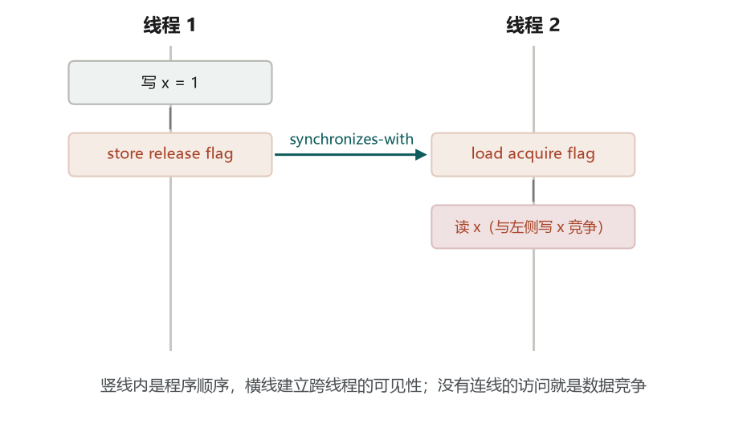
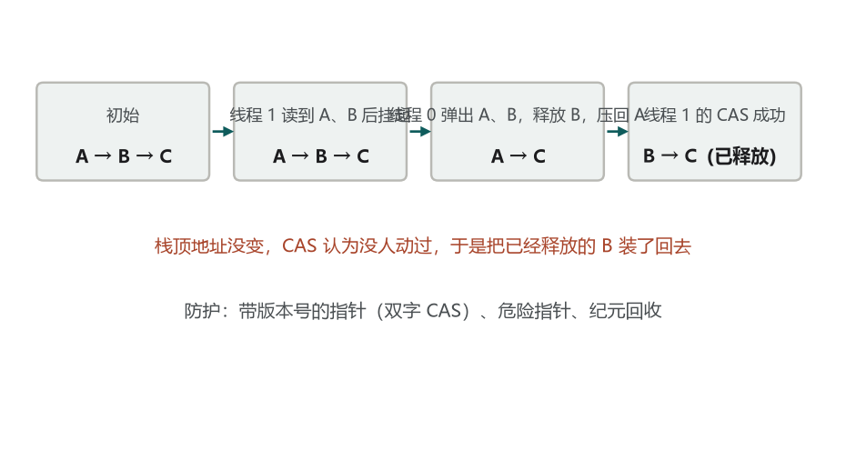

# 第十八章　并发与内存模型

一台服务器上的双线程程序跑了三年没出过问题。搬到一块 ARM 的手机芯片上做同样的事，每十万次有一次读到全零。日志里没有任何异常，变量明明在前一行赋了值，下一行读出来还是旧值。

这种 bug 有一个共同特征，它不出现在代码里，出在代码和硬件之间的那段空白。写代码的人心里有一个执行模型，语句按书写的顺序一条一条生效；编译器和处理器心里有另一个模型，只要最终结果不变，顺序可以随便调。两边平时看不出差别，一旦跨线程共享数据，差别就变成了读到的值和写入的值不一致。

要在这片空白上写正确的并发代码，靠"我觉得这样应该没问题"是不够的。得有一个人为定义的合同，规定哪种重排允许、哪种不允许、什么情况下一个线程的写能被另一个线程看见。这份合同就是内存模型（memory model）。C11 和 Java 各自写了一份，x86 和 ARM 各自实现了一份，它们不完全一样。

这一章从最朴素的直觉出发，先把直觉是怎么破的摊开，再给出替代直觉的那套形式化工具，最后落到几个真实漏洞的形状上。

## 18.1 顺序一致是一种虚构

1979 年，Lamport 给多处理器程序定义了一个执行模型，叫顺序一致性（sequential consistency）。它的说法只有两句，所有读写操作按某个全局顺序执行，每个处理器自己的操作在这个全局顺序里保持程序顺序。听起来就是"大家排队走"，但要意识到它是一条很强的要求，硬件必须为它付出实打实的代价。

在顺序一致的世界里，两个线程的读写可以用一张时间表排开，任意两次访问的先后都有明确答案。这种模型下写代码几乎不需要思考，`x = 1` 之后再读 `x`，只要没有别的线程写过，读到的必然是 1。很多人的并发直觉就建立在它上面。

真实的 x86 处理器不提供这个模型。arm64 处理器提供的更少。

有一个很小的测试叫存储缓冲（store buffering，SB），四行代码。

```c
/* 初值 x = 0, y = 0；r1, r2 是各自线程的局部变量 */
线程 0                线程 1
x = 1;                y = 1;
r1 = y;               r2 = x;
```

如果按顺序一致执行，两个线程各自的写必须在对方的读之前或者之后。四种交错里没有一种能让 `r1 == 0` 和 `r2 == 0` 同时成立，因为要让 `r1` 读到 0，线程 0 的读就得排在线程 1 的写之前，而 `r2` 读到 0 又要求反过来。

在 x86 上这个结果是可以观察到的，实测比例不高但确实存在。原因在于写操作进入了一个叫存储缓冲（store buffer）的队列，处理器不等它落到缓存就继续执行后面的读，于是两个线程的读都发生在对方的写生效之前。这个现象推翻了"按书写顺序执行"这条直觉里最容易被人相信的部分。

另一个测试叫消息传递（message passing，MP），形状更贴近实际代码。

```c
线程 0                线程 1
data = 42;            while (!ready) ;
ready = 1;            print(data);
```

代码的意图很清楚，`ready` 是信号，看到它就说明 `data` 已经写好。在 x86 上这个意图成立，因为 x86 只允许一种重排，写之后的读可以越过写。ARM 上这个意图不成立，两个线程可能同时看到 `ready == 1` 和 `data == 0`，因为 ARM 允许写之后的写也被重排，`ready = 1` 可能先于 `data = 42` 对其他核可见。

四种重排类型可以用一张表列清楚，读越过读、读越过写、写越过写、写越过读。

| 重排 | 含义 | x86 | ARMv8 |
| --- | --- | --- | --- |
| 读后读 | 两条读的执行次序对调 | 禁止 | 允许 |
| 读后写 | 读之后的写提到读之前 | 禁止 | 允许 |
| 写后写 | 两条写对其他核的可见次序对调 | 禁止 | 允许 |
| 写后读 | 写之后的读提到写之前 | 允许 | 允许 |

x86 只开了最后一格，所以 SB 能观察到而 MP 观察不到。ARMv8 四格全开，顺序要靠 `dmb`、`ldar`、`stlr` 这些指令逐个补回来。

## 18.2 顺序在三个地方被改掉

一份 C 代码从源码到真正执行，中间有三道工序，每一道都可能改变访问顺序。

第一道是编译器。循环里的读如果被判定为不变量，会被提到循环外。

```c
while (!ready)
    ;
printf("%d\n", data);
```

`ready` 在这一段里没有被修改，编译器有理由认为它不变，于是循环变成"先读一次，如果为真就跳过，否则进入死循环"。它甚至可能把整个循环删掉。这是并发程序里最常见的失效方式，而且它和硬件无关，单核机器上照样出现。挡住它的办法是让编译器知道这个位置会被别人改，`volatile` 是最弱的一种标记，`_Atomic` 是 C11 给的正规做法。

`volatile` 和 `_Atomic` 的区别值得单独说一句。`volatile` 在 C 标准里的含义是“这个对象可能被程序之外的东西改变”，编译器因此不会把访问合并或删除，也不会把它提到循环外。它管的是访问次数，不管顺序，也不管原子性。两个线程同时 `volatile` 自增同一个变量，结果照样是竞争加丢更新。把 `volatile` 当成同步手段是早期代码里最普遍的一个错误，Linux 内核直到今天还在为历史上留下来的这类代码打补丁。

第二道是处理器。现代乱序执行（out-of-order execution）的核心是一个重排序缓冲（reorder buffer），指令按程序顺序进入，按数据依赖决定的顺序执行，最后按程序顺序提交。问题在于访存指令的提交时机和它的效果可见时机不是一回事。一条写要等到它独占缓存行、把数据放进去才真正生效，这中间隔着几十上百个周期；一条读如果在缓存里命中，几周期就拿到值。两者之间的时间差就是重排的空间。

第三道是缓存。多核之间用缓存一致性协议（cache coherence protocol）维持单一写者语义，常见的是 MESI 及其变种，每个缓存行处在修改、独占、共享、无效四种状态之一。一致性保证的是同一个地址的写在所有核看来有同一个顺序，它不保证不同地址之间的顺序。这两个概念经常被混为一谈，而几乎所有跨线程的内存序错误都出在这条分界线上。

把这三层叠起来的后果是，`x86-TSO` 这样的形式化模型要专门写出来给程序员看。它由 Sewell 等人在 2010 年的一篇 CACM 文章里给出，把 x86 的行为归纳成"写进缓冲、读可越过写、其他不动"，并且用机器验证过它和真实芯片的行为一致。有这份模型之后，写并发代码的人至少知道自己面对的是什么。

## 18.3 happens-before 是那把尺子

既然执行顺序不能靠观察，就得找一种不依赖时间的判定方式。C11 和 Java 走的是同一条路，用 happens-before 关系来定义"哪些写对哪些读可见"。

关系是分层搭起来的。第一层是程序顺序（sequenced-before），同一个线程里，语句 A 在语句 B 之前，就是 A sequenced-before B。这一层是语法的，编译器重排不影响它，因为标准规定的是"如同按顺序执行"。

第二层是同步关系（synchronizes-with）。它只在特定的操作之间成立，最典型的一对是释放写（release store）和获取读（acquire load），两者操作同一个原子对象，读读到了写写入的值（或者写之后的某个值），就称写 synchronizes-with 读。这一对关系的作用是把两个线程的程序顺序缝在一起。

第三层是 happens-before，取前两层关系的传递闭包。A happens-before B，意味着 A 的所有效果对 B 可见，中间不需要任何时间上的先后。

<figure>

<figcaption>图 18-1　释放写与获取读建立起的可见性。竖线是线程内的程序顺序，横线是 synchronizes-with，两条线上的操作经传递闭包后全部落在 happens-before 里；右侧那对没有连线的访问就是数据竞争。</figcaption>
</figure>

C11 提供了六种内存序（memory order），实际常用的五种。

| 内存序 | 保证 |
| --- | --- |
| `memory_order_relaxed` | 只有原子性与修改顺序，不建立任何同步 |
| `memory_order_acquire` | 该读之后的操作不能上移到它前面 |
| `memory_order_release` | 该写之前的操作不能下移到它后面 |
| `memory_order_acq_rel` | 读改写操作的合成，两个方向都挡 |
| `memory_order_seq_cst` | 在上面基础上再加一条全局总序 |

`relaxed` 常被误解成"不原子"，其实原子性一分不少，缺的只是跨线程的可见性保证。用 refcount 的时候 `relaxed` 就够了，因为计数本身不需要顺序，只需要不丢不重。

拿这套工具重写消息传递那段代码，正确版本是这样。

```c
/* 线程 0 */
data = 42;
atomic_store_explicit(&ready, 1, memory_order_release);

/* 线程 1 */
while (!atomic_load_explicit(&ready, memory_order_acquire))
    ;
printf("%d\n", data);      /* 一定输出 42 */
```

`release` 保证 `data = 42` 不会被挪到 `ready = 1` 之后，`acquire` 保证循环之后的读不会被挪到循环之前。两句加起来，`printf` 看到的 `data` 一定是 42。

seq_cst 多出来的东西是单一总序。它要求所有 seq_cst 操作在全局有一个所有线程都同意的前后关系，代价是在 x86 上要插 `mfence` 或者用带 `lock` 前缀的指令，在 ARM 上要 `dmb ish`。不是所有地方都需要它，但拿不准的时候它能省掉一类推理。

Java 的内存模型（Java memory model，JMM）在 2004 年的 JSR-133 之后与 C11 大体同构，`volatile` 对应 seq_cst，`final` 字段有特殊的初始化安全保证。两者对数据竞争的处理方式也一致，都把它定义成 UB 而不是"读到旧值"。这一点很关键，因为它意味着编译器可以假设没有竞争，进而做出更激进的优化，包括把读提到循环外。

## 18.4 数据竞争的严格定义

C11 的定义写得很短。两个线程访问同一个内存位置，至少一个是写，两个访问都不是原子操作，并且两者之间没有 happens-before 关系，这三条同时成立就是一个数据竞争（data race）。有数据竞争的程序行为未定义。

注意最后半句。它不是"可能读到旧值"，是未定义。所以下面这段代码是错的，不是"可能出错"。

```c
static int inited;
static struct config cfg;

struct config *get_config(void)
{
    if (!inited) {          /* 检查 */
        cfg = build();      /* 使用 */
        inited = 1;
    }
    return &cfg;
}
```

两个线程同时进来，都看到 `inited == 0`，都执行 `build()`，一次写覆盖另一次，构造过程中泄漏资源。更糟的情况是一个线程已经返回 `&cfg` 开始在别处使用，另一个线程还在往里写。`inited` 的读和写都是普通的非原子访问，两者之间没有 happens-before，定义上就是竞争。

正确写法有好几种。用 `pthread_once` 是最省事的，它内部用原子操作加 futex 实现了"恰好执行一次"。手写的话需要一次发布动作。

```c
static _Atomic(struct config *) cfg_p;

struct config *get_config(void)
{
    struct config *p = atomic_load_explicit(&cfg_p, memory_order_acquire);
    if (p)
        return p;

    struct config *n = build();          /* 可能被多个线程各建一次 */
    struct config *expect = NULL;
    if (!atomic_compare_exchange_strong_explicit(&cfg_p, &expect, n,
                                                 memory_order_release,
                                                 memory_order_acquire)) {
        free_config(n);                  /* 别人先发布了 */
        return expect;
    }
    return n;
}
```

这个版本允许重复构造，靠 CAS 决定谁的结果生效，输的一方把自己那份释放掉。代价是 `build()` 要能被重复调用且中途失败不留垃圾。

"看起来对"的代码之所以能长期存在，是因为竞争窗口窄。现代 CPU 上两个线程同时进入 `if (!inited)` 的概率很低，测试环境往往只有一个核在跑，或者调度恰好错开。压测跑一万次不出问题，不代表没有竞争，只代表窗口没被撞上。

动态检测工具靠的也是 happens-before。ThreadSanitizer 给每次访问记录一段向量时钟，两个访问的时钟无法比较、地址相同、至少一个是写，就报竞争。它的局限很明确，只能看到本次执行走过的路径，没走到的分支里的竞争不会被发现。静态工具不受这个限制，但要面对路径爆炸和误报。

## 18.5 锁是被造出来的

有了原子操作和内存序，锁就可以自己造。这不是练习，理解锁的构造能解释很多锁的行为。

最基础的原语是比较并交换（compare-and-swap，CAS），x86 上是 `lock cmpxchg`，ARM 上是 `ldaxr`/`stlxr` 这对加载链接与条件存储（load-linked/store-conditional）。它的语义是"如果这个位置的值还是我读到的那个，就换成新值，否则告诉我失败"，整个过程原子。

自旋锁（spinlock）直接用 CAS 写出来是这样。

```c
void lock(atomic_int *lk)
{
    int expected = 0;
    while (!atomic_compare_exchange_weak_explicit(
               lk, &expected, 1,
               memory_order_acquire, memory_order_relaxed)) {
        expected = 0;
        while (atomic_load_explicit(lk, memory_order_relaxed))
            __builtin_ia32_pause();       /* 让出流水线，别把缓存行打爆 */
    }
}
```

内层那个只读的循环叫测试并测试并设置（test-and-test-and-set），作用是减少对缓存行的写请求。每个失败的 CAS 都会让缓存行在所有核之间弹跳一次，这个开销比自旋本身大得多。

自旋锁的问题是公平性。所有线程抢同一个位置，先到的未必先拿到，运气差的可能一直抢不到。票号锁（ticket lock）用一个取号计数器和一个叫号计数器解决这个问题，每个线程拿到唯一号码，只有号对上了才能进入。代价是多一个原子操作，以及释放时必须精确地加一。

自旋在临界区很短时有效，长了就是浪费。Linux 的 futex（fast userspace mutex）把两条路合起来，先在用户态自旋，抢不到就通过 `FUTEX_WAIT` 系统调用进入内核等待队列，释放时用 `FUTEX_WAKE` 唤醒。设计由 Franke、Russell 和 Kirkwood 在 2002 年的论文里给出，核心想法是"无竞争时不进内核"。今天 Linux 上所有 pthread 互斥锁最终都落在这套机制上。

锁能出问题的地方，Coffman、Elphick 和 Shoshani 在 1971 年就总结完了，四个条件同时成立才会死锁。资源互斥，一个资源同时只能被一个线程持有；持有并等待，拿着一个去等另一个；不可剥夺，别人不能强行拿走；循环等待，存在一个等待环。破坏任意一个就能避免死锁。工程上最常用的是第四条，给所有锁定一个全局顺序，按顺序申请。

## 18.6 四种反复出现的形状

**双重检查锁**（double-checked locking）。为了省掉每次调用都加锁的开销，有人在检查外面加了一层无锁的快速路径。

```c
if (!inited) {              /* 第一次检查，不加锁 */
    lock(&mtx);
    if (!inited) {          /* 第二次检查 */
        cfg = build();
        inited = 1;
    }
    unlock(&mtx);
}
```

这段代码在 Java 5 之前是有名的错误示范。问题出在 `new` 上，构造一个对象要先分配内存、再执行构造函数，最后把引用写回变量，这三步在编译器看来可以重排成"先写引用、再构造"。另一个线程在第一次检查处看到引用不为空，拿到的却是一个字段全是默认值的半成品。JSR-133 之后把 `inited` 声明成 `volatile` 就能修好，因为 volatile 的写会挡住它前面的操作外移。C 里的对应写法是 `_Atomic` 加 release 语义。

**惰性初始化**。和上面同源，症状是偶尔返回未初始化的对象。C 里最省事的修法是 `pthread_once`，它的实现把这些细节全包进去了，包括在初始化函数抛异常或者递归调用时的处理。

**引用计数竞态**。计数本身用原子加减就够了，危险的是"减到零就释放"和"增加引用"之间的窗口。

```c
/* 线程 A：释放 */
if (atomic_fetch_sub(&obj->ref, 1) == 1)
    destroy(obj);

/* 线程 B：获取 */
atomic_fetch_add(&obj->ref, 1);      /* 从 0 加到 1，把死对象救活了 */
use(obj);
```

线程 B 在 A 判断完、`destroy` 执行前把计数从 0 加到 1，对象被销毁而引用还在。解决办法是把"弱引用"和"强引用"分开，提升弱引用必须能失败，或者在释放前先摘链再等宽限期，后者就是 RCU 的思路。

**检查与使用之间的窗口**（time of check to time of use，TOCTOU）。这类问题的结构是，先验证一个条件，再基于这个条件行动，两者之间状态可以变。用户态最典型的是 `access()` 加 `open()` 的组合，检查权限和真正打开之间攻击者可以换掉路径上的符号链接。内核里更隐蔽的形态是 `copy_from_user` 被调用两次，第一次读长度、第二次读数据，攻击者用 `userfaultfd` 把第一次读之后的缺页挂住，在窗口里改掉缓冲区内容，于是校验的是 A 而使用的是 B。

<figure>

<figcaption>图 18-2　无锁栈上的一次 ABA。线程 1 读到栈顶为 A、次顶为 B 后被挂起；线程 0 弹出 A 和 B、释放 B、又把 A 压回；线程 1 的 CAS 看到栈顶仍是 A 于是成功，新栈顶变成已经释放的 B。</figcaption>
</figure>

无锁数据结构里有一个同构的问题，叫 ABA。线程 1 读栈顶得到 A，同时记下次顶是 B，准备执行"把栈顶换成 B"。它在这两步之间被挂起。线程 0 趁这段时间弹出 A、弹出 B、释放 B，然后把 A 又压回去。线程 1 醒来，CAS 比较栈顶，看到还是 A，判定没人动过，于是把栈顶写成 B。而 B 早已被释放，可能已经被分配给别人，整个栈的结构就此损坏。修法是给指针配一个版本号打包成 128 位一起 CAS，或者用风险指针、epoch 回收这类延迟释放的机制。

这四种形状看起来差别很大，共同点只有一个。检查和使用之间隔着一段时间，而这段时间里状态可以被别人改变，窗口的宽度由调度器、缓存和编译器共同决定，写代码的人看不到它。
