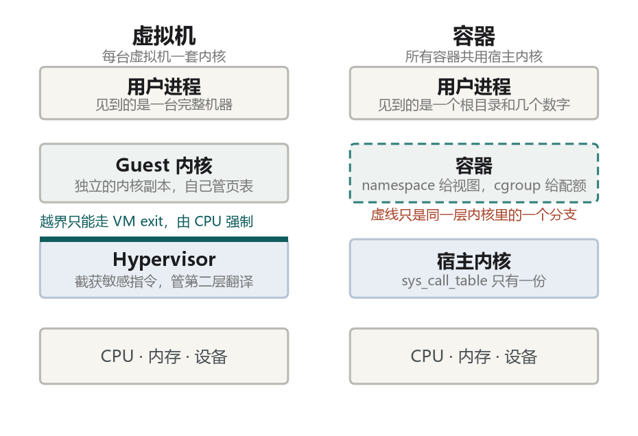
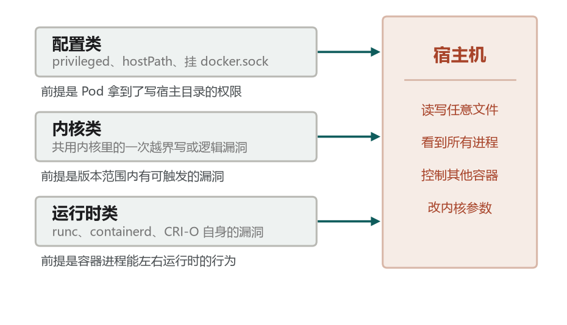

# 第十九章　虚拟化与容器隔离

2015 年，一家安全公司在 QEMU 的虚拟软盘控制器里发现了一个缓冲区溢出，编号 CVE-2015-3456，代号 VENOM。攻击者站在虚拟机里，往软驱的数据端口连续写一串精心构造的字节，就能让宿主机上承载这台虚拟机的进程跳到他的代码上执行。同一台机器上的其他虚拟机、宿主机的文件、宿主机的网络，从那一刻起都在他的权限之内。

这条通道不是从隔离里凿出来的，它开在隔离必须留的那扇门上。虚拟机要跑起来就得能读写磁盘和网卡，而这两样在宿主机上都是普通进程模拟出来的，模拟的代码要解析客户机交上来的每一个寄存器值和每一个 DMA 地址。门必须开，门上的锁只有代码正确性这一把。

大多数人日常用的隔离不是虚拟机。`docker run` 一秒起一个环境，用起来和一台虚拟机差不太多。两者面对的是同一个问题，怎么让一段代码看不见也碰不到别的东西，但边界建在不同的位置，强度的差别不是一点点，而是"要利用一个设备模型里的溢出"和"要利用内核里任意一处越界写"的差别。

## 19.1 一条边界，两种造法

虚拟化（virtualization）在体系结构里有一个很窄的定义，由 Popek 和 Goldberg 在 1974 年写下来。一个虚拟机监控器（virtual machine monitor，VMM）要提供一台和真机足够像的机器，客户机（guest）跑在上面时，除了少数可测量的差异（时间、缓存、设备编号），行为和裸机上一致；VMM 必须完全控制硬件资源；客户机的绝大部分指令要直接跑在 CPU 上，不能每条都解释一遍。第三条讲的是性能，也是整个问题的难点。

难点在于"直接跑"和"完全控制"互相矛盾。客户机里跑着它自己的内核，那个内核会执行特权指令，改页表基址、关中断、写控制寄存器。这些操作要是在物理 CPU 上直接生效，客户机的内核就能改宿主机的页表。所以要有一类指令，它在客户机里执行时不生效，而是把控制权交出去。Popek 和 Goldberg 把这类指令叫敏感指令，把"敏感指令都是特权指令"称作可虚拟化条件。

x86 在很长时间里不满足这个条件。`popf` 在 ring 3 执行不产生异常，只是悄悄不改变 IF 标志；`sgdt`、`sidt` 老老实实返回真实的值，不 trap；段寄存器里能看到真实的 ring 信息，客户机看不出自己其实不在 ring 0。这几处漏网让 1990 年代的 x86 上做不出干净的 VMM。VMware 的办法是二进制翻译（binary translation），在客户机代码执行前扫一遍，把敏感指令换成对 VMM 的调用，其余指令原样放行。Xen 走了另一条路，直接改客户机内核，把特权操作换成超级调用（hypercall），这叫半虚拟化（paravirtualization）。

2005 年之后 Intel 的 VT-x 和 AMD 的 SVM 把这件事挪进了硬件。CPU 多出两种操作模式，VMM 跑在 root 模式，客户机跑在 non-root 模式，客户机里执行敏感指令不再需要翻译，CPU 直接产生一次 VM exit，把控制权和一份记录着退出原因的状态（VMCS）交给 VMM，VMM 处理完再用 `VMRESUME` 回去。特权级的形状从"ring 0 和 ring 3"变成两套 ring 各管一层，客户机自己的内核确实在自己的 ring 0 里，只是管的是假的特权。

按 VMM 的位置能分两类。裸金属（type 1）直接跑在硬件上，Xen、ESXi、Hyper-V 属于这一类；宿主型（type 2）作为进程跑在普通操作系统上，VirtualBox、VMware Workstation 是这一类。KVM 哪类都不完全像，它把 Linux 内核本身变成 VMM，用 `/dev/kvm` 把 VT-x 的能力暴露给用户态，QEMU 在用户态负责设备模型。这个拆分要记住，因为讲逃逸时会看到，QEMU 那个用户态进程才是主要攻击面。

容器完全不在这条路上。它不在硬件层切一刀，而在系统调用接口上切。一个容器是一组进程，加一套让它以为自己是唯一的视图，加一组资源上限，内核还是那一个。

<figure>

<figcaption>图 19-1　两种隔离的层次。左侧客户机内核是独立副本，边界压在 hypervisor 顶上，跨过去要 CPU 配合；右侧容器与宿主共用同一份内核，虚线框住的只是一组视图和配额。</figcaption>
</figure>

## 19.2 影子页表、EPT 与设备模型

地址翻译是虚拟化里最费劲的一块，它要在一个已经有两层翻译的系统上再加一层。没有虚拟化时，进程的虚拟地址经页表变成物理地址。有了客户机之后，客户机内核自己也要给它的进程建页表，地址于是要过两道，客户机虚拟地址（guest virtual）先按客户机的页表翻成客户机以为的物理地址（guest physical），再按 VMM 的页表翻成真正的机器地址（machine physical）。

最早的做法是影子页表（shadow page table）。VMM 把客户机页表和自己的映射合成一张表，直接从 guest virtual 走到 machine physical，CPU 只走一级。代价在同步上。客户机每次改页表，无论是写 PTE 还是换 CR3，VMM 都得知道，否则影子表就过期。办法是把客户机的页表页设成只读，任何写入都触发缺页，VMM 在缺页处理里更新影子表，再重新执行那条写指令。一次进程切换要重建一大批表项，TLB 跟着全部失效。早期 Xen 和 VMware 的开销大头都在这里。

2008 年 Intel 在 Nehalem 上加了扩展页表（extended page tables，EPT），AMD 的叫嵌套页表（nested page tables，NPT）。硬件自己走两遍页表，客户机页表完全归客户机管，写 PTE 不再 trap。遍历的代价从"VMM 的软件开销"变成"多几次内存访问"，这两遍遍历各有自己的 TLB，命中之后不比原生慢多少。代价换成了另一种，EPT 的映射一变，对应的 TLB 项就得刷掉，这个操作比刷普通 TLB 贵，因为它要跨越两个地址空间。

设备是第二块。客户机要用磁盘和网卡，而真实设备不能直接给它，因为设备的 DMA 会绕过 CPU 直接写内存，客户机只要把 DMA 目标地址填成宿主机的内核地址，就能让设备替它写内核。传统做法是模拟，QEMU 在用户态实现一块网卡、一个 IDE 控制器、一块 VGA，客户机读写的端口和 MMIO 都落到 QEMU 的代码里，由它翻成宿主机的系统调用。

这些模拟设备是逃逸面的主体，原因很简单，它们处理的是客户机完全控制的数据。一个 DMA 描述符里的地址、一个寄存器里的长度、一个链表的 next 指针，都可以是任意值，而解析这些值的代码跑在宿主机上。VENOM 就是这个形状，虚拟软驱的 FIFO 在接收一批数据时没有核对长度，客户机连续往数据端口写，就溢出了 QEMU 进程的栈。同一个漏洞同时影响 KVM、Xen 和 VirtualBox，因为三者用的都是 QEMU 的设备模型。

比模拟设备更轻的是 virtio，它把描述符环放在客户机和宿主共享的内存里，客户机填好"缓冲区的地址和长度"，宿主按环里的索引去取。省掉了大量 VM exit，也把校验的责任全推给宿主，环的索引能不能回绕、长度和实际映射对不对得上，每一条都得查。共享内存加索引这个结构在虚拟化里出过很多次问题，形状和后面要讲的 io_uring 属于同一类。

设备直通（passthrough）是另一条路，把一张真实的网卡交给某台虚拟机独占。这需要 IOMMU（Intel 的 VT-d、AMD 的 AMD-Vi）把设备的 DMA 请求也过一遍地址翻译，只允许它访问分配给这台虚拟机的物理页。没有 IOMMU 的直通等于把整台机器的内存交给客户机。直通解决了性能，也把设备固件和驱动的问题原样带了进来。

## 19.3 命名空间给视图，cgroup 给配额

容器这个词没有对应的内核对象。Linux 里没有一个叫 container 的结构，所谓容器是几样东西的组合。命名空间（namespace）决定它看得见什么，cgroup 决定它最多用多少，capabilities 和 LSM 决定它能做什么。三样都不做，它就是一个普通进程。

命名空间把内核里若干张全局表换成了按命名空间分开的实例，到 5.x 内核为止有八种。

| 命名空间 | 隔离的对象 | 不做隔离的后果 |
| --- | --- | --- |
| mount | 挂载点树 | 容器里的挂载出现在宿主机上 |
| PID | 进程号空间 | 容器能看到并杀掉宿主进程 |
| network | 网卡、路由、端口 | 端口冲突，能抓别的容器的包 |
| IPC | System V IPC 与消息队列 | 共享内存段互相可见 |
| UTS | 主机名与域名 | 改主机名影响全机 |
| user | uid 与 gid 的映射 | 容器里的 root 就是真 root |
| cgroup | cgroup 根目录的视图 | 能改别的容器的限额 |
| time | 时钟偏移 | 改时间影响全机 |

实现方式很统一。进程的 `task_struct` 里挂着一组 `nsproxy`，系统调用按当前进程的命名空间去找那张表。`getpid()` 返回的是 PID 命名空间里的编号，同一个进程在宿主上是 40021，在自己命名空间里是 1。`/proc` 挂进来时也按命名空间过滤，所以容器里的 `ps` 只看得到自己的进程。time 命名空间到 5.6 才有，之前容器和宿主共用一个时钟。

这里要分清一件容易混的事。命名空间改的是"看到什么"，不是"能做什么"。一个进程在 user 命名空间里被映射成 uid 0，在内核看来它 `cred` 里的 kuid 仍然是宿主机上那个普通用户的 id，做能力检查时比较的是它在这个命名空间里的能力集。这套设计本来是给普通用户做实验用的，副作用是它打开了一批原本只有真 root 才碰得到的内核代码，而那些代码的审计假设一直是"只有 root 能到这里"。

cgroup 管的是另一件事，资源。v2 把控制器统一到一棵树里，常用的是 `cpu.max`、`memory.max`、`io.max`、`pids.max`。`memory.max` 到顶时内核触发的是 OOM killer，杀掉组里的进程，不是让分配失败；`pids.max` 挡住 fork bomb；`cpu.max` 写的是"每个周期最多用多少微秒"，比如 `50000 100000` 就是半个核。这几个数字决定同机邻居会不会互相拖垮，和安全的关系是间接的，一个没设 `memory.max` 的容器可以把整台机器的内存吃光，让宿主机上的 sshd 也被 OOM 掉。

## 19.4 能力、系统调用与强制访问控制

root 的权限在 Linux 里不是一个布尔值，被拆成了四十个左右的能力（capability）。其中 `CAP_SYS_ADMIN` 最杂，挂载文件系统、创建命名空间、改大部分内核参数、调一堆驱动的 ioctl 都要它，以至于它被称为新的 root。容器运行时会丢掉大部分能力，只留十来个，`CAP_NET_BIND_SERVICE` 让非 root 绑 1024 以下的端口，`CAP_CHOWN`、`CAP_SETUID`、`CAP_SETGID` 用来在容器里切换用户。

有几个要单独记住。`CAP_SYS_MODULE` 能加载内核模块，有它就等于有内核代码执行。`CAP_SYS_PTRACE` 能读写别的进程的内存，配上 `--pid=host` 就是宿主上任意进程的内存。`CAP_DAC_READ_SEARCH` 绕过文件读权限检查，配上 `open_by_handle_at`，只要知道 inode 号就能读到不属于自己的文件，容器里拿它加上宿主文件系统的句柄，直接读宿主文件。`CAP_SYS_CHROOT` 能让 `chroot` 生效，而 `chroot` 从来不是安全边界。`--privileged` 是把上面全部打开，再搭上所有设备节点和关掉的过滤。

能力管的是"这个进程有没有这项特权"，系统调用过滤管的是"这个进程能不能发起这个调用"。seccomp-bpf 让进程装一个 BPF 程序，内核在每次系统调用入口执行它，按调用号和寄存器里的参数值决定放行还是杀掉。它的表达力有限，只能看寄存器里的 32 位值，不能解引用指针，所以 `openat` 的路径字符串它看不见，只能按调用号一刀切。Docker 的默认策略拒绝几十个调用，`mount`、`ptrace`、`init_module`、`kexec_load` 全在里面。

按调用号过滤有个结构性弱点，新接口能绕过去。io_uring 在 2019 年进内核，用户态只调 `io_uring_setup` 和 `io_uring_enter`，真正的读写写在共享内存的提交环里，由内核异步执行。seccomp 看到的只有两个调用号，环里做了什么它一概不知，于是一个只放行这两个调用的白名单，等于把整套文件操作放了进去。有的运行时后来干脆把 io_uring 相关的调用直接拉黑，代价是应用程序用不了它。

第三层检查来自强制访问控制（mandatory access control）。AppArmor 按路径写规则，`/home/** rw` 这样的条目决定容器能不能碰这个路径；SELinux 按标签写规则，每个进程和每个文件带一个 `system_u:system_r:container_t:s0` 这样的上下文，策略判断某个标签的进程能不能对某个标签的文件做某件事。两者都由运行时在启动容器时生成 profile，能用的挂载点、能访问的设备、能绑的端口都写在里面。关掉 LSM 的容器，前面两层的效果要打折，因为不少内核接口的检查就落在 LSM 的钩子里。

三层的分工可以这样记。能力决定资格，seccomp 决定入口，LSM 决定对象。缺一层就漏过去一类路径，`--privileged` 一次把三层全拆了，这就是它危险的地方。

## 19.5 容器不是沙箱

把这些拼起来，容器的边界是什么就清楚了。它由一堆松散的检查组成，全部依赖同一个前提，内核本身是对的。虚拟机里客户机内核被攻破，攻击者拿到的是一台虚拟机的控制权，还要再找一条从 QEMU 出去的路；容器里内核被攻破，攻击者已经站在宿主机上了，同一份内核里的所有容器、所有进程、所有文件，一次到位。

所以"容器是轻量级虚拟机"这个说法在安全上是错的。它是一个进程隔离设施，不是安全边界。配置正确时这个区别影响不大，配置出错时它是决定性的。

配置类的路径最常见，也最不需要技术。`--privileged`、`--pid=host`、`--net=host` 再加 `CAP_NET_ADMIN`、把宿主根目录挂进容器、把 `/var/run/docker.sock` 挂进容器，每一条都能让容器里的进程直接指挥宿主机。挂 docker.sock 尤其彻底，容器通过这个 socket 调 Docker API，让宿主上的守护进程替它起一个挂了 `/` 的特权容器，一步到位，不需要任何漏洞。

Kubernetes 里对应的是 `hostPath`。一个 Pod 挂上 `/var/lib/kubelet` 或者 `/etc`，里面的进程就能改 kubelet 的配置、写宿主机的 systemd unit、往 `/etc/cron.d` 里丢文件。`hostPID: true` 让 Pod 看到宿主所有进程，配上 `CAP_SYS_PTRACE` 可以读任意进程的内存。还有一类更隐蔽的，把 `/proc/sys` 以可写方式挂进去，往 `kernel.core_pattern` 写一个以 `|` 开头的路径，下一次有任何进程 core dump，内核就会以 root 执行那个程序。

cgroup 也能变成逃逸通道。v1 的 `release_agent` 是每个 cgroup 挂着的一个程序路径，当这个 cgroup 里的进程全部退出时，内核会以初始命名空间里的 root 执行它。这个设计本来是给清理工作用的，但一个在 user 命名空间里拿到 `CAP_SYS_ADMIN` 的容器可以挂上 cgroup v1 文件系统，把 `release_agent` 指向自己的脚本，再把组清空，脚本就在宿主上以 root 跑起来。CVE-2022-0492 是这条路上缺的一次检查，把入口收紧了一些，配置本身仍然是危险的。

内核类的路径需要漏洞，收益也最大。共用内核意味着内核里任何一处能影响到其他进程的 bug 都是逃逸原语，写页缓存的那一类是，`nf_tables` 里的越界写也是，user 命名空间里能触发的一大批提权漏洞同样是。评估时看的不是"我的容器里有没有危险配置"，而是"宿主内核的版本在不在某个已知问题的范围内"。

运行时类的路径在中间。runc 是真正执行 `clone`、`pivot_root`、`mount` 的那个进程，它的 bug 直接把配置正确变成配置失效。CVE-2019-5736 让容器里的进程通过 `/proc/self/exe` 拿到宿主上 runc 二进制的写权限；CVE-2024-21626 是 runc 泄漏了一个指向宿主目录的文件描述符，容器里的进程沿着 `/proc/self/fd` 就能走出去；CVE-2021-30465 是挂载时的符号链接竞态，两个容器可以互换挂载源。这类漏洞的共同点是，利用它们不需要容器有任何错误配置。

## 19.6 编排层与三类路径

Kubernetes 把上面所有按钮做成了 YAML 字段，"谁能创建 Pod"于是成了一个权限问题。RBAC 用 Role 和 RoleBinding 描述谁能对哪类资源做什么动作，`create pods` 配上 `hostPath` 或者 `privileged`，等价于在节点上执行命令。实践中出问题最多的几条权限是 `create pods`、`create daemonsets`、`get secrets`、`impersonate`、`escalate`。前两个能起特权容器，第三个能读所有凭据，后两个能直接把自己提成 cluster-admin。

ServiceAccount 是 Pod 的身份。默认每个 Pod 会自动挂一个 token 到 `/var/run/secrets/kubernetes.io/serviceaccount/`，1.24 之后换成了投射卷（projected volume），有时效、绑定受众、绑定到具体的 Pod，比原来那张长期有效的 JWT 好很多。但它仍然是一个文件，容器里任何一个能读文件的人都能拿到，拿到之后就能以这个身份调 API server。给 CI 用的 ServiceAccount 绑上 cluster-admin，等于把整个集群交给每一个能提交代码的人。

Secret 这个名字容易让人误解。它存进 etcd 时只做了 base64，不是加密，任何能读 etcd 数据目录或者备份文件的人都能直接解出来。要加密得显式配 `EncryptionConfiguration`，密钥还得放在别处。Secret 挂进 Pod 之后是环境变量或者文件，能 `exec` 进 Pod 的人和能 `get secrets` 的人都看得到。真正需要保护的凭据不该只靠这一层，至少要配合外部的密钥管理。

准入控制（admission control）是唯一能在对象落地之前拦住这些配置的地方。`PodSecurity` 用三个等级描述约束，privileged 什么都不管，baseline 禁掉特权容器和宿主命名空间，restricted 再加上必须非 root、必须丢掉所有能力、必须只读根文件系统。更细的规则用 validating webhook 写，OPA Gatekeeper 和 Kyverno 是常见的实现。没有这一层，集群的安全就完全取决于写 YAML 的人知不知道 `hostPath` 意味着什么。

把上面这些路径归一下类，形状只有三种。

<figure>

<figcaption>图 19-2　三条逃逸路径与它们各自的前提。配置类不依赖任何漏洞，内核类依赖共用内核里的一处缺陷，运行时类依赖运行时自身在边界上的实现错误。</figcaption>
</figure>

配置类的前提是对象里给了多余的权限，检查办法是把 Pod spec 和容器启动参数逐项过一遍，成本最低。内核类的前提是版本落在受影响范围里，检查办法是看发行版的安全公告，成本取决于有没有公开的利用。运行时类的前提是容器进程能左右运行时的行为，检查办法是看 runc、containerd、CRI-O 的版本。

三种路径的成本差得很远，防御的着力点也不一样。配置类靠准入控制和最小权限，内核类靠及时打补丁和减少共用的攻击面，运行时类靠版本管理，以及不把不可信代码和别人的容器放在同一台机器上。这个要求把注意力引向一类中间形态，Firecracker 用 KVM 加一个极简的设备模型做微虚拟机（microVM），gVisor 在用户态实现一个内核来拦截系统调用，Kata 把容器套进一台轻量虚拟机。它们都在把边界往虚拟机那一侧挪，代价是启动时间和兼容性。

隔离的强度不是一个二值问题。它是一条连续谱，一端是共享内核的进程隔离，另一端是硬件强制的虚拟机，中间是一堆混合方案。判断一个环境安不安全，要问的不是它叫容器还是虚拟机，而是边界画在哪一层，边界上开了几扇门，每扇门后面是谁在检查。
