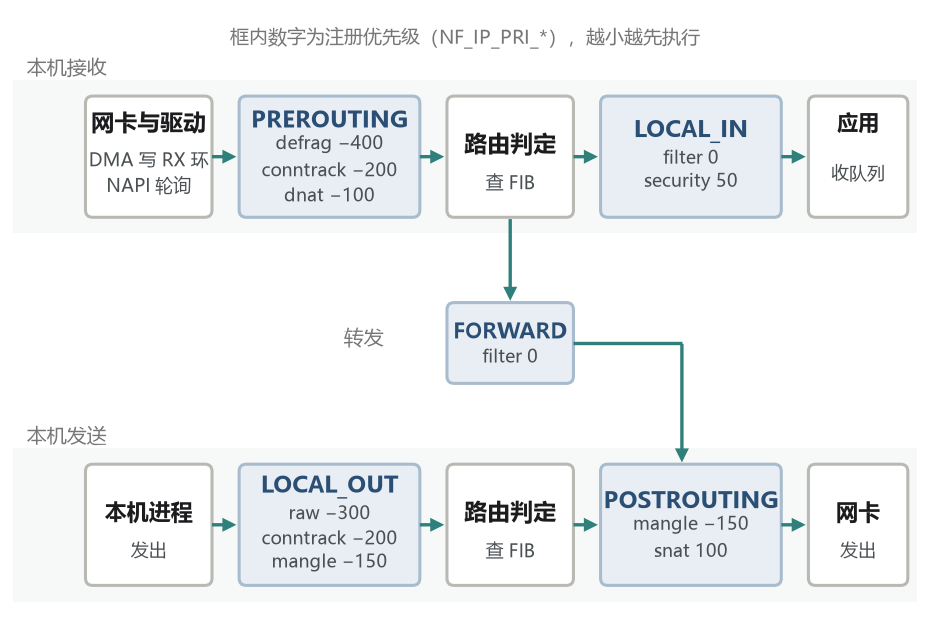
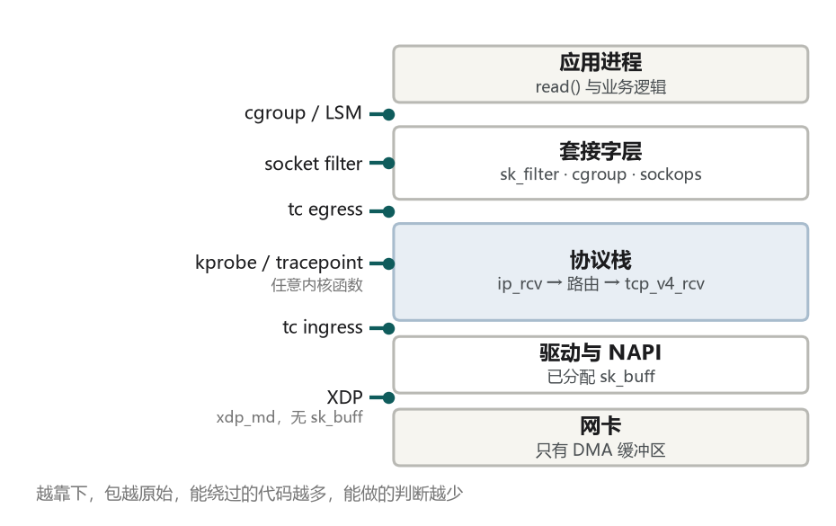

# 第二十章　网络数据面

1998 年，Ptacek 与 Newsham 在那篇讲入侵检测规避的论文里演示了一个很朴素的手法。规则里写着丢弃去往 23 端口的包，测试者把 TCP 头切进两个 IP 分片，第一个分片只放 8 个字节，连源端口号都装不下。过滤器看到的两个分片都不含端口信息，都放行了；目标主机把分片拼起来，得到一个完整的、目标端口为 23 的 TCP 头，连接建立成功。

同一串字节，在线路上被看了一眼，在主机里被重新组装了一次，两次看到的东西不一样。这不是某个产品的 bug，而是结构决定的。过滤器工作在链路上，端点工作在重组之后；中间的每一个中间盒、每一层虚拟化，都在改变“一个包”到底是什么。

这一章讲的是那条路上每一段代码。数据面（data plane）指的是每个包都必须经过的那部分处理，和路由协议、防火墙规则这类偶尔改一次的配置相对。它决定了转发一个包要花多少时间，也决定了谁能看到包里的什么。

先说时间。一条 10 GbE 链路跑最小尺寸的以太网帧，每分钟要处理 1488 万个包，平均到每个包 67 纳秒。算上前导码和帧间隙，这已经是物理层的极限。一颗 3 GHz 的核在这 67 纳秒里能做两百条指令上下，而 Linux 完整走一遍接收路径要花上千个周期。差距不是靠优化几条汇编能补上的，只能是批处理、卸载、或者绕开。

## 20.1 一个包进来之后

网卡收到帧，先用 DMA 把数据写进内存，再写一个描述符。描述符放在一段环形缓冲区（RX ring）里，每个描述符指向一块预先分配好的缓冲区，通常是 2 KB 左右。CPU 不参与这次拷贝，它只会在描述符的完成位上看到结果。环的大小可以调，`ethtool -g` 能看到，常见值是几百到几千个描述符。

环满了就丢包，这个丢包发生在驱动里，协议栈完全不知道。这是排查“为什么应用层看不到”时第一个要看的地方，`ethtool -S` 里的 `rx_missed_errors` 和 `rx_no_buffer_count` 就在说这件事。

描述符写完之后网卡发中断。中断处理程序只做一件事，把这个设备挂到当前 CPU 的 NAPI 轮询链表上，然后返回。真正的收包在软中断（softirq）里做，`net_rx_action` 逐个调用设备的 `poll` 函数，每次最多取 64 个包，这个数叫权重（weight）。软中断一次运行的总预算由 `net.core.netdev_budget` 控制，默认 300 个包，时间上限由 `netdev_budget_usecs` 控制，默认 2000 微秒。预算用完就把剩余的留给下一轮，同时把中断重新打开。

这个设计的目的很直接。如果每个包都发一次中断，10 GbE 满载时每秒一千多万次中断，CPU 会把全部时间花在进出中断上下文上。改成“中断关掉，一次取一批”，中断次数降到和批次数一个量级，剩下的开销才是真正的协议处理。

取到的数据要变成 `sk_buff`。这个结构是整条路径上唯一贯穿始终的东西，值得拆开看。它本身不存数据，只存四个指针，`head` 指向缓冲区起点，`end` 指向终点，`data` 是当前协议层的头，`tail` 是数据末尾。`data` 和 `head` 之间的空隙叫头部空间（headroom），默认留 64 字节左右，专门给各层往上加自己的头用。

这个设计省掉了大量的内存搬移。以太网层在 `data` 前面塞 14 个字节，IP 层再塞 20 个，TCP 再塞 20 个，每次只是把 `data` 指针往前挪，数据本身一动不动。反过来封装的时候把指针往回挪，也不需要拷贝。

数据不一定连续。大包的主体可以放在若干个页碎片（page fragment）里，`sk_buff` 只记录这些碎片的数组，`skb_headlen()` 返回线性部分的长度，`skb->len` 是整个包的长度，两者之差就是分片部分。缓冲区末尾还挂着一个小结构 `skb_shared_info`，里面存碎片数组和引用计数。`skb_clone` 复制出来的两个 `sk_buff` 共享同一份数据，靠这个计数决定什么时候真正释放。

代价是这层间接性带来了大量引用计数和生命周期问题，内核网络子系统里的漏洞有很大一部分就长在这里。一个包在排队、克隆、重传、分片之间辗转，任何一个环节少加一次引用或者多减一次，都会让某个 `sk_buff` 在还被使用的时候被释放。

往上走之前还有一步聚合。GRO（generic receive offload）会把同一个流里连续的、可以拼接的段合并成一个大的 `sk_buff`，最多到 64 KB。协议栈因此看到的包比线路上少得多，每个包的处理开销被摊薄。副作用是端点看到的分段边界和线路上真实发生的完全不是一回事，这对做流量分析的人是长期的麻烦。

接着是路由和分发。`ip_rcv` 检查版本、长度、校验和，穿过 netfilter 的第一个钩子，然后查转发表。目的地是本机就交给 `ip_local_deliver`，穿过第二个钩子，再进 `tcp_v4_rcv`。TCP 有一个针对正常数据段的快速路径，靠首部预测一次性判断“这个段没有异常”，跳过大部分状态机分支，直接挂到套接字的接收队列上。

队列挂好之后是唤醒。数据挂进 `sk_receive_queue` 之后，`sk_data_ready` 回调通知等待者，进程从 `epoll_wait` 或 `recv` 里醒来，把数据从内核缓冲区拷到用户空间。这一次拷贝省不掉，除非用零拷贝接口。所以一个包完整的旅程至少是两次内存写，一次 DMA 进来，一次拷贝出去。

<figure>

<figcaption>图 20-1　一个包在 Linux 里的路径与 netfilter 的五个钩子。钩子框内的负数是该位置常见模块的注册优先级，数字越小越先执行。转发路径只经过 FORWARD 一次，本机收发的包则各自再穿两个钩子。</figcaption>
</figure>

图里把钩子画在路径上，是为了说明一件容易被忽略的事。同一个包可能被看很多遍，每一遍看它的模块不同，看到的形态也不同。分片在第一个钩子之前就被重组了，所以后面所有模块看到的都是完整包；而线路上真实流动的是碎片。后面讲规避，根子就在这个错位上。

## 20.2 五个钩子与连接跟踪

netfilter 在 IP 层放了五个钩子，名字就是它们的位置。`NF_INET_PRE_ROUTING` 在包刚进来、还没决定去哪的时候，`NF_INET_LOCAL_IN` 在确定送给本机之后，`NF_INET_FORWARD` 在确定要转发之后，`NF_INET_LOCAL_OUT` 在本机发出的包刚生成时，`NF_INET_POST_ROUTING` 在包即将离开之前。

每个钩子上可以挂多个处理函数，按优先级排序。优先级不是随便定的，是一套约定，写在内核头文件里。分片重组是 −400，连接跟踪是 −200，mangle 是 −150，目的地址转换是 −100，过滤是 0，安全模块是 50，源地址转换是 100。数字小的先跑。

iptables 的五张表其实就是这五个优先级上的固定挂载点。raw 表挂在 −300，在连接跟踪之前；mangle 挂 −150；nat 表的 DNAT 链挂 −100，SNAT 链挂 100；filter 挂 0。所以“iptables 的执行顺序”不是表名的字母顺序，而是这个优先级序列。一条 raw 表里的 `NOTRACK` 能让后面的 conntrack 完全看不到这个包，因为它在 −300 就已经打了标记。

nftables 把这层关系摊开了。一条链自己声明类型和优先级，同一个钩子上可以有多条 base chain，按优先级串起来跑。这比 iptables 灵活，也更容易写出“我以为它先跑”的规则。查一个包到底经过了哪些链，`nft list ruleset` 里的 `priority` 字段是唯一的线索。

链内的规则是首次匹配即终止。匹配到一条带终结动作的规则，这个链就结束了，后面的规则不再看；没有匹配到任何规则，就执行链的默认策略。这一点在两种工具里一样，也都容易被误读成“规则从上到下依次执行完”。

连接跟踪（conntrack）是这套结构里最有意思的部分。它在 −200 的位置，为每个连接维护一条记录，键是五元组，值是状态和一连串与协议相关的信息。状态有四种，`NEW` 表示只看到一个方向的首包，`ESTABLISHED` 表示两个方向都见过，`RELATED` 表示这个连接是另一个连接的派生（FTP 的数据连接是典型），`INVALID` 表示这个包不属于任何已知连接也不构成新连接。

有了这张表，NAT 才能工作。DNAT 在 −100 改掉目的地址，之后的转发决策看到的是改过的地址；回程包靠 conntrack 里的记录被反向改回来。这也解释了一件事，nat 表的规则只对连接的第一个包生效，因为后续的包直接查表就够了。filter 表不一样，每个包都要过。

表的容量是有限的。`nf_conntrack_max` 决定最多能记多少条，默认值和哈希桶数挂钩，桶数又和内存大小相关。表满了内核就开始丢新连接，日志里是那句 `nf_conntrack: table full, dropping packet`。一台跑了几万个长连接的服务器，这个上限比带宽更早成为瓶颈。

还有一个出口值得知道，`NFQUEUE`  verdict 把包交给用户态程序处理，处理完再送回来。这是很多开源 IPS 的工作方式，也是这套架构里唯一一处“每个包都要做一次上下文切换”的地方。它的性能上限因此比纯内核路径低一个数量级，功能却可以任意复杂。

## 20.3 eBPF 插在哪

eBPF 是一套把用户提交的字节码安全地放进内核执行的机制。它的核心约束是，代码在跑之前必须先被证明不会做坏事。

证明由验证器（verifier）完成。它不看具体输入，而是做抽象解释，为每个寄存器维护一个“可能取值的范围”和“类型”。类型有标量、指向栈的指针、指向 map 值的指针、指向上下文结构的指针等等。每条指令执行后，验证器更新这些抽象状态，遇到分支就把状态分叉，在汇合点取并集。任何一次内存访问，都要证明偏移落在已知对象的边界内。

这套分析是保守的。它证明不了的程序一律拒绝，所以合法但写法奇怪的代码经常过不了。为了让更多程序能过，验证器这些年一直在放宽，5.3 开始支持有界循环，靠的是记录每个循环的迭代次数上界；总指令数上限从 4096 提到 100 万，只对特权程序开放。放开一点，近似就松一点，这是同一个天平的两端。

通过验证的字节码会被 JIT 编译成本机指令。这一步很关键，它让 eBPF 程序的运行开销接近手写内核模块，而不是解释执行。map 提供的共享内存也是按这个思路设计的，数组 map 是一段连续内存，per-CPU map 每个 CPU 一份副本、读写不加锁，ring buffer 用生产者消费者模型在内核和用户态之间传数据。

挂载点决定了程序能看到什么。XDP 挂在驱动里，包还在 DMA 缓冲区里，还没有分配 `sk_buff`，程序拿到的是一个 `xdp_md` 结构，里面只有数据起止位置和几个元数据字段。这个位置最早，代价最小，能在包进入协议栈之前就丢掉它，也能直接把包从另一块网卡发出去。代价是它只能看到线性区，没有分片信息，也没有套接字。

tc（traffic control）挂在协议栈的入口和出口，此时 `sk_buff` 已经存在，程序能看到完整的包、设备、以及一部分元数据，还能改包、重定向、做队列调度。socket filter 挂在套接字上，只能看到这个套接字收到的数据。cgroup 钩子和 LSM 钩子挂得更靠上，管的是“这个进程能不能做这件事”，不是“这个包长什么样”。kprobe 和 tracepoint 挂在内核的任意函数上，用于观测，也能改寄存器。

<figure>

<figcaption>图 20-2　eBPF 的几类挂载点在协议栈中的位置。越靠下，拿到的数据越原始，能绕过的代码越多，能做的判断也越少；越靠上，上下文越丰富，开销也越大。</figcaption>
</figure>

性能优势来自三个地方。程序在核内跑，不需要把包送到用户态再送回来，省掉了两次上下文切换和一次拷贝；JIT 之后是本地指令，没有解释器开销；map 的 per-CPU 设计让热路径上几乎没有锁竞争。2018 年 Høiland-Jørgensen 等人在 CoNEXT 上发表的那篇 XDP 论文里，单核转发能做到每秒一千万包的量级，和纯轮询的用户态方案在同一档，但仍然保留了内核的控制面。

风险也来自同一处。验证器做的是近似，近似就有缝。CVE-2020-8835 是 32 位边界追踪和 64 位运算不一致，程序用一个 32 位的比较让验证器相信某个值很小，实际执行时这个值是一个很大的 64 位数。CVE-2021-3490 是 ALU32 运算之后上界计算错误，同一类问题的另一种形态。

还有一类更隐蔽，验证器证明的是字节码的语义，实际执行的是 JIT 生成的机器码。两者之间只要有一处不一致，验证过的程序就能做出验证器认为它不会做的事。CVE-2021-29154 就是 JIT 在编译跳转时算错了偏移，程序在验证器眼里完全合规，跑起来却跳到了别的地方。

推测执行是第三层。验证器按体系结构语义推理，而 CPU 会投机地执行那些“分支预测猜对”的路径，包括被验证器判定为不可达的分支。Spectre 那一类攻击因此在 eBPF 里也成立，内核的对策是在敏感位置插入屏障指令，把指针值遮蔽掉，但这要求每个可能被推测执行读到的地方都被想到。

出于这些原因，非特权用户加载 eBPF 程序在多数发行版上是关掉的，`kernel.unprivileged_bpf_disabled` 默认就是 1，5.16 之后还可以设成 2，表示永久关闭、不可再改。这个开关的收紧本身就说明了一件事，验证器的安全性是一个不断被测试的假设，而不是一条定理。

## 20.4 把内核从快路径上拿掉

如果协议栈本身太慢，一个办法是不要它。

DPDK 走的是这条路。它把网卡交给用户态驱动，用大页（hugepage）分配缓冲区，用 VFIO 把设备直接映射到进程地址空间，然后在一个死循环里轮询收包。没有中断，没有系统调用，没有 `sk_buff`，收发的单位是一个叫 `mbuf` 的固定结构，从内存池里取，用完放回。每个核绑定一块网卡队列，靠网卡的多队列和 RSS 把流量分散开。

这样做的吞吐能到线速，延迟也低且稳定，因为没有调度。代价同样明确。被轮询的核 100% 占用，即使没有流量也在空转，一台机器上能跑的业务核数直接减少。内核提供的一切都没有了，netfilter、套接字语义、cgroup 记账、`ss` 能看到的连接状态，统统要自己实现或者引入一个用户态协议栈。运维看到的是一块黑盒，出问题时没有 `tcpdump` 可用。

io_uring 走的是另一条路，它不绕开协议栈，只绕开系统调用。提交队列和完成队列放在一块由内核和用户态共享的内存里，应用把请求写进队列，一次 `io_uring_enter` 可以提交几十个操作，内核处理完把结果写进完成队列。注册过的文件描述符和缓冲区可以反复使用，省掉每次操作时的查找和映射。开了 SQPOLL 之后，连那一次 `io_uring_enter` 都可以省掉，由内核线程自己轮询队列。

对于网络，io_uring 省下的是每次收发的系统调用开销，而不是协议栈本身的开销。一个包还是要走 `ip_rcv`、`tcp_v4_rcv`、`sk_receive_queue`，只是从“每个包一次 `recvmsg`”变成“一批包一次提交”。高包速率、小包为主的场景收益明显，大包传输的收益有限，因为瓶颈在拷贝和内存带宽上。

AF_XDP 是两者的折中。XDP 程序把包重定向到一个用户态的 umem 区域，用户态进程直接从这块内存里读写，不经过协议栈，也不需要独占整个核。它保留了 XDP 的位置优势，又不像 DPDK 那样把设备完全从内核手里拿走，控制面还在内核里，`ip link` 还能看到这块网卡。

三种方案切掉的东西不一样。DPDK 切掉内核，io_uring 切掉系统调用，AF_XDP 切掉拷贝。共同点是复杂度被搬到了用户态，而用户态能用的检查工具比内核少得多。一个自己实现的 TCP 状态机不会经过二十年的模糊测试，也不会被 `syzkaller` 覆盖。

## 20.5 状态与信任的错位

回到开篇那个分片。它的成立依赖两个事实，一是分片可以在任意 8 字节边界切开，二是接收方对重叠分片的处理策略由自己决定。

IPv4 的重组允许重叠，规范没有规定重叠部分该信谁。不同的实现选择了不同的策略，有的信第一个到达的，有的信后到的，有的按偏移大小决定。攻击者只要让两台机器的策略不同，就能让过滤器和端点对同一个数据流得出不同结论。IPv6 后来在 RFC 5722 里把这条路堵死了，规定任何重叠的分片都必须整包丢弃，代价是这类包永远无法通过。

分片还带来另一种压力。重组需要缓存，缓存有上限，`ipfrag_high_thresh` 和 `ipfrag_time` 控制它的行为。发一堆永远凑不齐的分片，就能把这块缓存占满，后续合法的分片全部被丢。teardrop 在 1997 年用的就是重叠分片的偏移算出一个负长度，让内核在拷数据时越界。

第二类错位在 TCP 状态机上。建立连接不需要任何认证，一个 SYN 包就能让服务器分配一块状态。这块状态有大有小，小到几十字节的请求块，大到一整个套接字。SYN flood 打的不是带宽，是这块内存。SYN cookie 的对策是不保存状态，把连接信息编码进序列号，等第三个包回来再验证；代价是丢失了一些 TCP 选项的协商能力。

同一种逻辑适用于所有“表”。conntrack 表、分片重组队列、ARP 缓存、TIME_WAIT 列表、TCP 接收队列，每一项都是由未认证的输入创建的状态，每一项都有上限，因此每一项都是拒绝服务的入口。判断一台机器的抗压能力，看的是这些表的默认值和淘汰策略，而不是网卡带宽。

序列号的另一面是可信度。TCP 用四元组加序号来区分连接，序号空间是 32 位，在一个足够长的连接上可以被推测。RFC 5961 之前，只要序号落在窗口内，一个伪造的 RST 就能拆掉连接。窗口越大，猜中的概率越高。中间盒让这件事更复杂，一个代理会用自己的序号空间重建连接，两端看到的 RST 语义完全不同，链路上一个包被丢可能表现为另一端连接被重置。

第三类问题在 eBPF 上。验证器保证的是“这段程序不会访问它不该访问的内存”，而 map 是一条合法的内核到用户态通道。一个程序如果把某个内核指针写进 map 的值，用户态读 map 就拿到了这个地址，KASLR 的随机化随之失效。这不违反任何规则，验证器允许标量被存进 map，指针只是标量的一种。

特权程序的情况更直接。kprobe 类型的程序调用 `bpf_probe_read_kernel` 可以读任意内核地址，这是它的设计功能，用于调试和观测。因此 `CAP_BPF` 和 `CAP_PERFMON` 这两个能力在现代 Linux 上等价于相当大的权限，拿到它们基本等于拿到了读内核内存的能力。容器里如果这两个能力没被丢掉，隔离的强度就要重新评估。

数据面的信任链条止于内核和驱动。内核相信网卡送来的描述符，驱动相信固件配置的寄存器和 DMA 地址，而固件来自主板上的另一块芯片。这条链再往上一环，就是下一章要讲的硬件信任根。
