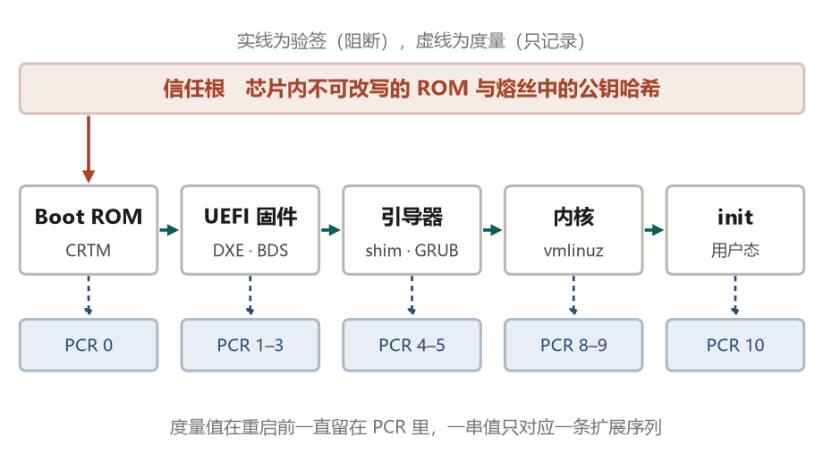
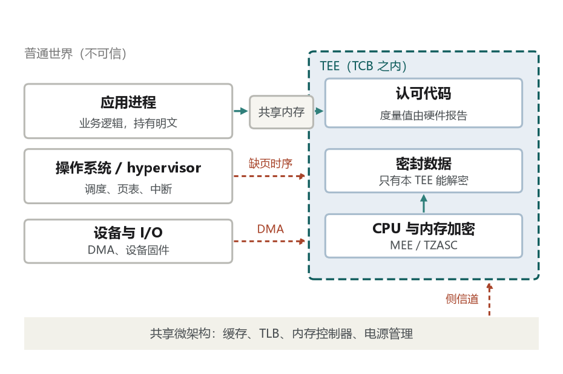

# 第二十一章　硬件信任根

一块开了 BitLocker 的笔记本被拆开，硬盘被取出来接到另一台机器上。预期中的明文没有出现，系统要求输入一串 48 位的恢复密钥。把这把硬盘装回原机，开机，什么都不用输。

起作用的不是硬盘上的任何东西。加密密钥被 TPM 封存在芯片里，解封的条件是若干寄存器的值必须和当初封存时一致。换了主板，那些值就变了，密钥取不出来。硬盘上的数据从来没有离开过这台机器，它只是被绑定到了这台机器的某一段启动历史上。

这是一个很具体的例子，说明“信任”在硬件层面是什么样子。它不是一句承诺，而是一个可以被计算、被比较、被拒绝的比特串。这一章沿着开机那一刻往上走，看这条链在哪几个点上做了判断，每个判断依赖什么，又在什么地方失效。

起点比大多数人想的要低。在操作系统之前有引导器，在引导器之前有固件，在固件之前有一段烧在芯片里的只读代码。这段代码运行时，内存里还没有任何可以被称作“软件”的东西，它是整条链上唯一无法被软件修改的一环。

## 21.1 信任从哪一块字节开始

x86 机器上电后，CPU 从复位向量取第一条指令，这条指令位于芯片组映射的一段 ROM 里。这段代码通常叫 Boot ROM，或者更正式一点，叫核心度量根（core root of trust for measurement, CRTM）。它做的事情很少，初始化一点点内存控制器，从 SPI 闪存里把固件读出来，校验，然后跳过去。

校验用的公钥不在闪存里，在 CPU 或芯片组的熔丝（fuse）里，存的是公钥的哈希。熔丝是一次性可编程的，烧断之后不可逆。攻击者要换掉这个公钥，得改熔丝，那是物理层面的操作；要伪造一个哈希相同的固件，得找到哈希函数的碰撞。

Intel 把这一套叫 Boot Guard，AMD 对应的是 PSP 里的硬件验证启动。名字不同，结构一样：芯片里有一段改不了的代码，配一个烧在硅片上的信任锚，用它去验第一段可改的固件。

从这里往上，每一环的规则相同。上一环验证下一环的签名，验证通过才把控制权交出去。固件验证引导器，引导器验证内核，内核验证模块。任何一环验不过，链条就停在那里。

验证之外还有一条并行的动作，度量（measurement）。它不阻断任何东西，只是把每一环的摘要记下来，记的方式是把它交给 TPM 扩展进某个寄存器。验证回答“能不能继续”，度量回答“刚才发生过什么”。

<figure>

<figcaption>图 21-1　一条典型的 x86 启动链，以及两条并行的动作。横向的实线箭头是验签，用上一环的公钥校验下一环；向下的虚线箭头是度量，把每一环的摘要扩展进 TPM 的对应寄存器。括号里的 PCR 编号取自 TCG 的 PC 客户端平台规范，实际分配随固件实现略有差异。</figcaption>
</figure>

两个动作解决的是不同问题。验证让未签名的代码无法运行，前提是签名者可信、签名者的密钥没丢、验证逻辑本身没漏洞。度量不阻止任何事，但它留下一条无法事后伪造的记录，前提是 TPM 可信、记录没有被跳过。

这两条链都有一个共同的弱点，就是它们在时间上是顺序的，信任只能往下传，不能往回查。固件把控制权交给引导器之后，它对引导器做什么一无所知。度量能部分弥补这一点，因为度量值会被带进操作系统，但那只在有人去读的时候才有意义。

## 21.2 TPM 与 PCR

TPM 是一块独立的芯片，挂在 LPC 或 SPI 总线上，有自己的处理器、内存和非易失存储。它做三件事，存密钥、做密码运算、记录度量。密钥在芯片内部生成，私钥永远不出来，所有用到私钥的运算都在芯片里完成。

它记度量用的是一组叫平台配置寄存器（platform configuration register, PCR）的槽位。TPM 2.0 有 24 个，编号 0 到 23，每个槽位按不同的哈希算法各有一份，SHA-1 和 SHA-256 最常见。

写 PCR 的操作不叫写，叫扩展（extend）。给定一个旧值和一个新数据，新值是两者拼接之后的哈希。`PCR_new = H(PCR_old || data)`。这个操作有三个性质：不可逆，知道新值推不出旧值；顺序敏感，同样的两个数据换个顺序扩展，结果不同；不可清零，除了重启。

顺序敏感这一点是设计的关键。它意味着 PCR 的值唯一对应一条度量序列，攻击者要让 PCR 看起来正常，就必须让机器真的按那个顺序启动一遍。

每个 PCR 记录什么，由 TCG 的 PC 客户端规范约定。PCR 0 到 3 记固件本身、它的配置和可选 ROM，4 和 5 记引导器的第一阶段与分区表，7 记 Secure Boot 的策略状态，8 和 9 记引导器执行的命令和它加载的内核，10 留给 IMA 做运行时的文件度量。剩下的槽位由具体实现分配，shim、内核命令行、MOK 列表各有各的位置，不同发行版并不完全一致。具体到某台机器，用 `tpm2_pcrread` 打一遍就能看到实际的值，用 `tpm2_eventlog` 能看到每一次扩展的来源。

PCR 的用途有两个，封存和证明。

封存（sealing）是把一个密钥交给 TPM 保管，附带一个条件，只有当指定的几个 PCR 取值符合预期时才能取回。取回的操作叫解封（unseal），TPM 会先比对 PCR，不匹配就拒绝。BitLocker 用的就是这个机制，默认绑 PCR 7 和 11，7 反映 Secure Boot 的策略有没有被改，11 反映引导器的度量。把硬盘换到另一台机器，PCR 值不同，解封失败，系统才要恢复密钥。

证明（attestation）是把 PCR 的值报给一个远程方，让对方相信“这台机器当前处于某个状态”。报的方式是 TPM 对选定的 PCR 集合加一个随机数签名，这个签名叫 quote。随机数由验证方提供，防止重放。签名用的密钥叫证明密钥（attestation key, AK），AK 本身由背书密钥（endorsement key, EK）签发的证书来证明它属于一块真的 TPM。

这里有一个容易被跳过的细节。如果只看 quote 的签名，一个纯软件实现的假 TPM 也能签出一样的结构。所以协议里还有一步凭证激活（credential activation），验证方把一段只有真 TPM 才能解开的秘密发过去，对方解开并证明它掌握了 EK 对应的私钥。这一步才能把“某个密钥签了这段话”变成“某块真实的芯片签了这段话”。

度量的局限同样明显。PCR 记录的是“启动过程中被度量过的东西”，不是“现在内存里跑着的东西”。内核被度量、被验签、被加载之后，它自己就成了可以修改一切的主体。`kexec` 可以加载一个新内核，`/dev/mem` 可以写物理内存，一个加载了任意代码的内核可以让 PCR 的值停留在启动结束那一刻的样子。

补这个洞的办法是把度量延伸到运行时。IMA（integrity measurement architecture）在每次执行文件、每次打开文件时计算摘要并扩展进 PCR 10，同时用一份签名过的策略决定拦不拦。代价是开销，每次 exec 都要做一次哈希，路径越长越慢。多数量产系统没有开这一项。

TPM 自身也不是无懈可击。它挂在一条可以被探针接触的总线上，2018 年公开的 TPM Genie 就是用一颗便宜的 FPGA 做中间人，改掉总线上的数据。AMD 的固件 TPM 把实现放进了 PSP 里，2023 年那篇 faulTPM 的论文用电压毛刺让 fTPM 在计算时出错，从而提取出 BitLocker 的密钥。这些攻击都需要物理接触，但“需要物理接触”和“不可攻破”是两件事。

## 21.3 Secure Boot 保护的是谁可以启动

Secure Boot 是 UEFI 规范里的一套签名验证机制，用四组密钥表达策略。

平台密钥（platform key, PK）在最上面，代表这台机器的所有者。密钥交换密钥（key exchange key, KEK）由 PK 签名，用来更新下面的库。签名数据库（db）里放允许加载的证书和镜像哈希，吊销库（dbx）里放禁止加载的。固件在加载一个 EFI 应用之前，先查 dbx，再查 db，都不匹配就拒绝。

Linux 发行版在这套体系里的位置比较特殊。微软的 UEFI CA 在几乎所有主板的 db 里，而发行版拿不到自己的证书进 db。于是有了 shim，一个由微软签名的很小的引导器，它再去验证发行版自己的引导器。shim 还提供一层机制叫 MOK（machine owner key），让用户把自己的公钥加进去，给自编译的内核模块签名。

这套机制确实挡住了东西。一个被改过的引导器无法加载，一个未签名的内核无法启动，一个试图在启动早期植入的 bootkit 要面对签名检查。它对“谁能在这台机器上运行代码”这个问题给出了一个默认答案。

但它回答不了另一个问题。Secure Boot 在把控制权交给内核之后就退出舞台了，之后内核加载什么驱动、挂载什么文件系统、运行什么程序，它一概不管。链上的签名只保证“这段代码是某个厂商签发的”，不保证“这段代码没有漏洞”。

BootHole 是这句话最好的注脚。2020 年 7 月披露的 CVE-2020-10713 是 GRUB2 在解析配置文件时的缓冲区溢出，攻击者可以构造一个 `grub.cfg` 让已经签名的 GRUB 执行任意代码。GRUB 是签过名的，所以 Secure Boot 放行；GRUB 有漏洞，所以放行之后的一切都可以被接管。修的办法是把有漏洞的 GRUB 的哈希写进 dbx 吊销掉，但 dbx 更新依赖固件厂商推送，很多机器从来没有收到过。

密钥管理也会塌。2024 年 7 月，Binarly 公开了一批固件里的平台密钥问题，代号 PKfail。多家厂商的量产固件里用了 AMI 提供的测试密钥，那对密钥的证书主题里明明白白写着“DO NOT TRUST”。这对私钥在网上流传了多年，任何拿到它的人都能签出一个通过验证的引导器。这不是密码学被攻破，是把测试配置发到了生产环境。

再退一步，Secure Boot 可以被关掉。绝大多数主板的固件设置界面里都有一个开关，按一下就能让它失效，改回传统引导。物理接触者按一下开关，整条链就断了。这也是为什么高安全场景会在固件里设管理员口令、开 Boot Guard、把设置项锁死，而不是只依赖 Secure Boot。

所以它的准确定位是，一个默认开启的、防远程和防顺手改动的门槛。它把攻击成本从“改一个文件”抬到“拿到签名密钥或者找到已签名代码里的漏洞”，但没有把成本抬到无穷。

## 21.4 TEE 的边界

可信执行环境（trusted execution environment, TEE）要解决的问题是，如果操作系统本身就是攻击者，代码怎么在一个它管不着的地方运行。

Intel SGX 的做法是在用户态划出一块叫飞地（enclave）的区域。飞地的代码和数据放在一段特殊的内存里，叫 EPC（enclave page cache），这块内存由 CPU 内部的内存加密引擎加解密，操作系统看到的只有密文。飞地一旦启动，外部的读写、调试、甚至页表操作都会被硬件挡住。

ARM 的做法不一样，TrustZone 把整个世界分成安全和非安全两半，由一条叫 monitor 的代码在两者之间切换。内存按地址区间划分，由 TZASC 这类控制器强制执行，非安全世界访问安全区的地址会失败。跑在安全世界里的那套小操作系统（OP-TEE 是最常见的开源实现）就是 TEE。

AMD 的 SEV-SNP 和 Intel 的 TDX 又换了一个粒度，保护的是整台虚拟机。hypervisor 仍然调度它、仍然能观察它的退出行为，但读不到它的内存，也改不了它的寄存器状态。ARM 在 2021 年提出的 CCA（confidential compute architecture）引入了第四种状态叫 realm，思路类似。

<figure>

<figcaption>图 21-2　TEE 的信任边界与它没有覆盖的部分。虚线以内是 TCB，硬件保证其机密性与完整性；虚线以外的一切，包括调度器、设备、内存控制器和共享缓存，仍然能观察甚至影响 TEE 的行为。</figcaption>
</figure>

这四种实现共享一个威胁模型。它假设操作系统、hypervisor、固件都可能被攻破，因此都不可信；它不假设 CPU 封装内部会被攻破，因此 CPU 是可信的；它明确把物理攻击和侧信道排除在外。

被排除的那一项，是整个模型里最脆弱的地方。飞地和普通进程共享同一颗 CPU、同一份缓存、同一个内存控制器、同一套电源管理。硬件保证了“不能直接读”，但没有保证“不能推断”。

最早的一类攻击利用页错误。操作系统控制页表，它可以把飞地要访问的页面标成不存在，飞地一访问就触发一次缺页，操作系统由此知道飞地走到了哪一行代码。2015 年 Xu 等人把这个方法叫受控通道攻击（controlled-channel attack），它能以页为粒度还原飞地的控制流。SGX-Step 更进一步，用 APIC 定时器把飞地的执行切成单步，让时间分辨率提高到指令级。

缓存是第二条路。飞地的访问模式会改变共享缓存的占用状态，另一个核上的进程用 Prime+Probe 就能测出来。这类攻击不需要任何特权，一个同机的普通进程就够。

推测执行是第三条，也是影响最大的一条。2018 年的 Foreshadow（CVE-2018-3615）利用 L1 终端故障，让飞地里的推测执行去读它本来读不到的内存，再通过缓存侧信道把结果带出来。这一击直接针对 SGX 的安全模型，因为它不需要操作系统配合，只需要在同一颗 CPU 上跑一段代码。

之后的几年里，这个方向没有停下来。Plundervolt（CVE-2019-11157）用降低电压的方式让飞地里的乘法指令算错，从而伪造签名；CrossTalk（CVE-2020-0543）利用跨核的填充缓冲区；ÆPIC Leak（CVE-2022-21233）从 APIC 的寄存器里读出飞地的残留数据；Downfall（CVE-2022-40982）用 AVX2 的 gather 指令把数据从乱序执行的内部缓冲区里捞出来，影响范围包括 SGX 飞地里的密钥。

这些漏洞的共同点是，它们不在 TEE 的密码学边界上，而在它脚下。TEE 的设计假设“CPU 内部的资源隔离是可靠的”，而微架构层面的共享把这条假设一点点磨掉了。每一代修复的方式都是微码更新加性能损失，而被修复的永远是已经被发现的那一类。

TEE 仍然有价值，它的价值在于把 TCB 从“整个操作系统”缩小到“CPU 加上一小段代码”。一个把密钥放在飞地里的服务，不再需要信任云厂商的系统管理员。但它不提供“即使攻击者能接触硬件也无法攻破”这种保证，任何把这句写进产品文档的说法，都超出了它的实际能力。

还有一处经常被忽略，飞地的输入输出必须经过不可信的操作系统。网络包要由 OS 收进来再交给飞地，磁盘上的数据要由 OS 读出来再送进去。攻击面因此从飞地内部移到了边界上，而边界上的解析代码通常不在飞地里。

## 21.5 带外的那一层

主板上有几块芯片不在操作系统的管辖范围内，它们各自有处理器、内存和固件，各自能访问总线和网络。它们通常被合称为带外组件，因为从操作系统的角度看，它们在“外面”。

Intel 的管理引擎（management engine, ME）是其中最出名的一个。它跑在一颗 ARC 核心上，有自己的 ROM 和 SRAM，只要主板接通待机电源就在运行，可以访问内存控制器和网卡。它的功能包括 AMT 远程管理、启动阶段的固件验证、以及一部分电源管理。它的固件由 Intel 签名，厂商和用户都无法审计其中的代码。

AMD 对应的是平台安全处理器（platform security processor, PSP），一颗基于 ARM TrustZone 的小核，负责启动 CPU、验证固件、以及处理 SEV 的密钥。Apple 的 SEP 在结构上类似，管 Touch ID 和文件系统的密钥。

服务器上还有一个更直接的入口，基板管理控制器（baseboard management controller, BMC）。它是一台完整的嵌入式系统，跑 Linux，有自己的网口（经常和主机共享 PHY，通过 NC-SI），常年在线，即使在主机关机时也在工作。它通过 IPMI 或 Redfish 提供远程开关机、看串口、读传感器、挂载虚拟光驱这些功能。

BMC 的问题是它的暴露面。IPMI 2.0 的 RAKP 认证协议在 2013 年被发现有一个设计错误，CVE-2013-4786，服务器在认证的第二步就把密码的哈希发给了客户端，攻击者拿到哈希之后可以离线爆破。这个协议没法在不破坏兼容性的前提下修好，于是大量设备至今仍在跑它。默认口令是另一个长期问题，厂商预置的 `ADMIN/ADMIN` 之类在互联网上被扫描了很多年。

这些组件的固件更新走的是自己的通道。签名验证通常有，回滚保护（anti-rollback）不一定有，A/B 分区和恢复模式也不一定有。NIST 在 2018 年发布的 SP 800-193 把这些要求归纳成三件事，保护（防止未授权修改）、检测（能发现被改过）、恢复（能回到已知良好的状态）。三者缺一，一次成功的写入就可能变成永久性的。

一个具体的例子说明了这条链的脆弱。Boot Guard 用熔丝里的公钥校验固件，而固件里包含 ME 的代码；ME 的签名密钥在 Intel 手里，OEM 拿到的是签好的二进制。如果 OEM 自己的固件签名密钥泄露，攻击者能签出一个通过 Boot Guard 校验的固件，里面塞进任何东西。整条链的强度等于最弱的那个签名密钥。

从操作系统的角度看，这些组件是黑盒。`lspci` 能看到，`dmidecode` 能看到版本号，但没法知道里面在跑什么。资产管理清单里通常没有它们，漏洞扫描器也扫不到它们，而它们有网络地址、有固件、有凭据。很多入侵事件里，攻击者最后一步的持久化就落在 BMC 或者 ME 上，因为重装系统不会影响它们。

硬件信任根回答的问题是“这块板子上跑的代码是谁签的”。它不回答“这段代码是不是从那份源码编译出来的”。后一个问题要往前追一层，追到构建过程，那是下一章的事。
