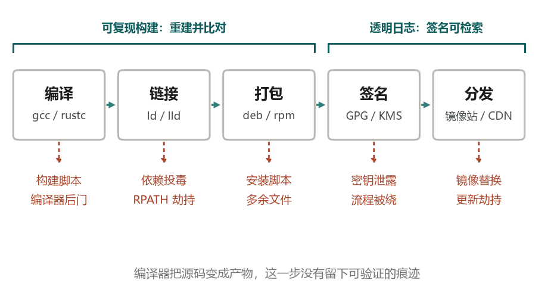
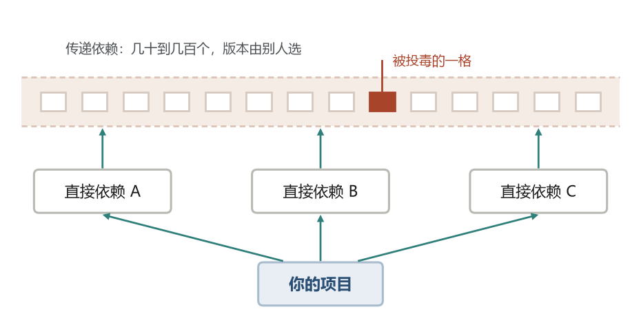

# 第二十二章　构建与供应链

2024 年 3 月，Andres Freund 在调试 PostgreSQL 的一台测试机时注意到一个反常现象，SSH 登录比平时慢了大约 500 毫秒。他沿着这条线索往下查，发现 `liblzma` 里多了一段不是编译产物该有的代码，再往下查，发现这段代码在特定条件下会劫持 `sshd` 的认证流程。

这个后门差点进入所有主流 Linux 发行版的稳定版本。它的作者用两年时间在邮件列表里经营身份，先提交一些无害的补丁，再逐步要求成为共同维护者，最后把真正的载荷藏在两处不会被 `git log` 看到的地方，一处是 `build-to-host.m4` 这个构建宏，一处是几个用作测试输入的二进制文件。发行版打包时用的是项目发布的 tarball，而 tarball 里包含了 git 仓库里没有的东西。

三年多以前，SolarWinds 的 Orion 平台发布了一个带后门的更新。这个更新有合法的数字签名，通过了所有完整性校验，被一万八千多家客户下载安装。攻击者没有伪造签名，他们进了构建服务器，在编译之前把代码改掉。

再往前一年，Codecov 的 Bash 上传脚本被人改了两个月，凡是那段时间在 CI 里跑过 `bash <(curl ...)` 的项目，环境变量都被送到了一个外部地址，包括各种令牌和云凭据。

三次事件，三个不同的位置，同一个模式。密码学一次都没有被攻破，签名是有效的，哈希是对的，TLS 是正常的。被攻破的是流程，是“谁有权改动这个产物”和“改动之后有没有人能看见”。

## 22.1 五个环节与它们各自的注入点

一个二进制从源码到用户手里，要经过五步。编译把源码变成目标文件，链接把目标文件拼成可执行文件或库，打包把它装进 deb、rpm、容器镜像或者压缩包，签名给产物盖一个章，分发把它送到用户能取到的地方。

每一环都是一个可以被动手脚的位置，而多数团队的注意力只放在第一环的输入上。

编译这一步的输入不只是源码。编译器本身是程序，它在处理输入时可以执行任意逻辑。Thompson 在 1983 年的图灵奖演讲里描述过一种极端的形态，一个被改过的编译器在编译“编译器源码”时插入后门，同时让被编译出来的编译器在编译别的程序时插入后门，源码看上去完全干净，用这份源码重新编译也复现不出干净的结果。这篇演讲在 1984 年以《Reflections on Trusting Trust》为题发表，五十年后仍然是这个领域最准确的描述。

比这更常见的是构建脚本。`Makefile`、`build.rs`、`setup.py`、`postinstall`、`Dockerfile`，这些都是会被执行的代码，而在代码评审里它们得到的关注远少于业务代码。xz 的后门就藏在一个 m4 宏里，那段宏在 `configure` 阶段被展开，逻辑是“如果环境满足某些条件，就把测试目录里的某个文件解压并拼进编译单元”。评审者看的是 C 代码，没人去读那个宏。

链接是第二个位置。链接器按 `-L` 给出的顺序搜索库，一个同名但放在前面的库会被优先选中；`DT_RPATH` 和 `LD_LIBRARY_PATH` 能让程序在运行时加载到别的 `.so`；静态链接把依赖的代码直接搬进产物，于是被链接的那份代码里的任何东西都成了产物的一部分。一个被投毒的构建依赖，可以在链接这一步把自己的代码混进去，而源码里看不出来。

打包这一步决定“什么东西被装进去”。deb 和 rpm 允许在安装前后执行脚本，这些脚本以 root 身份运行；Docker 镜像的每一层都可能包含上一层的残留文件，即使后来 `rm` 掉了，层里还在；npm 的 `files` 字段没列全的时候，整个目录会被打进 tarball，包括测试数据和 `.env`。发包的人经常只检查“我要的东西在不在”，不检查“多出来的东西是什么”。

签名给产物盖一个身份章。它的作用范围精确到字节，一旦产物被签，之后任何改动都会被发现。问题在于签名发生在产物已经生成之后，它证明“这个字节串是某个密钥的持有者签的”，不证明“这个字节串来自那份源码”。SolarWinds 的攻击者不需要碰签名环节，他们让构建系统生成一个带后门的产物，然后让正常的流程去签它。

分发是最后一环。镜像站、CDN、包管理器的仓库、自动更新通道，任何一个位置被替换，用户拿到的就是另一个东西。这一环的防护依赖传输层和签名，传输层保护的是“在路上的完整性”，签名保护的是“来源”，两者都不保护“源头生成得对不对”。

<figure>

<figcaption>图 22-1　从源码到用户的五个环节，以及每一环上被实际利用过的注入点。方框下方是攻击者在这一步能做的事，上方是两个可以插入检查的位置：可复现构建覆盖源码到产物的映射，透明日志覆盖签名与分发。</figcaption>
</figure>

这张图的重点不是“环节多所以要小心”，而是五个环节里只有一个地方存在可验证的映射关系，就是源码和产物之间那一段。前面四环都可以被检查，唯独“这份源码编译出了这个二进制”这句话，默认情况下没有任何证据。

## 22.2 可复现构建

可复现构建（reproducible build）要提供的正是这份证据。它的定义很朴素，同样的源码、同样的构建环境，任何人重建都能得到逐字节相同的产物。

默认情况下得不到。同样一份源码，编两次，结果的哈希通常不一样，原因分散在很多细节里。

时间戳是最常见的一个。C 的 `__DATE__` 和 `__TIME__` 会把编译时间写进二进制，`ar` 归档会把每个成员的文件修改时间写进去，`tar` 会记录打包时间，`gzip` 会把压缩时间写进头部。这些都不影响功能，但都会让字节不同。

路径是第二个。调试信息里记录着源文件的绝对路径和编译目录，`__FILE__` 展开出来的是构建机上的路径。两个人在不同目录下编译，产物就不一样。修的办法是加映射，GCC 和 Clang 的 `-ffile-prefix-map` 把构建目录映射成一个固定字符串，Go 的 `-trimpath` 做同样的事，Rust 用 `--remap-path-prefix`。

顺序是第三个。文件系统返回目录项的顺序不固定，`readdir` 拿到的顺序取决于底层实现；并行编译的完成顺序不固定；哈希表的遍历顺序在有些语言里是随机化的。归档时按名字排序，生成列表时显式排序，就能消除这一层。

还有一些更隐蔽的。LTO 的分区可能带随机性，GCC 用 `-frandom-seed` 固定它；构建 ID 的生成方式在不同工具链里不同；`-march=native` 让产物依赖构建机的 CPU 特性；locale 和时区会影响字符串排序和日期格式化；某些构建系统会把主机名、内核版本、编译器版本串写进产物。

这些问题的处理已经有了一套事实标准。`SOURCE_DATE_EPOCH` 是一个环境变量，构建系统读到它就把所有时间戳固定成这个值，这个提案从 2015 年开始在多个发行版之间协调，现在 GCC、Clang、Python、Rust、Go 的工具链都认它。剩下的是逐个项目去修，修完之后把“可复现”写进 CI，每次提交都跑一遍双重构建，比对哈希。

Debian 从 2013 年起就在做这件事，到今天超过九成的二进制包可以被独立重建并得到相同结果。这个数字的意义在于，一个用户不需要信任 Debian 的构建机，他可以自己在自己的机器上编一遍，然后比对。

可复现构建能抓到什么，xz 是一个清楚的例子。发行版维护者后来发现，项目发布的 tarball 和 git 仓库的内容不一致，差异正是那个后门。如果打包流程是基于 git 重建的，这个差异会立刻暴露成一个哈希不匹配。Freund 发现它靠的是运气和敏感，可复现构建把它变成一个可以被机器发现的问题。

它的局限同样要说清楚。它证明的是“这份源码能生成这个产物”，前提是重建用的工具链和原构建一致，而工具链本身可能被污染。Thompson 的攻击在可复现构建面前仍然成立，因为两边用的是同一个被改过的编译器。Wheeler 在 2005 年提出的多样化双重编译（diverse double-compiling）是对这个问题的回应，用两个独立实现的编译器互相编译对方，比对结果，代价很高，实践中很少用。

还有一个更现实的局限，可复现不等于有人在重建。一个项目宣布自己可复现，但没有人真的去独立验证，那这个声明只是一句话。真正起作用的是“有第三方持续在重建并且比对”，这需要基础设施和人力。

## 22.3 依赖的解析

现代项目的代码量里，自己写的那部分通常只占很小一块。一个中等规模的 Node 服务，`package.json` 里可能列了二十个直接依赖，装完之后 `node_modules` 里有上千个包。Java 的 Maven 工程、Python 的虚拟环境、Rust 的 cargo 工程，情况类似，只是数量级不同。

解析这些依赖的规则叫语义化版本（semantic versioning）。版本号写成 `主.次.补丁`，约定主版本变化表示不兼容的改动，次版本表示新增功能且向后兼容，补丁表示修 bug。依赖声明里用 `^1.2.3` 表示“1.x 里任何大于等于 1.2.3 的版本”，用 `~1.2.3` 表示“1.2.x 里任何大于等于 1.2.3 的版本”。

这套约定是承诺，不是强制。它可以被违反，也可以被利用。一个包在次版本更新里偷偷改了行为，所有用 `^` 声明的下游都会在下一次安装时拿到它，不需要任何人做任何事。这不是假设，2018 年的 event-stream 事件里，恶意的 `flatmap-stream` 就是这样被引进来的。

锁文件（lockfile）是为了固定这件事。`package-lock.json`、`Cargo.lock`、`poetry.lock`、`go.sum` 记录了整个依赖树的精确版本和内容哈希，安装时按它来，不再重新求解。这让“昨天能编，今天编不出来”这类问题消失，也让供应链攻击的窗口从“每次安装”缩小到“每次更新锁文件”。

锁文件不是万能的。它自己可以被改，一次 `npm install` 就可能把它更新；CI 里用 `npm install` 还是 `npm ci` 差别很大，后者严格按锁文件装，前者会顺手更新。哈希能保证“拿到的是锁文件里记的那份内容”，不能保证“那份内容本身是好的”。

依赖解析还有一个顺序问题。当私有源和公共源同时配置时，包管理器按什么顺序查找同名包，各家的行为不一样。如果私有源的包名没有命名空间，公共源上有人注册了同一个名字，解析器可能优先取到公共源上的那个。2021 年 Alex Birsan 用这个方法在苹果、微软、PayPal 等三十多家公司的内部系统里执行了代码，拿到超过十三万美元的漏洞奖金，这个方法被叫做依赖混淆（dependency confusion）。

比这更朴素的是抢注。把常用包的名字改一个字母，`reqeusts`、`python-dateutil` 少一个横线、`cross-env` 拼成 `crossenv`，总有人会打错。装错之后，包里的 `postinstall` 脚本就以开发者的权限跑起来了。这个权限不算高，但足够读 `~/.ssh`、读 npm 的发布令牌、读环境变量里的云凭据，而拿到发布令牌就能去污染这个开发者维护的所有包。

再往上一层是维护者本身。event-stream 的原作者把包转手给了一个陌生人；xz 的 Lasse Collin 长期独自维护一个被几乎所有发行版依赖的库，在几年的压力之下接受了共同维护者。一个被上万个项目依赖的组件，背后可能只有一个人，这个人在业余时间维护它，没有报酬，没有第二双眼睛。

<figure>

<figcaption>图 22-2　依赖树的形状与审计覆盖的差距。示意图，节点数量仅作说明。你评审的是最下面一层，实际执行的是整棵树；深层的节点由别人挑选、别人维护，出事时却和你的进程同权限运行。</figcaption>
</figure>

图里那条加粗的路径是这类事件的典型形状。出问题的不是你的直接依赖，是它依赖的某个东西，或者是那个东西依赖的东西。你没有选过它，没有读过它的代码，也不知道它的维护者上个月换了人。

## 22.4 签名、证明与清单

签名解决的是身份问题。一个产物带着签名，你能知道它是谁签的，也能知道它签完之后没被改过。这两件事在很多场景里已经足够，比如一个内部仓库只接受自家 CI 签名的产物。

它的盲区在于签名者可能签了一个坏东西。SolarWinds 的 DLL 是 SolarWinds 自己签的，密钥没有泄露，签名完全有效。签名只回答“谁”，不回答“这个东西是怎么来的”。

密钥管理是另一个薄弱点。签名密钥放在哪里，谁有权调用它，用了之后有没有记录，这些问题的答案经常是“在 CI 的 secrets 里”“所有构建都能用”“没有记录”。一个能调用签名密钥的人，等于能发布任何东西。

近几年的一个方向是把长期密钥换掉。Sigstore 的做法是，签名的身份由一次 OIDC 登录来证明，Fulcio 给这个身份签发一张有效期十分钟的证书，用完就废；每次签名事件被写进一个叫 Rekor 的透明日志，日志是追加的、可公开检索的、篡改会被发现的。cosign 是这套流程的命令行工具。好处是没有长期私钥可以被偷，缺点是信任转移到了身份提供方和日志运营方身上。

透明日志这个思路来自证书透明（certificate transparency），它让“某个身份为某个产物签名”这件事变成公开记录。攻击者可以伪造一次签名，但没法让这次签名不出现在日志里，而一个定期检查日志的监控方会看到不认识的签名记录。

更新通道有另一套机制。TUF（the update framework）把更新元数据分成几个角色，根角色管密钥，目标角色管文件清单，快照角色管版本一致性，时间戳角色管新鲜度。每个角色可以要求多个密钥同时签名，密钥有有效期，可以轮换。这套设计针对的是几种具体的攻击，回滚到有漏洞的旧版本、冻结更新让用户停留在旧版本、以及密钥泄露之后无限期地继续签名。

构建这一环的标准化成果是 SLSA（supply-chain levels for software artifacts）。它给构建过程分了级，Build L1 要求构建过程脚本化、可重复；L2 要求构建跑在托管的构建服务上，并且生成签名的来源证明（provenance），说明这次构建用了哪个仓库、哪个提交、哪个构建配置；L3 要求构建环境隔离、构建之间不能互相影响、签名密钥在构建过程中不可导出。来源证明是一份结构化声明，由构建平台签发，验证方拿到产物和证明之后，可以核对“这个产物确实是由这个仓库的这个提交在这套配置下构建出来的”。

SLSA 的级别描述的是“构建平台有多可信”，不是“代码有多安全”。一个 L3 的构建可以产出带后门的产物，只要后门在源码里。它的价值在于把“产物和源码的对应关系”变成可验证的，而不是靠信任。

软件物料清单（software bill of materials, SBOM）是另一件被政策推动的事。2021 年 5 月 12 日美国发布的第 14028 号行政令要求向联邦政府供货的软件提供 SBOM，之后 SPDX（2021 年成为 ISO/IEC 5962 标准）和 CycloneDX（2024 年成为 ECMA-424 标准）成了两个主流格式。

SBOM 的用途是回答“这个产品里有什么”，包括间接依赖、版本号、许可证。它不回答“有没有漏洞”，也不回答“这个组件是不是被改过”。一份 SBOM 的完整性取决于生成器能看见多少东西，静态链接进二进制的库、vendored 进源码树的第三方代码、容器镜像里手工装进去的包，都可能不在清单上。

## 22.5 三次事件，同一个位置

把三个案例放在一起看，被攻破的位置各不相同，攻破的方式却是同一类。

SolarWinds 攻破的是构建环境。攻击者先进入企业网络，找到构建服务器，在里面待了几个月，学习正常的构建流程，然后在编译之前把后门代码加进一个源文件，让构建系统照常编译、照常签名、照常发布。检测方看到的是一份完全合规的产物，因为从签名的角度看它确实合规。

xz 攻破的是维护者身份。攻击者没有碰任何服务器，他用两年的时间在开源社区里建立可信度，成为共同维护者，然后利用这个身份往构建脚本里放东西。这条路绕开了所有技术防线，因为它在防线定义的范围之外，防线的假设是“项目维护者是可信的”。

Codecov 攻破的是分发通道。脚本放在官网上，用户 `curl` 下来直接执行，攻击者改的是官网上的那个文件。它不需要签名，因为从来没有人给它签名；它不需要构建，因为它就是一个 shell 脚本；它的传播方式是“官方文档让你这么用”。

三次事件里，密码学都没有失效，签名都有效，哈希都对。失效的是“谁有权改动产物”这个问题的答案，以及“改动之后有没有人能看见”这个能力。

防御的方向因此也是三条线，和这三个位置对应。让改动可见，靠的是可复现构建和透明日志；让有权改动的人变少，靠的是隔离的构建环境、阈值签名、双人复核；让分发通道不可篡改，靠的是签名验证、子资源完整性、以及不从网上 `curl` 一个脚本直接执行。

这三条线都建立在同一个认识上。供应链安全不是把密码学做得更强，密码学这一层已经很结实了。它是把“谁能改”和“改了能不能被看见”这两件事，从流程里的口头约定变成可执行的检查。一个组织在这件事上的实际水平，不看它用了什么签名算法，看的是它能不能回答一个具体的问题，昨天发布的那个二进制，是根据哪一次提交、在哪一台机器上、用哪一份依赖清单构建出来的。答不上来，就还没有开始。
